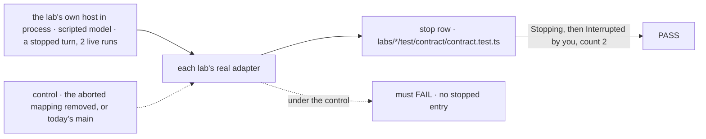
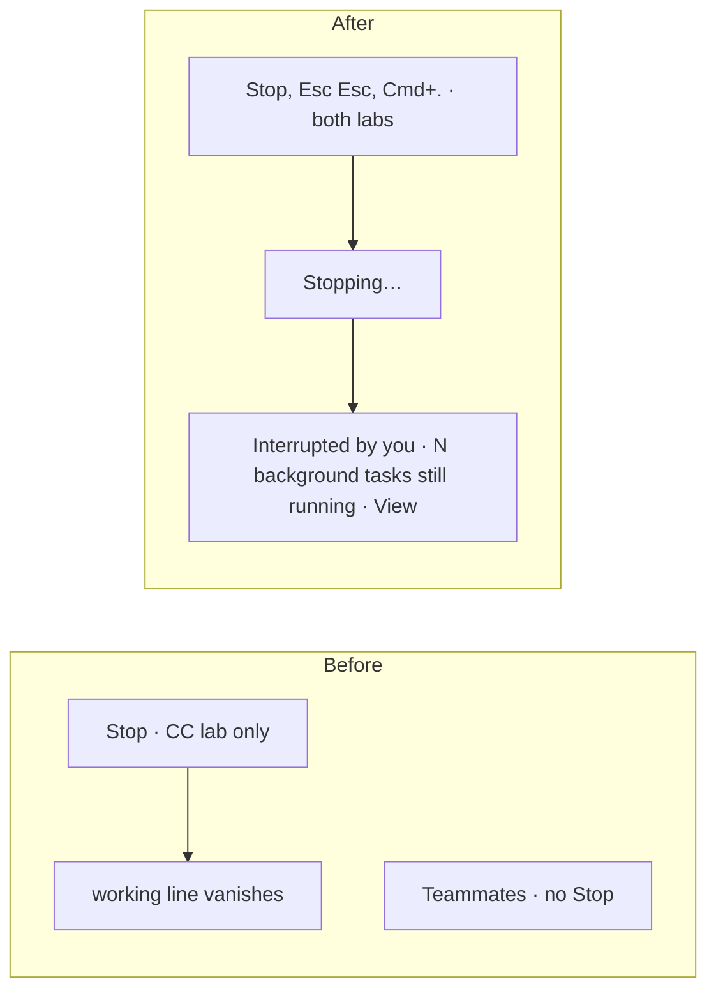
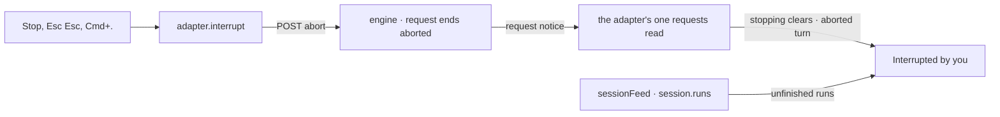

# FIX-2375 · Stop a running turn, with clear feedback afterwards

**Spec** · [Decisions](DECISIONS.md)

## Who feels it, before and after

| Someone who… | Today | After |
|---|---|---|
| **watches a Teammates worker head the wrong way** on a long turn | There is no Stop. The turn runs to its end, up to 100 steps (`maxSteps: 100`) | A **Stop** button sits beside Send while the worker answers, and stops every turn it is answering. Send stays, since a line sent mid-turn starts its own answer at once (FIX-2376). Esc Esc or Cmd/Ctrl+. stops it too, the gesture the Claude Code-style lab already uses |
| **presses Stop** in either lab | Claude Code-style: the *working* line just disappears. Nothing in the thread says what happened | *Stopping…* until the server says the turn ended. Then **Interrupted by you** sits in the thread, right after the last thing the turn did |
| **stopped a turn that had filed background tasks** | Nothing says whether they still run. (The lab's test fake says *Background tasks keep running*; the real lab never draws it) | The line adds **2 background tasks still running · View**, counted live from the session. View goes to where the lab lists that work. The clause goes when the count reaches 0 |
| **reloads, or opens the conversation later** | n/a | The line is still there. It is read from the turn's own record, which says `aborted`, not from what this tab remembers |
| **presses Stop as the turn finishes on its own** | n/a | Nothing breaks. The turn reads as finished, with no *Interrupted* line. A Stop the server refuses for another reason clears *Stopping…* and says why beside the button |

A Stop you can't trust is one you don't press. Today Teammates has none, and the Claude Code-style
lab's goes silent, so the person can't tell a stopped turn from a lost connection or a finished one.

## The goal, and how we'll know it's met

**Goal:** in both labs, a person can stop a running turn, and the thread then says it stopped
because they stopped it, and what is still running.

| Is it the right goal? | |
|---|---|
| **The real need** | R-06 of the app review (findings TM-ROB-5, CC-USA-3): *"a 100-step turn heading the wrong way blocks that teammate until it ends"*, and in the other lab *"the indicator just disappears … nothing says the background tasks are still running."* The epic's goal needs a developer to see what is running and what failed without asking a model |
| **Smaller, and rejected** | "Teammates gets a Stop button." The turn stops, and the person is left guessing whether it stopped, failed or lost the server, which is exactly the Claude Code-style lab today |
| **Bigger, and not this issue's** | "Stop also stops the work the turn delegated." That is FIX-2202, an engine change to who owns that work. This spec reads the live count, so it stays right on either side of FIX-2202 |
| **Not done if** | The line shows only in a lab's test fake · it comes from what the tab remembers, so a reload loses it · the background clause is fixed text, not a count read from the session · Teammates stops on a single Esc |



The check reads what each lab's real adapter hands the screen, talking to that lab's real host
in process. No test fake and no recorded responses are involved.

| How we verify | |
|---|---|
| **Goal check** | The *stop* row of each lab's `test/contract/contract.test.ts` (FIX-2406's matrix), run by the implementer before the PR is ready, verdict in the PR. They drive the real `createWiredLab` / `createLabAdapter` against the lab's own host in process (`createInProcessFetch` + `createMockModelResolver`), the harness FIX-2406's D1 chose, so the server writes the `aborted` status the adapter reads. No recorded `/requests` fixtures: a recording could pass on a shape the server stopped writing. FIX-2406's implementation already carries this harness and a *stop* row per lab (`test/contract/contract.test.ts`, the Claude Code-style row marked `it.fails` against FIX-2375), so this slice stacks on it and turns those rows into plain passing tests instead of adding a second test file. Then **one browser pass per lab** with a real model: ask for something that files a task, press Stop, read the thread. If no browser is available, hand it to `fsd-qa` over the mailbox |
| **Signal** | (1) `interrupt` posts `…/requests/<id>/abort` once for each running turn, and none for a `dispatch` request. (2) The view says it is stopping from that call until the requests read shows the turn ended. (3) Once that read shows the turn `aborted`, exactly one `stopped` entry follows the last entry of that request. (4) The view's `backgroundRunning` is 2 while the session stream's `session.runs` names two runs, 0 once it names zero, and `null` before the stream has named them. (5) In Teammates, a `completed` request gets no entry. Browser: the line reads *Interrupted by you · 1 background task still running · View* |
| **Input** | A scripted turn `r1` that files two board tasks and then waits, stopped through the adapter's `interrupt`; the host writes `r1` `aborted` and the stream names the two runs until they settle. A correct adapter must also pass with the stopped turn being the older of two (a newer `completed` turn after it), where the entry still lands after `r1`'s items. In Teammates, a line sent after Stop is pressed starts its own turn: it gets no abort, reads running, and `stopping` clears once `r1` ends |
| **Anti-game** | Never assert on `test/fake-lab.ts` output: the fake already draws this line, which is how the dead entry went unnoticed. The request statuses come from the `/requests` response, not from a hand-built entry. No assertion on copy beyond the browser pass |
| **Control that must fail** | Today's `main`: the Claude Code-style adapter never produces the entry, so signal 3 fails; the Teammates adapter has no `interrupt` verb, so signal 1 fails. After the change: delete the `aborted` → entry mapping in either adapter, and signal 3 fails. Each PR shows that red run |

## What changes



Both labs stop a turn the same way and say so the same way, from one shared line.

- **The UI registry's `request-recovery` gains a third look, *stopped*** ([D1](DECISIONS.md#d1)).
  It is the line a turn that didn't finish leaves in a thread. Today it has *failed* (FIX-2370)
  and *cut off by a restart* (FIX-2377). *Stopped* is quiet: a status, not an alert, with no
  button, since the server retries only a failed or cut-off request. It takes an optional count
  of work still running and a View callback.
- **Each lab installs `request-recovery`** into `src/components/flow-state/`, as it installed
  `error.tsx`, once the registry slice has landed. Neither lab has it today, and this slice is the
  first lab slice to need it, so it installs it; FIX-2370 and FIX-2377's later lab slices use that copy.
- **Each lab's adapter** produces a `stopped` entry from the turn's request status (`aborted`),
  placed after that request's last entry. The Claude Code-style lab's dead `interrupted` entry kind
  is renamed to `stopped`: in `request-recovery`, *interrupted* already means a turn a restart cut
  off. The thread view gains `stopping` and `backgroundRunning`, the live count of the session's
  unfinished runs (`sessionFeed`'s `runs`). One number per thread: the lab's thread view decides
  which line shows it.
- **Teammates** gains the `interrupt` verb, the Claude Code-style lab's: abort each running
  answering turn in the conversation. The composer shows Stop beside Send while the worker answers (Send stays: a mid-turn line
  starts its own answer, see FIX-2376),
  and the conversation takes `useInterruptKeys` (FIX-2413) on the document.
- **Claude Code-style** keeps its verb, button and keys. Its thread's one request read widens from
  running turns to recent turns with their status, so it sees `aborted`.
- **Each lab's host can be built by a test.** `openLab(options)` (Claude Code-style) and an optional
  `modelResolver` on `openTeammates(options)`. FIX-2406's implementation already adds both; this
  slice stacks on it. Whichever lands first owns them, and the other reuses them.

The call site, in the Claude Code-style lab's `Entry.tsx`:

```diff
+ import { RequestRecovery } from "./flow-state/request-recovery";
  …
-     case "interrupted":
-       return (
-         <div className="text-xs text-muted-foreground" data-entry="interrupted">
-           Interrupted. Background tasks keep running.
-         </div>
-       );
+     case "stopped":
+       return <RequestRecovery stopped stillRunning={countFor(entry)} onView={onViewTasks} />;
```

**Docs:** update `packages/ui/README.md`'s `request-recovery` row and add a *A turn you stopped*
subsection under *RequestRecovery* in `apps/docs/docs/ui/flow-aware-components.md`. Update the
Claude Code-style README's *Interrupting* row (*its tasks keep running* becomes the live count),
and add Stop and its keys to the Teammates README.



The turn's state comes from the session's request records. The count comes from the session
stream's runs, which are the child sessions doing background work, never the session's own turns.

## What stays as it is

- **What Stop stops.** Only the turn's own request, as today. Stop cancels no task. A task is
  cancelled from its own row (FIX-2382's actions). Whether stopping a turn also stops the work it
  delegated is FIX-2202's, in the engine. This spec reads the count live, so if FIX-2202 makes that
  work stop, the clause empties with no lab change.
- **The stop gesture.** FIX-2413's `useInterruptKeys`: Esc Esc or Cmd/Ctrl+., never one Esc.
  Teammates adopts it as is.
- **The engine, client and react.** No change. `RequestHandle.abort()`, the `aborted` status and
  `sessionFeed`'s `runs` are used as they are.
- **The failed and cut-off lines** (FIX-2370, FIX-2377). Their lab slices come later on the same
  entry mapping and use the same request read.
- **Shift Manager and Kitchen Sink.** Shift Manager already says *Interrupted · run stopped at* from
  the record. Kitchen Sink's `useSession` stop is not touched.

## What's already here, and the debt

| Already here | What this does with it |
|---|---|
| **Whatever already stops a turn.** `RequestHandle.abort()` (client); `useSession`'s `abortRequest` and `dismissRequest` (react); Shift Manager's `requestInterrupt` (`lib/task.tsx`, `lib/run.ts`); the Claude Code-style lab's `interrupt` verb. No row in `docs/mechanisms/mechanisms.yaml` (searched *stop*, *abort*, *cancel*, *interrupt*: only the `suspension` and harness rows match, neither this job) | **Builds on** `abort()`. Teammates' new verb calls it the same way the other lab's does. No new way to stop |
| **Whatever already shows a stopped turn.** `useSession` injects a local status item, *Request was stopped.*, that a reload loses; Shift Manager reads the record's `aborted`; the Claude Code-style lab declares an `interrupted` entry and never produces it (only `test/fake-lab.ts:473` does) | **Builds on** Shift Manager's way: the record. The labs' line comes from the request status, so it survives a reload. `useSession`'s item is **left alone** (debt, below) |
| `request-recovery` (FIX-2370, extended by FIX-2377) | **Extends** it with the *stopped* look ([D1](DECISIONS.md#d1)). Not yet installed in either lab (`labs/*/src/components/flow-state/` has `error.tsx`, not this); this slice installs it |
| `sessionFeed` (FIX-2374), its snapshot's `runs` | **Builds on.** Both labs already follow sessions with it. Teammates' `lib/session-feed.ts` wrapper passes `runs` through; today it passes only items and state |
| `useInterruptKeys`, `interruptChordLabel` (FIX-2413) | **Builds on.** Teammates adopts them. Its session popup's Esc listener spends its Esc (`preventDefault`), as FIX-2413 asks of every dismisser |
| The issue's evidence | **Moved since filing:** `maxSteps: 100` is now `labs/teammates/host.mts:323`; the entry type is `labs/claude-code-style/src/adapter.ts:113`; Teammates' request tracking is in `watchConversation` (`onNotice` on request notices). `packages/client/src/types/index.ts:203` is `ChildSessionStatus`'s `aborted`; a request's own is `RequestStatus` in `@flow-state-dev/contracts` |
| FIX-2413's [*The lab keeps its interrupted entry*](../FIX-2413/DECISIONS.md#decided-not-asked) | **Amended.** The entry is kept, and now produced. Its fixed text *Background tasks keep running* becomes the live count |

**Builds on / Adds**

| Adds | Existing piece considered | Why it doesn't fit, or how this is composed from it |
|---|---|---|
| A *stopped* look on the registry's `request-recovery` | `request-recovery` itself; `error`'s `ErrorDisplay`; `stuck-request-banner` | Composed into `request-recovery`: its job is the line a turn that didn't finish leaves, and a stopped turn is one. `ErrorDisplay` is a failure. The banner is a lost connection |

Nothing is added to a package beyond that. The lab verbs and entry mapping are app code.

| The debt | |
|---|---|
| **Removes** | The Claude Code-style lab's dead `interrupted` entry, by producing it as `stopped`, and its fixed claim *Background tasks keep running*. The gap between the lab's test fake and its real adapter on this case |
| **Adds** | None. Teammates' `interrupt` verb mirrors the other lab's, as every shared verb does: labs share no code (FIX-2152 ER-4, kept by the epic). FIX-2406's one contract matrix covers both, with an *interrupt* scenario |
| **Leaves** | `useSession`'s local *Request was stopped.* item, which Kitchen Sink shows and a reload loses. It could read the record the same way; no issue filed yet |

**Net: flat.** One registry look added; one dead entry and one fixed claim removed.

## Sign off

**[The goal](#the-goal-and-how-well-know-its-met):** both labs can stop a turn, and the thread then
says you stopped it and what still runs. If wrong: Stop lands in Teammates and the person still
can't tell a stopped turn from a lost one.

**[The debt](#whats-already-here-and-the-debt), net flat:** one look on a shared line, one dead
entry brought to life. If wrong: a lab-only line drifts the way the failed-turn line did.

1. **[D1](DECISIONS.md#d1) · The stopped line is a look of the registry's `request-recovery`, not a
   line in each lab.** Engineering, by the epic's D4. If wrong: two labs draw it themselves, and
   the third app to want it copies one.

**Open: none.** The copy, the source of each fact, where the count shows and the seam with
FIX-2376 are in [DECISIONS.md → Decided, not asked](DECISIONS.md#decided-not-asked).

Improvement · `ui` registry, Teammates lab, Claude Code-style lab · small · a registry slice, then
one slice per lab on its adapter stack (2374 → 2375 → 2376) · child of epic
[FIX-2369](../../epics/FIX-2369/SPEC.md)
