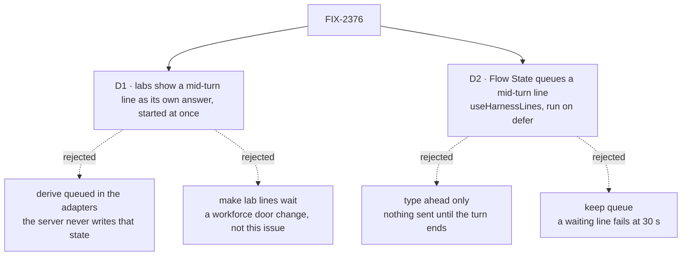

# FIX-2376 · Decisions

[Spec](SPEC.md) · **Decisions**

What was considered, what was chosen, and what each choice locks in. Two decisions are the
sign-off surface. D1 is the one to weigh.

## The tree

Solid edges are what you're signing. Dashed edges lost, and the label says why.

## D1 · In the labs, a line sent mid-turn is shown as what it is: its own answer, started at once

| | |
|---|---|
| **Instead of** | The issue's ask, deriving `queued` in each adapter · or making a lab line wait for the running turn, as Claude Code does |
| **Because** | Both labs send a line through the worker door, `respond`, which is `hold`: a person's turn starts at once and runs beside the one already running. The engine's test *starts every reply at once* pins it (run on this spec's base, 14/14), and the concurrency docs teach it: `queue` "would also make the person's own next message wait behind the reply, and fail after 30 seconds". So a derived `queued` never fires, and its test could only pass on a fixture the server never writes. That is the dead feature the issue found, built again. Making the line wait instead changes the workforce door, which every app shares (epic ER-2: opt-in only). It needs its own design for steering in task sessions and for notices deferred on the same key |
| **Locks in** | The labs no longer promise Claude Code's queue. Two answers can stream at once in one conversation, as they already do. [FIX-2153 D2](../FIX-2153/DECISIONS.md#d2)'s "your line waits until it ends" is amended. The lab test fakes must start a mid-turn line at once from now on, or they drift from the server again |

It comes down to whether the screen is true: a derived mark never fires, and a real wait needs a door change.

**What would change my mind:** Jake wanting the labs to behave like Claude Code, a line typed
mid-turn waiting for the turn. This issue still removes the false claims. A workforce issue then
gives the door an opt-in that defers a person's line, and the mark comes back, read from the same
request read FIX-2375 widens.

## D2 · Flow State queues a mid-turn line for real, through `useHarnessLines`, with `run` on `defer`

| | |
|---|---|
| **Instead of** | Type ahead only: the composer stays open, but Send waits for the turn to end · or keep `run` on `queue` |
| **Because** | The chat-agent flow already queues a second `run` ("queues behind the first (FIFO) instead of being dropped"). The page can't use it: `sendAction` leaves the running turn's stream, so the page locks the composer instead. React's `useHarnessLines` already sends a mid-turn turn through the client and follows it once the running turn ends; Kitchen Sink's harness modes ship on it. Its input is fixed at `{ prompt }` and it doesn't say what waits, so it gains `input` and `waiting`. Under `queue` a waiting run fails after 30 seconds (503), and a Flow State turn often runs longer; `defer` waits with no limit, as the hook's docs ask |
| **Locks in** | Two public additions to `useHarnessLines` (`input`, `waiting`), so a changeset for `@flow-state-dev/react`. Flow State's `run` waits as long as the turn ahead takes; a 33rd waiting run on one session is refused (409), and a turn that never ends holds every line behind it until it is stopped. That holds for every caller of `run`, not only the composer. In this repo they are the Flow State page's composer and its voice input (`useVoice`, `action: "run"`, `page.tsx`), and `fsdev run chat-agent run`, which sends one line. A caller that relied on a 503 at 30 seconds now waits; none in the repo did. Under `FSD_BULLMQ_DISPATCH=1` the BullMQ worker runs `defer` too (`packages/bullmq/src/worker.ts`) |

It comes down to a turn longer than 30 seconds: under `queue` the waiting line fails with a 503.

**What would change my mind:** evidence that Flow State turns stay under 30 seconds. Then `queue`
stays, and only the page changes.

## Decided, not asked

- **One seam for turn state in the labs.** Running, stopped and any future *waiting* state come from
  the one request read each adapter makes on request notices (Claude Code-style `runningTurns`,
  which FIX-2375 widens to recent turns with their status; Teammates' `watchConversation` read of
  every status). Never from `sessionFeed`'s `runs`, which are child sessions. If D1 flips, the mark
  is derived there. This spec adds no derivation and no second read.
- **Teammates' composer says the truth, not nothing.** People ask what a mid-turn line does; the
  hint stays, worded for what happens (an answer now). The wording is the implementer's.
- **Flow State's composer mirrors the harness composer.** Stop and Send are two buttons while a turn
  runs; Stop stops the running turn and the waiting line then runs, as it does there.
- **Mode, thinking style and features stay live mid-turn; model and thinking stay locked.** The
  first three are read only when a line is sent (FIX-2416 seeds them). The other two call
  `sendAction`, which would leave the running stream.
- **The mark lives under the conversation, not in it.** A waiting line has no item until its turn
  starts and stores its user message; the mark reads `lines.waiting`. After a reload the hook
  follows the oldest running turn and lists the rest as waiting.
- **No steer in Flow State.** The chat-agent flow has no `steer` action; `sendOne` sends a turn.
- **Lab and Kitchen Sink parts land as two PRs** on their own stacks (lab adapters after FIX-2375;
  `flow-state/page.tsx` after FIX-2377). The react slice goes first, from `main`.
- **The fakes follow the server.** Both start a mid-turn line's turn at once; the Claude Code-style
  screen test that proved the queue is rewritten to prove that.

## Considered and dropped

| Alternative | Why not |
|---|---|
| Derive `queued` from `sessionFeed`'s `runs`, as the issue suggests | `runs` are child sessions (background work), never the session's own turns |
| Derive `queued` from an `in_progress` request with no user item yet | Under `hold` that window is a few milliseconds, not a state. Under `queue` or `defer` the stub record is `in_progress` too, with nothing that says it hasn't started |
| A new hook for plain chats beside `useHarnessLines` | A second way to do the hook's job. Extend it, and rename it later |
| Send Flow State's mid-turn line through `sendAction` | It closes the running turn's stream: the answer the person is watching stops updating |

## Analysis

Not run here: in spec-set mode the epic agent runs `analysis` and `reuse-review` over the whole set.
Step 3.5 verdict, recorded for it: **build smaller and refine** — the labs' half is a removal, not a
derivation (D1); Kitchen Sink's half extends an existing react hook rather than adding one (D2).

## Settled

- **A person's line in a worker conversation starts at once** — **CONFIRMED**:
  `packages/engine/test/transports/host-concurrency-hold-defer.test.ts` ran 14/14 on this spec's
  base, including *starts every reply at once, mid-reply and around a notice*; the door declares
  `hold` in `agent-worker-flow.ts` and `coordinator-flow.ts`.
- **The lab test that proves the queue is green against the fake** — **CONFIRMED**: the Claude
  Code-style *queues a line sent while a turn runs* passes on this spec's base.
- **A `queue` wait fails at 30 seconds** — **CONFIRMED** by read: `QUEUE_WAIT_TIMEOUT_MS = 30_000`
  in `engine/src/transports/concurrency/lease-backend.ts`, not configurable per action.

## Notes from review

For the implementer; recorded, not baked into the design.

- *Cursor review, PR #4732:* "Leg **c** (35s held turn e2e) is the heaviest part of the set. The
  anti-game rationale is sound (`queue` fails at 30s). If CI/runtime cost becomes painful later,
  consider documenting a fallback tier (e.g. engine/integration proof of `defer` >30s + a slimmer
  e2e for unlock + waiting mark only) **without** shortening the hold in the contract test —
  optional, not required for this spec."
- *Second-look review, PR #4732:* "Since the rename is already conceded as a follow-up, file that
  issue now so the two new public options don't cement the name." The issue (*give
  `useHarnessLines` a neutral name*) is filed as FIX-2557; land it before or with the react slice.

## How it got here

- **Draft** — framed as a promise the labs can't keep and a queue Kitchen Sink can't reach; the labs
  tell the truth and Kitchen Sink queues through `useHarnessLines`; built on the door's `hold`, the
  engine's `defer`, and the request read FIX-2375 widens.

**Open: none.**
