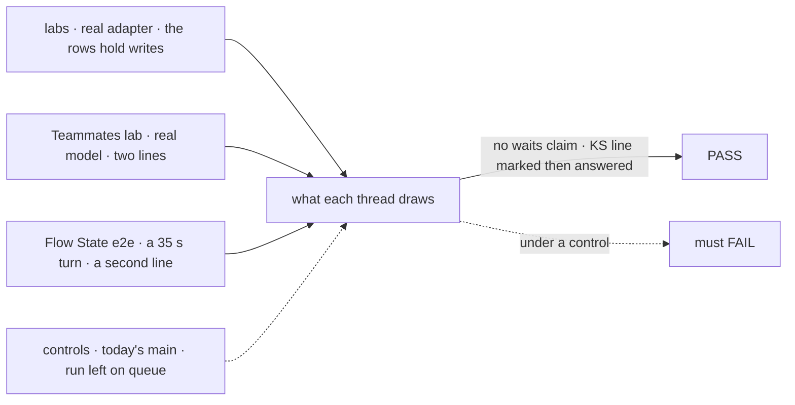
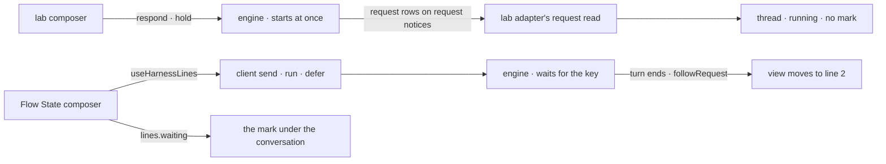

# FIX-2376 · Real 'queued' state for a line sent mid-turn

**Spec** · [Decisions](DECISIONS.md)

## Six people, before and after

| Someone who… | Today | After |
|---|---|---|
| **sends a second line to a Teammates worker while it answers** | The composer says *a line you send now waits for it*. It doesn't wait: its own answer starts at once and streams beside the first | The composer says what happens: the line gets its own answer now. Nothing on screen says it waits ([D1](DECISIONS.md#d1)) |
| **does the same in the Claude Code-style lab** | The line's answer starts at once. The *queued · runs when this turn ends* mark exists, but the real lab never draws it | The same, and the mark is gone. Nothing promises a queue the lab doesn't have |
| **works on either lab and runs its tests** | *queues a line sent while a turn runs* passes against a fake that queues lines one at a time. The real lab never does | The fakes start a mid-turn line's turn at once, as the server does. A test runs the real adapter on the lab's own host in process |
| **types into Kitchen Sink's Flow State while an answer streams** | The textarea and all six controls are locked. The one button is Stop | They can type, and change mode, thinking style and features. Stop and Send are two buttons. A line sent now shows under the conversation, *runs when this turn ends*, and the running answer keeps streaming. Two lines sent now run in the order typed ([D2](DECISIONS.md#d2)) |
| **waits behind a Flow State turn that takes over 30 seconds** | n/a: nothing can be sent. Under today's `queue` policy, a waiting `run` fails after 30 seconds | The line waits as long as the turn takes, then runs and streams in |
| **changes Flow State's model or thinking toggle mid-turn** | Locked | Still locked until the turn ends. Each saves to the server at once, which would move the view off the running answer |

Both labs and Kitchen Sink show a mark the person can't trust. In the labs it describes a queue the
server doesn't run. In Kitchen Sink the queue is real, but the page won't let anyone use it.

## The goal, and how we'll know it's met

**A person who sends a line while a turn runs sees what will really happen to it. In the labs it is
answered at once, beside the running turn, and nothing says it waits. In Kitchen Sink's Flow State
they can type and send mid-turn, and the line waits, marked, until the turn ends, then runs.**

| Is it the right goal? | |
|---|---|
| **The real need** | R-07 of the app review (CC-USA-3, TM-ROB-8, KS-USA-4): *"neither real adapter ever sets it … so the test passes while the feature is dead"*, and Kitchen Sink's composer locks while a turn streams. The [epic's goal](../../epics/FIX-2369/SPEC.md#the-goal-and-how-well-know-its-met): a developer sees what is running without asking a model |
| **Smaller, and rejected** | The issue's literal ask: derive `queued` in each lab adapter. The server never produces that state for a lab line ([D1](DECISIONS.md#d1)). The derivation would be dead code, proved by a fixture the server never writes |
| **Bigger, and not this issue's** | Lab lines that wait, as Claude Code's do. That changes the workforce door for a person's line. It is D1's flip, filed only if Jake wants it |
| **Not done if** | A lab test still proves a queued line against a fake · a lab fixture holds a request state the server never writes · a Flow State line fails after 30 seconds · two waiting lines are answered out of order · a mid-turn send moves the view off the running answer |



Every leg reads what the person sees, from the runtime that runs the line. A fake that queues and a
`queue` that times out are the controls.

| How we verify | |
|---|---|
| **Goal check** | Three legs, run by the implementer at completion; verdicts in the implementation PR. **a:** each lab's real adapter against that lab's own host in process (`createInProcessFetch` + `createMockModelResolver`, FIX-2406's D1 harness; no recorded fixtures), sending a second line while a scripted turn runs, plus the same send through that lab's fake. It becomes FIX-2406's mid-turn scenario when the matrix lands. **b:** the Teammates lab under `fsdev dev`, real model, in a browser (handed to `fsd-qa` if the implementer can't). **c:** a Kitchen Sink e2e in `apps/kitchen-sink/e2e/`, test mode, with the assistant script held 35 s and two lines sent while it runs |
| **Signal** | **a:** no entry for the mid-turn line, from the fake or the real adapter, renders a *waits* or *queued* mark, and the thread reads running. **b:** the second line's answer starts streaming before the first ends, and no text on screen says it waits. **c:** the textarea takes text mid-turn; both lines show *runs when this turn ends*, in the order typed; the first answer keeps streaming; while it does, the session holds one waiting `run` request, not two; after it ends the second line's answer appears, then the third's, and the session has three completed `run` requests in that order |
| **Input** | **a:** two `respond` requests `in_progress` at once with both user lines stored, the shape `hold` gives. Three lines, or a line sent as a turn ends, must pass too. **c:** any held turn over 30 s, and any two lines sent during it |
| **Anti-game** | **a** must not hand-write a request that waits to start: `hold` never produces one (`packages/engine/test/transports/host-concurrency-hold-defer.test.ts`, *starts every reply at once*, run on this spec's base: 14/14 pass). **c** must not shorten the hold below 30 s: that would pass under `queue` |
| **Control that must fail** | **a:** today's `main`. The fakes mark the line (Claude Code-style `queued: true`, Teammates `queued: w.running`), so *no waits mark* FAILS. Neither real adapter sets `queued` on `main`, so the real-adapter half needs its own red: an adapter that sets `queued` from `running` must FAIL it, driven over the in-process host's rows, not the fake. **b:** today's `main`. Teammates' composer says *waits for it* while the second answer streams. **c:** today's `main` FAILS *textarea takes text*; `run` left at `queue` FAILS *the second answer appears* (refused with a 503 at 30 s); a hook that sends both waiting lines at once FAILS *one waiting `run` request*, on any backend, where ordering by luck would pass in memory. The PR shows each FAIL before the PASS |

## What changes


Position along a row is time. The labs' bars don't move: only what the screen claims changes. Kitchen
Sink's line 2 goes from impossible to waiting, then running, on the queue its flow already declares.

**A page sends a Flow State line mid-turn:**

```diff
- await session.sendAction("run", { message: text, mode, thinkingStyle, features }, { userMessage: text });
+ const lines = useHarnessLines(session, {
+   turnAction: "run",
+   input: (line) => ({ message: line, mode, thinkingStyle, features }),
+   sendOne: (line, _running, sender) => sender.turn(line).then(() => "turn"),
+ });
+ await lines.send(text);
+ // lines.waiting: the lines that wait for the running turn, oldest first, for the mark.
+ // One is on the server at a time; the rest wait in the page and go, in order, as each starts.
```

```diff
  run: {
    block: runSequencer,
-   concurrency: "queue",
+   concurrency: "defer",
```

**Docs:** update `packages/react/README.md` → `useHarnessLines`: the `input` option, the waiting
lines it returns, that it keeps one waiting turn on the server at a time, and that any flow's
turn action can use it. No page in `apps/docs` changes: the
concurrency page already says a person's turn under `hold` runs at once and `queue` fails after 30
seconds, and the coding-agents page stays true. The lab READMEs never mention the mark.

## How a mid-turn line moves



The labs read turn state from the one request read each adapter makes on request notices, the seam
FIX-2375 widens. Neither takes turn state from `sessionFeed`'s `runs`, which are child sessions.

## What stays as it is

- **The workforce door.** `respond` stays `hold`, so a person's line in any worker conversation runs
  at once, as `advanced/concurrency-policies.md` documents.
- **The labs' request reads.** Unchanged here; FIX-2375 widens the Claude Code-style one.
- **`useSession`.** `canSendAction` and `sendAction` don't change.
- **Kitchen Sink's harness modes.** Their composer already works this way.

## What's already here, and the debt

| Already here | What this does with it |
|---|---|
| `worker-door` · `respond` with `REPLY_CONCURRENCY = { policy: "hold" }` (`workforce/src/conversation-board/task-settled.ts`) | **Leaves alone.** It is why a lab line runs at once. Pinned by the engine's *starts every reply at once* test and the concurrency page's *hold and defer* section |
| `lease` · `queue` with a fixed 30 s wait (`QUEUE_WAIT_TIMEOUT_MS`), `defer` with none | **Builds on.** Flow State's `run` moves to `defer`, as harness turns already are |
| `harness-steering`'s page half, react's `useHarnessLines` | **Extends**: an `input` option, the waiting lines returned, and one waiting turn on the server at a time. Whatever else does this job: client `harnessLines`/`sendHarnessLine` (inside the hook) and `useSession.followRequest` (it calls). Searched `queued`, `waiting`, `after-this-turn`, `followRequest` in `packages/`. This is not a second way |
| `useSession.sendAction`, which leaves the followed stream (`useSession.ts`) | **Leaves alone.** Why a mid-turn line can't go through it, and why model and thinking stay locked |
| Lab adapters' request read on request notices; `sessionFeed`'s `runs` | **Builds on** the read, shared with FIX-2375. **Doesn't use** `runs`: child sessions, not this session's turns |
| Labs' `queued?` field, both entry marks, Teammates' composer claim, both fakes' queues, the *queues a line* screen test (green on `main` against the fake) | **Removes** |
| [FIX-2153 D2](../FIX-2153/DECISIONS.md#d2) *Locks in*: "your line waits until it ends, as Claude Code queues it" | **Superseded in part** by [D1](DECISIONS.md#d1): the line runs at once, as the door runs it. The rest of D2 stands |
| [FIX-2154 D2](../FIX-2154/DECISIONS.md#d2): another worker's message waits for the turn | **Kept.** That is a `receive`, deferred; Teammates' pending line for it stays |

| Adds | Existing piece considered | Why it doesn't fit / how composed |
|---|---|---|
| `input` on `useHarnessLines` | `react` · `turnAction`, `sendOne` | Composed: `turnAction` names the action but its input is fixed at `{ prompt }`. Default unchanged |
| `waiting` returned by `useHarnessLines` | the hook's own waiting list; the harness page's *after this turn* note | Extends: exposes what the hook already tracks |
| One waiting turn on the server at a time | client `harnessLines` (orders the sends, not the starts); engine `defer` (no order among waiting defers) | Extends the hook: it holds later lines and sends the next when the one before it starts, so order never rests on the backend ([D2](DECISIONS.md#d2)) |

| The debt | |
|---|---|
| **Removes** | The dead `queued` field and two marks, Teammates' false composer claim, two fake queues and the test that proved them; Flow State's whole-composer lock |
| **Adds** | A hook named for harnesses serving a plain chat. Accepted: renaming a public hook is its own change; filed as FIX-2557, *give `useHarnessLines` a neutral name*. Two Flow State controls stay locked while three are live: accepted, they save through `sendAction` |
| **Leaves** | FIX-1015 (the composer during a drain): a line sent then now waits, not blocked; the bug stays open. FIX-2406 owns the shared contract matrix; leg a is one of its scenarios |

**Net: down.** A dead field, three false claims and two fake queues go; one hook gains two options and sends one waiting turn at a time.

## Sign off

**[The goal](#the-goal-and-how-well-know-its-met), at that size:** the truth about a mid-turn line
in all three apps, and a real queue where the flow has one. If wrong: the labs keep promising a
queue, or Kitchen Sink stays locked.

**[The debt](#whats-already-here-and-the-debt), net down:** dead marks and fake queues go; one
react hook gains two options. If wrong: a harness-named hook spreads to plain chats unrenamed.

1. **[D1](DECISIONS.md#d1) · In the labs, a mid-turn line is shown as what it is: its own answer,
   started at once.** If wrong: the labs stop aiming at Claude Code's queue without Jake choosing it.
2. **[D2](DECISIONS.md#d2) · Flow State queues a mid-turn line for real, through `useHarnessLines`,
   with `run` on `defer`.** If wrong: a public react option for one app, and a turn that never
   ends holds every waiting line.

**Open: none.** D1 is the one to weigh: it amends FIX-2153 D2.

Improvement · labs (claude-code-style, teammates) + `react` + kitchen-sink · medium (filed S, for a
derivation with nothing to derive) · epic [FIX-2369](../../epics/FIX-2369/SPEC.md), lab stacks
2374 → 2375 → 2376, Kitchen Sink stack 2370 → 2377 → 2376
