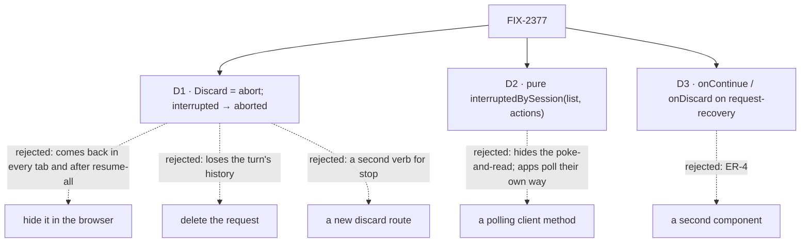

# FIX-2377 · Decisions

[Spec](SPEC.md) · **Decisions**

The issue settles the what (Continue or Discard a turn a restart cut off) and the epic settles
where (FIX-2370's component, extended; the client's helper). D1 is the one to sign, because it
changes what an engine route answers. D2 and D3 are shape calls, recorded.

Solid edges are what you're signing. Dashed edges lost, and the label says why.

## D1 · Discard is an abort, and abort ends an interrupted turn

Today `recordRequestStop` writes `abortRequested` only while a request is `in_progress`. An
`interrupted` request with no gate behind it falls through to *finished*, and the route answers
409 *already in terminal state "interrupted"*. But `interrupted` is not terminal: it is listed by
`interrupted-requests` on every call until it is continued, and `continue` takes it.

| | Abort moves it to `aborted` (chosen) | Hide it in the browser | Delete the request record | A new `discard` route |
|---|---|---|---|---|
| Gone after a restart, in another tab, for another app | yes | no | yes | yes |
| Safe from FIX-2175's resume-all | yes | no | yes | yes |
| Turn's items stay in history | yes | yes | no | yes |
| New surface | none: 409 becomes 204 | none | a delete path for one record | a route, a client verb, docs |
| `useSession.dismissRequest` works on it | yes, it already calls abort | no | no | no |

- **Because:** "stop this request" is what abort means, and a dead request that nobody continues
  is one the user has stopped. The status transition already exists as a fenced write
  (`setFieldsIfStatus` with `settledRecordFields`), so the change is one small function.
- **Every host, durable or not.** Today the interrupted handling sits inside the
  `parked !== undefined` branch, so without durable execution an interrupted request falls to
  *finished*. The end is independent of `parked`: with no gate store there is no gate or owed
  park to consult, so the request is plainly dead behind no gate.
- **Its own result kind, `ended`.** `stopped-parked` documents a parked request; reusing it would
  make that doc wrong. The abort route answers `ended` with 204, and `ctx.session.stopRequest`
  answers it `"stopped"`.
- **The write, and the race.** One `setFieldsIfStatus(id, aborted, ["interrupted"], incarnation)`,
  after an owed park is let go. A continue that takes the request between the stop's read and
  this write leaves it `in_progress`, so the write misses and the stop answers *already
  resolved*: the running turn is never flipped to `aborted`. A stop that wins first leaves it
  `aborted`, and `/continue` then answers 409 (it continues only `interrupted`).
- **Kept as is:** an interrupted request parked behind a gate is stopped through its gate, as
  now; one whose owed park a continuation already holds answers *already resolved* and runs.
- **Locks in:** `abort()` on an interrupted request succeeds and ends it. A caller that relied on
  the 409 to tell an interrupted request apart reads its status instead. Pre-1.0, and the
  engine's own tests are the only callers found that assert the 409 (`park-owed.test.ts`'s
  "stays stopped" cases, and `abort.test.ts`'s second abort of a request whose signal cut it off,
  which now end it `aborted` first); no caller in `orchestration`, `workforce` or
  `harness-manager` asserts it. **`ctx.session.stopRequest` changes too**, since it shares
  `recordRequestStop`: a block that stops an interrupted request in its session ends it and
  reads `"stopped"`, where it read `"already-finished"`; `StopRequestOutcome`'s docs say so. Task
  readers treat the two endings alike: `task-request.ts` counts `failed`, `aborted` and
  `interrupted` as a failed attempt, and `wait-on-task.ts` releases a lapsed slot once its request
  reads ended, which `aborted` is. So discarding a turn a task waits on ends that attempt the way
  the restart already had. The engine is L1, and nothing here names a worker, task or app.
- **What would change it:** a product reason for a discarded turn to stay resumable later. Then
  it needs a state of its own, and this becomes an engine issue of its own.

## D2 · The client helper is a pure function over the list

`interruptedBySession(requests, { actions })` takes the `InterruptedRequest[]` that
`requests.interrupted()` returns and gives `Map<sessionId, InterruptedRequest[]>`, oldest first,
keeping only `actions` and dropping requests with no session.

- **Instead of** a method that polls: each app already reads on its own timer (Teammates every
  1.5 s, Shift Manager's own loops, Kitchen Sink through `useSession`), and FIX-2374's session feed
  may change that. A function composes with any of them. Tenet 2.
- **Instead of** an `actions` option on `interrupted()`: the route would still sweep and read
  every request, so the filter belongs where the grouping is.
- **Turn actions are the app's** (was E4). Each app passes its own (`respond`, a door's action,
  the harness turn action); the client knows no worker or task noun.
- **Locks in:** one export in `@flow-state-dev/client`'s root, beside the `InterruptedRequest`
  type and outside `createClient`, so any caller imports it without the factory. Its docs say
  what it does and that each `interrupted()` call sweeps; the cadence is the app's (E2).

## D3 · `request-recovery` takes `onContinue` and `onDiscard`

FIX-2370's D1 made the component plain props with callbacks, and named this extension. With
`onContinue` or `onDiscard` set, it draws the interrupted line instead of a failure reason, and
the buttons given, each with its own busy and refused states. `onRetry` is not drawn on an
interrupted turn: the server would take it, but it starts a new request beside the lost one, and
Continue is the one that finishes it.

- **Instead of** a second component: ER-4. Kitchen Sink's `ResumePrompt` is the second copy this
  removes.
- **Wording and colour** (was E5): it says *turn*, never a role, and uses the `attention` token
  Kitchen Sink's `ResumePrompt` uses, so an interrupted turn reads as needing a look, not as a
  failure.
- **Locks in:** the app decides which buttons show, by passing callbacks or not.

## Decided, not asked

- **E1 · Delivery follows the build order.** The package PR (engine branch, client function,
  component state, Kitchen Sink's installed copy for the drift test, the goal leg, docs) stacks on
  FIX-2370's implementation branch. Each app's slice lands in its own stack: Kitchen Sink's Flow
  State page after FIX-2370 there (`2370 → 2377 → 2376`), its `harness-session.tsx` after
  FIX-2410; each lab's and Shift Manager's after that app's FIX-2370 slice.
- **One path per app for the open conversation.** Kitchen Sink's Flow State chat keeps the
  hook's path for the conversation on screen (`latestRequest?.status === "interrupted"`, then
  `continueRequest` / `dismissRequest`) and uses `interrupted()` only for other sessions' badges;
  the labs and Shift Manager, which don't run `useSession` for their feed, use
  `interruptedBySession` for both. No app keeps two continue paths for one conversation.
- **Two meanings of *interrupted*.** Claude Code-style's own `interrupted` entry is a stop the
  user made with Esc; this issue's is a turn a restart lost. They stay separate entries, and the
  lab's slice names both in its adapter.

- **E2 · Poll slowly, and only while the page is visible.** Each `interrupted()` call is a POST
  to `check-interrupted` (a sweep: a stale-entry query, and writes only for rows it marks) plus a
  GET of the user's interrupted records, per open tab. The apps poll every 5 seconds while the
  tab is visible, and once on focus and on reconnect. Five seconds is not what sets how soon a
  lost turn shows (that is E3's minute, and the server's own 30-second sweeper); it only bounds
  the wait after a row is marked. **A carve-out from the epic's D2 and FIX-2367 ER-3**, which
  route changes through `client.subscribe`: no push carries a request becoming interrupted
  today. When the session feed (FIX-2374) or `client.subscribe` carries it, the apps drop this
  poll.

- **E3 · The minute stays.** The sweep marks a row interrupted once its heartbeat is a minute old
  (`DEFAULT_STALE_SWEEP_THRESHOLD_MS`), and the startup sweep only takes rows already that stale.
  A restarted host can't tell its own dead rows from a live one on another host (active entries
  carry no host), so marking them sooner is a separate engine change. Until then the turn reads as
  *working* for up to a minute after a restart, then the line appears. Filed as
  [FIX-2434](https://linear.app/fixpoint-labs/issue/FIX-2434) (host-tagged active entries, so a
  restarted host marks its own dead rows at startup).

## How it got here

- Initial draft, 2026-10-31, from the issue, the epic's ER-4 and build order, FIX-2370's spec
  (#4362), and a read of `client.ts` (`requests.interrupted`, `continue`, `abort`),
  `recovery-routes.ts`, `abort-routes.ts`, `record-request-stop.ts`, `request-recovery.ts`,
  `createFlowState`'s startup sweep, Kitchen Sink's `ResumePrompt` and `harness-turn.ts`, and both
  labs' adapters.
- A throwaway engine test settled D1's premise: `handleAbortRequest` on an `interrupted` record
  answered `409 {"error":"Request \"req_cut\" is already in terminal state \"interrupted\""}` and
  the record was still listed as interrupted.

## Notes from review

Round 1 (#4382): Jake's architecture pass, Cursor's review (approved), Codex (no findings).

| Finding | Disposition |
|---|---|
| D1 only covered hosts with durable execution (`parked` set) | **Folded** into D1: every host |
| New result kind or overloaded `stopped-parked` | **Folded**: its own kind, `ended` |
| `ctx.session.stopRequest` changes too | **Folded** into D1's *Locks in* |
| Spell out the fenced write and both race directions | **Folded** into D1; both are unit cases |
| Task readers of `interrupted` / `aborted` | **Folded** into D1: they treat both as ended |
| Poll cost, visibility, and the epic's subscribe rule | **Folded** into E2: visible-only, a stated carve-out |
| 5 s locked into the client README | **Folded** into D2: cadence is the app's |
| The minute is E3, not E2 | **Folded** into E2 and the SPEC table |
| One continue path per app; two meanings of *interrupted* | **Folded** into the decided list |
| E3 unfiled | **Folded**: FIX-2434 |
| E4 into D2, E5 into D3 | **Folded** |
| Control should also fail on a non-durable host | **Noted for the implementer**: the engine unit cases run with no `parked`, and are red against the old code |
| Four browser legs vs a representative two | **Noted** for the closure (FIX-2425); each app slice still shows its own |
