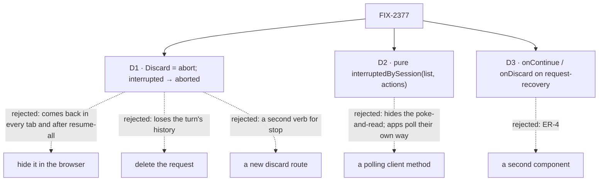

# FIX-2377 · Decisions

[Spec](SPEC.md) · **Decisions**

The issue settles the what (Continue or Discard a turn a restart cut off) and the epic settles
where (FIX-2370's component, extended; the client's helper). D1 is the one to sign, because it
changes what an engine route answers. D2 and D3 are shape calls, recorded.

Solid edges are what you're signing. Dashed edges lost, and the label says why.

## D1 · Discard is an abort, and abort ends an interrupted turn

Today `recordRequestStop` writes `abortRequested` only while a request is `in_progress`. An
`interrupted` request with no gate behind it falls through to *finished*, and the route answers
409 *already in terminal state "interrupted"*. But `interrupted` is not terminal: it is listed by
`interrupted-requests` on every call until it is continued, and `continue` takes it.

| | Abort moves it to `aborted` (chosen) | Hide it in the browser | Delete the request record | A new `discard` route |
|---|---|---|---|---|
| Gone after a restart, in another tab, for another app | yes | no | yes | yes |
| Safe from FIX-2175's resume-all | yes | no | yes | yes |
| Turn's items stay in history | yes | yes | no | yes |
| New surface | none: 409 becomes 204 | none | a delete path for one record | a route, a client verb, docs |
| `useSession.dismissRequest` works on it | yes, it already calls abort | no | no | no |

- **Because:** "stop this request" is what abort means, and a dead request that nobody continues
  is one the user has stopped. The status transition already exists as a fenced write
  (`setFieldsIfStatus` with `settledRecordFields`), so the change is one branch.
- **Kept as is:** an interrupted request parked behind a gate is stopped through its gate, as
  now; one whose owed park a continuation already holds answers *already resolved* and runs.
- **Locks in:** `abort()` on an interrupted request succeeds and ends it. A caller that relied on
  the 409 to tell an interrupted request apart reads its status instead. Pre-1.0, and the
  engine's own tests are the only callers found that assert the 409 (`park-owed.test.ts`'s
  "stays stopped" cases, which now read `aborted`). The engine is L1, and nothing here names a
  worker, task or app.
- **What would change it:** a product reason for a discarded turn to stay resumable later. Then
  it needs a state of its own, and this becomes an engine issue of its own.

## D2 · The client helper is a pure function over the list

`interruptedBySession(requests, { actions })` takes the `InterruptedRequest[]` that
`requests.interrupted()` returns and gives `Map<sessionId, InterruptedRequest[]>`, oldest first,
keeping only `actions` and dropping requests with no session.

- **Instead of** a method that polls: each app already reads on its own timer (Teammates every
  1.5 s, Shift Manager's own loops, Kitchen Sink through `useSession`), and FIX-2374's session feed
  may change that. A function composes with any of them. Tenet 2.
- **Instead of** an `actions` option on `interrupted()`: the route would still sweep and read
  every request, so the filter belongs where the grouping is.
- **Locks in:** one export in `@flow-state-dev/client`'s root, documented with the 5-second
  cadence (E2).

## D3 · `request-recovery` takes `onContinue` and `onDiscard`

FIX-2370's D1 made the component plain props with callbacks, and named this extension. With
`onContinue` or `onDiscard` set, it draws the interrupted line instead of a failure reason, and
the buttons given, each with its own busy and refused states. `onRetry` is not drawn on an
interrupted turn: the server would take it, but it starts a new request beside the lost one, and
Continue is the one that finishes it.

- **Instead of** a second component: ER-4. Kitchen Sink's `ResumePrompt` is the second copy this
  removes.
- **Locks in:** the app decides which buttons show, by passing callbacks or not.

## Decided, not asked

- **E1 · Delivery follows the build order.** The package PR (engine branch, client function,
  component state, Kitchen Sink's installed copy for the drift test, the goal leg, docs) stacks on
  FIX-2370's implementation branch. Each app's slice lands in its own stack: Kitchen Sink's Flow
  State page after FIX-2370 there (`2370 → 2377 → 2376`), its `harness-session.tsx` after
  FIX-2410; each lab's and Shift Manager's after that app's FIX-2370 slice.

- **E2 · Poll every 5 seconds, not on the app's fastest timer.** Each `interrupted()` call POSTs
  a sweep, a write path. A lost turn shows within the minute of E3 either way.

- **E3 · The minute stays.** The sweep marks a row interrupted once its heartbeat is a minute old
  (`DEFAULT_STALE_SWEEP_THRESHOLD_MS`), and the startup sweep only takes rows already that stale.
  A restarted host can't tell its own dead rows from a live one on another host (active entries
  carry no host), so marking them sooner is a separate engine change. Until then the turn reads as
  *working* for up to a minute after a restart, then the line appears. Not filed; raised in the PR.

- **E4 · Turn actions are the app's.** Each app passes its own (`respond`, a door's action, the
  harness turn action); the client knows no worker or task noun.

- **E5 · Wording** says *turn*, never a role, and uses the `attention` token Kitchen Sink's
  `ResumePrompt` uses, so an interrupted turn reads as needing a look, not as a failure.

## How it got here

- Initial draft, 2026-10-31, from the issue, the epic's ER-4 and build order, FIX-2370's spec
  (#4362), and a read of `client.ts` (`requests.interrupted`, `continue`, `abort`),
  `recovery-routes.ts`, `abort-routes.ts`, `record-request-stop.ts`, `request-recovery.ts`,
  `createFlowState`'s startup sweep, Kitchen Sink's `ResumePrompt` and `harness-turn.ts`, and both
  labs' adapters.
- A throwaway engine test settled D1's premise: `handleAbortRequest` on an `interrupted` record
  answered `409 {"error":"Request \"req_cut\" is already in terminal state \"interrupted\""}` and
  the record was still listed as interrupted.

## Notes from review

None yet.
