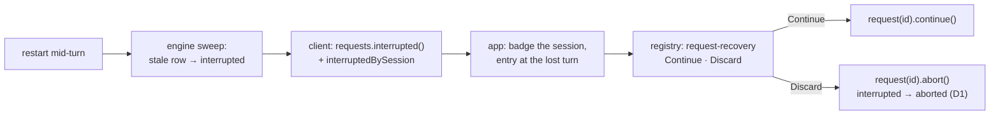

# FIX-2377 · Continue or Discard a turn a restart cut off

**Spec** · [Decisions](DECISIONS.md)

Child of epic [FIX-2369](../../epics/FIX-2369/SPEC.md) (*Trust the feed*). It extends
[FIX-2370](https://github.com/fixpoint-labs/flow-state-dev/pull/4362)'s `request-recovery` component (epic ER-4) and stacks on it. This
spec covers the whole issue; the delivery splits into a package slice and four app adoptions,
which land in their apps' stacks per the epic's
[build order](../../epics/FIX-2369/DECISIONS.md#coordination-seams).

## Who feels it, before and after

| Someone who… | Today | After |
|---|---|---|
| **was mid-turn when `fsdev dev` restarted** (a `--dev` save, a crash, a daily restart) in Teammates, Claude Code-style or Shift Manager | Their line stays with no reply. Nothing says the turn was lost, and nothing resumes it | Within about a minute of the restart, a line at the lost turn says it was cut off, with **Continue** and **Discard** |
| **the same, in Kitchen Sink's harness modes** | The turn reads as a bare *This turn failed.* | The same line, from the same component |
| **the same, in Kitchen Sink's Flow State assistant** | An inline *Resume* prompt above the composer, Kitchen Sink's own copy | The registry component, at the turn, with Discard as well |
| **presses Continue** | — | The same request carries on: finished steps replay from the durable log, the step in flight runs again, and the reply streams in |
| **presses Discard** | — | The line goes, the turn reads as stopped, and it stays gone after another restart or in another tab |
| **has a lost turn in a conversation they aren't looking at** | — | That conversation (or worker) carries a badge in the list |
| **builds their own app** | Calls `requests.interrupted()` and works out which session each belongs to | `interruptedBySession(…)` from the client, and `request-recovery` from the registry |

## The goal, and how we'll know it's met

**A turn a restart cut off shows where it was lost, with a Continue that resumes it and a Discard
that ends it for good, in all four apps, from the component FIX-2370 adds.**

- **The real need**, from the app review (R-08): every `--dev` save restarts Shift Manager's Lab,
  and both labs run durable on purpose so work survives a restart. The work does survive. Nothing
  shows it.
- **Smaller, and rejected:** have each app read `requests.interrupted()` and draw its own line.
  Four copies, and Kitchen Sink's `ResumePrompt` is already a fifth.
- **A gap found while writing this:** Discard has nothing to call. Today `abort()` on an
  interrupted request answers 409 and leaves it interrupted (confirmed by a throwaway test against
  `handleAbortRequest`), so it would be listed forever, and FIX-2175's resume-all would bring back
  a turn the user discarded. [D1](DECISIONS.md#d1) fixes that in the engine.
- **Not done if:** a restart mid-turn leaves any of the four apps with no line at the turn;
  Continue starts a new request instead of carrying on the same id; or a discarded turn comes back
  after the next restart.

**How we verify.**

- **Goal leg (new), `goals/continue-interrupted-run/after-a-restart`**, no model. A durable host
  on an on-disk store, over HTTP, with a flow whose turn blocks until released. Two sessions each
  start a turn; the host process is killed (`SIGKILL`, through `goals/lib/server.mts`) and a fresh
  one starts on the same store. Graded: `interruptedBySession` lists each turn under its own
  session; **Continue** on the first finishes the *same* request id with its output; **Discard**
  on the second answers success, and the turn is `aborted` and absent from `interrupted()`; after
  a **second** restart it is still absent and the first is still `completed`. The fixture sets a
  short stale threshold so the run takes seconds, not a minute.
- **Control that must fail:** `GOAL_CONTROL=old-abort` patches the abort back to today's
  behaviour as the server loads. The Discard leg fails (409, still listed). Shown red in the PR.
- **Unit, engine:** abort of an interrupted request no gate holds moves it to `aborted` and
  answers 204; the parked cases keep their behaviour; a continue that wins the race keeps it
  running. The existing "stays stopped" cases in `park-owed.test.ts`, and `abort.test.ts`'s second
  abort after a cut-off run, now read `aborted`.
- **Unit, client:** `interruptedBySession` keeps only the actions given, drops entries with no
  session, groups by session, oldest first.
- **Render, registry:** the interrupted state shows its line; Continue and Discard each call
  their callback once, show their busy word, and come back with the message if refused. Controls:
  a button that calls nothing, and a line that draws the failed copy for an interrupted turn.
- **App slices:** each app's adoption PR shows the line after a real restart mid-turn (a browser
  run for the labs and Shift Manager, Kitchen Sink in its stack), and Continue finishing the reply.

## What changes

- **Engine: Discard is an abort** ([D1](DECISIONS.md#d1)). `recordRequestStop` moves an
  `interrupted` request that no gate holds to `aborted`, fenced on its status and incarnation, so
  `POST …/abort` answers 204 instead of 409. An interrupted request parked behind a gate keeps
  today's path (its gate is stopped); a continuation that already holds the lease wins, as now.
  No new route or verb.
- **Client: `interruptedBySession(requests, { actions })`** ([D2](DECISIONS.md#d2)), a pure
  export beside `createClient`. It takes what `requests.interrupted()` returned and gives a
  `Map<sessionId, InterruptedRequest[]>`, oldest first, with only the named actions. The app
  passes its turn actions, so a worker's internal passes and deliveries don't badge anything.
- **Registry: `request-recovery` gains its interrupted state** ([D3](DECISIONS.md#d3)). Beside
  FIX-2370's `onRetry`, it takes `onContinue` and `onDiscard`. With either set, it draws *This
  turn was cut off before it finished* (the app may pass its own line) and the buttons given. Each
  button owns its busy word (*Continuing…*, *Discarding…*) and its refused state, as Retry does.
  Kitchen Sink's `ResumePrompt` folds into it.
- **App slices** (later, in their stacks; [E1](DECISIONS.md#e1)): each app polls
  `requests.interrupted()` every 5 seconds while open ([E2](DECISIONS.md#e2)), runs
  `interruptedBySession` with its turn actions, badges the session or worker in its list, and
  draws `RequestRecovery` after the lost turn's last entry, or at the end if it wrote none. Kitchen
  Sink's harness modes stop folding `interrupted` into *failed* (`harness-turn.ts`).
- **Docs:** the client README and the requests reference gain `interruptedBySession` and the
  abort rule for an interrupted request; `apps/docs/docs/ui/flow-aware-components.md` gains the
  interrupted state under *RequestRecovery*; the engine's recovery doc says abort ends a dead turn.

## What stays as it is

The sweep and its threshold, so a turn reads as *working* until its heartbeat is a minute old
([E3](DECISIONS.md#e3)); `requests.interrupted()`, `continue()` and `retry()`; the durable
replay; the parked-request stop path; `StuckRequestBanner`; Workforce, core and react.

## What's already here, and the debt

| Piece | What this does with it |
|---|---|
| `requests.interrupted()` (`client.ts`), its sweep poke and its read | **Reused** as the source. Only DevTool calls it today |
| `RequestHandle.continue()` and the `/continue` route (FIX-811, FIX-865) | **Reused** as Continue. The goals in `goals/continue-interrupted-run/` already prove continue-not-restart in-process |
| `RequestHandle.abort()` and `recordRequestStop` | **Extended** (D1): an interrupted, unparked request ends as `aborted` instead of a 409 |
| `useSession.dismissRequest` and `continueRequest` | **Reused** by Kitchen Sink's Flow State assistant for Discard and Continue; D1 makes its dismiss of an interrupted request work too |
| FIX-2370's `request-recovery` | **Extended** with two callbacks (ER-4) |
| Kitchen Sink's `ResumePrompt` (`flow-state/page.tsx`) | **Removed** in the Kitchen Sink slice, replaced by the component |
| Claude Code-style's `interrupted` entry (the user's own stop) | **Left alone.** It is a stop the user made, not a turn a restart lost |
| `goals/suspension/resumes-after-a-cold-restart`, `goals/lib/server.mts`, `durable.mts` | **Reused** for the restart leg. If FIX-2407's restart helper lands first, the leg uses it |
| FIX-2175 (resume every interrupted request in one call) | **Compatible**: after D1, a discarded turn is no longer interrupted, so resume-all skips it |

**Adds:** one engine branch, one client function, two component callbacks, one goal leg.
**Removes:** Kitchen Sink's `ResumePrompt`. **Debt:** the minute before a lost turn shows
(E3). **Net:** small.

## Sign off

**Approve by merging.** One call to sign:

- [D1](DECISIONS.md#d1) · **Discard ends the turn on the server**: abort of an interrupted request
  moves it to `aborted`. *If wrong:* a discarded turn would need its own state; the client and
  component stay, and the abort branch is one function.

Recorded, not asked: D2 (a pure client function, not a method), D3 (callbacks on FIX-2370's
component), E1–E5.

Feature · engine, client, `ui` registry, then 4 apps · small · 1 package PR (stacked on FIX-2370)
\+ 4 app slices · child of [FIX-2369](https://linear.app/fixpoint-labs/issue/FIX-2369)
