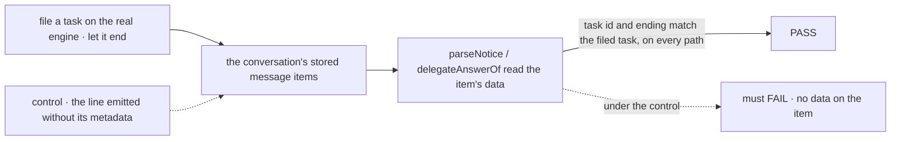

# FIX-2378 · A task's line says which task it is, as data

**Spec** · [Decisions](DECISIONS.md)

## Who feels it, before and after

| Someone who… | Today | After |
|---|---|---|
| **changes how a task's ending is worded** (`noticeText` in orchestration) | The Claude Code-style lab stops drawing results, and Teammates loses the task id, with no error | Nothing breaks: apps read the line's data, not its words |
| **builds an app that draws a task's result** | Copies a regex over the line's words, as both labs do | Calls `parseNotice(item)` and gets the task, its ending, title and what came back |
| **draws a delegate's answer as that delegate's** | Guesses from `agentName`: a dotted id is a worker (wrong for a hired worker such as `otto`) | Calls `delegateAnswerOf(item)` and gets the worker and the task it answered |
| **opens a conversation stored before this change** | Lines read as they do today | Its ending lines still read as results (read off their words); its delegate answers read as plain lines |
| **emits a message from a handler of their own** | Text only | May attach `metadata` a client reads; the model never sees it |

## The goal, and how we'll know it's met

**An app learns which task a conversation's line is about, and how it ended, from the line's item,
so rewording the line can't break the app.**

| | |
|---|---|
| **The real need** | The epic's rule that apps don't parse a protocol the package owns ([FIX-2369 D1, ER-3](../../epics/FIX-2369/DECISIONS.md#who-owns-what)); the review's CC-ROB-8: two labs' regexes over `noticeText` and `agentName` |
| **Smaller, and rejected** | Move the labs' regex into orchestration as `parseNotice(text)`. One copy instead of two, but still a parse of English: a new ending's wording, or a title holding `" (`, still misreads, and a delegate's answer still has no marker at all |
| **Bigger, and not this issue's** | Deleting the labs' regexes. The build order puts that in each lab's `adapter.ts` stack 2 (2378 → 2379 → 2370 → 2393), after stack 1 merges ([build order](../../epics/FIX-2369/DECISIONS.md#coordination-seams)). This slice touches no app file |
| **Not done if** | A line is marked only on one path (a notice heard by a turn, a line a running turn took, a routed answer, an unrouted answer); or `parseNotice` passes only because it falls back to the words |

The check reads what the conversation stored, not what a block meant to write.

**How we verify.** No goal check under `goals/`: this slice changes no app, and nothing a person
sees changes until the labs adopt it in wave 3, whose PRs carry the app-level check. The proof is
package tests on the real engine:

- **Lines, real engine** (`packages/workforce/test/task-line-markers.test.ts`): a coordinator
  conversation files a task through `createTask_tasks` and it ends. A completion's and a final
  failure's line each carry `taskNotice` data with the filed task's id and ending, and
  `delegateAnswerOf` answers `undefined` for them. A `resultTo: "conversation"` task's answer, from
  a coordinator, from a worker's own conversation, and from a routed message, each read as
  `{ worker, taskId }` and `parseNotice` answers `undefined`. The conversation's own words carry no
  marker.
- **Control that must fail:** the same file with the marker dropped at each emit site. Prototyped:
  dropping it from the notice line fails both ending legs (they still parse from the words, but
  with no `attempt` and no data on the item, which the legs assert); dropping it from the
  coordinator's two answer sites fails the routed and unrouted answer legs; dropping it from the
  board's answer line fails the worker-conversation leg.
- **Parser, unit** (`packages/orchestration/test/tasks/parse-notice.test.ts`): each ending
  round-trips through `noticeMetadata`; a line whose words changed still parses from its data; a
  line with no data parses from `noticeText`'s own output for every ending, cascade included; a
  user's message quoting a notice's words, another item type, and malformed data are not notices.
- **Hook, engine** (`packages/engine/test/emit-message-metadata.test.ts`): `metadata` rides the
  streamed and the stored item, for both message emitters, is absent when not given, and
  `itemToLLMMessages` yields the text alone. Control: the engine drops the field; the leg fails.

## What changes

- **Core and engine, one generic hook** ([D1](DECISIONS.md#d1)): `ctx.emit.message(text, {
  metadata })` puts `metadata` on the `MessageItem`. `EmitMessageOptions` is exported from core.
  The engine doesn't read it; history holds the text alone. No task, worker or notice noun enters
  L1 (ER-1).
- **Orchestration, beside `noticeText`:** `noticeMetadata(notice, task)` (the item's
  `taskNotice` data: board, task, attempt, ending, title, what came back, cancelled dependents),
  and `parseNotice(item)`, from `./tasks`, which the labs already import in the
  browser.
- **Workforce:** every line a conversation says about a task is emitted with its data: the board's
  notice line, a line a running turn took (`takeFinishedTasks`), and a routed failure's line carry
  `noticeMetadata`; a delegate's answer that lands as written, from the board or a coordinator,
  carries `delegateAnswerMetadata({ worker, taskId })`. `delegateAnswerOf(item)` reads it, from the
  root and `./browser`. The keys stay internal ([E7](DECISIONS.md#decided-not-asked)).
- **Docs:** the orchestration and workforce READMEs, `docs/architecture/items.md`, and the
  *Emitting items* page (attaching data a client reads). A changeset for the five packages.

## What stays as it is

`noticeText`'s words; what a model reads (the woken turn still reads the ending as its `getTask`
read, FIX-2345); `agentName` on every line; the labs and Shift Manager, untouched until wave 3;
the workforce copy of the notice schema (FIX-2099's).

## What's already here, and the debt

| Piece | What this does with it |
|---|---|
| `noticeText` and the notice records in `task-notice.ts` | **Extends**: the data and its reader sit beside the words, tested against them |
| `ContainerItem.metadata` | **Precedent**: the same name and shape on a message |
| `OutputItemBase.taskId` (task attribution, FIX-658) | **Not reused**: it means "emitted while working this task", and the task-attribution helpers read it so; a filer's line about a task is not that ([D1](DECISIONS.md#d1)) |
| Claude Code-style `RESULT_LINE` and `WORKER_ID`; Teammates' `task_` id regex | **Left for wave 3**, which deletes them in the PR that adopts `parseNotice` and `delegateAnswerOf` (ER-3) |
| FIX-2099 (notice schema copied into workforce) | **Unchanged**: no field added to the notice itself |

**Adds:** one optional field on a core item and its option; two orchestration exports; two
workforce exports. **Removes:** nothing yet; wave 3 removes two regexes per lab. **Debt:** a text
fallback in `parseNotice` for lines stored before this, kept while such sessions exist. **Net:**
down once wave 3 lands.

## Sign off

**Approve by merging.** The one call is **where the data rides** ([D1](DECISIONS.md#d1)): a
generic `metadata` field on message items, which every package may use for its own lines. *If
wrong:* the field is optional and additive; moving the data elsewhere later changes the three emit
sites and the two readers, not the apps that call the readers.

Feature · `contracts`, `core`, `engine`, `orchestration`, `workforce` · small · 1 PR · builds on
FIX-2078 notices · wave 1 of FIX-2369; the labs adopt it in wave 3
