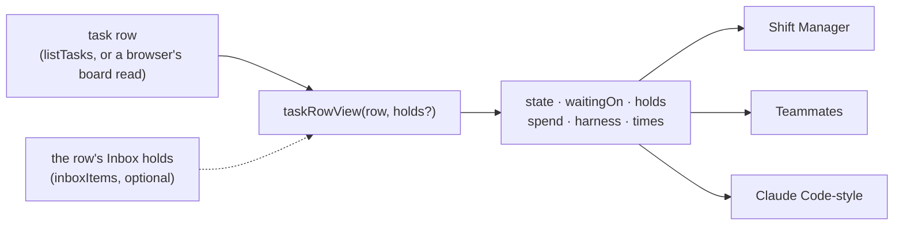

# FIX-2379 · One task-row view: held, waiting on you, timing, harness

**Spec** · [Decisions](DECISIONS.md)

## Who feels it, before and after

| Someone who… | Today | After |
|---|---|---|
| **files a task that asks them a question** (in the Teammates lab) | The card says *running* forever, because every status but completed, errored and cancelled reads as running (`labs/teammates/src/adapter.ts:355`) | Once Teammates adopts the view (its wave-3 stack), the card says *Waiting on you* with the question |
| **has a running task in Shift Manager that asks them a question** | The `in_progress` row sits under RUNNING (`packages/shift-manager/src/lib/columns.ts:14`); a `held` row sits under QUEUED with its *held* tag, also with no sign it waits on them | Once Shift Manager adopts it (its wave-2 `reads.ts` stack), both read *waiting on you* |
| **uses the Claude Code-style lab** | Already right, through its own copy of the hold read (`labs/claude-code-style/src/adapter.ts:495-528`) | Same screen; the copy goes when the lab adopts the view |
| **builds their own task screen** | Re-derives status, holds and spend from a raw row, three different ways if they copy ours | Calls `taskRowView(row)` and gets one display state, what it waits on, its spend and its times |
| **reads a row stored before `held` replaced `blocked`** | Each copy handles it or doesn't | Reads as *held*, the same as the board |

## The goal, and how we'll know it's met

**Every workforce app turns a task row into what a person sees through one function in
orchestration, so a task that waits on a person says so in every app, with the same words.**

- **Smaller, and rejected:** fix Teammates' status mapping in the lab (FIX-2349's shape). Shift
  Manager keeps its own bug, and the next app writes a fourth copy. ER-3 forbids sharing between
  labs, so the copy can only be shared from a package.
- **Bigger, and not this slice's:** the apps adopting it. The epic's build order puts this issue's
  package slice in wave 1 and each app's adoption in that app's own stack (Shift Manager
  `reads.ts`, wave 2; each lab's `adapter.ts` stack 2, wave 3). Branch, commits and the review
  outcome are harness-manager's ([D2](DECISIONS.md#d2)).
- **Not done if:** a row with an open question for the user reads as anything but *waiting*, in
  any status that isn't terminal; or an app that adopted the view still maps status itself.

One function between the row and every screen. The holds are optional: without them the view
reads the row's own hold record, so the waiting state never depends on a reader doing the Inbox
read ([D1](DECISIONS.md#d1)).

**How we verify.**

- **Unit, `packages/orchestration/test/task-row-view.test.ts`:** one row per status, and
  the cases that carry the bug: an `in_progress` row and a `held` row each with an open user
  question read *waiting* with that prompt; the same rows with the question answered (a steer
  carrying its id) read *running* and *held*; a system-actor hold is not *waiting*; a terminal
  row with a stale hold is terminal; a legacy `blocked` row is *held*; an Inbox item's holds,
  passed in, win over the row's record (a found suspension the row hasn't recorded yet).
- **Control that must fail:** with the view's hold read replaced by the status-only mapping
  Teammates ships today, the waiting cases fail. Shown in the PR, red then green.
- **Browser-safe:** `src/inbox/index.ts` joins the entry list in
  `test/tasks-subpath-browser-safe.spec.ts`, so a `node:` import reaching the view fails the build.
- **The apps' checks are their stacks'.** This slice changes no app file (the build order's wave 1
  rule).

## What changes

- **`taskRowView`**, exported from `@flow-state-dev/orchestration/inbox`, beside `inboxItems`
  and `createInboxClient`. It takes a row (an `InboxRow` plus the fields a board publishes: error,
  status note, spend, times) and, optionally, that row's holds from its Inbox item.
- **One display state** ([D1](DECISIONS.md#d1)): `queued`, `held`, `running`, `waiting`, `failed`,
  `done`, `cancelled`. *Waiting* is any open user hold on a row that isn't terminal, whatever the
  stored status. The stored status stays on the view beside it.
- **`waitingOn`**: the oldest open user hold's kind and prompt, and the hold itself (where its
  answer goes, whether it can be answered, and the `detail` a reader found for it, such as a
  review stop's data). `null` when nothing waits on the user.
- **Spend and harness** from `taskSpendView`; a malformed stored spend reads as none, never a
  throw. **Times**: created, updated, started and completed, `null` where the row has none.
- **Docs:** the orchestration README's *Inbox* section and `apps/docs` *Building an Inbox* get the
  view.
- **Changeset:** `@flow-state-dev/orchestration` minor, one sentence.

## What stays as it is

- `inboxItems`, `openUserHolds` and the hold schema. The view reads holds through the same
  `openUserHolds` the Inbox does; it builds no Inbox item.
- Every app file. The three copies stay until each app's stack adopts the view.
- The task status enum and its state machine.

## What's already here, and the debt

| Already here | What this does with it |
|---|---|
| `openUserHolds` (`src/inbox/holds.ts`), the Inbox's one hold read | **Builds on.** The view's default holds are its answer for the row |
| `inboxItems` | **Builds on.** A reader that has an item passes its holds in |
| `taskSpendView` | **Builds on.** The view's spend and harness |
| `persistedTaskStatusSchema` | **Builds on.** The legacy `blocked` read |
| Shift Manager `columns.ts` / `reads.ts` row shaping | **Superseded** once Shift Manager's stack adopts the view |
| Claude Code-style `holdsOf` / `listedWithWaitingOn` | **Superseded** once that lab's stack adopts it |
| Teammates `toBoardTask` status mapping | **Superseded** once that lab's stack adopts it |

**Builds on / Adds.** `taskRowView` (adds) over `openUserHolds`, `inboxItems` and
`taskSpendView`: **extend**, a view over the existing reads, no second hold read.

**Debt added:** none new. Until all three apps adopt the view there are four copies, not three;
the build order schedules each removal.

**Net:** one function replaces three copies once the stacks land; this slice alone adds it.
