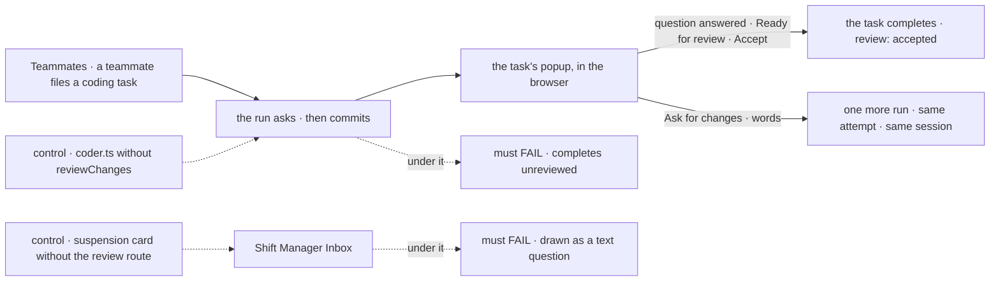
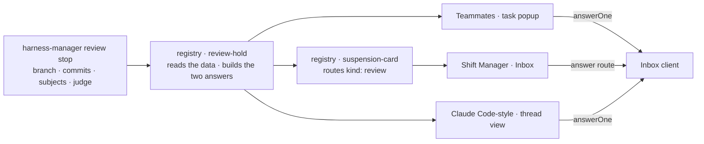

# FIX-2380 · Answer holds and review coding changes in Teammates

**Spec** · [Decisions](DECISIONS.md)

## Who feels it, before and after

| Someone who… | Today | After |
|---|---|---|
| **has a coding task in Teammates that asks a question** | The popup shows the run's steps and nothing to answer with. The question is reachable only through the teammate that filed it | The popup shows the question with an answer box. The answer continues the same run, on the same attempt |
| **has a coding task in Teammates that committed** | The task completes the moment the run says it finished, unreviewed and with no judge (`labs/teammates/src/flows/coder.ts`) | The task waits: the popup shows *Ready for review* with the branch, the commits and the judge's verdict, and **Accept** or **Ask for changes** |
| **asks for changes** | Nothing to ask from | Their words go to the same coding session, one more run on the same attempt; a new commit is reviewed again |
| **works FSD in Shift Manager's `fsd` profile** | Any commit settles the task. Had a review stop reached the Inbox, the registry's suspension card would draw it as a free-text question the answer schema refuses | The coder waits for review, and the Inbox draws the review card: Accept, or Ask for changes with words |
| **uses the Claude Code-style lab** | Reviews through its own `ReviewCard` and its own read of the stop's data | Same screen, drawn by the registry card; a thread worker's review still shows its work as the prompt; the lab's copy goes |
| **builds the next workforce app** | Copies a lab's review card, its data read and its answer payload | Adds `review-hold` from the registry, reads the stop with harness-manager's browser entry, and the card builds the only answers the review takes |

## The goal, and how we'll know it's met

**A person who files coding work in Teammates or Shift Manager answers what it asks and reviews
what it changed in the app, before the task counts as done, through one card that every app
shares.**

- **Smaller, and rejected:** turn `reviewChanges` on and leave the apps to draw the stop. The
  Teammates popup has nothing to draw it with, and Shift Manager's registry card would offer a
  text box whose answer the review refuses. Every task would wait until its deadline.
- **Bigger, and not this issue's:** the diff (FIX-2384), checks (FIX-2387), the branch chip
  (FIX-2386) and the task's waiting state on its card (FIX-2379's adoption, and FIX-2395 and
  FIX-2397). The card keeps a place for the diff, and FIX-2384 fills it.
- **Not done if:** a Teammates coding task with commits completes without a review; an app
  draws a review stop with anything but the registry card; or an answer leaves the app in a
  shape other than `harnessReviewAnswerSchema`'s.



The check reads what the popup and the Inbox show, and what the board then records.

**How we verify.**

- **Goal, `goals/teammates-lab/a-coding-task-waits-for-your-review/`:** the Teammates host with a
  scripted harness for the legs that grade the loop, and Claude Code for one real leg. Legs: a
  run that asks shows its question in the popup, and the typed answer continues the run on
  attempt 1 in the same session; a run that commits shows *Ready for review* with the branch,
  the commit count and the judge line, and the task is not done; **Accept** completes it with
  `review: "accepted"` and no further run; **Ask for changes** carries the words into one more
  run on attempt 1, which is reviewed again; the real leg reaches *Ready for review* on a real
  commit. **Control `no-review`:** the coder built without `reviewChanges` completes on the
  commit, and the review legs fail.
- **Shift Manager, one leg on an existing Inbox goal** (`every-stop-is-one-inbox-item` already
  raises a review stop): the review item draws the registry card, and its Accept completes the
  task. **Control:** the suspension card without its review route draws the free-text question,
  and the leg fails.
- **Unit, `packages/ui`:** the card's answers are exactly `{ verdict: "accepted" }` and
  `{ verdict: "revise", words }`; blank words send nothing; a review with no commit count says the
  commits couldn't be read; no judge says so; with no `review` the card draws the stop's prompt.
  harness-manager's reader reads data of the wrong shape as unknown.

## What changes



One card between the stop and every screen. Teammates and Shift Manager's profiles also turn
`reviewChanges` on, so their coding runs make the stop at all.

- **A registry component, `review-hold`** ([D1](DECISIONS.md#d1)), lifted from the Claude
  Code-style lab's `ReviewCard`: *Ready for review*, the commits on the branch, the commit
  subjects, the judge's line and reason, **Accept**, and **Ask for changes** with a box for
  the words. It takes the review as plain props, or draws the stop's prompt without one, and
  builds the two answers; the app supplies how an answer is sent.
- **A reader in harness-manager's `./browser` entry** ([D2](DECISIONS.md#d2)), beside
  FIX-2386's `workPlace`: the review stop's data as the card's props.
- **The registry's `suspension-card` routes a `review` stop that takes a verdict to it**, in
  prompt form. Every app that draws stops through `SuspensionCard` can answer a review; Shift
  Manager's `AskCard` passes the code review in through the reader.
- **Teammates:**

  ```diff
   harnessManager({
     name: `${CODER_FLOW}-${name}`,
     …
     harness,
  +  reviewChanges: true,
  +  judge: goalJudge({ name: `${CODER_FLOW}-${name}-judge` }),
   })
  ```

  The adapter gives each task its Inbox holds, so a hold knows where its answer goes, and
  answers through the Inbox client (`answerOne`). The task popup shows an open question with an
  answer box, and an open review with the registry card.
- **Shift Manager:** its `fsd` and `devteam` profiles pass `reviewChanges: true` to `openLab`
  ([D3](DECISIONS.md#d3)). It re-adds the registry's suspension card and the new card, and its
  `AskCard` gives a review ask the reader's result.
- **Claude Code-style:** `ReviewCard.tsx`, `lib/review.ts` and the adapter's own read of the
  stop's data are replaced by the registry card and the reader.
- **Docs:** `packages/ui/README.md` lists `review-hold`; the Teammates README says coding tasks
  wait for your review; harness-manager's *Reviewing a run's changes* names the registry card.
  A harness-manager changeset for the reader; the registry ships as source, and every app here
  is private.

**How it lands** (the epic's [build order](../../epics/FIX-2369/DECISIONS.md#coordination-seams)):
the registry card first, stacked on FIX-2379's slice; the reader after FIX-2385's entry merges;
then Teammates at the head of its stack 3
(`adapter.ts`, `Popups.tsx`), with `coder.ts` after FIX-2391; then Shift Manager and the Claude
Code-style lab, each from `main` once the card has merged.

## What stays as it is

- **harness-manager's run path.** The review stop, its data, `harnessReviewAnswerSchema` and the
  judge are unchanged. `openLab` keeps `reviewChanges` off by default, so goals that grade a plain settle
  are untouched.
- **The Inbox client and `inboxItems`.** Both apps answer through `answerOne`, as Claude
  Code-style does today.
- **How a task reads as waiting.** That is FIX-2379's `taskRowView` (epic ER-4). The popup reads
  the hold from the row view; it shapes no status of its own.
- **The teammate that filed the task** can still answer its question by a steer. Whichever
  answer lands first wins; the second is told the question is answered.

## What's already here, and the debt

| Already here | What this does with it |
|---|---|
| harness-manager's review stop (`suspendForUser({ kind: "review" })`, data `{ branch, commits, subjects, judge }`) and `harnessReviewAnswerSchema` | **Builds on.** Unchanged; its one browser reader joins `./browser` |
| harness-manager `./browser` (FIX-2385) and `workPlace` (FIX-2386) | **Extended** with the review reader, the same split as the `work-place` chip |
| `goalJudge` | **Builds on.** Teammates uses it as the Claude Code-style lab does |
| Claude Code-style `ReviewCard`, `lib/review.ts`, `reviewStopOf` | **Superseded** by `review-hold`; deleted |
| Registry `suspension-card`, `question`, `approval` | **Extended:** the dispatcher gains a `review` route |
| Inbox client `answerOne`, `inboxItems` | **Builds on** |
| FIX-2379 `taskRowView` and its `hold` | **Builds on.** The popup's question and review come from it |
| Shift Manager `AskCard` | **Builds on.** Unchanged; it draws the card through `SuspensionCard` |

**Builds on / Adds.** `review-hold` (adds) against Claude Code-style's `ReviewCard`: **extend**,
the same card moved to the registry with its actions. The `suspension-card` review route
(adds) against its `render.component` escape hatch: **extend**, a route by the stop's `kind`,
which `suspendForUser` already writes on its item ([D1](DECISIONS.md#d1)).

**Debt added:** none new. The card's plain props are a second spelling of the review's shape as
a type; the one reader of the stop's fields is harness-manager's ([D2](DECISIONS.md#d2)).

**Net: down.** One app copy of the card and its data read goes; two apps that had none use the
registry's.
