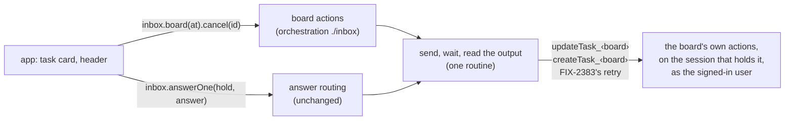

# FIX-2381 · Shared task actions: cancel, steer, release, retry, re-file

**Spec** · [Decisions](DECISIONS.md)

Child of epic [FIX-2369](../../epics/FIX-2369/SPEC.md) (merged #4358). The epic decided where
this lives: orchestration's `./inbox` entry, next to `createInboxClient`, and not as a new client
constructor ([epic Decided](../../epics/FIX-2369/DECISIONS.md#coordination-seams), review finding
"Task actions as a new constructor", folded).

## Who feels it, before and after

| Someone who… | Today | After |
|---|---|---|
| **builds a workforce app** with task cards | Hardcodes `"updateTask_tasks"`, rebuilds each payload (`{ id, status: "cancelled" }`, `{ id, message }`), and writes their own send, wait and read-the-refusal loop | Calls `inbox.board(at).cancel(id)`, `.steer(id, words)`, `.release(id)`, `.retry(id)`, `.refile(row, overrides)`. A refusal rejects with the board's own words |
| **uses Shift Manager** | Only Interrupt works on a task. A held row shows its *held* tag with no way to release it | Its reader exposes the same actions. The buttons themselves are FIX-2382's |
| **uses the Claude Code-style lab** | A steer goes through the adapter's own `run` loop and its own copy of the action name | Unchanged by this issue's PRs. FIX-2382's lab stack swaps the copy for the shared call when it adds the buttons |
| **uses the Teammates lab** | Has no task actions, so no copy yet | Gets them through FIX-2382 and FIX-2380, with nothing to copy |
| **answers a task's question** | `inbox.answerOne(hold, answer)` | **Unchanged.** Answering stays the Inbox's one answer call ([D2](DECISIONS.md#d2)) |

## The goal, and how we'll know it's met

**An app cancels, steers, releases, retries and re-files a task on a conversation's board with
one shared call each, imported from `@flow-state-dev/orchestration/inbox`, and no app names the
board's action or builds its payload.**

- **Smaller, and rejected:** export only the action-name constant. Every app still rebuilds the
  payloads and the send-wait-read loop, which is where the copies differ today (Shift Manager's
  answer path maps 4xx and a timeout; the lab's `run` does neither).
- **Bigger, and not this issue's:** the buttons on task cards (FIX-2382), the retry verb itself
  (FIX-2383, this issue's base), and hand-off or reassign (no board verb exists).
- **Not done if:** an app outside orchestration still spells `updateTask_tasks` or builds one of
  these payloads after FIX-2382 lands (the closure sweep, FIX-2425); or a refusal resolves instead
  of rejecting.

**How we verify.**

- **Goal check, against a real conversation board** (`packages/workforce/test`, on the
  conversation-board harness that already serves a flow to a real `Client`): file a held task and
  release it, then see it pending; steer an open task and see the words in its `steers`; cancel it
  and see `cancelled`, with the dependents the board names returned; re-file the cancelled row with
  one field overridden and see a new pending row carrying the copied fields and the override;
  retry an errored task and see the same id back in `pending` (FIX-2383's verb). Each step reads
  the row back through the board, never the helper's own return alone.
- **Refusal leg:** steer a finished task and cancel it again. Both reject with the board's
  `task_finished` words, and nothing is written.
- **Control that must fail:** point the helper at the wrong board id (`"plan"` for `"tasks"`).
  Every leg must go red, since the action doesn't exist on that flow. A second control drops the
  `ok: false` read from the shared routine: the refusal leg must go red.
- **Unit:** the existing `test/inbox.test.ts` answer tests keep passing unchanged after the send
  routine is shared, which shows the answer path didn't move.

## What changes

- **`@flow-state-dev/orchestration/inbox`** gains, on `InboxClient`, `board(at)`, which returns
  the board's actions bound to `at = { flowId, sessionId, board }` (`board` is the collection id,
  such as Workforce's `"tasks"`) ([D1](DECISIONS.md#d1)):
  - `cancel(id)` → `updateTask { id, status: "cancelled" }`, resolving to the ids it took along.
  - `steer(id, message)` → `updateTask { id, message }`.
  - `release(id)` → `updateTask { id, status: "pending" }` on a held row.
  - `retry(id)` → FIX-2383's verb, in whatever shape its spec settles. The task keeps its id.
  - `refile(row, overrides?)` → `createTask` with the row's `goal`, `title`, `context`,
    `assignee`, `labels` and `priority`, overrides winning, resolving to the new task id
    ([D3](DECISIONS.md#d3)).
- **`taskActionName(tool, board)`** is exported from the same entry: the one place an app gets a
  board's action name (for an `InboxRow.holder`, say). It uses `taskToolSuffix`, which moves to a
  browser-safe leaf module so `./inbox` stays free of the task board's runtime.
- **One send routine.** The answer path's send, wait, list-the-output, reject-on-`ok:false` loop
  becomes the routine every board action and every row answer goes through.
- **Shift Manager** (second PR, stacked per the build order): `reads.ts` drops its
  `UPDATE_TASK_ACTION` copy for `taskActionName`, and `LabReader` exposes the board's actions for
  FIX-2382's buttons to call.
- **Docs:** the orchestration README's Inbox section gains the board actions. The epic's guide
  (*building a workforce app from the packages*, FIX-2387) names them; no page of its own.

## What stays as it is

`answer` and `answerOne`, and how they route. The task tools' rules: what the board refuses, and
why, is still the board's (`updateTask`'s locks, the steer limit, the finished-task rule). The
engine's abort route, which Shift Manager's Interrupt uses for a running request. Core and the
engine. Workforce's board id.

## What's already here, and the debt

| Piece | What this does with it |
|---|---|
| `createInboxClient` and its `answerRowQuestion` loop | **Extends.** The loop becomes the shared routine; the client gains `board(at)` |
| The task tools' `updateTask` and `createTask` actions | **Reuses.** No new board verb here; the helper only names and sends them |
| `taskToolSuffix` in `task-tools-capability.ts` | **Moves** to a leaf module, re-exported where it is today |
| FIX-2383's retry verb | **Reuses**, as this issue's base branch |
| Shift Manager's `UPDATE_TASK_ACTION`, the Claude Code-style lab's copy and `run` loop | **Replaced:** Shift Manager's here; the lab's in FIX-2382's lab stack, which owns that file in the wave |
| The DevTool's own `task-actions.ts` suffix mirror | **Left.** The DevTool depends on client, core and react only, by design |

**Adds:** one method and one helper on an existing client, and a moved function. **Removes:** two
copies of the action name and one copy of the send loop. **Debt:** a re-filed row doesn't record
what it was re-filed from, since a browser's row carries no metadata ([D3](DECISIONS.md#d3)).
**Net:** smaller.

## Sign off

**Approve by merging.** The one call is **the shape** ([D1](DECISIONS.md#d1)): the board's actions
hang off the Inbox client you already have, bound once per board, and answering stays the Inbox's.
*If wrong:* the methods move to another name on the same client; no stored data depends on it.

Feature · `orchestration`, then `shift-manager` · small · 2 PRs (package on FIX-2383's branch;
Shift Manager's `reads.ts` after FIX-2379, per the epic's build order)
