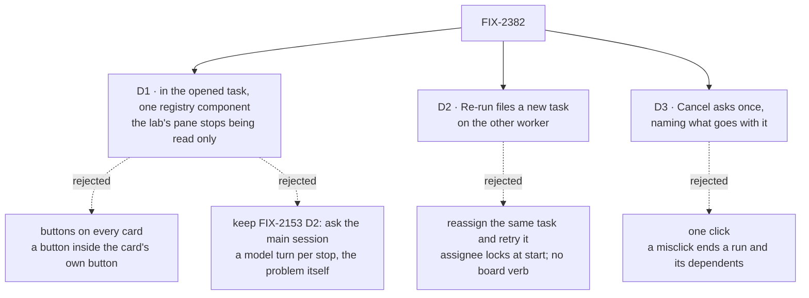

# FIX-2382 · Decisions

[Spec](SPEC.md) · **Decisions**

FIX-2381 settled the calls; the epic settled that shared UI lives in the registry (its D4) and
the order the app files are touched in (its build order). What's left is where the buttons sit,
including the lab pane FIX-2153 kept read only, what *Re-run on another harness* does to the
board, and whether Cancel asks first.

## The tree

Solid edges are what you're signing. Dashed edges lost, and the label says why.

## D1 · The buttons live in the opened task, from one registry component, `task-actions`; the Claude Code-style lab's tasks pane stops being read only

| | |
|---|---|
| **Instead of** | Keeping [FIX-2153 D2](../FIX-2153/DECISIONS.md) (stop or steer by asking the main session) · buttons on each task card · each app's own buttons |
| **Because** | FIX-2153 D2 kept the pane read only so the lab would prove the main session can act on its tasks, and named this request as what would change its mind ("Jake wanting the pane to be a control surface too"); this issue is that request. The proof stays: the lab's script step 5 still has the main session cancel and steer. A card in all three apps is already one button that opens the task, and a button inside it is invalid markup. One component, because the epic's D4 puts UI two apps need in the registry |
| **Locks in** | The registry name `task-actions`. The lab is a control surface as well as a conversation: a person can change a task without the main session knowing until its notice. A person opens a task to act on it, one click more than a card button; a card button later reuses the component |

It comes down to the way of working FIX-2153 chose: a model turn per stop is the cost this issue
exists to remove.

## D2 · *Re-run on ‹harness›* files a new task on that harness's worker; the failed task stays as it was

| | |
|---|---|
| **Instead of** | Moving the failed task to the other worker and retrying it, so one row carries both attempts |
| **Because** | A started task's `assignee` is locked (`field-rules.ts`, `until-start`), and hand-off is FIX-1651's. `refile` (FIX-2381 D3) is "run it again, changed". The new task's context is the old context plus a line naming the old task by title, so the brief isn't lost and the link is visible. It is what the issue asks for, and what Chief of Staff does when asked in words (cancel if open, then one new task) |
| **Locks in** | Two rows for one piece of work, the old one `errored` or `cancelled`. The link is words, not a field; a lineage field is a board change, filed if an app needs to draw it (FIX-2381 D3's debt) |

**Where the options come from.** Teammates offers one *Re-run on* per roster coding worker whose
`harness:` differs from the task's (`teammates.claude-code`, `.codex`, `.cursor`). Shift
Manager's team has one coder, and the Claude Code-style lab's main session picks its coder, so
neither offers it now; the component takes options as a prop, so either can later.

It comes down to the locked assignee: moving a started task needs a new board verb, and
re-filing uses one that exists.

## D3 · Cancel asks once, inline, and says what goes with it

| | |
|---|---|
| **Instead of** | One click, or a modal dialog |
| **Because** | A cancel stops a run that can't be resumed (Retry starts it again from the brief) and cancels the tasks that wait on it, which a later Retry of this one does not bring back (FIX-2383 E4). Release, Retry and Steer are cheap to repeat, so they don't ask. Inline (*Cancel? Tasks waiting on it go too · Yes · No* in place of the button) keeps it one row in three apps. The outcome names the tasks the board says it took (`cancel` resolves to their ids) |
| **Locks in** | Two clicks for every cancel, in every app that uses the component |

It comes down to the cost of a misclick: a lost run and its dependents, against one extra click.

## Decided, not asked

- **E1 · Steer shows only where the view has no composer.** The lab's thread view already
  steers through its composer, and Shift Manager's composer messages the run's session.
- **E2 · Shift Manager keeps Interrupt beside Cancel.** Interrupt aborts the running request;
  Cancel ends the task. The component's Cancel title says so.
- **E3 · The error shows where the row is drawn, as an error.** Shift Manager: a banner in the
  task frame and a line on its Tasks row (errored rows sit in *Needs you*; cancelled ones are
  *Done* and reached through Jump to). Its Inbox lists open holds and an errored row has none, so
  nothing changes there. The Claude Code-style lab's adapter starts carrying `error`; Teammates
  moves it out of the *Result* box. All use the registry's `ErrorBody`.
- **E4 · Buttons follow board `status`, and the board decides.** The component never pre-checks
  what the board would refuse; it shows the board's words (FIX-2381 E1). Teammates' adapter
  carries the raw status beside its shown `running`, plus the fields `refile` copies.
- **E5 · The labs' copies go here (FIX-2514).** `updateTask_tasks` is spelled nowhere outside
  orchestration: holders use `taskActionName`, changes use `board(at)`. The Claude Code-style
  adapter's `run` stays for pins and projects.
- **E6 · Build from `main`.** FIX-2381 is on `main` (#4643 and its package slice), so #4671 is no
  base. Shift Manager first (`TaskFrame.tsx`: `2382 → 2384 → 2387 → 2386`) with the registry
  component; each lab on its `adapter.ts` stack 3 (Claude Code-style `2382 → 2386 → …`, Teammates
  `2380 → 2382 → 2398 → 2396`) once FIX-2393 closes that lab's stack 2. Teammates' `host.mts` and
  `coder.ts` keep FIX-2407's three crash goals green.
- **E7 · Cancel is checked against the run, not only the row**, and in Teammates, where
  harness-manager watches the row, within one steer poll. Shift Manager's run-lab stub stops on
  its lease's renewal, so its bound is the lease's.
- **E8 · Chief of Staff hears a user's cancel.** It owes a notice and wakes on it; the Teammates
  goal checks it files nothing beside a pressed Re-run.
- **E9 · No changeset.** The registry isn't a published package's API, and the apps are private.

## Considered and dropped

| Alternative | Why not |
|---|---|
| Keep asking a model, with better Chief of Staff rules | That shipped (#4239), and it is still a model turn, which is the problem |
| A Steer box in every view | Two boxes where a composer exists (E1) |
| Only Shift Manager | The smaller goal, rejected in the spec: the closure runs each app |
| Extend `review-hold` or `request-recovery` | One answers a stop, the other re-sends a request; these change a task on its board |

## Analysis

2026-11-04 · watermark 2026-10-31 (issue filed) · **Right approach, build as scoped**, after
folding three findings.

1. **Reuse** — every board change is a FIX-2381 call; the one addition is a registry component
   beside `review-hold` (epic D4). `request-recovery` is distinct; `ErrorBody` is reused. See
   [Builds on / Adds](SPEC.md#whats-already-here-and-the-debt).
2. **Prior art** — CI and job dashboards put cancel (with a confirm) and re-run on the opened
   item, and treat a re-run with other settings as a new run. Confirms D1 to D3.
3. **Other shapes** — card buttons, reassign-then-retry, recorded above.
4. **New factors** — FIX-2349 and FIX-2350 are fixed on `main` (#4239; Linear still says
   Backlog). FIX-2530 shipped. FIX-2381 is on `main`. FIX-2514 lands here.
5. **Necessity** — earns its place: it takes a model off the recovery path in three apps.
6. **Ergonomics** — an app passes `inbox.board(at)` and a status; nothing new to learn.
7. **Findings** — folded: the FIX-2153 D2 reversal is now D1's; `request-recovery` named and
   `ErrorBody` reused; a cancel's dependents named (D3). Corrected: the base, FIX-2349/2350's
   state, Shift Manager's Cancel and Release legs, a reachable refusal leg, the labs' error
   display, and what stays in the lab adapters.

## How it got here

- **Draft** — framed as taking the model off task recovery in three apps; one registry action row
  over FIX-2381's calls, placed in the opened task; drafted from the issue, the epic's decisions
  and build order, and `main` at `f3b19ba4`.
- **Analysis** — D1 took on the FIX-2153 D2 amendment; D3 names the dependents a cancel takes.

**Open: none.**
