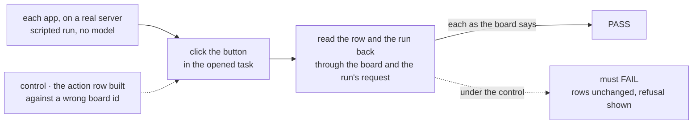
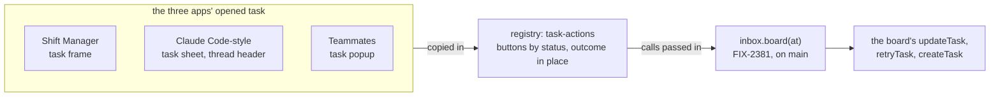

# FIX-2382 · Cancel, Steer, Retry and Re-run-on-harness buttons on task cards and sheets

**Spec** · [Decisions](DECISIONS.md)

Child of epic [FIX-2369](../../epics/FIX-2369/SPEC.md) (merged #4358). It is the buttons half of
FIX-2381, whose calls are on `main`: `inbox.board(at).cancel / steer / release / retry / refile`
([spec](../FIX-2381/SPEC.md), merged #4373; package and Shift Manager's `taskActions` getter
merged, #4643). The buttons go in the opened task, not on the cards in a list
([D1](DECISIONS.md#d1)), whatever the issue title says. It amends [FIX-2153 D2](../FIX-2153/DECISIONS.md), which kept the Claude
Code-style lab's tasks pane read only ([D1](DECISIONS.md#d1)).

## Who feels it, before and after

| Someone who… | Today | After |
|---|---|---|
| **watches a 20-minute coding run go wrong**, in either lab | Types "stop that task" to the main session or Chief of Staff and waits for a model turn | Opens the task, presses **Cancel**, confirms once, and sees *cancelled*. The run stops |
| **cancels a task other tasks wait on** | Learns which ones went with it only by finding them | The confirm says tasks waiting on it go too, and the outcome names the ones that did. A later Retry brings back this task only |
| **wants to nudge a running task** from the lab's tasks pane or a Teammates popup | Can't: the sheet says *Read only, ask the main session*, and the popup has no box | Types one line in **Steer**. It reaches the run, and stays under the task after a reload (FIX-2530) |
| **has a task that failed** | Sees *failed*: no reason in Shift Manager or the Claude Code-style lab, and in Teammates the error sits in the green *Result* box. Asks a model to try again | Sees the error as an error, presses **Retry**, and the same task runs again with its history and spend kept (FIX-2383) |
| **had a Cursor task fail in Teammates** because Cursor isn't set up | Says "try with Claude" and waits for Chief of Staff to cancel and re-file | Presses **Re-run on Claude Code**. One new task starts on `teammates.claude-code`, its brief naming the failed one |
| **sees a held task in Shift Manager** | Sees the *held* tag, with no way to release it | Presses **Release**, and the row goes back to pending |
| **presses Re-run twice** | n/a | The second press shows the board's own refusal (`already_open`). One task, nothing else written |

## The goal, and how we'll know it's met

**In Shift Manager, the Claude Code-style lab and the Teammates lab, a person stops, steers,
retries, releases and re-runs a task from the task itself, with no model turn in between, and
sees each outcome, or the board's refusal, in place.**

- **The real need**, in the issue's words: stopping a runaway run, steering it, retrying a failed
  task or switching harness "costs a typed model turn, which may go wrong". The buttons take the
  model off that path.
- **Smaller, and rejected:** buttons in Shift Manager only. The epic's closure (FIX-2425) runs a
  real change in each app, and both labs carry the *ask the main session* note this removes.
- **Cut from the issue, with reasons:** Re-run in Shift Manager (its team has one coder, so there
  is nothing to switch to; [D2](DECISIONS.md#d2)); the error in Shift Manager's Inbox (it lists
  open holds, and an errored row has none; E3).
- **Not done if:**
  - a button only looks right: the row read back through the board doesn't change;
  - Cancel marks the row cancelled while the coding run keeps working, or the row then reads
    *failed* (FIX-2349's symptom, fixed in #4239; the Cancel leg guards it);
  - a re-run starts two tasks, or one whose result never reaches the conversation that filed the
    first, or drops the old brief;
  - an app outside orchestration still spells `updateTask_tasks` (FIX-2514, which lands here);
  - an errored task shows no reason, or shows it as a result.

**How we verify.** One goal check per app, driven in a browser by clicks and graded on the
board's rows and the run's request record. The page is checked only for the board's own refusal
words:

- **Teammates lab** (a harness-manager run, so this is where *the run stops* is proved): in a
  coding task's popup, Steer it (its row's steers hold the words), Cancel it (the row reads
  `cancelled` and the run's request leaves `in_progress` within one steer poll, with no step
  after), Re-run on another harness (one new row on that worker, its context the old context
  plus a line naming the old title, the old row unchanged, and its result reaching Chief of
  Staff's conversation), then Re-run on the same harness again (the board's `already_open` words
  show, and no row is added).
- **Claude Code-style lab:** in the tasks pane's sheet, Steer, Cancel, then Retry a task (same
  id, `pending`, then running again). A failed task's sheet shows its error.
- **Shift Manager**, extending `goals/shift-manager/it-shows-and-stops-a-task-run`: the fixture
  gains a row filed `held` (`createTask({ held: true })`) and an errored row. Release the held
  row (it reads `pending`). Cancel a running stub (the row reads `cancelled`, and its run stops
  within the lease's bound; the stub isn't harness-manager's, so not within a poll). Retry it
  (same id, `pending`). The errored row's error is on its task frame and its Tasks row. The
  goal's word for a running stub becomes *running*, not *held*, so it can't be read as the
  board's `held`.
- **Controls that must fail:** each app's action row built against the wrong board id (`"plan"`
  for `"tasks"`): every leg red, the refusal on the page. In Teammates, Re-run bound to another
  session: the *result reaches Chief of Staff* leg red.
- **Unit:** the registry component's screen tests pick buttons by status, name the dependents a
  cancel took, show a refusal, and hold a button busy while its call runs.

## What changes

- **One shared action row, `task-actions`, in the UI registry** ([D1](DECISIONS.md#d1)), copied
  into each app with `fsdev ui add`, as `review-hold` is. By the row's board status it draws:
  - while open (`pending`, `held`, `in_progress`): **Cancel**, confirmed once inline
    ([D3](DECISIONS.md#d3)), and a one-line **Steer** box where the view has no composer;
  - while `held`: **Release** too;
  - after `errored` or `cancelled`: **Retry**, and one **Re-run on ‹harness›** per option the
    app passes ([D2](DECISIONS.md#d2));
  - each press shows busy, then its outcome or the board's refusal in place. It takes the calls
    as props and imports no package.
- **An errored task's reason shows as an error,** drawn with the registry's `error` body
  (`ErrorBody`), which every app already has, not a new style.
- **Shift Manager** (`TaskFrame.tsx` header, beside Interrupt): the reader's `taskActions`. The
  errored row's `error` shows as a banner in the frame and a line on its Tasks row. *Hand off*,
  *Reassign* and *Open PR* stay as they are.
- **Claude Code-style lab** (`TasksPane.tsx` sheet, `ThreadView.tsx` header): the adapter gains
  the task actions and carries the row's `error`. `sayInThread`'s steer calls `steer`; the
  adapter's `run` stays for pins and projects. Its `UPDATE_TASK_ACTION` becomes `taskActionName`
  for the Inbox holder (FIX-2514). The *ask the main session* notes go.
- **Teammates lab** (`TaskPopup` in `Popups.tsx`): the adapter gains the task actions, and its
  task carries the board status and the fields `refile` copies, beside the shown `running`. An
  error shows as an error, not in *Result*. Re-run options come from the roster's coding workers.
  `UPDATE_TASK` becomes `taskActionName` (FIX-2514). The task line in the thread stays one click
  that opens it.
- **No package code changes.** FIX-2381, FIX-2383 and #4239 (FIX-2349, FIX-2350) shipped what
  this uses.
- **Docs:** the UI registry's component list gains `task-actions`; the epic's guide (*building a
  workforce app from the packages*, FIX-2387) names it beside `review-hold`. No page of its own.

## What stays as it is

What the board allows and refuses, and its words. Shift Manager's Interrupt (it aborts the
request; Cancel ends the task) and its composer. The lab's thread composer, Resolve and Request
changes, and its script's step 5, which still proves the main session can cancel and steer.
Answering a task's question or review (`answerOne`, `review-hold`). Chief of Staff's rules for a
switch asked in words. Shift Manager's EM still reports a failed task: the person can now retry it.

## What's already here, and the debt

This would be the **second** way for a person to change a task from a page. The first is the
DevTool's Tasks tab (`packages/devtool/src/react/lib/task-actions.ts`), which offers any flow
action on a row, for developers; it stays. The job's mechanism rows are `task-board` and `inbox`
in `docs/mechanisms/mechanisms.yaml`, and every call here is the `inbox` row's.

| Piece | What this does with it |
|---|---|
| FIX-2381's `inbox.board(at)` (`BoardActions`), and Shift Manager's `taskActions` | **Reuses.** Every button is one of its calls |
| FIX-2383's retry verb; `refile` (FIX-2381 D3) | **Reuses**, Re-run overriding `assignee` and extending `context` |
| The registry's `review-hold`, in all three apps | **Precedent.** `task-actions` sits beside it the same way |
| The registry's `request-recovery` (FIX-2370, ER-4's owner) | **Distinct.** It recovers a failed *request* and re-sends it; this changes a *task* on its board. Shares its look through `ErrorBody` |
| The registry's `error` (`ErrorBody`) | **Reuses** for the error banner and line |
| FIX-2153 D2 (the pane is read only) | **Amended** ([D1](DECISIONS.md#d1)) |
| The labs' `UPDATE_TASK_ACTION`, `UPDATE_TASK` and the steer through `run` | **Replaced** with `taskActionName` and `steer` (FIX-2514) |
| The labs' *ask the main session* notes | **Removed** |
| The DevTool's Tasks-tab actions | **Left.** A developer tool, generic over a flow's actions by design |

**Builds on / Adds.** Adds one registry component, `task-actions`. Considered: each app's own
buttons (the copies the epic's D4 forbids), extending `review-hold` (it answers a stop) and
extending `request-recovery` (it re-sends a request). Everything else is wiring an existing call.

**Adds:** one registry component. **Removes:** two copies of the action name, one steer path, the
*ask the main session* notes, and in Shift Manager two LLM hops per recovery. **Debt:** a re-run
records the task it re-ran only in its context's words (FIX-2381 D3's debt, unchanged).
**Net:** smaller.

## Sign off

**The goal, at that size.** Three apps, five actions, each outcome read back from the board.
*If wrong:* we ship buttons in one app and the closure finds the other two still asking a model.

**The debt: net down.** One registry component added; the action-name copies, a steer path and
the *ask the main session* notes removed. *If wrong:* a fourth app writes its own buttons again.

- **[D1](DECISIONS.md#d1) · The buttons live in the opened task, from one registry component,
  and the lab's pane stops being read only.** The one to weigh: it reverses FIX-2153 D2.
  *If wrong:* the lab no longer shows that every change goes through the main session.
- **[D2](DECISIONS.md#d2) · Re-run on another harness files a new task; the failed one stays.**
  *If wrong:* two rows for one piece of work, and a lineage field later.
- **[D3](DECISIONS.md#d3) · Cancel asks once, naming what goes with it.** *If wrong:* one extra
  click on every cancel, or, the other way, a misclick that ends a 20-minute run.

Feature · Shift Manager, both labs, `packages/ui` registry · medium · one PR per app on the epic's
stacks, from `main`, the registry component in the first (Shift Manager's)
