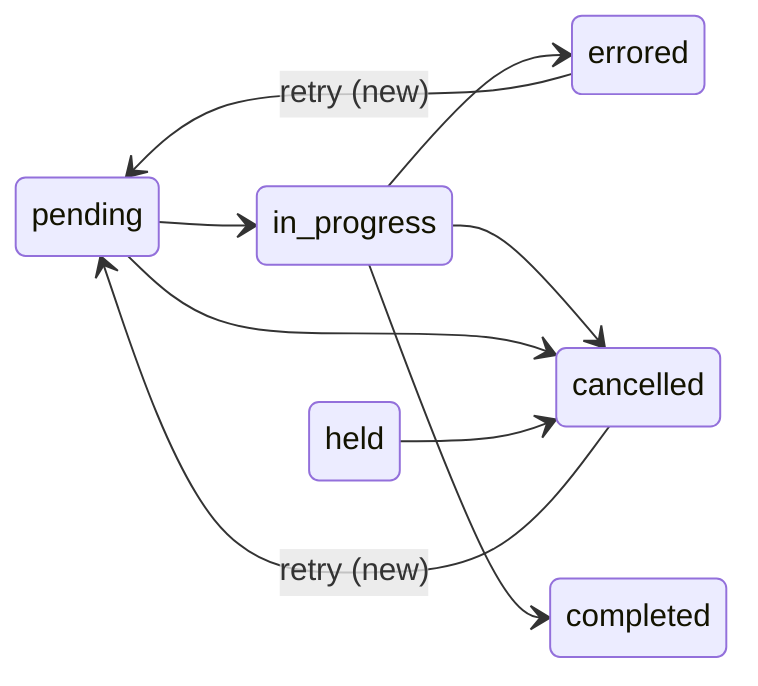

# FIX-2383 · Retry a failed or cancelled task, keeping the task

**Spec** · [Decisions](DECISIONS.md)

## Who feels it, before and after

| Someone who… | Today | After |
|---|---|---|
| **presses Retry on a failed task** (Shift Manager, Teammates, the Claude Code-style lab, once FIX-2382 adds the button) | No verb exists. An app can only file a new task: a new id, an empty history, spend starting at zero, and its own attempt budget | The same task goes back to waiting and runs again: same id, same steers and earlier output on its page, spend adding up, one more attempt counted |
| **cancelled a task by mistake** | Gone for good; filing it again loses the conversation it had | Retry brings it back the same way |
| **watches a board** (DevTool, an app's task list) | — | Sees a `retry_requested` change, then the usual `claimed` when it starts |
| **is a model filing tasks** | Files a follow-up for more work | Unchanged. Retry is a person's or an app's move; a model doesn't get it ([D2](DECISIONS.md#d2)) |
| **completed a task and wants it again** | Files a follow-up (`followUpOf`) | Unchanged. A completed task's output never changes; Re-run (FIX-2382) is a follow-up |

## The goal, and how we'll know it's met

**A person can put an `errored` or `cancelled` task back to `pending` from outside the run, and
it keeps its id, its history and its spend, with the extra attempt counted in the board's one
retry ledger.**

- **Smaller, and rejected:** each app files a new row on Retry. It loses history and spend, and
  every app writes it again. That's the issue.
- **Bigger, and not this issue's:** the browser call in orchestration's `./inbox` (FIX-2381, which
  stacks on this), the buttons (FIX-2382), retrying a whole plan's skipped steps at once, and
  giving a model a bounded retry.
- **Not done if:** a retried task gets a new id, loses its steers or spend, or a retry of a
  completed task writes anything.

**How we verify.**

- **Unit, both backings** (`packages/orchestration/test`): an errored task and a cancelled one
  each come back `pending` with the same id, `steers`, `spend` and items window, `error` cleared,
  `retryLedger.granted` up by one, and run once more: a second failure settles `errored` again.
  Refused, with nothing written: a `completed`, `pending`, `in_progress` or `held` row; a row
  whose dependency is itself `errored` or `cancelled` (it could never start); a state-backed
  board whose `maxTotalRetries` is spent.
- **The second ending tells the filer again.** A filed task that failed, was retried, and failed
  again produces two notices, keyed by attempt, not one swallowed as a duplicate.
- **Action test:** `retryTask_<suffix>` exists in `taskToolActions` and not in the model's
  `taskTools`; it answers `{ ok: false, error }` naming the rule for each refusal above.
- **Control that must fail:** with the transition left out of the retry write, the errored-task
  test fails (the status stays `errored`); with `granted` not incremented, the ledger test fails.

## What changes

- **A collection verb, `retry(id)`**, on `TaskCollectionRef`, on both backings
  ([D1](DECISIONS.md#d1)). One atomic write: `errored` or `cancelled` → `pending`, a failure's `error` moves
  to `feedback` (as a soft retry already does; a cancel's reason is cleared), `retryLedger.granted` + 1, and a `retry_requested`
  task-change. It is not an ending: no cascade, no notice, no recorder. Optional on the interface,
  so a ref written before it keeps compiling (BP-030); a retry on a board without it is refused.
- **One more attempt, whatever was left** ([D3](DECISIONS.md#d3)). The next claim takes attempt
  `attempts + 1`, and `maxAttempts` is not changed: a task that had tries left still has them, and
  one that had none gets exactly this one.
- **A `retryTask_<suffix>` action** in `taskToolActions`, built only for actions
  ([D2](DECISIONS.md#d2)). It acts as the signed-in user, reaches the row the way the action's
  cancel does, and on a board that starts ready rows at once starts it the way a release does.
- **Workforce's conversation board starts a retried row at once**, as it does a released one, so
  Retry in Shift Manager or Teammates runs the task without another touch of the board.
- **Refusals name the rule and the move**: a completed task points at a follow-up; a row whose
  dependency ended points at retrying that dependency first.
- **Docs:** orchestration README (the verb, the action, the state machine) and the task-board docs
  page that lists the lifecycle.

## What stays as it is

The status table every other write goes through (`ALLOWED_TRANSITIONS`): terminal stays terminal
for `fail`, `cancel`, `patchSettings`, a release and the claim gate. `completed` never reopens. The
model's four task tools. The cascade: dependents a failure skipped stay cancelled until each is
retried. Core, engine, client and react (ER-1). harness-manager code.

## What's already here, and the debt

| Piece | What this does with it |
|---|---|
| `retryLedger` and `maxTotalRetries` (`task-caps.ts`, FIX-948) | **Extends.** A person's retry is a grant in the same ledger; no second counter (epic reuse table) |
| `fail()`'s soft retry (`routeFailure`, `error` → `feedback`) | **Mirrors** its patch shape, so a worker reads a retried task the same way |
| `endingOf` (`ending.ts`) | **Unchanged.** `errored → pending` is already "no ending", which is right |
| Notice keys by `(taskId, attempt, ending)` | **Relied on**, and tested: a new attempt is a new key |
| `taskToolActions`' `claimless` build | **Extends** with one action-only tool, like `done` |
| `cascadeOwed` | **Guarded.** A row still owing a cascade is refused until the board's touch pays it, so a late payment can't cancel the retried run's work |

**Adds:** one verb, one change kind, one action, and the conversation board's start after it. **Removes:** nothing. **Debt:** on a
resource-backed board the grant is counted but not capped, as every retry there is today; a
model retry would need that cap first (D2). **Net:** small.

## Sign off

**Approve by merging.** The one call is **D3: a person's Retry always gets one more attempt, even
when the task had none left**, counted in the retry ledger. *If wrong:* refusing exhausted rows is
one guard in the write, and Retry becomes useless for single-attempt tasks, which are most of them.

Feature · `orchestration` · small · 1 PR · heads the FIX-2383 → FIX-2381 stack
