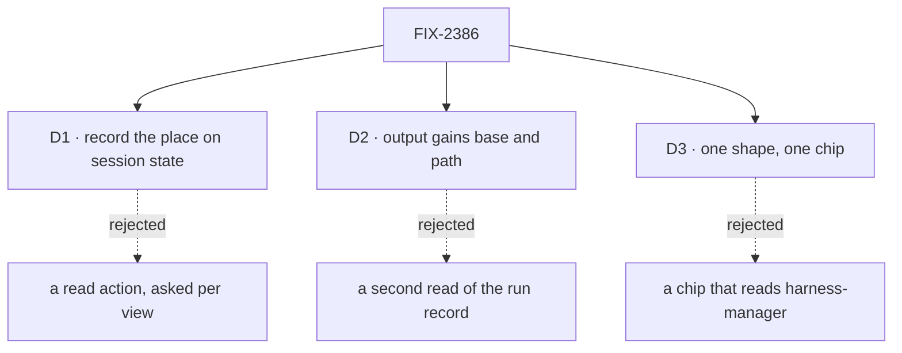

# FIX-2386 · Decisions

[Spec](SPEC.md) · **Decisions**

The epic settled where this lives (harness-manager and the ui registry, D4 of FIX-2369) and the
stack (2385 → 2386 → 2419 → 2388). What is left is how a session learns its place, what the
board output adds, and the one shape both are read through.

## D1 · A session records where it works on its own state

| | Record on state (chosen) | A read action per view |
|---|---|---|
| What the page does | Reads `clientData.session`, which it already holds | Calls an action; git runs on every open |
| After the session's worktree is deleted | The record is still there, so the chip says where it was | The read fails, and the place is gone |
| How current the count is | As of the last turn's end | Live |
| New mechanism | A field, written by the flow's own resolvers (`serverOwned`) | An action and its access rule |

- **Because:** the path and base are decided at provision and never change for the session's
  life; the session flow already writes server-owned state on every turn, and that write rides
  the session's existing change notice (FIX-2367's `client.subscribe`), so no poll is added. The count changes only
  when the harness runs, which is during a turn, so reading it at turn end misses only commits a
  person makes by hand between turns.
- **The base comes from the workspace, not the checkout.** `provision` may return
  `{ path, baseCommit }`. The workspace host already reports the commit it cut a new branch at;
  `readRunCommits` refuses to trust a base read from the checkout, for the reason in its own
  header (a run can move any named ref). A path alone still works and records `baseCommit: null`,
  so Kitchen Sink keeps compiling until its own stack adopts the new return.
- **The base is kept, never replaced.** The record takes `baseCommit` the first time `provision`
  reports one, and a later provision never overwrites it. A session stored before this change
  gets path and branch on its next turn (not on open), with no base and so no count, until the
  workspace reports one.
- **Branch and count describe the same work.** A harness can switch the checkout to a branch of
  its own, and the count reads the checkout's `HEAD`. So at turn end the flow records the branch
  `HEAD` is on beside the count it read, and the chip's branch, count and `git log` all name one
  line of work. The base stays the one recorded (review, Codex).
- **Locks in:** `workspace` on harness session state, exposed to the client and owned by the
  server. A read action, if one is ever wanted, reads the same record.

## D2 · The board manager's output gains `baseCommit` and `path`

- **Because:** the copy commands need both, and the manager's run record already holds them
  (`baseCommit`, `workspacePath`). The output is what a task row carries, so a page needs no
  second read of the run record. Both fields are bounded strings (BP-042).
- **The commit, not the ref, and one name for it.** `git log main..branch` changes meaning when
  `main` moves; the commit the branch was cut at does not. The output calls it `baseCommit`, as
  session state and the run record do, so `workPlace` maps no names (review, Architect).
- **This issue owns the place fields on the output**: `branch`, `commits`, `baseCommit`, `path`.
  FIX-2361 adds `head` and `pullRequest` beside them, and `workPlace` reads what is there. A
  follow-up keyed to its root task's run reports that run's place, and its count covers the
  root's commits too: that is the intent.
- **Defaulted to `null`** so outputs stored before this change still parse (BP-030), and `null`
  for a run with no repository, like `branch`.
- **Locks in:** two fields on the output, read through harness-manager's `./browser` entry
  (`workPlace`, D3), the one reader of a run's branch, commits, base and path. FIX-2379's
  task-row view stays in orchestration and carries none of them: orchestration can't read
  harness-manager's schema (the epic's call). An app composes the two reads.

## D3 · One shape and one chip, apart

- **`workPlace` in harness-manager's `./browser`** takes either source and returns
  `{ branch, path, baseCommit, commits }`, where `commits` is `null` when no base was recorded, and the
  commands. Only harness-manager knows both sources' fields, so the shaping lives with them.
- **The `work-place` registry chip takes plain props.** The registry copies files into apps
  (`fsdev ui add`), and a chip that imported harness-manager would pull a server package's name
  into every app that adds it. Apps call `workPlace` and pass the result.
- **Commands are shell-quoted.** A Kitchen Sink worktree lives under `XDG_STATE_HOME`, which
  can hold a space.
- **No run-record read is opened.** Everything the chip needs for a board task is on the task's
  output (`branch`, `commits`, `baseCommit`, `path`, and `review`), which the board already publishes to
  the page. The user-scoped `runs/**` record stays closed to the client, as its header says, and
  the count is the one the manager read at settle. So `readRecordedWork` gains no `run` section:
  a page passes the row's output, or the session's state, to `workPlace`.
- **Locks in:** one helper and one component. A third app adds the chip and calls the helper.

## Decided, not asked

- **E1 · Names are fixed:** `workPlace`, the `work-place` component, `state.workspace`, and
  `baseCommit` in every source (review, Cursor).
- **E2 · No subjects in the session record.** The count is what the chip shows; FIX-2384's diff
  read lists what changed.
- **E3 · The count is `readRunCommits`'s, unverified as unknown.** A count git couldn't read
  shows as unknown, never as 0.
- **E4 · The package slice touches no app file.** Kitchen Sink, Shift Manager and the Claude
  Code-style lab adopt in the stacks the epic's build order names.

## Notes from review

- Round 1 (fe4cf58). Folded: the branch recorded beside the count at turn end (Codex); one name,
  `baseCommit`, and this issue owning the output's place fields (Architect); names fixed (Cursor).
- Codex, for the implementer: the board output's `commits` is a bare count, and
  `readRunCommits` answers `0, verified: false` when git can't read the checkout. The output should
  carry that, so `workPlace` shows *unknown*, not 0 (E3).
- Cursor, for the implementer: reuse an existing shell quoter if one fits a browser leaf
  (`packages/cli/src/next-steps.ts` has `shellQuote`; the cli package is not a harness-manager
  dependency); a unit test on the turn-end count beside the goal leg; FIX-2384 edits the same
  turn-end handler, which the epic's build order names.

- FIX-2369 epic (on FIX-2379's seam): the task-row view carries no harness-manager output; a run's
  branch, commits, `base` and `path` are read through harness-manager's `./browser`. Folded into D2.
- FIX-2385 (on its `./browser` entry): asked whether a `run` section opens the run record. It
  doesn't need to; folded into D3 (the output already carries the fields).
