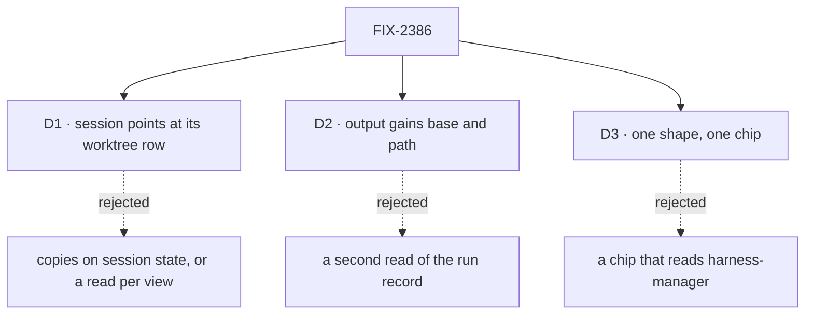

# FIX-2386 · Decisions

[Spec](SPEC.md) · **Decisions**

The epic settled where this lives (harness-manager and the ui registry, D4 of FIX-2369). The
order is now 2385 → 2419 → 2439 → 2386, with 2386 landing in FIX-2439's window. What is left is
how a session learns its place, what the board output adds, and the one shape both are read
through.

## D1 · A session points at its worktree's row

FIX-2439 adds a user-scoped `worktrees` collection, owned by the `workspace` mechanism and
written by the workspace host on provision, attach and remove. That row is the one owner of a
worktree's facts: name, path, branch, repo, `baseCommit`, owner, attached sessions, state and
the pull requests on its branch. This issue lands in the same window as FIX-2439, right after
FIX-2419, and reads the row from day one (review, amendment on this PR).

| | Pointer to the row (chosen) | Copies on session state | A read action per view |
|---|---|---|---|
| Who owns path, branch, base | The worktree row, once | The session, and later the row too | Git, on every open |
| After the worktree is removed | The row says `removed`, so the chip still says where it was | Same, until the copies drift | The read fails |
| Two sessions on one worktree | Both read one row; a non-owner shows "attached to …" | Each holds its own copy | Each runs git |
| Later migration | None | Copies move to the row | None |

- **`state.workspace` is `{ worktree }`, the row's key.** No path, branch, base or count is
  copied onto session state. The field is server-owned and exposed to the client, and its writes
  ride the session's existing change notice (FIX-2367's `client.subscribe`), so no poll is added.
- **The key is written when the session's worktree is provisioned or attached.** `provision`
  returns the row's key with the path (`{ path, worktree }`, on the one return shape FIX-2419
  and FIX-2420 also extend). The host writes the row; the session flow only stores the key.
- **Branch and count are one snapshot on the row.** The count is a fact about the worktree's
  checkout, not about one session: two sessions attached to one worktree see one `HEAD`. So the
  turn-end handler calls the workspace's `recordCheckout(place, { worktrees })` while the turn
  still holds the worktree. The host reads `HEAD`'s branch and the commits past the row's
  `baseCommit`, and writes both with `lastTurnAt` in one upsert (FIX-2439): git has one reader
  and the row one writer. Whichever session's turn ended last, the chip's branch, count and
  `git log` name one line of work (review, Codex, twice). A count git couldn't read, or a row
  with no base, is `null`: unknown, never 0. It is read only at turn end because the harness
  commits only during a turn, so it misses only commits a person makes by hand between turns.
- **This issue makes the record `{ worktree }`.** FIX-2419 adds a session `workspace` record
  and FIX-2439 adds its `worktree` key; this issue drops the record's path, branch and owner
  copies, so the shape has one owner.
- **A session stored before this change** has no key, so it shows nothing until its next turn
  provisions or attaches, which writes the row and the key.
- **Rejected: copies on session state until FIX-2439 lands.** They would show the chip sooner,
  but make the session a second owner that later needs migrating.
- **Locks in:** `workspace: { worktree }` on harness session state; the session flow reads
  FIX-2439's rows and asks the workspace host to record the checkout, never writing a row. A read action, if one is ever wanted,
  reads the same row.

## D2 · The board manager's output gains `baseCommit` and `path`

- **Because:** the copy commands need both, and the manager's run record already holds them
  (`baseCommit`, `workspacePath`). The output is what a task row carries, so a page needs no
  second read of the run record. Both fields are bounded strings (BP-042).
- **The commit, not the ref, and one name for it.** `git log main..branch` changes meaning when
  `main` moves; the commit the branch was cut at does not. The output calls it `baseCommit`, as
  session state and the run record do, so `workPlace` maps no names (review, Architect).
- **This issue owns the place fields on the output**: `branch`, `commits`, `baseCommit`, `path`.
  FIX-2361 adds `head` and `pullRequest` beside them, and `workPlace` reads what is there. A
  follow-up keyed to its root task's run reports that run's place, and its count covers the
  root's commits too: that is the intent.
- **Defaulted to `null`** so outputs stored before this change still parse (BP-030), and `null`
  for a run with no repository, like `branch`.
- **They are copies of the worktree row, not a second owner.** The run record keeps its fields
  for now; when FIX-2439's row exists, the output's place fields are taken from it.
- **Locks in:** two fields on the output, read through harness-manager's `./browser` entry
  (`workPlace`, D3), the one reader of a run's branch, commits, base and path. FIX-2379's
  task-row view stays in orchestration and carries none of them: orchestration can't read
  harness-manager's schema (the epic's call). An app composes the two reads.

## D3 · One shape and one chip, apart

- **`workPlace` in harness-manager's `./browser`** takes a task's output, or a session's
  worktree row, and returns `{ name, branch, path, baseCommit,
  state, attachedTo, commits }` and the commands. `commits` is `null` when unknown. Only
  harness-manager knows both sources' fields, so the shaping lives with them.
- **The chip reads the row's facts.** It shows the worktree's descriptive name, branch, state,
  and "attached to …" when the session is not the worktree's owner (FIX-2419 D4).
- **The `work-place` registry chip takes plain props.** The registry copies files into apps
  (`fsdev ui add`), and a chip that imported harness-manager would pull a server package's name
  into every app that adds it. Apps call `workPlace` and pass the result.
- **Commands are shell-quoted.** A Kitchen Sink worktree lives under `XDG_STATE_HOME`, which
  can hold a space.
- **No run-record read is opened.** Everything the chip needs for a board task is on the task's
  output (`branch`, `commits`, `baseCommit`, `path`, and `review`), which the board already publishes to
  the page. The user-scoped `runs/**` record stays closed to the client, as its header says, and
  the count is the one the manager read at settle. So `readRecordedWork` gains no `run` section:
  a page passes a task's output, or a session's state with its worktree row, to `workPlace`.
- **Locks in:** one helper and one component. A third app adds the chip and calls the helper.

## Decided, not asked

- **E1 · Names are fixed:** `workPlace`, the `work-place` component, `state.workspace` with
  `worktree` (the row key), and `baseCommit` in every source (review, Cursor).
- **E2 · No subjects in the session record.** The count is what the chip shows; FIX-2384's diff
  read lists what changed.
- **E3 · The count is `readRunCommits`'s, unverified as unknown.** A count git couldn't read
  shows as unknown, never as 0.
- **E4 · The package slice touches no app file.** Kitchen Sink, Shift Manager and the Claude
  Code-style lab adopt in the stacks the epic's build order names.

## Notes from review

- Round 1 (fe4cf58). Folded: the branch recorded beside the count at turn end (Codex); one name,
  `baseCommit`, and this issue owning the output's place fields (Architect); names fixed (Cursor).
- Codex, for the implementer: the board output's `commits` is a bare count, and
  `readRunCommits` answers `0, verified: false` when git can't read the checkout. The output should
  carry that, so `workPlace` shows *unknown*, not 0 (E3).
- Cursor, for the implementer: reuse an existing shell quoter if one fits a browser leaf
  (`packages/cli/src/next-steps.ts` has `shellQuote`; the cli package is not a harness-manager
  dependency); a unit test on the turn-end count beside the goal leg; FIX-2384 edits the same
  turn-end handler, which the epic's build order names.

- FIX-2369 epic (on FIX-2379's seam): the task-row view carries no harness-manager output; a run's
  branch, commits, `base` and `path` are read through harness-manager's `./browser`. Folded into D2.
- FIX-2385 (on its `./browser` entry): asked whether a `run` section opens the run record. It
  doesn't need to; folded into D3 (the output already carries the fields).
