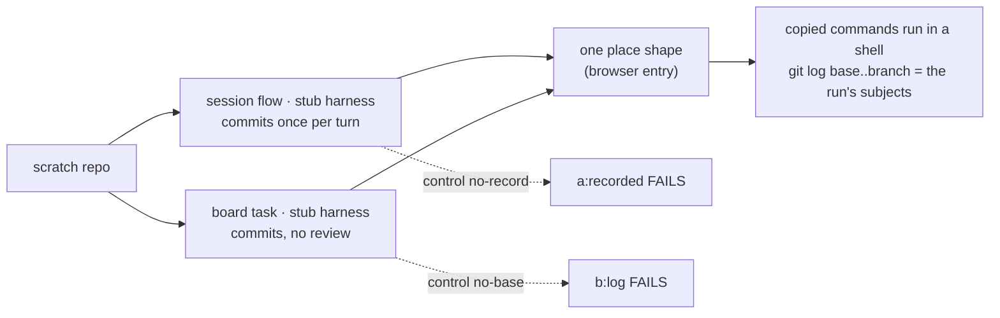
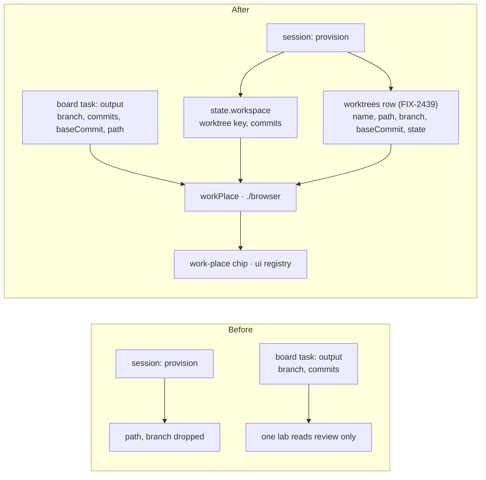

# FIX-2386 · Show where a coding run's work went

**Spec** · [Decisions](DECISIONS.md)

## Who feels it, before and after

| Someone who… | Today | After |
|---|---|---|
| **lets a coder finish in the Claude Code-style lab's Sessions view** (no review, so *Not reviewed*) | Sees the answer. The branch and commit count are in the task's output, and the lab drops them | Sees `3 commits on …/t-7f3c--code`, with copy buttons for `git switch`, `cd` and `git log base..branch` |
| **codes in a Kitchen Sink harness session** | Sees the model and a conversation id. The worktree's path and branch are computed on the server and never returned | Sees the same chip in the session header, with the worktree's name and state, counted after every turn. A session attached to another's worktree says whose |
| **opens a finished task in Shift Manager** | The task header reads nothing from the output, so the branch is in `git branch` somewhere | Sees the same chip in the task header |
| **opens a session stored before this change** | Nothing | Nothing until its next turn, which writes its worktree's row and the session's pointer to it |
| **runs a task with no repository** (kept files only) | Nothing | Nothing: there is no branch to show |
| **builds the next app** | Would copy one of three readers, or write a fourth | Reads one shape from harness-manager's browser entry and adds one registry chip |

## The goal, and how we'll know it's met

**Wherever a coding run worked, in a session or as a board task, a person can see its branch and
how many commits it made, and copy a command that takes them there, without searching git.**

- **Smaller, and rejected:** show `output.branch` in the Claude Code-style lab only. The issue
  was moved off that lab because Kitchen Sink and Shift Manager hide the same thing, and
  a session has no output to read: its worktree is never recorded at all.
- **Bigger, and not this issue's:** the diff (FIX-2384), choosing the base and removing worktrees
  (FIX-2419), and a follow-up task finding an earlier task's work (FIX-2361, which resolves a
  follow-up to its root task's run; this issue records the run, under whatever identity that
  gives it).
- **Not done if:** the copied commands, run in a shell, do not reach the branch and list the
  run's commits; or a session's count is right after its first turn and stale after its second.

Both paths end in the same shape, and the check runs the commands a person would copy.

**How we verify.**

- **Goal check (new), `goals/harness-manager/where-the-work-went`**, model-free. Leg **a**: a
  `harnessSessionFlow` over a scratch repository and the workspace package's local host, its
  harness a stub that commits one file per turn, served over HTTP. After turn 1 and turn 2, the
  session state read through the client names a worktree key, the worktrees row it points at
  names the branch, an existing path and the base it was cut at, and the count is 1, then 2. A
  second session attached to the same worktree reads the same row and shows as attached. Leg **b**: a board task through the harness-manager goal host,
  the stub committing once with no review; `getTask` output names the branch, the count, the
  base and the path. In both legs the browser entry's commands run in a real shell: `cd` lands
  on the branch, and `git log base..branch` prints exactly the stub's subjects.
- **Controls that must fail:** `GOAL_CONTROL=no-record` patches the session flow to skip storing
  the key; leg a fails **`a:recorded`**. `GOAL_CONTROL=no-base` drops the base from the manager's
  output; leg b fails **`b:log`**.
- **Unit:** the registry chip renders the count, *count unknown* when the base was never
  recorded, and nothing with no branch; the commands quote a path with spaces.

## What changes

The session gains a record of where it works; the task's output gains the two fields the
commands need; both are read through one shape and drawn by one chip.

- **The session points at its worktree** ([D1](DECISIONS.md#d1)): a server-owned,
  client-exposed `workspace` field on session state, `{ worktree, commits }`. `worktree` is the
  key of FIX-2439's row, which owns path, branch, base and state. The count is the session's
  own, read at turn end in the same `onFinished` handler that already checks the branch's pull
  requests; the branch `HEAD` is on goes to the host, which updates the row.
- **The workspace interface names the row** ([D1](DECISIONS.md#d1)): `provision` returns
  `{ path, worktree }` on the one return shape FIX-2419 and FIX-2420 also extend. A bare path
  still compiles and records no pointer.
- **Lands with FIX-2439.** The order is 2419 → 2439 → 2386, in one landing window. This issue
  adds no store.
- **The board manager's output gains `baseCommit` and `path`** ([D2](DECISIONS.md#d2)), defaulted to
  `null` so stored outputs parse (BP-030). `branch` and `commits` are already there.
- **One reader and one chip** ([D3](DECISIONS.md#d3)): harness-manager's `./browser` entry
  (FIX-2385's) exports `workPlace`, which takes session state or a task's output and returns one
  shape, and the commands for it, shell-quoted. `packages/ui/registry` gains a `work-place` chip:
  `branch · N commits` and a copy menu. It takes plain props, so the registry does not depend on
  harness-manager.
- **Apps adopt later, in their stacks** (the epic's build order): Kitchen Sink's
  `harness-session.tsx` and worktree code, Shift Manager's `TaskFrame.tsx`, and the Claude
  Code-style `adapter.ts` with its task sheet and result line. A task row carries the output
  through harness-manager's `./browser` reader, composed beside FIX-2379's task-row view, never
  an app's own reader (epic ER-4).
- **Docs:** harness-manager's README (the session state field, the two output fields, the browser
  reader) and the ui registry page for the chip.

## What stays as it is

The manager's two outcomes and when it settles; the session's model, binding and turn records;
the pull-request check and its timeout; `readRunCommits`, which both paths call as they are; how
Kitchen Sink names a session's branch and where its worktrees live.

## What's already here, and the debt

| Piece | What this does with it |
|---|---|
| `readRunCommits` (`commits.ts`) and the run record's base | **Reused** by both paths. The session flow calls it at turn end with the row's base |
| FIX-2439's `worktrees` rows | **Read**: the session stores the key and reads path, branch, base and state from the row. It never writes one |
| Manager output `branch`, `commits` | **Extended** with `baseCommit` and `path`, both from the run record the manager already keeps |
| `HarnessSessionWorkspace.provision`, `branch`, `locate` | **Extended**: `provision` returns the row key; `branch` still decides the pull-request check |
| The session flow's turn-end handler (`branchPullRequests`) | **Extended** by one call that records the count. FIX-2384's stack edits this region; merge order resolves it |
| FIX-2385's `./browser` entry | **Extended** with `workPlace` (ER-4) |
| FIX-2379's task-row view | **Left alone**: it stays in orchestration and carries no harness-manager output field (the epic's call). Apps compose `workPlace` beside it |
| The review stop's `branch`, `commits`, `subjects` (Claude Code-style `reviewStopOf`) | **Kept**. A review shows subjects for a person to judge; the chip is for finding the work. The lab's adoption reads the output, not the stop |

**Adds:** one session state field (a key and a count), two output fields, one browser helper, one registry
component. **Removes:** nothing in the package slice; each app's adoption deletes its own
partial reads (Kitchen Sink's dropped `{path, branch}`). **Debt:** the count of a session is as of
its last turn's end, not live. A commit made outside a turn shows on the next one. **Net:** small.

## Sign off

**Approve by merging.** The goal, and the debt: a session's count is as of the last turn's end.
*If wrong:* a live count is a read action, which FIX-2384's diff read already adds. The call to
weigh is [D1](DECISIONS.md#d1): the session points at FIX-2439's worktree row and lands with it.
*If wrong:* the session waits on FIX-2439 for nothing it couldn't have had sooner.

Feature · `harness-manager`, `ui` · small · package slice in 1 PR, landing after FIX-2439; app
adoption in the epic's Kitchen Sink, Shift Manager and Claude Code-style stacks · epic FIX-2369
