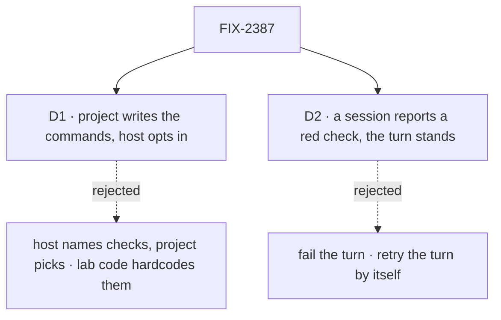

# FIX-2387 · Decisions

[Spec](SPEC.md) · **Decisions**

The epic settled the shape: a check composes into `isDone`, a failed check is *not done*, and
its output feeds the next attempt ([FIX-2369 ER-2](../../epics/FIX-2369/DECISIONS.md#who-owns-what)
and its *Decided* list). What is left to ask is who says which commands run, and what a red check
does in a session that has a person in it.

## D1 · Project members write the commands; the host decides whether they run · for sign-off

| | Project writes, host opts in (chosen) | Host names checks, project picks (the MCP shape) | Each app's code |
|---|---|---|---|
| A new repository gets checks without a host change | yes | no: each command is host config | no |
| Who can make the host run a command | a project member, only on a host that opted in | the host's operator | the app's author |
| Places to say a project's commands | one: the row | two: host config and the row | one per app |

- **Because:** the commands belong to the repository (`pnpm typecheck` here, `cargo test`
  elsewhere), and the project row is where the repository is already named. A host cannot know
  them for an arbitrary remote.
- **The trust line.** A member who can file a coding task already has an agent run code in that
  checkout. A check runs the same repository's scripts in the same checkout, so it widens that
  only where the agent runs sandboxed and the check does not. That is why nothing runs until the
  host composes `projectChecks()`: the host's operator makes that call once, for its own machine.
- **No shell.** A command is split into argv (quotes kept) and run without a shell; the write
  refuses `&&`, `|`, `;`, redirects and backticks. Two commands are two entries.
- **Locks in:** `checks: string[]` on the project row, `setChecks`, and `projectChecks()` in
  `@flow-state-dev/workforce`.

**What would change my mind:** a host that runs coding agents sandboxed and shares projects with
people it does not trust. Then the MCP shape is safer, and the field becomes names of
host-offered checks.

## D2 · In a session, a red check is reported and the turn stands · for sign-off

| | Report it (chosen) | Fail the turn | Retry the turn by itself |
|---|---|---|---|
| The person sees the output | yes, on the turn notice | yes, as an error | after the retry |
| The conversation stays as the harness left it | yes | the turn reads as failed, though the harness did what it was asked | a turn nobody asked for |
| Matches the board run | no: there, red is *not done* | closer | closest |

- **Because:** a board run has nobody watching, so the manager refuses it and tries again. A
  session has the person right there, and the next turn is theirs. Failing the turn would tell them
  the harness broke when the code did.
- **Locks in:** `verify` records, never throws. The turn record's `checks` is what a page reads.

**What would change my mind:** sessions run unattended (a scheduled session). Then `verify` takes
a choice to fail the turn.

## Decided, not asked

- **E1 · `commandCheck(phase, options)` wraps a `PhaseSpec`.** The phase's own `isDone` runs
  first; the commands run only when it passes, so a run that stopped at its limit spends no time
  on a typecheck. One call also sets `doneTimeoutMs`, so the bound and the check cannot drift.
- **E2 · `isDone` may answer `{ done, reason?, checks? }`.** A boolean settles as before. `reason`
  is appended to the not-done message, which is already the next attempt's `feedback`; no new
  carry-forward. A `done: true` with checks puts them on the review's `data`.
- **E3 · `doneTimeoutMs`** replaces the fixed minute for this phase's `isDone` when set, and
  `harnessDrainBudgetMs({ doneTimeoutMs })` reserves it in place of one `NETWORK_CALL_TIMEOUT_MS`.
  A host that does not pass it to the budget gets a shutdown that can cut a check short; the
  README says so.
- **E4 · `timeoutMs` is the budget for all the commands.** They run in order; a red one does not
  stop the rest, so the next attempt hears about every failure. A command still running when the
  budget is spent is stopped (its process group) and recorded `timedOut`; any after it are
  `skipped`, and either is red.
- **E5 · A result is** `{ command, exitCode, timedOut, skipped, durationMs, tail }`, with `tail`
  the last 4,000 characters of stdout and stderr together, colour codes taken out.
- **E6 · Where it is recorded:** the run record's `checks` (each attempt's opening write clears
  it, so a failed attempt keeps its own), the review's `data.checks`, and the session turn
  record's `checks`. The task's output does not grow (BP-042).
- **E7 · Commands run in the run's checkout with the host process's environment, under the
  checkout's lease.** The agent step lets the lease go when the agent stops; the manager takes it
  back for `isDone`, inside the same bound, because the commands write to the tree and a
  replacement attempt takes the lease before it provisions (review: Codex). A wait that outlives
  the bound means the attempt was displaced, and it fails. The agent can edit the scripts the checks run. They are evidence
  for a person, not a grader the agent cannot reach; devteam's acceptance check keeps that job.
- **E8 · `projectChecks()` answers `[]`** for a run with no project, or a refused lookup, and the
  run source refuses that run on its own. A files-only project's checks still run, in its folder.
- **E9 · One runner** serves `commandCheck` and `verify`; neither shells out on its own. It is
  `runCheckoutCommands` in `@flow-state-dev/workspace`, which harness-manager and workforce both
  depend on, so the write check (`checkoutCommandProblem`) and the run agree on what a command is.
- **E11 · `verify` is a step of the turn, not of the turn's end.** It reads the run's outcome
  (only a finished turn is checked), and the turn notice shows the checks while the turn runs.
  The turn-end sequencer FIX-2384 added (`recordTurnHead`, `branchPullRequests`) stays as it is.
- **E12 · FIX-2420's `setup` option is turned on by these app PRs.** Its own slice turns it on in
  no app; each app's adoption here adds the one line, since the checks are what need it (the
  FIX-2369 epic thread's call).
- **E10 · PRs.** The package slice (harness-manager, workforce, ui registry, the goal check) is
  stacked on FIX-2384's branch and merges after FIX-2420, as the epic's build order says. Each
  app adopts in its own stack there: Shift Manager's `TaskFrame.tsx` (wave 3), the Claude
  Code-style `adapter.ts` (wave 4, stack 3), Teammates' `host.mts` / `coder.ts` and Kitchen
  Sink's `harness-frame.tsx` (merge order).

## Considered and dropped

- **Throw `HarnessAttemptFailed` from `isDone`** to carry the output. It works today, but it reads
  as a broken check rather than a not-done run, and passing checks would have nowhere to go.
- **A `checks` field on `PhaseSpec`** that the manager runs after `isDone`. That is a second gate
  beside `isDone`, which ER-2 rules out.
- **Checks in the board's settle** (orchestration). Settlement is the board's; what *done* means is
  the phase's.

## Open

None.

## Settled

No POC. The design rests on code read on `main` at `675f61441`: `isDone`'s arm and its fixed
bound (`manager.ts`, arm 2), the not-done message as feedback, `harnessDrainBudgetMs`, the review
hold's `data`, and `runProjectOf` / `projectMcpTools()`.

## How it got here

- **Draft** — the check is a `PhaseSpec` wrapper over `isDone` (ER-2), reporting through a verdict
  object and a run-record field; the project row declares the commands and the host opts in, as
  `projectMcpTools()` does; a session reports and does not fail.

## Notes from review

None yet.

## Analysis

**2026-10-31 · watermark `675f61441`.** Run in the authoring context, not by a fresh sub-agent;
a reviewer may re-run it. **Verdict: right approach.** Reuse: every Add extends a piece already
here (`isDone`, the feedback carry-forward, the review `data`, the run record, the
`projectMcpTools()` pattern); the runner is the one new piece, shared by both callers. Prior
art: CI systems gate a merge on required checks and show each check's log, which is the shape
the review takes here. The other shape, a check stage beside `isDone`, is ER-2's rejected one.
