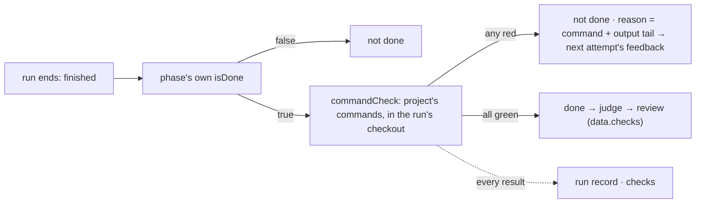

# FIX-2387 · Typecheck and tests run before a coding run is *done*

**Spec** · [Decisions](DECISIONS.md)

## Who feels it, before and after

| Someone who… | Today | After |
|---|---|---|
| **files a coding task whose run breaks the typecheck** (Shift Manager, both labs) | The run says it finished, so the task is done. The break shows up when someone checks the branch out by hand | The task is not done. Its next attempt starts with the failing command and the end of its output in the brief |
| **reviews a run's changes** (the Claude Code-style ReviewCard, Teammates' TaskPopup, Shift Manager's Checks tab) | Sees commits and the run's answer. Nothing says the code builds | Sees "Checks 2/2 passed", and opens each command's output |
| **works with a harness in a Kitchen Sink session** | A turn ends with no word on whether the code still builds | The turn notice says "Checks 1/2 failed" with the output. The turn is not failed: the person decides what to say next |
| **owns a project** | Has nowhere to say how its code is checked | Writes the project's `checks` (`pnpm typecheck`, `pnpm --filter … test`) once, on the project |
| **runs a host that does not opt in** | — | Unaffected. No command runs anywhere until a host wraps its phase or sets `verify` |

## The goal, and how we'll know it's met

**A host can make "done" mean the project's own checks passed, with one helper composed into
the phase's `isDone`, and every app on harness-manager shows the same result.**

- **Is it the right goal?** The issue's need is "nobody checks out an accepted run to test it by
  hand" (BP-003's evidence bar, for FSD's own work). Checks that only *report* would leave a red
  run marked done, so the run has to be refused, and told why.
- **Smaller, and rejected:** each lab adds `pnpm typecheck` to its own `isDone`. That is four
  copies, no output on the review, and no place for a project to say its commands.
- **Not done if:** a run whose code fails a check completes; the next attempt's brief lacks the
  output; the review shows no checks; a project's `checks` reach a host that did not opt in; or a
  check can run past the time the host's shutdown budget reserves for it.



**How we verify.**

- **Goal check (new), `goals/harness-manager/checks-gate-done`**, model-free, on the existing
  fixture host (`goals/harness-manager/host.mts`) with `harnessStub` over a scratch repository
  whose check is `node check.mjs`. Legs: **a** run 1 commits code the check rejects; the task is
  not done after attempt 1, and the run record holds the command, exit 1 and an output tail that
  carries the fixture's marker. **b** attempt 2's brief carries that tail; run 2 commits the fix,
  and the task waits on review with `data.checks` 1 of 1 passed. **c** a run that stopped at its
  limit runs no command. **d** a command past `timeoutMs` is stopped, recorded as timed out, and
  the attempt is not done. **e** `harnessSessionFlow` with `verify`: a red check is on the turn
  record and the turn is not failed.
- **Controls that must fail:** `GOAL_CONTROL=no-checks` (the helper hands the phase back
  unchanged) must fail **`a:not-done`**. `GOAL_CONTROL=drop-reason` (the manager ignores the
  verdict's reason) must fail **`b:brief-has-tail`**. Both are scratch patches, printed and refused
  when they never reached the code.
- **Unit:** the command runner (argv split, tail cut, timeout, skipped after the budget), the
  verdict read (a boolean still settles as before), `harnessDrainBudgetMs` with `doneTimeoutMs`,
  and the project row's `checks` (default `[]`, write refuses a shell operator, `projectChecks()`
  answers the run's project and nothing else).
- **Apps:** each app PR in the build order shows its view against a red and a green run.

## What changes

The host's code, before and after (the Claude Code-style lab's phase):

```diff
-const phase: PhaseSpec = {
+const phase: PhaseSpec = commandCheck({
   phase: "code",
   buildPrompt: ({ task, answers, feedback }) => …,
   isDone: ({ stopReport }) => stopReport === "finished",
-};
+}, { commands: projectChecks(), timeoutMs: 10 * 60_000 });
```

```diff
 harnessSessionFlow({
   kind: "claude-code-session",
   workspace,
   agent: (feeds) => claudeCodeAgent({ ...feeds }),
+  verify: { commands: ["pnpm typecheck"], timeoutMs: 5 * 60_000 },
 });
```

```diff
 // a project row
 { id: "storefront", repository: "https://github.com/acme/storefront.git",
+  checks: ["pnpm typecheck", "pnpm --filter storefront test"] }
```

- **harness-manager.** `commandCheck(phase, { commands, timeoutMs })` hands back the phase with
  its `isDone` composed: the phase's own check first, then the commands in the run's checkout. It
  sets the phase's new `doneTimeoutMs`, which bounds `isDone` in place of the fixed minute and which
  `harnessDrainBudgetMs({ doneTimeoutMs })` reserves. `isDone` may now answer
  `{ done, reason?, checks? }` as well as a boolean: `reason` is added to the not-done feedback,
  and `checks` goes on the run record (every attempt) and on the review's `data`.
  `harnessSessionFlow` takes `verify` (the same options) and records `checks` on the turn
  record. One runner serves both, and it lives in `@flow-state-dev/workspace`
  (`runCheckoutCommands`, beside the package's one process door), where FIX-2420's setup command
  runs too and where workforce's write check reads what a command may be.
- **workforce.** The project row gains `checks: string[]` (default `[]`, client-exposed), a
  `setChecks` write beside `setMcpServers`, `checks` on create, and `projectChecks()`: the run's
  project's commands, read with `runProjectOf` as `projectMcpTools()` reads its servers.
- **ui registry.** A `checks` component: "Checks n/m passed", red when any failed, each command's
  output tail behind a toggle.
- **Apps, in the build order:** Shift Manager's Checks tab, the Claude Code-style ReviewCard,
  Teammates' TaskPopup and Kitchen Sink's turn notice render the component; both labs' prompt
  builders add `feedback`; a red result holds back the default focus on Resolve. Each app's
  workspace host also turns on FIX-2420's `setup: { command }` (for example `pnpm install`) in
  the same PR, since the checks need the dependencies; Kitchen Sink's turn notice also says when
  `turn.setup` failed.
- **Docs:** `packages/harness-manager/README.md` and `apps/docs/docs/orchestration/harness-manager.md`
  (a *Checking the work with commands* section beside *Checking the work with a judge*, and
  `verify` under the session flow); `packages/workforce/README.md` and
  `apps/docs/docs/workforce/projects.md` (`checks` on *The row*, a *Checks a project's coding work
  runs* section beside *Tools a project's coding work gets*); the ui registry's component list.

## What stays as it is

`isDone` and the judge stay the one way a run is judged (ER-2): no gate beside them, and a host
that writes no `commandCheck` runs no command. A boolean `isDone` settles exactly as today. The
review hold, the retry budget, the feedback carry-forward and the checkout lease are unchanged.
Core, engine, client and react gain nothing (ER-1).

## What's already here, and the debt

| Piece | What this does with it |
|---|---|
| `PhaseSpec.isDone` and its fixed `NETWORK_CALL_TIMEOUT_MS` bound (`manager.ts` arm 2) | **Extends:** a verdict object beside the boolean, and `doneTimeoutMs` for the bound |
| The board's `feedback` carry-forward (`fail()` → `PhaseRunContext.feedback`) | **Reuses:** the reason rides the existing not-done message |
| The judge (`HarnessJudge`) | **Kept** as is. It reads a run the checks passed; it is information, the checks are a gate |
| The review hold's `data` (FIX-2163; FIX-2384 adds numstat) | **Extends:** `checks` beside the commits and the diff |
| `projectMcpTools()` and `runProjectOf` (`workforce/src/projects`) | **Pattern reused:** the project names, the host opts in, one read of server-written data (BP-031) |
| Shift Manager's devteam acceptance check (`teams/devteam/acceptance.mts`) | **Kept.** It is a lab grader the agent cannot reach; project checks run the repository's own scripts and are evidence for a person, not a grader |
| FIX-2420's setup hook | **Depends on:** a fresh worktree has no `node_modules` until it runs, so this merges after it |
| Jobs search: *decide whether a run is done* | `isDone`, the judge, devteam's acceptance check. This is the 4th, and it composes into the 1st rather than standing beside it |

**Adds:** one helper and one runner in harness-manager, a verdict shape and a timeout field on
`PhaseSpec`, a session-flow option, a project field with its write and resolver, a registry
component. **Removes:** nothing yet; the app PRs delete nothing either, since no app checks today.
**Debt:** `doneTimeoutMs` is a number the helper sets and a host could set wrong by hand
(permanent by design: only the phase knows how long its check takes). **Net:** small up.

## Sign off

**Approve by merging.** The goal: *done* means the project's checks passed, through one helper
in `isDone`. *If wrong:* a host drops the wrapper and settles as today.

The debt: small up, a helper, a verdict shape and a project field; nothing removed. *If wrong:*
the verdict shape is additive and a boolean keeps working.

1. **Project members write the commands; the host decides whether they run** ([D1](DECISIONS.md#d1)).
   *If wrong:* hosts name checks and projects pick from them, as MCP servers work; the field
   becomes names.
2. **In a session, a red check is reported, not a failed turn** ([D2](DECISIONS.md#d2)). *If
   wrong:* `verify` gains a `failTurn` choice.

Feature · `harness-manager`, `workforce`, `ui` · medium · package slice stacked on FIX-2384,
merges after FIX-2420; app PRs per the epic's build order · epic FIX-2369 (ER-2)
