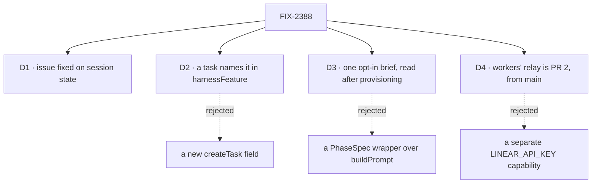

# FIX-2388 · Decisions

[Spec](SPEC.md) · **Decisions**

The epic settled where this lives (harness-manager for the issue, workforce for the relay), that
the brief is opt-in (ER-2), and the stack (2385 → 2386 → 2419 → 2388). What is left is where each
entry holds the issue, how a task names one, and what the brief reads.

## D1 · A session is born with its issue, like its model and start

- **Because:** a session is one conversation on one branch, and the branch is cut on the first
  turn. An issue named on turn five could change neither.
- **Shape:** `issue?: string`, `.readonly()`, a tracker key (`FIX-2165`): letters, digits, single
  `-` or `_`, no dots or slashes, so it can be a path segment and a ref component.
  `createCheck` refuses anything else by name. Absent on every stored session (BP-030).
- **The host names the branch.** `HarnessSessionPlace.issue` hands it to `provision`, `locate`
  and `branch`; the package doesn't pick a host's branch names. Kitchen Sink's adoption leads its
  session branch with it.

## D2 · A task names its issue under `harnessFeature`, phase optional

| | `harnessFeature: { issue }` (chosen) | A new `issue` field on `createTask` |
|---|---|---|
| Packages touched | harness-manager | orchestration's task row and tools, then harness-manager |
| Collides with a filer's own `input.issue` | No: the key is namespaced (FIX-2282) | No |
| How a lead learns it | Its WORKER.md | The tool's schema |

- **Because:** the key already exists for exactly this, and an `issue` on every task row is a
  board-wide noun that only coding work reads. A lead learns one input shape from its
  `WORKER.md`, the way it learns its assignees today.
- **The branch on a board read from the claim** leads with the issue and keeps the task-id leaf:
  `conductor/<scope>/<issue>--<task-id>--<phase>`. The task id keeps two tasks on one issue
  apart; the issue makes the branch say what it is for. Run topics and checkout paths don't
  change, so a record is found where it was.
- **A run already under way keeps its branch.** `locationFor` already keeps a pre-organization
  run on its recorded branch; it does the same for a recorded branch without the issue.
- **Still refused:** a phase with no issue, and a phase that isn't the manager's.

## D3 · One opt-in brief, read from the run's checkout after provisioning

- **Because:** the board builds the phase prompt *before* the checkout exists, so a wrapper over
  `buildPrompt` couldn't read the file on a first attempt. The manager already adds a section
  after provisioning (`heldPromptSection`); the spec section goes beside it, at the top.
- **One reader, two options.** `issueSpec: true | { path }` on `harnessSessionFlow` and on
  `harnessManager`; `path` maps an issue to a repository-relative file, default
  `specs/issues/<ISSUE>/SPEC.md`. Off by default (ER-2).
- **What it says:** the issue and the file's text, cut at a cap with a line saying so. A missing
  file is one line ("no spec at …"), never a failed run: an issue filed without a spec is
  ordinary.
- **When:** a session, on each turn until the harness confirms a conversation; after that the
  conversation already has it. A board run, on every attempt, since an attempt may start cold.
- **Locks in:** one option and one section.

## D4 · Workers' Linear relay is PR 2, from `main`

- **Because:** it touches workforce only, not the hot file this stack serialises. Built from
  `main`, it isn't held behind 2385, 2386 and 2419.
- **Shape:** a capability giving an agent or coordinator worker the project's MCP servers as
  tools, with its owner's key, through the same resolver `projectMcpTools` uses. "Read-only
  Linear on `LINEAR_API_KEY`" is that capability with the server's `seedEnv` and an allow-list
  of read tools, not a second Linear client.
- **The key-entry screen** exists in Shift Manager (`Settings.tsx`); the labs adopt it through
  the registry in their stacks.

## Decided, not asked

- **E1 · Names are the implementer's** (`issue`, `issueSpec`, `trackerIssue`), as long as there is
  one reader.
- **E2 · The package slice touches no app file.** Kitchen Sink's issue field, the labs' WORKER.md
  lines and issue chips, and Shift Manager's EM adopt in their stacks.
- **E3 · The cap is 64 KB.** Larger than any spec in this repository, small next to a context window.

## Notes from review

None yet.
