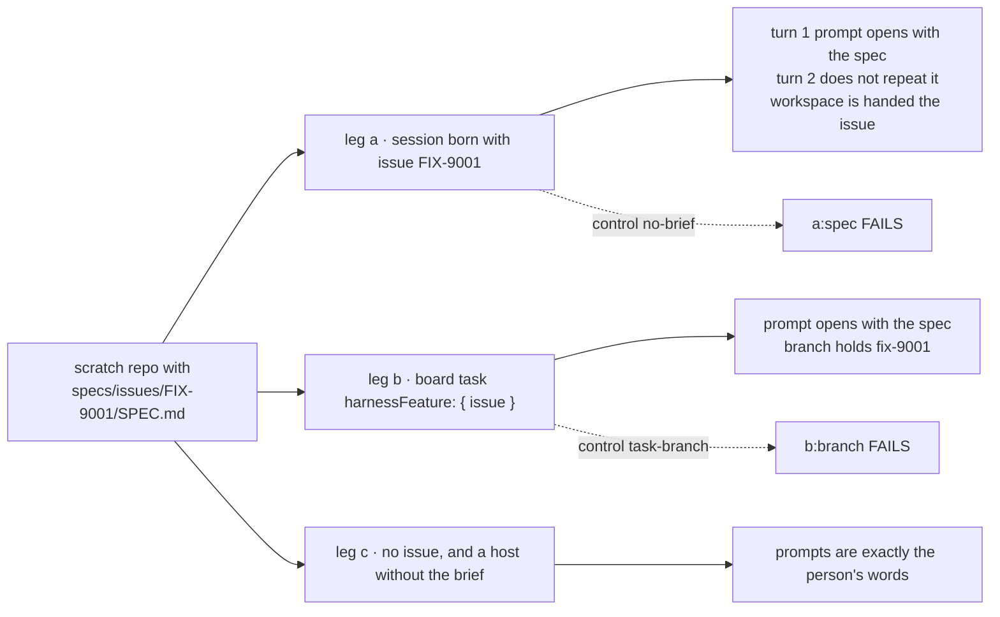
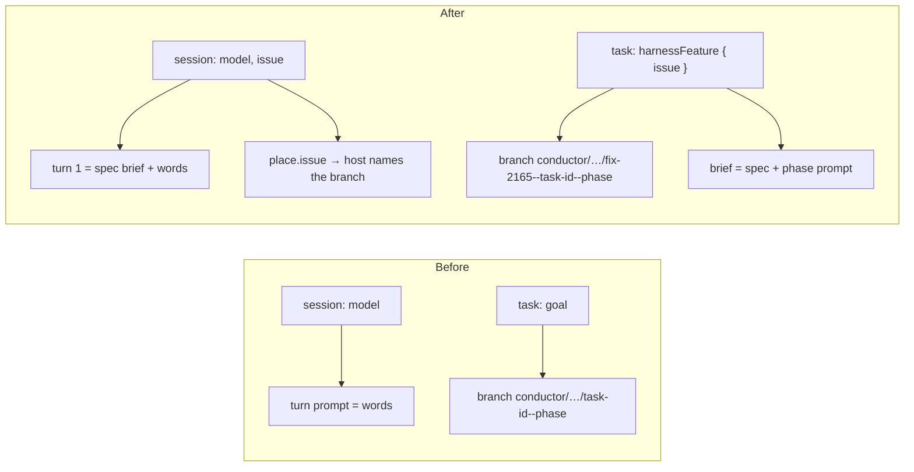

# FIX-2388 · Coding work that knows which issue it is for

**Spec** · [Decisions](DECISIONS.md)

## Who feels it, before and after

| Someone who… | Today | After |
|---|---|---|
| **tells a lead "implement FIX-2165"** in Teammates or Shift Manager | The coding task carries the goal as words. Its branch is named after the task id, and nothing hands the run the issue's spec. Shift Manager's EM invents a slug | The task names the issue (`harnessFeature: { issue }`). Its branch carries `fix-2165`, and the run's brief opens with `specs/issues/FIX-2165/SPEC.md` |
| **starts a Kitchen Sink harness session for an issue** | Picks a model. The session has no issue, so the person pastes the spec by hand | Picks a model and, optionally, an issue. The first turn's prompt opens with the spec; the host can name the branch after it |
| **reviews the pull request** | Can't tell from the branch which issue it was for; Linear doesn't link it | The branch name holds the issue id, which Linear's GitHub integration links |
| **builds an app that doesn't want any of this** | — | Nothing changes. The spec brief is an option a host turns on |
| **is a coding worker that wants to read Linear** | Only coding runs in Shift Manager get the project's MCP servers | Unchanged by PR 1. PR 2 gives agent and coordinator workers the same project servers as tools ([D4](DECISIONS.md#d4)) |

## The goal, and how we'll know it's met

**A coding run can be told which issue it is for, and then works on a branch named after the
issue with the issue's spec in its brief.** Both of harness-manager's coding entries take it: the
session flow (Kitchen Sink) and the board manager (Teammates, Shift Manager, the Claude Code-style
lab).

- **Smaller, and rejected:** a WORKER.md line telling the lead to paste the spec into the goal.
  The model has to find the file, the branch still says nothing, and KS has no lead at all.
- **Bigger, and not this issue's:** filing or updating Linear issues (the error reporter already
  files through the Linear MCP server); opening the PR (FIX-1768); each app's issue form and chip
  (the app stacks in the epic's build order).
- **Not done if:** a session or task names an issue and the first prompt lacks its spec; a later
  turn of the same session repeats the spec; a run with no issue, or a host that didn't turn the
  brief on, gets any of it; or a claim-board row already under way moves to a new branch.

**How we verify.**

- **Goal check (new), `goals/harness-manager/issue-aware-run`**, model-free. A stub harness that
  records each prompt it is handed, over a scratch git repository holding a known SPEC.md. Leg
  **a**: a `harnessSessionFlow` session created with `issue: "FIX-9001"`; the first turn's prompt
  contains the spec's text, the second turn's does not, and the workspace's `provision` saw
  `place.issue`. Leg **b**: a `harnessManager` run on a board read from the claim, the task's
  input `{ harnessFeature: { issue: "FIX-9001" } }`; its prompt contains the spec and its branch
  contains `fix-9001`. Leg **c**: the same two flows with no issue, and with the brief off; every
  prompt is the person's words alone.
- **Controls that must fail:** `GOAL_CONTROL=no-brief` drops the brief from both entries; leg a
  fails **`a:spec`**. `GOAL_CONTROL=task-branch` names the branch from the task id only; leg b
  fails **`b:branch`**.
- **Unit:** the issue grammar refusing a path-climbing value at create; a session's `issue` fixed
  after create; a missing SPEC.md said in one line, never an error; a SPEC.md over the cap cut
  with a note; a claim-board row whose record names the task-id branch keeping it.

## What changes

The issue is one more thing a session is born with, and one more thing a task can name; the spec
brief is an option both entries share.

- **The session is born with its issue** ([D1](DECISIONS.md#d1)): optional `issue` on harness
  session state, read-only like `model`, checked by `createCheck`. It reaches the workspace on
  `HarnessSessionPlace.issue`, so a host can name the branch after it.
- **A task names its issue under the key that already exists** ([D2](DECISIONS.md#d2)):
  `harnessFeature: { issue }`, the phase now optional (it defaults to the manager's). On a board
  read from the claim the branch leads with the issue and keeps the task id, so two tasks on one
  issue never share a branch. A row whose record names its old branch keeps it (BP-030).
- **The spec brief is opt-in** ([D3](DECISIONS.md#d3), epic ER-2): an `issueSpec` option on
  `harnessSessionFlow` and `harnessManager`, and one reader under it. The section is read from
  the run's own checkout once it is provisioned, and opens the brief. A session gets it on turns
  until the harness confirms a conversation; a board run gets it on every attempt.
- **Phases see the issue**: `PhaseRunContext.trackerIssue`, the issue the task named or `null`.
- **Docs:** harness-manager README; the harness-manager docs page.

## What stays as it is

Fixed boards: their rows already carry `{ issue, phase }` and their branches are already named
for it. Run topics and checkout paths on every board, so every run record is found where it was.
`createTask`'s fields. How a session's model, start and binding work. `projectMcpTools` and the
coding run's MCP relay.

## What's already here, and the debt

| Piece | What this does with it |
|---|---|
| `HARNESS_FEATURE_KEY` and its parse (FIX-2282) | **Extended**: `phase` optional. Still refused with a phase and no issue |
| `locationFor`, which keeps a pre-organization run on its recorded branch | **Extended** the same way for a claim-board run's pre-issue branch |
| `model`'s read-only create field and `createCheck`; FIX-2419's `start` | **Extended** with `issue` the same way |
| `heldPromptSection`, the after-provision brief section | **Reused** as the place the spec section is added |
| `projectMcpTools`, called by Shift Manager's devteam host (`host.mts:797`) | **Reused** in PR 2 for workers; the labs and KS wire it in their stacks |
| Teammates README's "a task with an `issue` field is refused" (FIX-2282) | **Removed** in Teammates' adoption PR: plain `input.issue` is the filer's already |

**Adds:** one session field, one place field, one option on two entries, one reader, one phase
field, and a branch rule for claim boards. **Removes:** nothing in the package. **Debt:** the spec
path is a convention (`specs/issues/<ID>/SPEC.md`, overridable); a repository that keeps specs
elsewhere passes its own path. **Net:** small, in harness-manager.

## Sign off

**Approve by merging.** The goal, and the debt above. The call to weigh is
[D2](DECISIONS.md#d2): a task names its issue through the existing `harnessFeature` key rather
than a new `createTask` field. *If wrong:* a field on `createTask` later writes the same key;
nothing in harness-manager moves.

Feature · `harness-manager` (PR 1), `workforce` (PR 2) · small · PR 1 stacked on FIX-2419, PR 2
from `main` · epic FIX-2369
