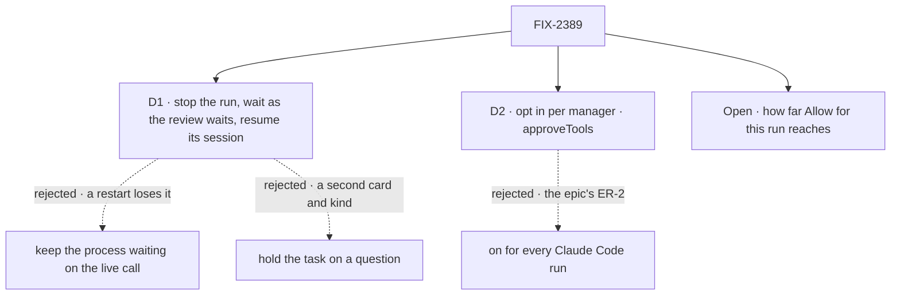

# FIX-2389 · Decisions

[Spec](SPEC.md) · **Decisions**

One decision is the sign-off surface, and one question is open. D2 is an engineering call the
epic already made, recorded so nobody reopens it.

## The tree

## D1 · An approval stops the run, waits as the run's suspension, and resumes its coding session after the answer · for sign-off

| | |
|---|---|
| **Instead of** | Keeping the harness process up, waiting on the live `canUseTool` call until someone answers · or holding the task on a question that ends the turn (the ask step) |
| **Because** | Only a wait with nothing alive during it survives a restart, and an approval can wait overnight. The manager's review already waits this way: `suspendForUser`, mirrored by the claim gate as the task's hold (`source.kind: "suspension"`, `ask.kind: "approval"`), listed by the Inbox, answered approve or reject over the one answer route, drawn by the registry `approval` card. A question hold would need a new row kind or a bent `confirm`, and a second card, which the epic forbids |
| **Locks in** | Each approval costs the run a harness restart and a session resume, a few seconds, and the model asks for the call again. The answer reaches that re-issued call, not the original one, so a grant has to match it. Approvals need durable execution: a manager with them on refuses a run on a host without it, as `reviewChanges` does. This is what a person waits through on every approval, so a faster live path later is an addition, not a rewrite |

It comes down to a restart: a process kept waiting loses the question, with no record of it.

**What would change my mind:** an SDK that persists a pending permission request across a
process restart. Then the live wait would be durable too, and it is faster.

## D2 · Approvals are opt-in per manager, `approveTools: true` · engineering, decided

| | |
|---|---|
| **Instead of** | On for every Claude Code run a manager drives · or a policy object (which tools, which paths) |
| **Because** | The epic's ER-2: optional behaviour is something a host opts into, and no child changes a default. The flag mirrors `reviewChanges`, the manager's other stop. What is pre-allowed already has a home: the harness's own `allowedTools` and `permissionMode` |
| **Locks in** | The public name `approveTools`. A host turns it on and wires `onToolApproval: feeds.onToolApproval` into its Claude Code slot; the feed is absent when the option is off |

## Decided, not asked

- **One stop path.** The park stops the harness step through the stop it already composes (a
  steer's), and the next step resumes the session the attempt confirmed, as `stepForSteer`
  does, with the checkout taken again. No new abort path, and no second resume.
- **One bound.** Approval steps go round the loop-back that carries steer steps. The
  implementer sizes its bound for both; past it the attempt fails, saying why. Approvals take
  no steer places on the row.
- **A deny goes on.** The session resumes, told the call was not allowed, with the person's
  note, as Claude Code's own deny does. A deadline reads as a no (`suspendForUser`'s own rule).
  A cancel records nothing and starts no step.
- **What the person sees** is the tool, what it touches (the command or the file, read with
  `progressNoteOf`'s keys, so no Claude Code input shape enters harness-manager) and the
  checkout's folder, as the stop's prompt and `data`.
- **A grant is per attempt**, on the manager's state, never on the row. A retry asks again.
- **Codex and Cursor.** Neither SDK as we wrap it offers a per-call question (Codex's
  `approvalPolicy` and Cursor's sandbox are run-wide). They ignore the feed, as a harness that
  reports no activity ignores `onActivity`. The README says approvals cover Claude Code only.
- **The feed type lives in harness-manager**, not in core's harness contract, because ER-1 keeps
  new harness nouns out of core. If a second harness gains a per-call question, lifting it into
  the contract is an ER-1 amendment, not a quiet move.
- **The claude-code change is small**: a third decision, *held*, recorded as a call waiting on a
  person rather than "Denied tool". Its name is the implementer's.
- **The answer's shape** is the Inbox's approval answer: `{ approved, data }`, with data saying
  *for this run* on a yes. `useApproval` and the registry card send data with a yes; neither
  learns a harness noun.

## Considered and dropped

| Alternative | Why not |
|---|---|
| Live wait, falling back to stop and resume after a restart | Two paths for one wait. Faster while the process lives, and the second path is the one that must work anyway. Reconsider once D1's restart cost is measured |
| Lab and Kitchen Sink pre-allow less, with no approvals | Runs would only be refused their tools, which is why the lab leaves `default` out today |
| A new `approvals` field on the task | The epic: no storage named after approvals. The suspension mirror is already a hold |
| Confining the worktree (Codex writable roots, Claude Code's sandbox), the issue's "cheap first step" | A boundary, not an approval. FIX-2421 and FIX-1930 own it |

## Open

### How far does *Allow for this run* reach: that exact command, or every call to that tool?

**Plain terms.** After *Allow for this run*, either only the same command or file passes without
asking, or every call to that tool does, so *Allow Bash for this run* lets every later command
through.

**The trade-off.** The narrow grant asks again for `pnpm test -- foo` after allowing `pnpm test`,
so a busy run asks more. The wide one is quieter, and for Bash it puts the rest of the run back on
today's blanket access after one click.

**My recommendation:** narrow. The same tool with the same command, or the same file. Widening
later is one added choice on the card; narrowing after people rely on it breaks what they expect.

**What would change my mind:** the lab's first week showing runs asking about many near-identical
commands. Then add a *commands starting with* grant, as Claude Code's own terminal offers.

**What being wrong costs:** little. Some extra clicks, or one widening change in the manager.

It comes down to one click: tool-wide Bash is blanket access for the rest of the run.

## Settled

None built. The one premise that matters, that a stopped Claude Code session resumes and asks
for the call again when told it may, is leg **r** of the goal check: the implementer runs it
first, before building on it. The steer step already resumes a stopped session this way.

## Analysis

2026-10-31 · watermark 2026-10-31 (the epic's merge, #4358) · **Right approach.** Run in the
authoring context, not by a fresh sub-agent: this worker had no way to dispatch one. The
coordinator may re-run it before the gate.

1. **Reuse** — four Adds, all extending an existing piece ([Builds on / Adds](SPEC.md#whats-already-here-and-the-debt)).
2. **Prior art** — Claude Code's terminal and Agent SDK ask per call and offer *don't ask again*; durable-workflow engines wait for a person by stopping and replaying. Both support D1.
3. **Other shapes** — the live wait and the question hold, in D1.
4. **New factors** — open specs FIX-2390 and FIX-2379; neither changes this.
5. **Necessity** — the lab's `approval` kind is typed and never filled.
6. **Ergonomics** — one option and one feed line; a tool in `allowedTools` never asks (docs).
7. **Concerns** — Kitchen Sink's direct sessions are left out (*Leaves*).

| Finding | Changes the approach? | Disposition |
|---|---|---|
| Kitchen Sink sessions are a session's stop, not a task's hold | Scope | Recorded, *Leaves* |
| `allowedTools` silently skips the ask | No | Recorded, docs line |

## How it got here

- **Draft** — framed as a durable wait for a person on one tool call; the manager stops the run,
  waits as its review does, and resumes the session; built on `suspendForUser`, the task's
  suspension hold, the Inbox and the steer step's resume.

**Open: one**, above.
