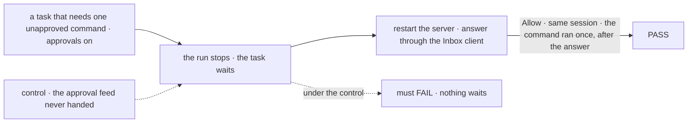

# FIX-2389 · Tool approvals as durable *Waiting on you* holds

**Spec** · [Decisions](DECISIONS.md)

## Who feels it, before and after

| Someone who… | Today | After |
|---|---|---|
| **leaves a Claude Code run working in a worktree of their own repo** | The run has blanket Bash and edits (`acceptEdits`, Bash pre-allowed). Nothing it does waits on them | With approvals on, a call that isn't pre-allowed stops the run. The task waits on them, naming the tool, the command or file, and the folder |
| **answers that approval** | n/a. `default` mode is refused, because nothing turns an approval into a wait | Allow: the same coding session goes on and the call runs. Deny: the session goes on, told it may not. Allow for this run: that call does not ask again in this run |
| **answers it the next morning, after `fsdev dev` restarted** | n/a | The approval is still listed. The answer resumes the session that asked |
| **never answers** | n/a | At the host's deadline for a person's stop, it reads as a no and the run goes on without the call. With no deadline set, it waits |
| **runs Codex or Cursor through the same manager** | Their own sandbox and approval settings apply | Unchanged. Neither SDK we wrap offers a per-call question. Confining them is FIX-2421 and FIX-1930 |
| **builds a manager without approvals** | Today's behaviour | Today's behaviour, byte for byte |

## The goal, and how we'll know it's met

**A coding run with approvals on stops at each tool call that is not already allowed, waits on
the person as a task they can see and answer, and their Allow, Deny or Allow for this run
reaches the same coding session, also after a server restart. No call runs that nobody allowed.**

| Is it the right goal? | |
|---|---|
| **The real need** | "Runs get blanket Bash under acceptEdits in a worktree of the developer's own repo, because default permission mode has nothing to turn an approval into a wait" (the issue). The epic's row: "An approval parks the run as a hold" |
| **Smaller, and rejected** | "The manager hands the harness an approval callback." The seam exists today and nothing waits on it. Or: an approval that works only while the process stays up. Either looks done while a restart loses the question |
| **Bigger, and not this issue's** | A boundary that commands cannot cross (FIX-1930). A trusted-repository policy for every harness (FIX-2421). Approvals in Kitchen Sink's direct harness sessions (below, *What stays*) |
| **Not done if** | It passes only on the stub harness · the call ran before the answer · the answer resumes a fresh session · the restart leg never ran · the lab shows nothing until a reload |



The check reads the task row, the Inbox and what the harness ran, never the manager's state.

| How we verify | |
|---|---|
| **Goal check** | `goals/harness-manager/a-tool-call-waits-for-approval/`, beside FIX-2163's review goal, on the DevTeam Lab and a durable SQLite store. Stub legs, and one leg **r** on real Claude Code. Run by the implementer at completion; verdict in the implementation PR |
| **Signal** | `a:waits` the task is `in_progress` with one open hold, `source.kind: "suspension"`, `ask.kind: "approval"`, naming the tool, the command and the folder; the Inbox lists it. `c:same-session` after a restart and Allow, the next step resumes the session that asked. `b:ran-after` the command ran once, after the answer. `d:never-ran` a Deny: it never ran, and the run went on. `r:*` the same on real Claude Code in `default` mode with Bash not pre-allowed: the marker file the command writes is absent while it waits and present after Allow |
| **Input** | A task whose goal needs one shell command that writes a marker file. Another command, or an edit to a file, must pass the same way |
| **Anti-game** | Answer through orchestration's Inbox client over the engine's answer route, never a store write. Run counts and commands come from the harness's own record. Leg c restarts the host |
| **Control that must fail** | `GOAL_CONTROL=no-approval` (the feed is never handed): must FAIL `a:waits`. `GOAL_CONTROL=grant-ignored` (a grant never matches): must FAIL `b:ran-after`. Today's `main` fails `a:waits` |

The lab's own check, *the approval shows under Waiting on you and Allow resumes it*, lands with
the lab's adoption PR (below), in the browser, with today's `main` as its control.

## What changes


Nothing stays alive while it waits: the manager stops the run, waits as its review does, and resumes the session.

**A host that turns it on** (the lab's adoption, not this slice):

```diff
  harnessManager({
    name: "harness-thread-claude-code",
    phase, workspace, ledgers: conversationLedgers,
+   approveTools: true,
    harness: (feeds) =>
      claudeCodeAgent({
        ...feeds,
-       allowedTools: ["Read", "Write", "Edit", "Bash"],
-       permissionMode: "acceptEdits",
+       allowedTools: ["Read"],
+       permissionMode: "default",
+       onToolApproval: feeds.onToolApproval,
      }),
  });
```

**What lands, and when.** The package slice ships first from `main` (wave 1) and touches no app
file: harness-manager (the option, the feed, the approval step, the stub harness's approval
script), claude-code (a held call is recorded as waiting, not as denied), and the generic answer
a yes carries in `useApproval` and the registry `approval` card. The Claude Code-style lab adopts
it after: `harness-thread.mts` in merge order after FIX-2390, and the adapter's *Waiting on you*
row in the lab's adapter stack 3 (2382 → 2386 → 2384 → 2387 → 2389), read through FIX-2379's
task-row view.

**Docs:** extend `apps/docs/docs/orchestration/harness-manager.md` with *Approving a run's tool
calls* after *Reviewing a run's changes*, plus a *Limits* line (durable execution; Claude Code
only). Extend `apps/docs/docs/tools/claude-code-sdk.md` → *Configuring the run* with how
`onToolApproval` and `allowedTools` interact under a manager. Update the harness-manager and
claude-code READMEs. No new page.

## What stays as it is

- **Core, engine, client.** No new contract: `suspendForUser`, the answer route and `Task.holds`
  already carry an approval ([ER-1](../../epics/FIX-2369/DECISIONS.md#who-owns-what)).
- **The judge, `isDone`, the review hold.** An approval is before the verdict, not part of it.
- **Kitchen Sink's harness modes.** They run Claude Code directly in a session, not through the
  manager, under `bypassPermissions`. Approvals there are a session's stop, not a task's hold, in
  `session-flow.ts`'s turn region, where 2384 → 2387 → 2398 stack. Not this slice; the
  coordinator places it.
- **FIX-275**, per-tool approval on generators. Another path, another issue.

## What's already here, and the debt

| Already here | What this does with it |
|---|---|
| **Whatever already waits on a person:** `suspension` (`suspendForUser`), `task` holds, `inbox`, the ask step (`askStep`), `wait-gate` (`parkOnWait`) | **Builds on `suspension`.** Closest entry: the manager's review step, which already suspends after a run. This is the second use of that step's shape, not a sixth way to wait |
| claude-code's `onToolApproval` onto `canUseTool` (`agent.ts`) | **Extends.** A held outcome beside allow and deny |
| The steer step: stop a running step, resume the confirmed session (`stepForSteer`) | **Builds on.** The approval stops and resumes the same way |
| `progressNoteOf`'s *what a call touches* (`progress-note.ts`) | **Reuses** for the approval's command or path |
| `ApprovalAnswer`, the Inbox's `approval` answer, the registry `approval` card | **Extends** the card and `useApproval` so a yes carries data |
| The lab's `waitingOn.kind: "approval"`, and `PERMISSION_MODES` leaving out `default` | **Fills and removes**, at adoption |
| [FIX-2163](../FIX-2163/SPEC.md)'s review hold and its durable refusal | **Kept**; approvals refuse the same way |
| [Epic decided](../../epics/FIX-2369/DECISIONS.md#decided-recorded-so-no-child-reopens-them): "a task hold, answered through the inbox" | **Kept.** No storage named after approvals |

| Adds | Existing piece considered | Why it doesn't fit, or how composed |
|---|---|---|
| `approveTools` option, an approval step | `suspension` · the review step | Composed: the same `suspendForUser` call, kind `approval`, in the same loop. A flag, because the epic's ER-2 makes it opt-in |
| `onToolApproval` on `HarnessFeeds` | `HarnessActivityHook` (core) | Same pattern; lives in harness-manager, because ER-1 keeps new harness nouns out of core |
| The run's grants (allow once, for this run) | The steers on the row | Per attempt, on the manager's state: a grant is not a message to the run |
| A held decision in claude-code | allow · deny | A deny records "Denied tool", which a waiting call isn't |

| The debt | |
|---|---|
| **Removes** | At adoption: the lab's never-filled `approval` kind becomes real, and its "no approval becomes a wait" exclusion of `default` goes |
| **Adds** | Each approval restarts the harness process and resumes the session (seconds). Permanent by design ([D1](DECISIONS.md#d1)). Approvals cover Claude Code only, until another SDK offers a per-call question |
| **Leaves** | Kitchen Sink's `bypassPermissions` harness sessions (to be filed by the coordinator, stacked after 2398 on `session-flow.ts`). Codex's and Cursor's unconfined defaults (FIX-2421, FIX-1930) |

**Net: up, small.** One option, one step and one feed, all on an existing stop. Nothing is
removed until the lab adopts it.

## Sign off

**[The goal](#the-goal-and-how-well-know-its-met):** a run that waits, survives a restart and
resumes the session that asked, proved on real Claude Code. If wrong: we ship an approval that
holds only while the process lives, and runs stay on blanket Bash.

**[The debt](#whats-already-here-and-the-debt), net up, small:** one opt-in option and step on
the review's own stop. If wrong: a second stop path in the manager.

1. **[D1](DECISIONS.md#d1) · An approval stops the run and resumes its session after the
   answer.** If wrong: every approval costs a process restart, and the model must ask again for
   the call.

**Open (1):** [how far *Allow for this run* reaches](DECISIONS.md#open). Recommended: the same
tool with the same command or file.

Feature · harness-manager, claude-code, react, ui registry · medium · epic FIX-2369, wave 1
