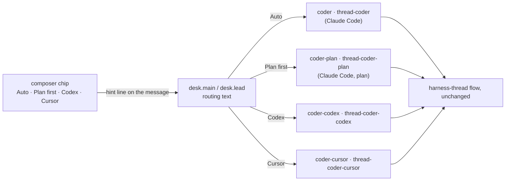

# FIX-2390 · Plan-first and harness choice as workers, plus a composer chip

**Spec** · [Decisions](DECISIONS.md)

## Who feels it, before and after

| Someone who… | Today | After |
|---|---|---|
| **wants a plan before any edit** (Claude Code-style lab, either mode) | Every code change goes to a Claude Code worker in `acceptEdits`, which edits at once | They pick *Plan first* on the composer chip; the change goes to a Claude Code worker in `plan` mode, which reads, changes nothing and answers with the plan. They then ask for the change |
| **wants to compare Codex or Cursor with Claude Code** (lab) | Only by writing their own `WORKER.md` | They pick *Codex* or *Cursor* on the chip; the change runs on that harness, and the card and row are tagged with it |
| **is rate-limited on one harness** (lab) | Stuck until the window resets | Picks another harness on the chip for the next change |
| **leaves the chip on *Auto*** (lab) | — | Exactly today's behaviour: `desk.coder` / `desk.thread-coder` on Claude Code |
| **asks the main session in words** ("plan it first", "use Codex") without the chip | The words reach a model that has no worker to send it to | Best effort: the routing text names the words too, but only the chip's line is checked |
| **runs Shift Manager on a real FSD issue** | The coder is `stub` or `claude-code`, chosen once per process, and a Claude Code run is cut off at 10 minutes | `DEVFORCE_LAB_HARNESS` also takes `codex` and `cursor`. They start with no sign-in check of their own: readiness for every harness is FIX-2391's, which reports instead of refusing. The run budget defaults to 20 minutes and a setting changes it |
| **wants a different harness per task in Shift Manager** | Can't | **Still can't in this issue.** A follow-up lifts the lab's per-worker harness routing into `harness-manager` so Shift Manager uses the same piece ([D2](DECISIONS.md#d2)) |

## The goal, and how we'll know it's met

**In the Claude Code-style lab, a person chooses, per request, whether a code change is
planned first or which harness makes it, and the change runs on the worker that choice names.**

- **Smaller, and rejected:** only the `WORKER.md` files. The choice would exist but only as
  words the person has to know to type.
- **Bigger, and not this issue's:** a typed per-turn *preferred delegate* on the workforce
  turn input (the issue's fallback if the hint is unreliable), and per-task harness choice in
  Shift Manager ([D2](DECISIONS.md#d2)). Harness readiness on the chip is FIX-2403's, after
  FIX-2391.
- **Not done if:** the chip on *Codex* files the change to a Claude Code worker; *Plan first*
  leaves a commit; *Auto* changes where today's changes go.

The chip only writes a line the person can see; the main session's routing text reads it; every
new worker is a `WORKER.md` on the existing `harness-thread` flow.

**How we verify.**

- **Goal leg (new), `goals/claude-code-style-lab/picks-the-coder`**, real model, on the lab's
  existing boot (`goals/claude-code-style-lab/lab.mts`). In session mode and in threads mode,
  the script clicks the chip to *Codex* and asks for a code change: the filed task's assignee
  (`listTasks_tasks`) is the Codex worker and its card reads *Codex*. Then *Plan first* and a
  second change: the task goes to the plan worker, the run's worktree branch has no commit past
  its base, and the result holds a plan. Graded on the rendered page and the board's records,
  never on adapter return values. The Codex leg grades the filing and the tag, not the run's
  outcome, so it needs no Codex account.
- **Controls that must fail:** `no-hint`, the chip's line left off the sent message (must fail
  the Codex filings in both modes); `no-delegates`, the new coders taken off `desk.main`'s and
  `desk.lead`'s delegates (must fail the same signals). Both run and fail
  before the PR is ready (ER-6).
- **Regression:** `session-mode-script` and `threads-mode-script` pass unchanged, with the chip
  on *Auto*.
- **Unit:** the composer test shows the chip's line on the sent text and none on *Auto*;
  Shift Manager's `selectHarness` tests cover `codex`, `cursor`, the budget setting, and a bad
  budget refused at start; Claude Code's start check is unchanged.

## What changes

- **Lab workers (`workforce/teams/desk/workers/`):** six `WORKER.md` files on `harness-thread`:
  `coder-plan` (`harness: claude-code`, `permissionMode: plan`), `coder-codex`, `coder-cursor`
  for session mode, and `thread-coder-plan`, `thread-coder-codex`, `thread-coder-cursor` for
  threads mode, the last two with `review: true`. The plan thread has no review: it commits
  nothing, so there is nothing to review.
- **Routing text:** `desk.main` and `desk.lead` delegate to the new workers and say which one a
  hint line or the person's own words name; *Auto*, or no hint, keeps today's coder.
- **Composer chip:** one control beside Send, *Auto* by default, kept for the session while it
  is open. Any other choice adds one plain line to the message the person sends (for example
  `Coder: Codex`), which shows in the transcript as sent ([D1](DECISIONS.md#d1)).
- **Shift Manager (`teams/devteam/harness.mts`):** `codex` and `cursor` join `HARNESS_CHOICES`,
  each with only its own environment pass-list and no new start-time check ([D2](DECISIONS.md#d2));
  a run budget setting (minutes), defaulting to 20 for a real harness. The start line names the
  coder and the budget. The hint-line routing stays lab-only: Shift Manager's choice is
  process-level.
- **Docs:** the lab README's worker list and the Shift Manager README's settings table.

## What stays as it is

The `harness-thread` flow, which already builds the plan, Codex and Cursor managers; the
workforce turn input; core and the engine; Shift Manager's one coder per process.

## What's already here, and the debt

| Piece | What this does with it |
|---|---|
| `harness-thread.mts`'s managers per harness and `permissionMode: plan` (FIX-2152) | **Reused**, unchanged: each new worker is a file naming them |
| `HARNESS_LABEL` in `ThreadStatus.tsx` | **Reused** for the card tag and the chip's labels |
| Shift Manager's `selectHarness` / `startHarness` | **Extended** with two choices and the budget. Its Claude Code refusal is left as it is; FIX-2391 (#4372) turns all three into a readiness report, so this adds no refusal for it to remove |
| FIX-2371 (optimistic send, same composer) | **Merges first** (epic build order: 2371 → 2390); this branch merges main after it |
| FIX-2403 (harness chips read FIX-2391's readiness) | **Builds on this chip** later; nothing here probes readiness in the browser |

**Adds:** six worker files, routing text, one chip, two Shift Manager choices and one setting.
**Removes:** nothing. **Debt:** the chip is a text hint, not a typed field, so routing rests on
the model reading one line; if the goal leg shows it unreliable, the issue's typed *preferred
delegate* gap is filed against workforce. Per-task choice in Shift Manager is a filed follow-up.
**Net:** small.

## Sign off

**Approve by merging.** Two calls: **the chip writes a visible line** ([D1](DECISIONS.md#d1)),
and **Shift Manager gets more harnesses and a budget now, per-task choice later**
([D2](DECISIONS.md#d2)). *If wrong:* D1 is a few lines in one component; D2's follow-up is the
same work this would have done, in the package instead of the app.

Improvement · Claude Code-style lab, Shift Manager · small · 1 PR · builds on FIX-2152 · merges
after FIX-2371
