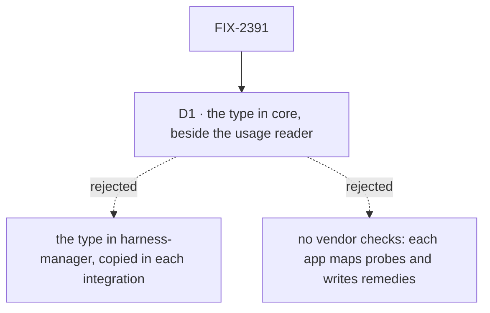

# FIX-2391 · Decisions

[Spec](SPEC.md) · **Decisions**

The issue settles the what: one readiness read in harness-manager, run at start, shown, and fed
to the coordinator. The epic places it (FIX-2369 SPEC, *harness-manager*; ER-2: an opt-in read,
not a default) and names Kitchen Sink's `harness-gate.ts` as the shape to lift. One call is
left, and it bends an epic rule's wording, so it is on the sign-off.

## D1 · `HarnessReadiness` lives in core's harness contract, beside `HarnessUsageReader`

| | In core's harness contract (chosen) | In harness-manager, each integration repeats the shape | Each app maps probes itself |
|---|---|---|---|
| Remedy text written once, by the vendor package | yes | yes | no: per app |
| Integrations stay on `core` alone | yes | yes (structural copy) | yes |
| Copies of the type | one | four (harness-manager + three) | one |
| Reads against ER-1 | grows an existing harness contract; adds no workforce noun | no core change | no core change |

- **Because:** an integration package depends on `core` only, so a contract it implements
  has to live there or be copied. FIX-2139 put `HarnessUsageReader` in
  `core/types/harness.ts` for the same reason, and a readiness check is the same kind of thing:
  a neutral question every harness answers. ER-1 keeps Workforce nouns (worker, task, board,
  hold) out of L1 and says L1 offers generic hooks; the harness contract is already that hook.
  Tenet 2: one shape, not four.
- **What would change my mind:** the epic meaning ER-1 literally, that `core` gains no harness
  type at all. Then the structural copy is the fallback, and TypeScript still catches a mismatch
  at every host that hands an integration's check to `harnessReadiness`.
- **Locks in:** the public names `HarnessReadiness`, `HarnessReadinessCheck`,
  `checkClaudeCodeReadiness`, `checkCodexReadiness`, `checkCursorReadiness`,
  `harnessReadiness`, `harnessReadinessAction`, `harnessReadinessCapability`,
  `formatHarnessReadiness`.
- **If wrong, it costs:** a move of two types and three import lines per integration.

## Decided, not asked

- **E1 · Once at start, kept, re-read on request.** `read()` runs every check the first time and
  keeps the rows in the process; `read({ refresh: true })`, or a harness name, runs again.
  Concurrent refreshes share one run. No throttle: a re-check is a person's click or a task
  start, not a poll (FIX-2367 ER-3 forbids an always-on poll, and this adds none).
- **E2 · A task start re-checks a not-ready harness once.** `readiness.refusal(harness)`
  returns `undefined` for a ready row without probing, and for a not-ready one probes again
  before it returns the sentence. A sign-in made after start then works without a restart;
  a sign-in that lapses after a ready read fails in the run, as today.
- **E3 · Never fatal.** `read()` never throws. A check that throws, rejects or passes
  `timeoutMs` (default 30 s, Codex's slow cold start in Teammates) is a not-ready row with
  `unanswered: true` and a plain reason. A host awaits nothing at start: it logs when the read
  lands.
- **E4 · Nothing is stored.** Readiness is the machine's state, so it is held in the process,
  not a resource collection. Two server processes each read their own machine.
- **E5 · One formatter.** `formatHarnessReadiness(rows)` makes the start log's table and the
  coordinator's context text, so they never disagree.
- **E6 · The coordinator's context is a capability a host opts into** (ER-2, FIX-2268): no
  generator default changes, and a host that leaves it off sees no difference.
- **E7 · The remedy is a sentence, separate from the reason.** `reason` says what is wrong
  ("no `CODEX_API_KEY` and `codex login status` says not logged in"), `remedy` what to do
  ("Run `codex login`, or set `CODEX_API_KEY`"). Chips show the remedy; the start log both.
- **E8 · Host-only checks stay in the host.** Kitchen Sink's root, worktree-root, Vercel and
  "not built yet" checks are about that host, not a harness, and stay in `harness-gate.ts`.
- **E9 · No `./browser` entry yet.** A browser reads rows through the action and imports the
  row type with `import type`. A runtime value a browser needs goes into FIX-2385's `./browser`
  entry after it merges (the epic's build order).
- **E10 · Order of work.** The package slice is one PR from `main` (wave 1, no app file).
  Teammates' `host.mts` and `coder.ts` change in the adoption PR, first in that file's merge
  order (2391 → 2380 → …). FIX-2403 draws the labs' chips from the read action.

## Considered and dropped

- **A readiness gate inside `harnessManager`** that refuses a task on its own. Every app would
  get it by default, which ER-2 rules out, and Kitchen Sink's harness flows don't run through a
  task board.
- **Storing readings like usage.** Usage is per person and expensive to read; readiness is per
  machine and cheap. A store would add a writer and a schema for a fact that is stale the moment
  the process restarts.

## How it got here

- **Draft** — framed as one readiness read replacing four app copies; the contract copies
  FIX-2139's usage-reader shape (core type, integration implementations, harness-manager runner
  and action), with Kitchen Sink's gate as the runner's shape.
