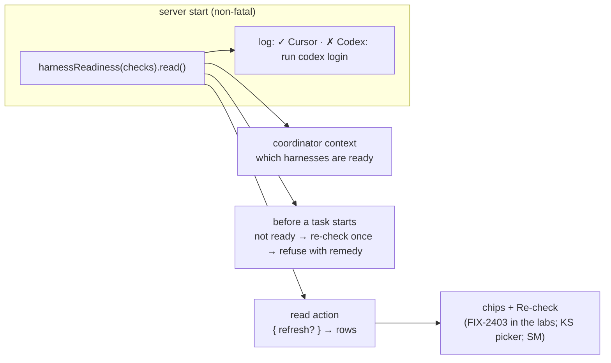

# FIX-2391 · Harness readiness read: probe at startup, show chips, tell the coordinator

**Spec** · [Decisions](DECISIONS.md)

## Who feels it, before and after

| Someone who… | Today | After |
|---|---|---|
| **starts the Teammates lab with Codex not signed in** | Learns it when a Codex task fails: "Codex isn't set up on this machine…" | The server's start log has a table, `✓ Cursor · ✗ Codex: run codex login`, and the lab can read the same rows to draw chips (FIX-2403 draws them) |
| **asks Chief of Staff for coding work** while one harness is not set up | Chief of Staff files the task on the dead harness, it fails, and it may retry it there (FIX-2350's incident) | Chief of Staff's context says which harnesses are ready, so it files on a ready one or tells the user what to run |
| **signs in after the server started** (`codex login`) | Teammates re-probes on every task start; Kitchen Sink keeps its answer until a restart | Re-check reads again on request. A task on a harness last read as not ready is re-checked once before it is refused |
| **opens the Claude Code-style lab without a Claude Code sign-in** | No warning until a session's turn fails | The start log says so, with the remedy, and the lab's read action returns it |
| **opens Kitchen Sink's picker with a mode unavailable** | A reason, no remedy, no re-check; Flow State shows Available with no `AI_GATEWAY_API_KEY` | The reason and its remedy, a Re-check in dev, and Flow State says the key is missing |
| **starts Shift Manager's devteam Lab without a Claude Code sign-in** | The server refuses to start | It starts, logs the table, and the Lab's read action carries the reason and remedy |

## The goal, and how we'll know it's met

**A person learns which coding harnesses can run on this machine, and what to do about one
that can't, before any task is filed on it; the coordinator knows the same thing and files
work only on a harness that is ready.**

- **Smaller, and rejected:** keep each app's own probes and only add remedy text to them. Four
  apps keep four copies of the same sign-in checks (Teammates' `READY`, Kitchen Sink's mode
  checks, Shift Manager's `startHarness`, and none in Claude Code-style), which is the drift the
  review found, and the coordinator still learns nothing.
- **Not this issue's:** drawing the chips in the two labs (FIX-2403, which reads this issue's
  rows), and the duplicate start and misread correction in FIX-2350. A sign-in that lapses
  *after* a ready read still fails in the run, as today.
- **Not done if:** any app keeps its own copy of a sign-in check after it adopts; Chief of Staff
  can still file a Codex task with Codex not ready and no ask from the user; a read can throw or
  block a server start; or Re-check returns the kept answer.



**How we verify.**

- **Goal leg, `goals/teammates-lab/routes-only-to-ready-harnesses`**, real model, 3 of 3 runs.
  The Teammates lab on a fresh store, with Cursor ready (a `CURSOR_API_KEY` in its environment)
  and Codex not (no `CODEX_API_KEY`, no `codex` on the run's `PATH`). Graded on three signals:
  the start log carries the Codex row with `codex login` in it; the read action returns
  `codex` with `ready: false` and a remedy, and after a stand-in `codex` that answers
  `login status` is put on `PATH`, `{ refresh: true }` returns `ready: true`; and asked "have
  Codex add a line to the README", Chief of Staff files **no** task on the Codex worker and its
  reply names what to run (it may offer, or use, Cursor).
- **Control that must fail:** `GOAL_CONTROL=no-readiness-context` leaves the readiness
  capability off Chief of Staff's `uses`. It must file the Codex task in at least 2 of 3 runs,
  which is the incident. A second control, `GOAL_CONTROL=kept-answer`, makes `refresh` return
  the kept rows; the re-check signal must fail.
- **Package (unit, no model):** a check that throws, hangs past its timeout, or rejects reads as
  not ready with a plain reason and never throws out of `read()`; concurrent refreshes share one
  run per harness; the integration checks map each probe's answers (an API key, a login, none,
  no SDK, no answer) to rows with the right remedy. Each test is shown red first (BP-003).
- **Adopters:** Kitchen Sink's existing harness-gate tests keep passing on the shared checks, with
  a new one for Flow State and the missing gateway key; Shift Manager's devteam start test
  changes from "refuses to start" to "starts and reports".

## What changes

```diff
  // labs/teammates/host.mts
+ import { harnessReadiness, harnessReadinessAction, harnessReadinessCapability } from "@flow-state-dev/harness-manager";
+ import { checkCodexReadiness } from "@flow-state-dev/codex";
+ import { checkCursorReadiness } from "@flow-state-dev/cursor";
+ import { checkClaudeCodeReadiness } from "@flow-state-dev/claude-code/sdk";

- const READY: Record<string, () => Promise<string | undefined>> = {
-   "claude-code": async () => { /* probe, retry once, notSetUp(…, "Sign in with `claude`") */ },
-   codex: async () => { /* probe, notSetUp(…, "Sign in with `codex login`") */ },
-   cursor: async () => { /* cursorSignIn, catch, notSetUp(…) */ },
- };
+ const readiness = harnessReadiness({
+   "claude-code": { label: "Claude Code", check: () => checkClaudeCodeReadiness({ env: harnessEnv({ pass: CLAUDE_CODE_PASS }) }) },
+   codex: { label: "Codex", check: () => checkCodexReadiness({ env: harnessEnv({ pass: CODEX_PASS }) }) },
+   cursor: { label: "Cursor", check: () => checkCursorReadiness({ env: harnessEnv({ pass: CURSOR_PASS }) }) },
+ });
+ void readiness.read().then((rows) => console.log(formatHarnessReadiness(rows)));   // non-fatal

    uses: [
      …,
+     harnessReadinessCapability(readiness),        // Chief of Staff's context
    ],
-   ready: READY,
+   ready: readiness.refusal,                        // re-checks a not-ready harness once, then the remedy sentence
+   actions: { harnessReadiness: harnessReadinessAction(readiness) },
```

- **The contract** ([D1](DECISIONS.md#d1)): `HarnessReadiness` and `HarnessReadinessCheck` in
  `@flow-state-dev/core/types`, beside `HarnessUsageReader`. A check answers `{ ready: true }`
  or `{ ready: false, reason, remedy?, unanswered? }` and never throws for an expected state.
- **Each integration's check**, beside its existing probe: `checkClaudeCodeReadiness`
  (`@flow-state-dev/claude-code/sdk`, over `probeClaudeAccount`, asking once more when the first
  probe went unanswered, which Teammates and Kitchen Sink each do today), `checkCodexReadiness`
  (over `probeCodexAccount`), `checkCursorReadiness` (over `cursorSignIn`, a missing SDK read as
  not ready). The remedy sentence lives here, once, with the vendor that knows it.
- **`@flow-state-dev/harness-manager`:** `harnessReadiness(checks, { timeoutMs? })` returns a
  read that runs every check once, keeps the rows in this process, and runs again on
  `read({ refresh: true })` (or one harness by name); concurrent refreshes share a run. A slow,
  thrown or rejected check is a not-ready row with a plain reason. Around it:
  `formatHarnessReadiness(rows)` (the start table and the context text, one formatter),
  `harnessReadinessAction(readiness)` (input `{ refresh? }`, output `{ harnesses: rows }`, the
  shape `harnessUsageAction` uses), `harnessReadinessCapability(readiness)` (a context entry a
  host adds to its coordinator's `uses`), and `readiness.refusal(harness)` for a coding flow's
  pre-start gate.
- **Adoption, after the package slice merges**, per the epic's build order: Teammates and Claude
  Code-style (the start table, the read action, Chief of Staff's context, and Teammates'
  `READY` deleted); Kitchen Sink (`MODE_CHECKS`' sign-in parts call the integration checks, the
  picker shows the remedy and a dev-only Re-check that clears the gate's memo, and Flow State
  checks the gateway key); Shift Manager's devteam (`startHarness` reports instead of refusing,
  and its Lab gets the read action). Each adopting PR deletes the app's copy (ER-3).
- **Docs:** the harness-manager README (a *Readiness* section after *Subscription usage*); the
  three integration READMEs (the new check); `apps/docs/docs/orchestration/harness-manager.md`,
  extended with a readiness section beside its usage section rather than a new page; a
  `harness-readiness` row in `docs/mechanisms/mechanisms.yaml`.

## What stays as it is

The harness slot and `harnessManager`'s run path; a harness that is not ready still fails its
task with a sentence that names it, as Teammates does now (ER-2: readiness is an opt-in read,
never a default gate in the manager); each integration's existing probe and its return type;
the usage record; core's runtime and the engine. Nothing is stored: readiness is a fact about
this process's machine, held in memory, not a resource.

## What's already here, and the debt

Searched `ready`, `probe`, `signIn`, `ModeCheck`, `availability`, `preflight` across
`packages/`, `labs/` and `apps/`. **This would be the fifth way to ask whether a harness can
run here, and it replaces the four app ones.** The mechanism list has no readiness row; the
change adds one.

| Piece | What this does with it |
|---|---|
| `probeClaudeAccount`, `probeCodexAccount`, `cursorSignIn` (the integrations) | **Kept**, and wrapped by each package's new check |
| `HarnessUsageReader` and `harnessUsageAction` (FIX-2139, core + harness-manager) | **The shape copied**: a neutral type in core each integration implements, run by harness-manager behind one action. Readiness differs in being per machine and unstored |
| Kitchen Sink `harness-gate.ts` (`ModeCheck`, `decideAvailability`, the memo) | **Extended**: the epic names it the shape to lift. Host-only parts (root, worktree root, Vercel, "not built yet") stay in Kitchen Sink; the sign-in parts move to the integration checks |
| Teammates `READY` (`labs/teammates/host.mts:130-150`) and `coderFlow`'s `ready` option | `READY` **removed** at adoption; the `ready` option **kept**, fed by `readiness.refusal` |
| Shift Manager `startHarness` (`packages/shift-manager/teams/devteam/harness.mts`) | **Amended** at adoption: reports instead of refusing to start |
| FIX-2350 (duplicate start, misread correction) | **Separate.** This gives Chief of Staff the facts; FIX-2350 fixes what it does with a correction |

| Builds on / Adds | Existing piece considered | Verdict |
|---|---|---|
| `HarnessReadiness`, `HarnessReadinessCheck` (core types) | `HarnessUsageReader`, `HarnessUsageReading` | extend the harness contract file ([D1](DECISIONS.md#d1)) |
| `check*Readiness` ×3 (integrations) | each package's probe | extend: wraps it with the remedy |
| `harnessReadiness`, `formatHarnessReadiness` | KS `decideAvailability` and its memo | extend: the lifted shape |
| `harnessReadinessAction` | `harnessUsageAction` | reuse its shape |
| `harnessReadinessCapability` | `defineCapability` context entries | reuse |

**Removes:** four app copies of sign-in checks (three now, plus Claude Code-style's missing
one). **Adds:** two core types, three small integration functions, one harness-manager module.
**Debt:** none filed; readiness has no history, by design. **Net:** down.

## Sign off

**Approve by merging.** Goal: a person and the coordinator know which harnesses are ready
before work is filed on one. Debt: down, four copies become one per vendor.

- [D1](DECISIONS.md#d1) · **The readiness type sits in core beside the usage reader**, which
  reads ER-1 as "no new workforce noun", not "the harness contract can't grow". *If wrong:* the
  two types move to harness-manager and each integration declares the same shape locally.

Feature · `core` types · `harness-manager` · `claude-code` · `codex` · `cursor` · then four
apps · medium · a package slice PR first (wave 1), then adoption PRs · builds on FIX-2139 ·
FIX-2403 reads it
