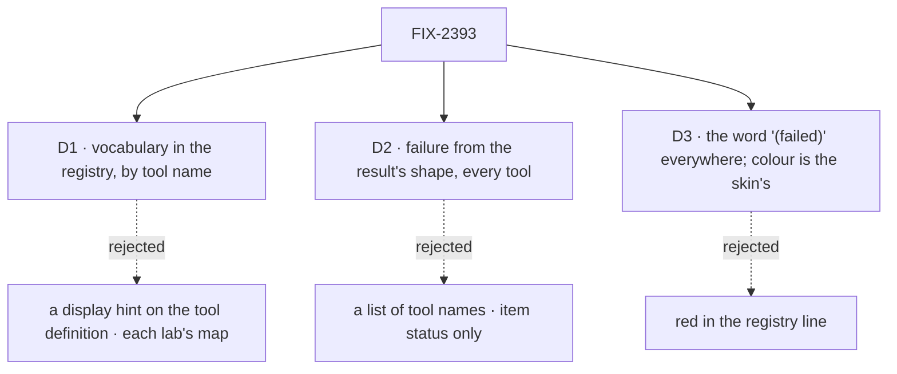

# FIX-2393 · Decisions

[Spec](SPEC.md) · **Decisions**

The epic placed this already: shared UI goes to the registry, and an app copies it in
([FIX-2369 D4](../../epics/FIX-2369/DECISIONS.md#d4), ER-3). The package slice merges in wave 1;
the labs adopt at the tail of each lab's `adapter.ts` stack 2 (the epic's build order). What is
left to decide is where the vocabulary lives, how a failure is found, and how one looks.

## D1 · The vocabulary lives in the registry's naming helpers, keyed by tool name

| | Registry, by name (chosen) | A display hint on each tool's definition | Each lab's own map (today) |
|---|---|---|---|
| One place names a tool | yes | yes, beside the tool | no, one per app |
| Reaches L1 | no | `handler()` in core grows a UI field (ER-1) | no |
| Renamed tool | falls back to its name | follows the rename | stale phrase |
| Works for tools FSD doesn't define (Claude Code's `Read`, MCP) | yes, as today | no, a second path for those | no |

- **Because:** `tool-naming.ts` already names Claude Code's, Codex's and Cursor's tools this way,
  so the workforce tools join the one table every app reads. A hint on the definition would put
  display words into core's handler shape and still need the table for tools FSD doesn't define.
- **Locks in:** `toolSubject(name, args, output?)` (the third argument is new and optional) and
  `toolOutcome(name, output)` as registry exports.

## D2 · A call failed when its result says so, read by shape, for every tool

| | By shape, every tool (chosen) | A list of tool names | Item status only (today) |
|---|---|---|---|
| A refused project read reads failed | yes | yes | no |
| A new tool that answers `{ ok: false, error }` | reads failed | reads done until listed | reads done |
| A third-party tool whose `ok: false` means something else | reads failed | reads done | reads done |

- **Because:** every workforce and task tool reports failure the same few ways, by design a
  result and not a throw: `{ ok: false, error }`, `{ kind: "refused", reason, message }`,
  `{ status: "failed", error }` (a `sendMessage` that waited on a reply its message never got
  to give), and a read's `status` other than `ok`. Reading the shape covers the next tool
  without an edit. The read's `status` is the one rule tied to a tool name.
- **What it changes beyond the labs:** Kitchen Sink's and Shift Manager's tool lines, on their
  next registry copy, say "(failed)" for such a result, which they read as done today. That is
  the point of the change, not a side effect.
- **Locks in:** the four shapes as the failure contract a tool can rely on to be shown as
  failed. A zero-match search is **not** a failure: it says `no matches`.

## D3 · "(failed)" in words everywhere; colour belongs to the app's skin

| | Words everywhere, colour per skin (chosen) | Red in the registry line |
|---|---|---|
| A failed call is visible | yes, by its word | yes |
| A routine miss (a grep with no hit on a harness) alarms | no | yes, on every app |
| The labs can show red, as the issue asks | yes, in their own CSS | yes |

- **Because:** FIX-2343 (#4232) made a failed call muted on purpose: an agent's failed call is
  routine, not an alarm on the run. The issue's complaint is that a failure looks like a success,
  which the word fixes. Each lab already draws its own look over the registry's helpers.
- **Locks in:** the helpers return a state (`failed`), never a colour.

## Decided, not asked

- **E1 · No new registry file.** `toolOutcome` goes in `tool-naming.ts` and the step-run line
  in `tool-grouping.ts`, so `registry.json` changes only its description and Kitchen Sink's
  drift count (37) stays.
- **E2 · Kitchen Sink's copies are refreshed in the wave-1 PR**, byte for byte, because its
  drift test fails otherwise. That is an exception to the epic's wave-1 row ("no app file"),
  forced by the test and carrying no app logic. No other app file changes in wave 1. Shift Manager's copies have
  no drift test and wait for its own copy.
- **E3 · A board-qualified task tool reads as its base.** `createTask_<board>` exists when two
  boards share a block (`nameSuffix`); it gets `createTask`'s line. The suffix is stripped only
  when the base is in the table, so `read_file` is untouched.
- **E4 · The output argument is optional.** Called with none (a call still running), a line
  says what it knows from its args; the count arrives when the result does.
- **E5 · No ids on a line.** A task or message id means nothing to a person, as Claude
  Code-style's comment already says; a task line uses the title, else the goal, else none.
- **E6 · The step-run state is lifted, then reshaped.** `withState` keeps its meaning;
  `runState` takes states, not items, so the pure file needs no item types. `tool.tsx` calls
  both, and its render tests stay as they are. The open-while-running rule is new.
  One step's state is shared too: a pure helper turns a call's status (running, waiting,
  failed, done) and its result into its state through `toolOutcome`, so neither lab copies
  `tool.tsx`'s `lineState`.
- **E7 · The real-tool test lives with the tools, in `packages/workforce/test/`,** importing the
  registry file by path, as Kitchen Sink's drift test imports `packages/ui/scripts`. A change
  to a tool's output then fails where the tool is.
- **E8 · A read's `status` is the only failure rule tied to a name.** Elsewhere a top-level
  `status` counts only as `failed` with an `error` beside it (the waited send's shape); any
  other `status` is a task's (`createTask` filed held, `getTask`'s nested task failed) and says
  nothing about the call. Tests lock all three.
- **E9 · Wording.** The examples in `SPEC.md` show the shape (verb, then subject, then a count);
  the exact words are the implementer's, and once chosen, the package check's exact-line
  assertions are their contract.

## Considered and dropped

- **Do nothing in the registry; extend Claude Code-style's map.** Smaller, and the
  rejected goal in `SPEC.md`: it names no file and leaves Teammates out.
- **Fold `tool-summaries.ts` into `tool-naming.ts` here.** Right direction, other callers
  (`evented-actors`, `task-plan`) and their tests; filed as FIX-2431.

## Open

None.

## Analysis

**2026-10-31, fresh sub-agent, on the draft.** Verdict: right approach, with folds. Reuse: the
two Adds extend the one subject reader and lift `tool.tsx`'s own state; no second mechanism.
Folded: the wave-1 control (today's fallback already names a path, so the check asserts the
exact line and the control empties the entries and stubs the outcome together); the Teammates
leg (it has no map to restore, so its control is popup-only, and the goal is named); all twelve
tools get words; *not done if* gains the zero-match, raw-name and fold cases; the labs commit to
red; Teammates reads through `sessionFeed`. Recorded: E2's exception, E6's reshape, E8.

## Notes from review

- Codex (f198514), folded: a `sendMessage` with `wait: true` whose message was refused or
  undeliverable answers `{ status: "failed", sent, error }`, a fourth failure shape D2 missed.
  D2 and E8 now carry it.
- Cursor (154da69), approved direction. Folded: one step's state is a shared helper (E6), and
  E9 names the tests as the wording's contract. Recorded for the implementer: open/fold rules
  sit beside label composition in `tool-grouping.ts` only because E1 keeps the file count; a
  `tool-step-run.ts` is the cleaner home if that count is ever relaxed. D2's cross-app change is
  already the sign-off's line to weigh.

## How it got here

- **Draft** — the problem is two labs with two (or no) vocabularies for the same workforce
  tools and no way to see a refused result; the approach extends the registry's naming helpers
  with those tools and an outcome read from the result, lifts the step-run line out of
  `tool.tsx`, and has both labs copy them in wave 3.
