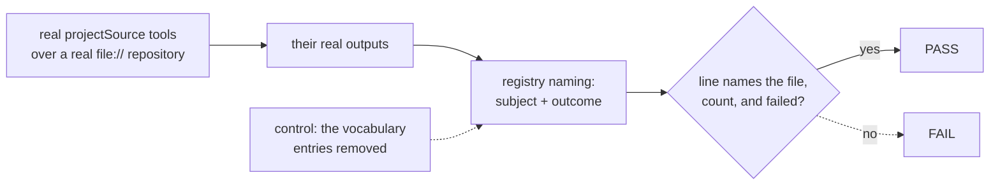
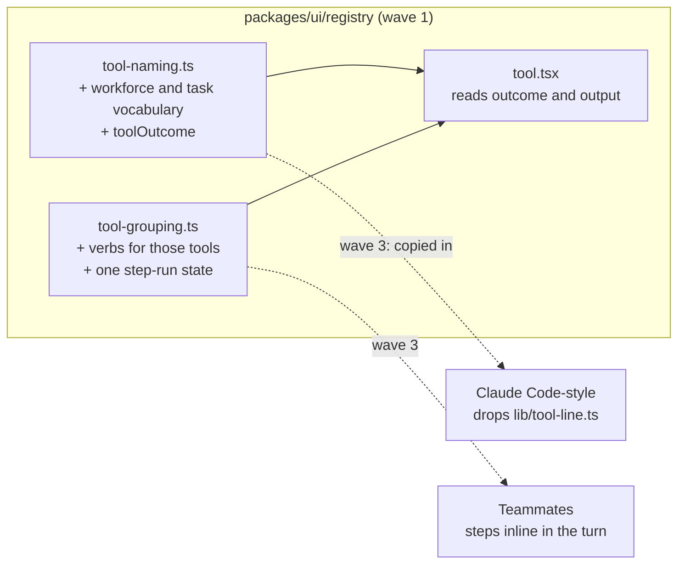

# FIX-2393 · Tool lines and steps that say what was read, run or edited, inline in the conversation

**Spec** · [Decisions](DECISIONS.md)

## Who feels it, before and after

| Someone who… | Today | After |
|---|---|---|
| **watches the Claude Code-style main session read six project files** | Six lines that each say "Read a project file" | One line, "Read 6 files", that opens to `Read src/billing/ledger.ts`, `Read README.md`, … |
| **watches a worker search the project and find nothing** | "Searched the project", the same line as a search that found ten matches | `Search "LEDGER_CODE" · no matches`, and a search that found ten says `· 10 matches` |
| **watches a read the project refused** (no project set, not a member, a missing file) | Reads like a read that worked | The line says "(failed)" |
| **watches a lead file and check on tasks** | "Started a task", "Checked on a task" | `Start a task: Fix the login copy`, `Check on "Fix the login copy"` |
| **talks to a Teammates lab worker while it works** | Sees nothing until the worker answers; its tool steps show only in the popup | Sees the steps inline during the turn, open while running and folded when the turn is done |
| **runs Kitchen Sink or Shift Manager on the registry's tool line** | A refused workforce read reads as done | It reads "(failed)" (the same registry rule; these apps take it on their next registry copy) |

## The goal, and how we'll know it's met

**In both workforce labs, a person watching a turn sees each tool step say what it acted on and
whether it worked, inline in the conversation, without opening anything.**

- **The real need** (R-27, "see what the work is doing", impact 5/5): eight reads read as eight
  identical lines, a failed grep looks like a good one, and Teammates shows no work at all until
  the answer.
- **Smaller, and rejected:** add the workforce tool names to Claude Code-style's own phrase map.
  Each line still says nothing about what was read, Teammates gets nothing, and the two labs keep
  two vocabularies, which is the drift the epic exists to end
  ([FIX-2369 D4](../../epics/FIX-2369/DECISIONS.md#d4)).
- **Bigger, and not this issue's:** the task-row status words (FIX-2379), a coding task's own
  run steps (FIX-2343 shipped them), and a lab contract test over both adapters (FIX-2406).
- **Not done if:** the lines name a file only in a unit test fed hand-written output; a refused
  read still reads as done in either lab; a search that found nothing reads as failed; any of
  the twelve workforce and task tools reads as its raw name; a lab still keeps its own phrase
  map; or a turn's steps don't fold once it ends.

The check feeds what the real tools return, not a fixture, through the registry's naming, so a
change to either side trips it.

**How we verify.** Two PRs, in the epic's build order: the package slice now (wave 1), the labs
at the tail of each lab's stack 2 (wave 3).

- **Package check (wave 1), CI.** A test beside the workforce tools runs `projectSourceTools`
  over a real `file://` repository and the real local workspace host (the
  `project-source.test.ts` harness), and passes each real output through the registry's
  `tool-naming.ts`. Signal: a read names its path; a grep names its pattern and its match count,
  `no matches` on zero; a glob names its count; a refused read and a missing file report
  `failed`. It asserts the exact line, so today's fallback (the tool's name title-cased before
  the path) fails it. The task tools are covered in the registry's own tests.
  **Control that must fail:** the new subject entries emptied and `toolOutcome` stubbed to `ok`,
  together: every one of the test's cases must FAIL. The PR shows that red run.
- **Goal legs (wave 3), real model,** graded on each lab's own entries (its adapter over the
  session's items, the surface the lab draws).
  - `goals/claude-code-style-lab/reads-project-files` gains two signals: leg 1, *lines name the
    file*, a tool line names the fixture file the value lives in; leg 2, *refusal reads failed*,
    the refused read's line is failed. Control `GOAL_CONTROL=old-lines` puts `lib/tool-line.ts`
    back; both signals must FAIL.
  - A new `goals/teammates-lab/shows-a-workers-steps` (run:
    `pnpm tsx goals/teammates-lab/shows-a-workers-steps/run.mts`) asks a worker with project
    reads a question about the project. Signals: *steps during the turn*, the conversation's
    entries hold the worker's step line, naming a file, before its answer lands; *folded after*,
    the run reads done and closed once the answer does. Control `GOAL_CONTROL=popup-only` keeps
    steps in the popup, as today; *steps during the turn* must FAIL.

## What changes

Everything new lands in the registry's existing pure files; the labs copy them in later and
delete their own.

- **Subjects for workforce and orchestration tools.** `toolSubject` learns
  `readProjectSource` (path, and a line range when given), `grepProjectSource` (pattern, and
  with the result its match count), `globProjectSource` (pattern or "the project's files", and
  the count), `createTask` (its title, else its goal), `getTask` (the title its result names),
  `sendMessage` (who to), `reportProgress` (the note) and `suspendForUser` (its title), and gives
  the rest (`updateTask`, `listTasks`, `holdTaskForUser`, `consultSessionHistory`) plain words,
  so none of the twelve reads as its name. It takes
  the result as an optional third argument, so a line can say more once the call is done. A
  board-qualified name (`createTask_<board>`) reads as its base.
- **Whether it worked.** A new `toolOutcome(name, output)` says `failed` when the result says
  so: `ok: false`, `kind: "refused"`, or a read whose status isn't `ok` ([D2](DECISIONS.md#d2)).
  The registry's tool line uses it, so a refused call reads "(failed)" as a thrown one does.
- **Group verbs.** `TOOL_VERB_MAP` gains these tools, so a run reads "Read 6 files and searched
  the code" (a project read merges with any other "read a file").
- **One step-run state.** `tool.tsx` already turns a run's steps into one state and says it
  in words ("Read 6 files (1 failed)", "Reading src/a.ts…"), privately. Those two pieces move
  into `tool-grouping.ts`, reshaped to take states, and both labs and `tool.tsx` call them. The
  rule that a run is open while it is running and folded once it isn't is new, written there,
  and the labs follow it; the registry's own `ToolGroup` keeps its `defaultOpen` prop.
- **Labs (wave 3).** Claude Code-style replaces `lib/tool-line.ts` with the registry helpers.
  Both labs draw a turn's steps inline as grouped lines in their own look; Teammates shows a
  worker's steps during its turn, not only in the popup, reading that worker's session through
  FIX-2374's `sessionFeed` (ER-4), not a read of its own. The words say "(failed)" everywhere,
  and both labs draw a failed step in their own red ([D3](DECISIONS.md#d3)).
- **Docs:** `packages/ui/README.md` (the tool-naming entry: workforce tools, `toolOutcome`);
  the registry's `tool-naming` description in `registry.json`. No site page names the
  vocabulary, so none changes.

## What stays as it is

What the tools return and how they refuse (a result, never a throw); a thrown or suspended
call's state; the registry's muted look for a failed call (FIX-2343); `toolIntent`; the task-row
status words (FIX-2379's); harness run steps.

## What's already here, and the debt

| Already here | What this does with it |
|---|---|
| Registry `tool-naming.ts` (`toolSubject`, `toolIntent`), the one subject reader | **Extends** with the workforce and task tools, and the result |
| Registry `tool-grouping.ts` (`TOOL_VERB_MAP`, `composeToolCallsLabel`) | **Extends** with verbs; gains the step-run line lifted from `tool.tsx` |
| Registry `tool-summaries.ts` (`extractToolCallSummary`, first string arg + result titles) | **Leaves alone.** Used by `evented-actors` and `task-plan` cards; a third reader of a call, see Leaves |
| Claude Code-style `lib/tool-line.ts`, a fixed-phrase map of the same tools | **Removes** (wave 3) |
| Teammates' copies of `tool-naming.ts` and `tool-grouping.ts`, its popup grouping walk | **Replaced** by a fresh copy (wave 3); the walk moves to the shared helper |
| Kitchen Sink's byte copies (its drift test) | **Refreshed** in the wave-1 PR, byte for byte: the drift test requires it |
| Shift Manager's own copies of `tool.tsx` and friends | **Left** to its next registry copy; no drift test holds it |
| FIX-2343 (#4232): a failed call says "(failed)" and stays muted | **Kept**, and now reached by refused results too |
| How a call's failure is found today: `item.status === "failed"` only | **Extended**: a result that reports failure counts too |

**Builds on / Adds**

| Adds | Existing piece considered | Why it doesn't fit, or how this composes |
|---|---|---|
| `toolOutcome(name, output)` | `tool.tsx`'s `lineState` (item status only) | Status can't see a refusal returned as a result, which is how the workforce tools refuse by design. `lineState` composes the two |
| Step-run line helper | `tool.tsx`'s private `withState` / `runState` | Not new: the same code, exported from the pure file so the labs reuse it instead of a third copy |

**The debt.** **Removes:** Claude Code-style's phrase map; Teammates' own grouping walk.
**Adds:** tool names hard-coded in the registry. Permanent by design: the registry already
names Claude Code's, Codex's and Cursor's tools this way, and a renamed tool falls back to its
name, never to a wrong line. **Leaves:** `tool-summaries.ts` reads a call a third way;
folding it into `tool-naming` is FIX-2431. **Net:** down, two lab vocabularies go and
one registry vocabulary grows.

## Sign off

**Approve by merging.**

- **The goal:** both labs show each step's subject and outcome inline, proved on the real tools'
  output now and on a real-model lab run in wave 3. *If wrong:* the lab leg shows it, and the
  vocabulary is one table to fix.
- **The debt:** down, two lab maps removed, registry vocabulary grows. *If wrong:* a tool rename
  reads as its raw name until the table is updated.
1. **[D1](DECISIONS.md#d1) · the vocabulary lives in the registry, keyed by tool name** (not on
   the tool definition). *If wrong:* moving it to a tool-declared hint later is additive.
2. **[D2](DECISIONS.md#d2) · failure is read from the result's shape, for every tool.** The one
   to weigh: it changes what Kitchen Sink and Shift Manager show for any tool that answers
   `ok: false`. *If wrong:* narrow it to a list of tool names; one function.
3. **[D3](DECISIONS.md#d3) · "(failed)" in words everywhere; red is a lab's skin.** *If wrong:*
   the registry line turns red in one class.

Open: none.

Feature · `ui` registry, then two labs · small (3 pure files, 1 test, 2 lab adoptions) · 2 PRs,
waves 1 and 3 · epic FIX-2369
