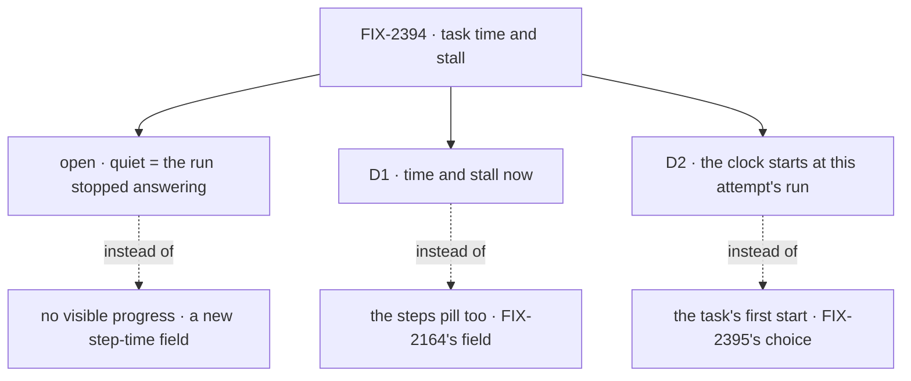

# FIX-2394 · Decisions

[Spec](SPEC.md) · **Decisions**

One open fork for Jake, two decisions for sign-off, then the engineering calls.

## Open · What should an amber *quiet* badge mean? · for Jake

**In plain terms.** While a task's run is alive, its request renews the row's two-minute lease
about every 40 s. Each renewal rewrites `updatedAt` (the [POC](poc/row-fields/)). So a row
unwritten for three minutes has no live run: it crashed, the host restarted, or the run ended
without settling the row, as in FIX-2032. That is what *quiet* can mean with no new field. It
can't catch a run that is alive but going nowhere, such as a long tool call or a loop, because
that run keeps renewing.

It comes down to the package change: *no progress* needs a step time that orchestration and every
harness write.

- **My recommendation:** *its run stopped answering*. It catches the case the issue cites (rows
  running forever) with nothing new. For a live but stuck run, `working · 25m` on a five-minute
  task is its own signal to a person.
- **What would change my mind:** the stuck runs you hit are alive but going nowhere. Then file the
  step-time field, and *no progress* becomes a second badge beside this one.
- **What being wrong costs:** one follow-up issue. Nothing built here is thrown away.

## D1 · Time and stall now; the steps pill stays FIX-2164's · for sign-off

| | |
|---|---|
| **Instead of** | Adding a step count to the row here, to feed Claude Code-style's `n/m` pill |
| **Because** | No row carries one; the POC asserts every key. FIX-2164 checks first whether the run's plan rows already give it, which needs no field. Building it here makes a labs issue a package change, against the epic's order (D3) |
| **Locks in** | No orchestration or harness change here. `TaskRow.steps` stays unfed until FIX-2164 |

It comes down to the row: no step count exists, and FIX-2164 may not need to add one.

## D2 · The clock starts at this attempt's run · for sign-off

| | |
|---|---|
| **Instead of** | The task's own `startedAt`, which FIX-2395 (#4717) adds to rows and times Teammates' running rows from |
| **Because** | A retry keeps the task's first `startedAt` (FIX-2383; `applyClaimToTask` keeps it on purpose), so a retried task would read `working · 40m 3s` ten seconds into its run. `run.startedAt` is "when this attempt's first run started", kept across a resume or a lease taken back, and every row already has it |
| **Locks in** | The clock reads `run.startedAt`. For the seconds between a claim and its run linking itself, a running row shows no clock. Amends FIX-2395's start for running rows, not its sort |

It comes down to a retried task: the task's clock counts failed attempts as this one's work.

## Decided, not asked

- **A registry item, `task-signals`** (epic D4). It is display, so it doesn't go in a package export.
- **The threshold is 1.5 × `DEFAULT_LEASE_DURATION_MS`**, three minutes, imported from the
  browser-safe `@flow-state-dev/orchestration/tasks`. It is a constant, not an option.
- **Convergence point:** the item's one `taskSignal(row, now, { stale })`. Every row a lab draws
  passes through it, and no component compares `updatedAt` itself. Quiet needs a `running` state,
  no `keptOpenBy`, and a feed that is not stale.
- **Formats:** the clock uses `durationText` (`4m 12s`); ended rows read `12m ago`; quiet reads
  `quiet for 7m`. All three live in the item.
- **Ticking:** the lab's `useNow` passes `now`, every second while a row runs. The item runs no
  timer of its own.
- **Count:** running, waiting, failed, done. Queued, held and cancelled stay in their groups.
- **Changeset** for `@flow-state-dev/ui`, as `task-actions` did. The labs are private.

## Considered and dropped

- **`updated 3m ago` on running rows.** The heartbeat makes it always read `now`. It is kept for
  ended rows.
- **Folding in FIX-2168.** The clock reads the run link, and FIX-2395 adds those times anyway.
- **A `quiet` field on `taskRowView`.** That would be a package change for a display rule.
- **Each running row's last step, read from its run session.** That is one read per row per poll,
  which epic D2 forbids.

## Open / Settled

- **Open:** what *quiet* means (above).
- **Settled · 2026-11-04, `main` at `5eaaa9f6`:** [`poc/row-fields`](poc/row-fields/) runs the
  real `listTasks` action. A running row carries `updatedAt` and `run.startedAt` but no task-level
  `startedAt`, `completedAt` or `createdAt`, so `taskRowView`'s `times.startedAt` is null. A
  finished row has no `completedAt`. No row has a step count, by a totality assertion over its
  keys. A lease renewal alone moves `updatedAt`. Control `POC_PLANT=1` plants `steps`, and both
  cases fail. This corrects the issue's premise: a stall badge from `updatedAt` can ship now, but
  it means *the run is gone*, not *slow*.

## Analysis

2026-11-04 · `5eaaa9f6` · run inline by the author, since this worker had no fresh sub-agent.
Weigh it accordingly.

- **Verdict: build smaller.** Time and stall now; steps to FIX-2164.
- **Reuse:** extend `durationText`, `taskRowView`, and the sweeper's threshold rule. Only the item
  is new, and it replaces FIX-2395's lab copy.
- **Folded:** the heartbeat finding. It dropped `updated 3m ago` on running rows and re-framed
  *quiet*, which is the open fork.
- **For the coordinator:** D2 amends FIX-2395's spec (#4717). FIX-2168 closes with FIX-2395.

## How it got here

- **Draft** — the issue's two halves were split on what a `listTasks` row carries, checked by a
  POC. The heartbeat finding re-framed *quiet*. The clock ships from the run link, the pill stays
  FIX-2164's, and one registry item serves both labs.
