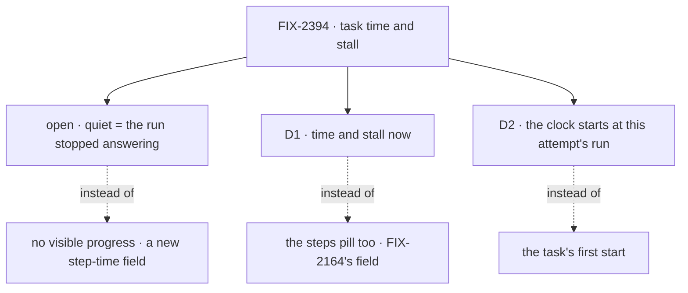

# FIX-2394 · Decisions

[Spec](SPEC.md) · **Decisions**

One open fork for Jake, two decisions for sign-off, the owners settled with #4717, then the
engineering calls.

## Open · What should an amber *quiet* badge mean? · for Jake

**In plain terms.** While a task's run is alive, its request renews the row's two-minute lease
about every 40 s (the [POC](poc/row-fields/)). The board already treats a lapsed lease as "no
live run here" (`leaseLapsed`). Such a run crashed, the host restarted, or the run ended without
settling the row, as in FIX-2032. That is what *quiet* can mean with no new writes. It can't
catch a run that is alive but going nowhere, such as a long tool call or a loop, because that run
keeps renewing.

It comes down to new writes: *no progress* needs a step time that orchestration and every harness
write.

- **My recommendation:** *its run stopped answering*. It catches rows that read *running*
  forever, and it uses a rule the board already has. For a live but stuck run, `working · 25m`
  on a five-minute task is its own signal to a person.
- **What would change my mind:** the stuck runs you hit are alive but going nowhere. Then file the
  step-time field, and *no progress* becomes a second badge.
- **What being wrong costs:** one follow-up issue. Nothing built here is thrown away.

## D1 · Time and stall now; the steps pill stays FIX-2164's · for sign-off

| | |
|---|---|
| **Instead of** | Adding a step count to the row here, to feed Claude Code-style's `n/m` pill |
| **Because** | No row carries one (the POC). FIX-2164 checks first whether the run's plan rows give it with no new field. Adding one here means changing every run's writes, against the epic's order (D3) |
| **Locks in** | No step field, and no harness change, in this issue. `TaskRow.steps` stays unfed until FIX-2164 |

It comes down to the row: no step count exists, and FIX-2164 may not need to add one.

## D2 · The clock starts at this attempt's run · for sign-off

| | |
|---|---|
| **Instead of** | The task's own `startedAt` |
| **Because** | A retry keeps the task's first `startedAt` (FIX-2383; `applyClaimToTask` keeps it on purpose). On that start, a retried task would read `working · 40m 3s` ten seconds into its run. `run.startedAt` is "when this attempt's first run started", kept across a resume, and on every row today |
| **Locks in** | The clock reads `run.startedAt`. Between a claim and its run linking itself, a running row shows no clock for a few seconds |

It comes down to a retried task: the task's clock counts failed attempts as this one's work.

## Owners, with #4717 (FIX-2395, FIX-2397)

FSD Architect's check found the overlaps, and the FIX-2395 thread agreed to these owners. FIX-2395
lands first, as #4717 at `c3f4828b`, and it has no running-row clock.

| What | Owner | The other side |
|---|---|---|
| A running row's clock, from `run.startedAt` | `task-signals` (here), outright | FIX-2395 has none; there is nothing to replace |
| *Quiet*, and which fields it reads | `task-signals`, through orchestration's `leaseLapsed` | `listTasks` rows carry no `leaseUntil` today (the POC). This issue adds it as a client read: no third liveness rule and no threshold |
| Per-state heading counts | `task-signals`' `taskCounts` | FIX-2395 shows a plain `Tasks (N)`; the count goes beside it |
| A row's word and tone | FIX-2395's `taskState` (`labs/teammates/src/lib/task-state.ts`); `task-status.ts` in Claude Code-style | This issue adds the warning tone for the `quiet` kind to each |
| Task-level `createdAt`, `startedAt`, `completedAt` on rows and `BoardTask` | FIX-2395 (#4717 D1) | Correct: they are null today. Only the `task-clock` control reads `startedAt` |

## Decided, not asked

- **One registry item, `task-signals`** (epic D4). It is display, so not a package export. Its
  one pure entry is `taskSignal`, like `spendLine`; `TaskTime` is a thin wrapper.
- **Formats:** `durationText` (`4m 12s`), `12m ago`, `quiet for 7m`, counted from `updatedAt`.
- **Ticking:** the lab's `useNow` passes `now`. The item runs no timer.
- **Count:** running, waiting, failed and done. Queued, held and cancelled stay in their groups.
- **Changesets:** `@flow-state-dev/orchestration` gets a `patch` for `leaseUntil`. `@flow-state-dev/ui`
  and the labs are private and get none (AGENTS.md, BP-022).
- **Goal checks** run on `main`, about ten minutes a lab, from one shared module.

## Considered and dropped

- **`updated 3m ago` on running rows.** The heartbeat keeps it at `now`. It is kept on ended rows.
- **A threshold on `updatedAt` (1.5 × the lease).** That was a third liveness rule, it misread a
  longer lease, and it needed a constant in the registry. `leaseLapsed` replaces it.
- **A `quiet` field on `taskRowView`.** That would be a package change for a display rule.
- **Each running row's last step from its run session.** That is one read per row per poll, which
  epic D2 forbids.

## Open / Settled

- **Open:** what *quiet* means (above).
- **Settled · 2026-11-04, `main` at `5eaaa9f6`:** [`poc/row-fields`](poc/row-fields/) runs the
  real `listTasks` action. A running row carries `updatedAt` and `run.startedAt`. It carries no
  `leaseUntil`, no task-level `startedAt`, `completedAt` or `createdAt`, and no step count. A
  lease renewal alone moves `updatedAt`. Control `POC_PLANT=1` plants `steps`, and the run fails.

## Notes from review

- **Cursor, POC:** "Targeted asserts … plus extending list-tasks-spend.test.ts may be lower
  maintenance than copy via run.sh." The POC now asserts named absences, not a key list. The
  `leaseUntil` change's own test belongs beside `list-tasks-spend.test.ts`, which is the
  implementer's call.
- **For FIX-2396 (#4724), from FSD Architect:** the popup should time a run from `run.startedAt`
  too. This is passed on, not built here.

## Analysis

2026-11-04 · `5eaaa9f6` · run inline by the author; this worker had no fresh sub-agent. Verdict:
**build smaller**. Reuse `durationText`, `taskRowView` and `leaseLapsed`. Only the item and one
row field are new. Folded: the heartbeat finding, which became the open fork.

## How it got here

- **Draft** — the issue's two halves were split on what a `listTasks` row carries, checked by a
  POC. The clock ships from the run link, the pill stays FIX-2164's, and one registry item serves
  both labs.
- **Review, round 1** — the overlaps with #4717 got one owner each.
- **Review, round 2** — *quiet* became the board's `leaseLapsed`, with `leaseUntil` added to
  `listTasks` rows in place of an `updatedAt` threshold (FSD Architect). The goal checks shrank to
  one module, three legs and three controls (Cursor). The adapters keep one `taskRowView`. The
  private `ui` package's changeset was dropped (Codex). "Progress" was dropped from the title.
