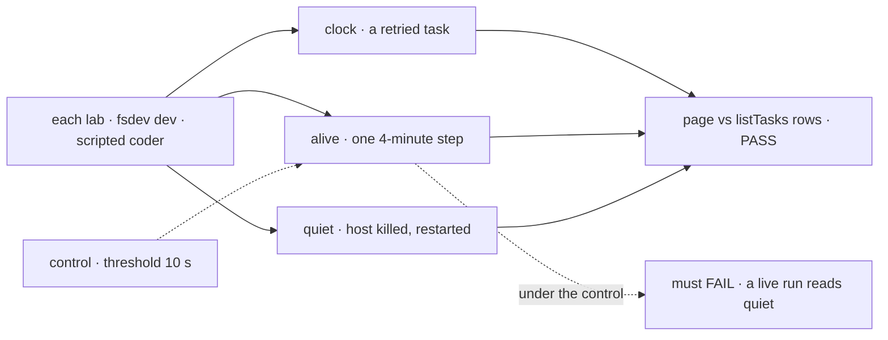

# FIX-2394 · Task time, progress and stall signals

**Spec** · [Decisions](DECISIONS.md)

## Who feels it, before and after

| Someone who… | Today | After |
|---|---|---|
| **watches a running task**, either lab | `running · "editing Login.tsx"`, no time | `working · 4m 12s · "editing Login.tsx"`, ticking |
| **has a task whose run died without ending its row** (FIX-2032) | `running`, forever | Amber `quiet for 40m`. The clock returns once the board takes the row back |
| **retried a failed task** | No clock | The clock restarts with the new attempt ([D2](DECISIONS.md#d2)) |
| **has a run in one long step** | `running` | `working · 9m 40s`, never `quiet`: the run is alive ([open](DECISIONS.md#open)) |
| **scans a pane's header** | `Background tasks · 3` | `2 running · 1 waiting · 1 failed · 28 done`, the same in both labs |
| **looks at a finished task** | No time on Claude Code-style's *Done* rows | `12m ago` |

## The goal, and how we'll know it's met

**In both labs, a person tells a task that is working from one whose run has stopped, and sees how
long each running task has worked on this attempt, without opening it or asking a model.**

| Is it the right goal? | |
|---|---|
| **The real need** | R-28: "A task running 40 seconds looks the same as one stuck for 18 of its 20 minutes" |
| **Smaller, and rejected** | `updated 3m ago` on running rows. A running request rewrites its row about every 40 s (its lease heartbeat, [POC](poc/row-fields/)), so every healthy row would read `now` |
| **Bigger, and not this issue's** | The `n/m` steps pill: no row carries a step count, so it waits for FIX-2164 ([D1](DECISIONS.md#d1)). A *no progress* badge for a live but stuck run ([open](DECISIONS.md#open)). `of 20:00`: a task has no time budget |
| **Not done if** | A healthy running row reads `quiet` · a row with no live run reads `working` past the threshold · a retried task's clock counts its earlier attempts · the labs word a row differently, or keep their own copy |



Every leg grades the page against the board's own rows. The control is the failure this design
exists to avoid: a live run called quiet.

| How we verify | |
|---|---|
| **Goal checks** | `goals/claude-code-style-lab/tells-a-stopped-task-from-a-working-one` and `goals/teammates-lab/tells-a-stopped-task-from-a-working-one`: the lab under `fsdev dev` on a fresh store, coding tasks on harness-manager's scripted coder, filed through the board's `createTask`. Model: n/a |
| **Signal** | **clock**: a cancelled-then-retried task reads `working · …` within 5 s of `now − run.startedAt` from `listTasks`, and moves on 10 s later. **alive**: a run in one 4-minute step never reads `quiet` while `in_progress`. **quiet**: SIGKILL the host mid-run, hold it down 4 minutes, serve again on the same store; within 30 s, before `attempts` changes, the row reads `quiet for` ≥ 4m in the warning tone, then `working` once the board takes it back. **counts**: the header equals `listTasks` counted by `taskRowView` state, one task waiting on a review |
| **Anti-game** | Read the page, never the adapter, the fake or React state. A row taken back before the page was read is CAN'T TELL |
| **Controls that must fail** | Planted in the lab's installed `task-signals` and put back (ER-6): `hair-trigger` (10 s threshold) fails **alive** · `never-quiet` fails **quiet** · `task-clock` (the task's own `startedAt`) fails **clock** · `raw-status` (counts from stored status) fails **counts** |

## What changes


Both labs draw the same signals from one registry item, which reads only what a `listTasks` row
already carries. No orchestration or harness code changes.

**`task-signals`**, a new `packages/ui/registry` item, installed in both labs like `spend` (epic D4):

- **Clock.** A `running` row reads `working · ` plus `spend`'s `durationText(now − run.startedAt)`.
- **Quiet.** A `running` row with `updatedAt` older than three minutes (1.5 × the default lease)
  reads `quiet for 7m` in the warning tone, in place of the clock. Never on a row kept open on its
  filed tasks (`keptOpenBy`: no lease), and never while the feed is stale.
- **Ended.** `done`, `failed` and `cancelled` rows read `12m ago`.
- **Count.** `taskCounts(states)` returns running, waiting, failed and done, without zeros.

```diff
 // labs/claude-code-style/src/components/TaskCard.tsx
-  {status.label}
+  <TaskTime row={task} now={now} stale={stale} />
   {task.statusNote ? ` · "${task.statusNote}"` : ""}
 // labs/claude-code-style/src/components/TasksPane.tsx
-  Background tasks · {active.length}
+  Background tasks · {taskCounts(tasks.map((t) => t.state))}
```

- **Claude Code-style.** `TaskRow` gains `state` (`taskRowView`, ER-4), `runStartedAt` and
  `keptOpen`. `TaskCard`, `TaskDoneRow` and `ThreadsBoard` draw `TaskTime`. `ThreadsBoard`'s
  `age(updatedAt)` goes, since it always read `now` on running rows.
- **Teammates.** `BoardTask` gains the same fields. FIX-2395's panel row and heading draw the item.
  FIX-2395's own elapsed time is deleted (ER-3).
- **Docs:** a `task-signals` row in `packages/ui/README.md`'s registry table; both lab READMEs say
  what a row's time and *quiet* mean. No site page describes these rows.

## What stays as it is

- Every orchestration, workforce and harness-manager file, and `taskRowView`.
- Claude Code-style's turn timer (`Thread.tsx`), and Teammates' status-line `age` (FIX-2397's).

## What's already here, and the debt

| Already here | What this does with it |
|---|---|
| `listTasks` rows: `updatedAt`, `run.startedAt`, `keptOpenBy` | **Builds on.** The [POC](poc/row-fields/) re-derives them |
| The lease heartbeat (`startLeaseRenewal`, lease ÷ 3) | **Builds on.** It is why `updatedAt` means *alive* |
| `taskRowView` (FIX-2379), `spend`'s `durationText` | **Reused** for state and format |
| FIX-2395's Teammates elapsed time (#4717) | **Superseded**: lifted, and started at the attempt ([D2](DECISIONS.md#d2)) |
| FIX-2168 (start and end on rows) · FIX-2164 (steps) | Not needed (FIX-2395 adds those fields) · left to it ([D1](DECISIONS.md#d1)) |

**The job is *say a thing has gone silent*, and this is the fourth way, each on its own noun.**
Searches for `stuck`, `stall`, `stale`, `quiet` and `lastActive` found the engine's stale-request
sweeper (a request), `useSession`'s `isStuck` with `stuck-request-banner` (the page's request) and
`isFeedStale` (the server). None reads a task row. *Quiet* borrows the sweeper's rule: threshold
at least twice the heartbeat.

| Debt | |
|---|---|
| **Removes** | FIX-2395's lab-local clock; `ThreadsBoard`'s misleading `age` on task rows |
| **Adds** | One registry item. A board with a longer lease reads `quiet` early. Rows don't publish their lease, and no lab sets one, so this is accepted by design |
| **Leaves** | The unfed `steps` field (FIX-2164). A live-but-stuck badge (filed only if the open fork goes that way) |

**Net: neutral.**

## Sign off

- **The goal**: tell a working task from a stopped one, with this attempt's time, in both labs.
  *If wrong:* the item and two labs' rows revert.
- **Debt, neutral**: adds one registry item; removes a lab copy and a misleading age. *If wrong:*
  the next app copies it a third time.
- **Open** · [*quiet* means the run stopped answering, not *no progress*](DECISIONS.md#open)
  (recommended). *If wrong:* a live but stuck run shows only a long clock.
- **D1** · [time and stall now; the pill stays FIX-2164's](DECISIONS.md#d1). *If wrong:* the pill
  lands one issue later.
- **D2** · [the clock starts at this attempt's run](DECISIONS.md#d2). *If wrong:* a retried task
  reads short by its earlier attempts.

Feature · `labs/claude-code-style`, `labs/teammates`, `packages/ui` registry · S · epic FIX-2369
wave 3 · after FIX-2399 and FIX-2397 · one PR for both labs
