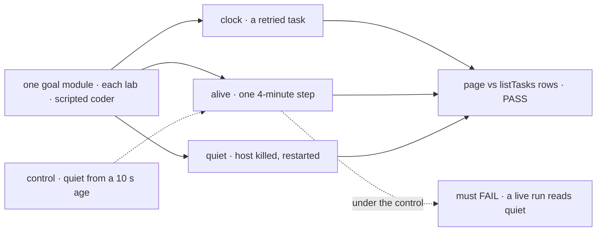

# FIX-2394 · Task time and stall signals

**Spec** · [Decisions](DECISIONS.md)

## Who feels it, before and after

| Someone who… | Today | After |
|---|---|---|
| **watches a running task**, either lab | `running · "editing Login.tsx"`, no time | `working · 4m 12s · "editing Login.tsx"`, ticking |
| **has a task whose run died without ending its row** (FIX-2032) | `running`, forever | Amber `quiet for 40m`, until the board takes the row back |
| **retried a failed task** | No clock | The clock restarts with the attempt ([D2](DECISIONS.md#d2)) |
| **has a run in one long step** | `running` | `working · 9m 40s`, never `quiet` ([open](DECISIONS.md#open)) |
| **scans a pane's header** | `Background tasks · 3` | `2 running · 1 waiting · 1 failed · 28 done`, both labs |
| **looks at a finished task** | No time on Claude Code-style's *Done* rows | `12m ago` |

## The goal, and how we'll know it's met

**In both labs, a person tells a task that is working from one whose run has stopped, and sees how
long each running task has worked on this attempt, without opening it or asking a model.**

| Is it the right goal? | |
|---|---|
| **The real need** | R-28: "A task running 40 seconds looks the same as one stuck for 18 of its 20 minutes" |
| **Smaller, and rejected** | `updated 3m ago` on running rows. The lease heartbeat rewrites a running row about every 40 s ([POC](poc/row-fields/)), so it always reads `now` |
| **Not this issue's** | The `n/m` steps pill (FIX-2164, [D1](DECISIONS.md#d1)). A *no progress* badge ([open](DECISIONS.md#open)). `of 20:00`: a task has no time budget |
| **Not done if** | A healthy row reads `quiet` · a row with no live run reads `working` past the threshold · a retried task's clock counts earlier attempts · the labs word a row differently or keep their own copy |



Every leg grades the page against the board's own rows. The control is the failure this design
exists to avoid: a live run called quiet.

| How we verify | |
|---|---|
| **Goal checks** | One module, `goals/lib/task-signals.mts`, taking the lab as a parameter, behind `goals/claude-code-style-lab/tells-a-stopped-task-from-a-working-one` and `goals/teammates-lab/tells-a-stopped-task-from-a-working-one`: `fsdev dev`, a fresh store, the scripted coder, tasks filed through `createTask`. Model: n/a. About ten minutes a lab; run on `main`, not on every PR |
| **Signal** | **clock**: a retried task reads `working · …` within 5 s of `now − run.startedAt`, and moves on. **alive**: a run in one 4-minute step never reads `quiet`. **quiet**: SIGKILL the host mid-run, keep it down 4 minutes, serve again; before `attempts` changes, the row reads `quiet for` ≥ 4m |
| **Anti-game** | Read the page, never the adapter or React state. A row taken back before the read is CAN'T TELL |
| **Controls that must fail** | One per signal, planted in the lab's copy of `taskSignal` and put back (ER-6); each re-runs only its leg: `quiet-from-age` (quiet once `updatedAt` is 10 s old) fails **alive** · `never-quiet` fails **quiet** · `task-clock` (the task's `startedAt`) fails **clock** |

The counts and formats are pure, so the registry item's unit tests cover them.

## What changes


Both labs draw the same signals from one registry item. It reads `run.startedAt` and `updatedAt`,
which a `listTasks` row carries today, and `leaseUntil`, which the board's action adds. No harness
code changes.

- **Orchestration, the board's `listTasks` action:** each row also carries `leaseUntil`, beside
  `updatedAt` and `spend`, as a client read only; the model's tool stays as it is. That lets
  *quiet* be the board's own `leaseLapsed`, with no third liveness rule and no threshold
  ([owners](DECISIONS.md#owners-with-4717)). It needs a `patch` changeset and a line in the README.

**`task-signals`**, a new `packages/ui/registry` item, installed in both labs like `spend` (epic
D4). One pure entry, `taskSignal(view, run, now, { stale })`, the way `spendLine` is; `TaskTime`
is a thin component over it, and `taskCounts(views)` sits beside it:

- **Clock.** A `running` row: `working · ` plus `durationText(now − run.startedAt)`.
- **Quiet.** A `running` row where `leaseLapsed` holds (imported from the browser-safe
  `@flow-state-dev/orchestration/tasks`) reads `quiet for 7m`, counted from `updatedAt`. A
  kept-open row has no lease, so it never reads quiet. Nor does any row while the feed is stale.
  `taskSignal` returns a `quiet` kind, and each lab's tone helper maps it.
- **Ended.** `done`, `failed` and `cancelled` rows: `12m ago`.
- **Count.** Running, waiting, failed and done, without zeros.

```diff
 // labs/claude-code-style/src/components/TaskCard.tsx
-  {status.label}
+  <TaskTime view={task.view} run={task.run} now={now} stale={stale} />
 // labs/claude-code-style/src/components/TasksPane.tsx
-  Background tasks · {active.length}
+  Background tasks · {taskCounts(tasks.map((t) => t.view))}
```

- **The adapters** compute `taskRowView` once per row and keep it (ER-4). Beside it they keep the
  row's `run.startedAt` and `leaseUntil`, which the view doesn't carry. No second `state` field.
- **Claude Code-style:** `TaskCard`, `TaskDoneRow` and `ThreadsBoard` draw `TaskTime`.
  `ThreadsBoard`'s `age(updatedAt)` goes.
- **Teammates:** `TeammatePanel`'s rows draw `TaskTime`, and its heading gets the count beside
  FIX-2395's `Tasks (N)`. FIX-2395's `taskState` gains the warning tone for the `quiet` kind
  ([owners](DECISIONS.md#owners-with-4717)).
- **Docs:** a row in `packages/ui/README.md`'s registry table; the orchestration README names
  `leaseUntil` on the action's rows. Both lab READMEs say what *quiet* means.

## What stays as it is

- The model's `listTasks` tool, `leaseLapsed`, `taskRowView`, and every workforce and
  harness-manager file.
- FIX-2395's order, grouping and `taskState` word and tone helper. Claude Code-style's turn timer.

## What's already here, and the debt

| Already here | What this does with it |
|---|---|
| `listTasks` rows: `updatedAt`, `run.startedAt`; no `leaseUntil` | **Builds on**, and **extends** with `leaseUntil`. The [POC](poc/row-fields/) shows what is there |
| `leaseLapsed` (`tasks/collection/internal.ts`), the board's claim and fence rule | **Reused** as *quiet*, so a lab and the board agree on when a row has no live run |
| `taskRowView`, `spend`'s `durationText` | **Reused** |
| FIX-2395 (#4717): `taskState`, `Tasks (N)`, task-level times | **Extends** `taskState` with one tone; the rest is left as it is ([owners](DECISIONS.md#owners-with-4717)) |
| FIX-2168 · FIX-2164 | Closed by #4717 D1 · left to it ([D1](DECISIONS.md#d1)) |

**Saying something has gone quiet: this is the fourth way, and each way is about a different
thing.** The engine's stale-request sweeper is about a request; `isStuck` with
`stuck-request-banner` is about the page's own request; `isFeedStale` is about the server. Searches
for `stuck`, `stall`, `stale`, `quiet` and `lastActive` found nothing that reads a task row
for a person. The board's own `leaseLapsed` does, for claiming, so *quiet* reuses it.

| Debt | |
|---|---|
| **Removes** | `ThreadsBoard`'s `age` on task rows, which always read `now` on running ones |
| **Adds** | One registry item, and one client-read field on the board's action |
| **Leaves** | The unfed `steps` field (FIX-2164) |

**Net: up slightly, by design.** It adds one item and one field, and none of it is a second way to do something.

## Sign off

- **The goal**: tell a working task from a stopped one, with this attempt's time, in both labs.
  *If wrong:* the item and two labs' rows revert.
- **Debt, up slightly**: adds one registry item and one row field; removes a misleading age. *If wrong:* the next app
  copies it a third time.
- **Open** · [*quiet* means the run stopped answering](DECISIONS.md#open) (recommended). *If
  wrong:* a live but stuck run shows only a long clock.
- **D1** · [time and stall now; the pill stays FIX-2164's](DECISIONS.md#d1). *If wrong:* the pill
  lands one issue later.
- **D2** · [the clock starts at this attempt's run](DECISIONS.md#d2). *If wrong:* a retried task
  reads short by its earlier attempts.

Feature · `labs/claude-code-style`, `labs/teammates`, `packages/ui` registry, one `listTasks` field · S · epic FIX-2369
wave 3 · after FIX-2399 and FIX-2397 · one PR for both labs
