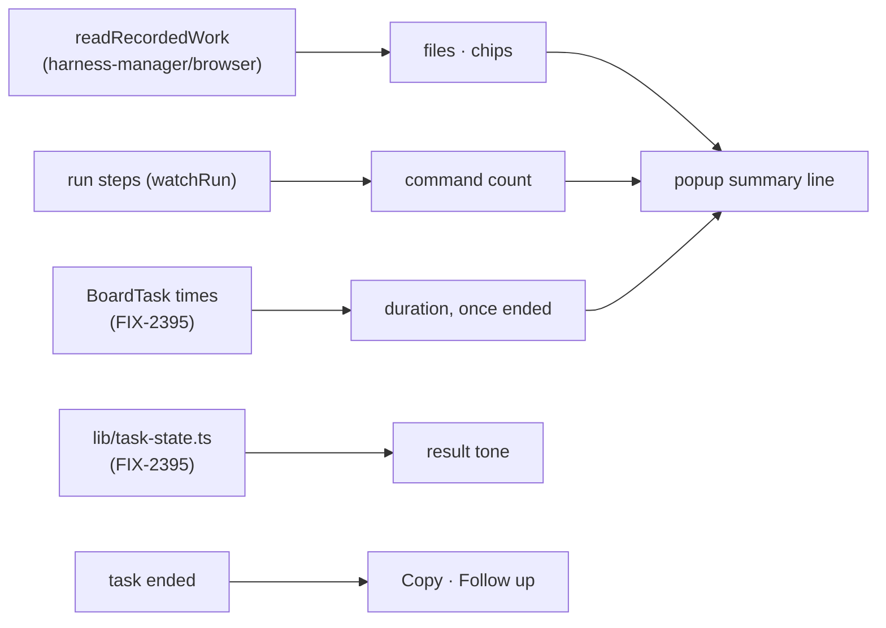

# FIX-2396 · A coding task's popup sums up what it did

**Spec** · [Decisions](DECISIONS.md)

## Who feels it, before and after

| Someone who… | Today | After |
|---|---|---|
| **opens a finished coding task in Teammates** | Opens each folded step group to learn which files changed and what ran | Reads one line under the title: `Edited 2 files · ran 5 commands · 2m 14s`, with a chip per edited file. Files show for a harness that records them (Claude Code today); Codex and Cursor tasks read `Ran 5 commands · 2m 14s` until theirs do (D1) |
| **opens a task that failed** | Sees the error in red, and any result below it in the same green as a success | The result box takes the task's status: green when done, red when failed, grey when cancelled |
| **wants the result somewhere else** | Selects the text by hand | Presses **Copy**: the result, or the error when there is no result |
| **wants more done after a task ends** | Closes the popup, finds the conversation that filed it, and types the context in | Presses **Ask Chief of Staff to follow up**: the popup closes, that conversation opens, and its composer holds `Follow up on "<task title>": ` with the cursor at the end |

## The goal, and how we'll know it's met

**A coding task's popup says what the run changed, how it ended and how long it took, without
opening a step, and gives two ways to act on the outcome.**

- **Smaller, and rejected:** colour and Copy only. The step groups stay the only way to learn
  what changed, which is the issue's main complaint.
- **Bigger, and not this issue's:** a diff view of the edited files (FIX-2384 owns diffs); Codex
  and Cursor recording their file touches the way Claude Code does (a change in those two
  packages, filed as a follow-up, D1); the summary on the task's line in the thread.
- **Not done if:** the files come from anywhere but the package's recorded-work reader, the
  duration shows on a task still running, the result's tone is decided in the popup rather than
  by the lab's one task-state helper, or the follow-up button types into a conversation other
  than the one that filed the task.

**Depends on FIX-2395 (#4717), which lands first.** It adds the task times to the board's
`listTasks` read and through `toBoardTask` (today `taskRowView.times` arrives null from that
read, so no duration could show), and `lib/task-state.ts`, the lab's one word-and-tone helper for
a task. This issue reads both and adds neither. Its implementation stacks on FIX-2395's.

**How we verify.**

- **Unit, `labs/teammates/test/task-summary.test.tsx`:**
  - The summary line from recorded files, a command count and a duration: files omitted when the
    run recorded none (`files: null`), a command still running not counted, no duration while
    running.
  - Through the fixture lab and `App` (the fixture's adapter answers the recorded-work read the
    way a Claude Code run's collections do): a finished Claude Code task's popup shows
    `Edited 1 file · ran 1 command · …` and a `README.md` chip; a Codex task's shows no file
    part; a failed task's result box takes the failed tone; Copy writes the result; the
    follow-up button closes the popup and leaves `Follow up on "…": ` in the filer's composer,
    after any draft already there.
- **Controls that must fail, shown red once in the PR:** count the run's edit steps instead of
  the recorded files; colour the result box green unconditionally; prefill the composer of the
  conversation that was open rather than the filer's.
- **By hand:** `pnpm --filter @flow-state-dev/teammates dev`, file a coding task, open its popup
  when it ends; a screenshot of done and failed goes in the PR.

## What changes

- `labs/teammates/src/adapter.ts`: `BoardTask` carries the run's `requestId` beside
  `runSessionId`; the adapter gains `watchRecordedWork(run)`, a thin call to `readRecordedWork`
  read again when the task ends; a pure `runSummaryLine` puts files, commands and duration in
  words.
- `labs/teammates/src/components/Popups.tsx`: the task popup draws the summary line and chips,
  takes the result's tone from `lib/task-state.ts`, and adds Copy and the follow-up button.
- `labs/teammates/src/App.tsx`, `Conversation.tsx`, `Composer.tsx`: a follow-up selects the
  filing conversation and hands its composer the words to add. Props, not `saveDraft` alone:
  `saveDraft` leaves a box that is already open showing what it showed, and the filer's
  conversation is usually the one open under the popup.
- `labs/teammates/test/fake-lab.ts`: the fixture answers the recorded-work read.

## What's already here, and the debt

- **Reused:** `readRecordedWork` from `@flow-state-dev/harness-manager/browser` (FIX-2385, which
  names this issue as a consumer) for the files; FIX-2395's task times and `lib/task-state.ts`;
  the registry's `durationText` (already copied into the lab) for `2m 14s`; `useDraft`'s
  per-conversation draft for the prefill. Commands are counted from the steps the popup already
  watches, by the shell flag `toolSubject` already sets (`code`); no tool args are re-parsed.
- **Only Claude Code records file touches today.** Codex and Cursor record plans and pull
  requests but not `observed-file-ops`, so their tasks show no file count. Filed as a follow-up
  for those two packages (D1).
- **The duration's start.** The board keeps a task's first `startedAt` across a retry; the run
  link's `startedAt` is this attempt's. The line uses whichever FIX-2395 carries; if it is the
  task's, a retried task's duration spans its attempts (D2).
- **FIX-2349** fixed this popup's wrong FAILED header; nothing here touches the header status.
