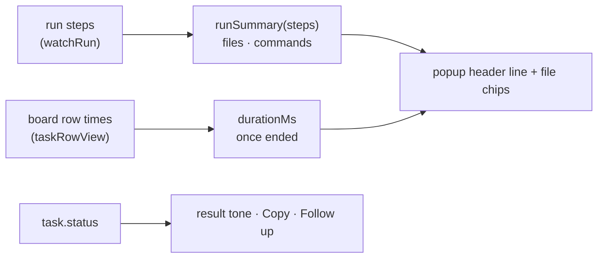

# FIX-2396 · A coding task's popup sums up what it did

**Spec** · [Decisions](DECISIONS.md)

## Who feels it, before and after

| Someone who… | Today | After |
|---|---|---|
| **opens a finished coding task in Teammates** | Opens each folded step group to learn which files changed and what ran | Reads one line under the title: `Edited 2 files · ran 5 commands · 2m 14s`, with a chip per edited file |
| **opens a task that failed** | Sees the error in red, and any result below it in the same green as a success | The result box takes the task's status: green when done, red when failed, grey when cancelled |
| **wants the result somewhere else** | Selects the text by hand | Presses **Copy**: the result, or the error when there is no result |
| **wants more done after a task ends** | Closes the popup, finds the conversation that filed it, and types the context in | Presses **Ask Chief of Staff to follow up**: the popup closes, that conversation opens, and its composer holds `Follow up on "<task title>": ` with the cursor at the end |

## The goal, and how we'll know it's met

**A coding task's popup says what the run changed, how it ended and how long it took, without
opening a step, and gives two ways to act on the outcome.**

- **Smaller, and rejected:** colour and Copy only. The step groups stay the only way to learn
  what changed, which is the issue's main complaint.
- **Bigger, and not this issue's:** a diff view of the edited files (FIX-2384 owns diffs), or the
  summary on the task's line in the thread. Both read the same steps, so this one doesn't block
  them.
- **Not done if:** the file count counts edit calls rather than files, a failed edit counts as an
  edit, the duration shows on a task still running, or the follow-up button types into a
  conversation other than the one that filed the task.

**How we verify.**

- **Unit, `labs/teammates/test/task-summary.test.tsx`:**
  - `runSummary` over steps from each harness's tool shapes (Claude Code `Edit`/`Write` with
    `file_path`, Codex `file_change` with `changes[].path`, Cursor `edit` with `path`): two edits
    to one file count once; a failed edit is not counted; shell commands count across `Bash`,
    `command_execution` and `shell`.
  - `toBoardTask` reads `durationMs` from a completed row's `startedAt`/`completedAt`, and none
    from a running row.
  - Through the fixture lab and `App`: a finished Codex task's popup shows
    `Edited 1 file · ran 2 commands · …` and a `README.md` chip; a failed task's result box is
    the failed tone; Copy writes the result to the clipboard; the follow-up button closes the
    popup and leaves `Follow up on "…": ` in Chief of Staff's composer.
- **Controls that must fail, shown red once in the PR:** count edit calls instead of distinct
  paths; drop the state check so a failed edit counts; colour the result box green
  unconditionally; prefill the composer of the selected conversation rather than the filer's.
- **By hand:** `pnpm --filter @flow-state-dev/teammates dev`, file a coding task, open its popup
  when it ends; a screenshot of done and failed goes in the PR.

## What changes

- `labs/teammates/src/adapter.ts`: `SessionStep` gains `paths` for a file-changing tool step,
  read from its args; a new `runSummary(steps)` gives the edited files and the command count;
  `BoardTask` gains `durationMs`, from the row view's times once the task ended.
- `labs/teammates/src/components/Popups.tsx`: the task popup draws the summary line and chips
  above the result, tones the result by status, and adds Copy and the follow-up button
  beside the task's actions.
- `labs/teammates/src/App.tsx`, `Conversation.tsx`, `Composer.tsx`: a follow-up selects the
  filing conversation and hands its composer the words to add.
- `labs/teammates/test/fake-lab.ts`: fixture tasks report `durationMs` when they end.

## What's already here, and the debt

- **Reused:** the registry's `durationText` (from `spend.tsx`, already copied into the lab) for
  `2m 14s`; `taskRowView`'s `times` for the duration; `useDraft`'s per-conversation draft for the
  prefill; `toolSubject`'s knowledge of Codex's `file_change` shape is the model for `paths`.
- **The duration spans attempts.** A board keeps a task's first `startedAt` across a retry, so
  a retried task's duration includes the wait between attempts. Said once in the D2 notes, not
  fixed here: it is orchestration's field.
- **Lab-local, on purpose (D1).** The Claude Code-style lab has its own popup and would need the
  same helper; when it does, `runSummary` moves to the registry's `tool-naming.ts` beside
  `toolSubject`.
- **FIX-2349** fixed this popup's wrong FAILED header; nothing here touches the header status.
