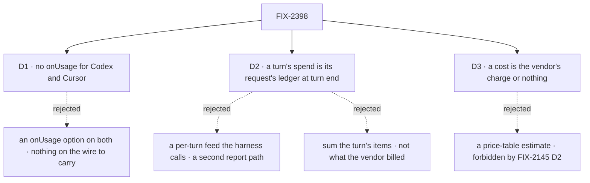

# FIX-2398 · Decisions

[Spec](SPEC.md) · **Decisions**

FIX-2288 put a task's spend on its row and every harness reports into it. These three say what
"usage for every harness" means when two vendors send no reading mid-run, where a Kitchen Sink
turn's spend comes from, and what a cost is.

## The tree

Solid edges are what you're signing. Dashed edges lost, and the label says why.

## D1 · Codex and Cursor get no `onUsage`; Teammates' gap is a reader and a dropped `onActivity`

| | |
|---|---|
| **Instead of** | An `onUsage` option on `codexAgent` and `cursorAgent`, as the issue asks |
| **Because** | `onUsage` carries a subscription window a vendor announces mid-run. Claude Code sends `rate_limit_event`; Codex's wire has `thread.*`, `turn.*`, `item.*` and `error` only, and Cursor's has `usage` (tokens) only (`packages/codex/src/types.ts`, `packages/cursor/src/types.ts`). Their tokens and cost already reach every task row through `reportHarnessSpend`, in all three apps. Codex's windows come from `readCodexUsage` as a `harnessUsageAction` reader. What Teammates actually drops is Cursor's `onActivity` (its host passes `cwd, resume, onSession, onSteerable` only) and any reader |
| **Locks in** | An app that wants Codex's windows registers a reader; nothing arrives by itself. If Codex or Cursor later stream a window event, `onUsage` is added in that harness package then, one hook per real event |

**What would change my mind:** a Codex or Cursor wire event carrying a limit reading. Then the
option is cheap and belongs in that package.

## D2 · A turn's spend is its request's ledger at turn end, folded by `taskSpendView` and kept on the turn record

| | |
|---|---|
| **Instead of** | A feed callback on `HarnessSessionFeeds` the harness calls with its usage; or a sum over the turn's items |
| **Because** | Every harness already reports its run into the request's ledger, from its `finally`, however the run ends. The session flow's request `onFinished` runs after the harness block returns and before the ending hands the ledger on, so `readRequestSpend(ctx)` there is the whole turn: a failed or stopped turn included. Folding it with `taskSpendView` gives a turn the same view a task has, so one component draws both (tenet 5: one fold). A feed callback would be a second report path beside `reportHarnessSpend`, kept in step by every harness |
| **Locks in** | A turn's count is final, not live: it appears when the turn ends. The record's `spend` has the view's shape, so a change to the view changes both readers at once |

**What would change my mind:** a page that must show a turn's tokens rising while it runs. Then
the turn writes its live part on a timer, as a task's request does (FIX-2288 D2).

## D3 · A cost is the vendor's billed charge, summed, or `null`

| | |
|---|---|
| **Instead of** | `$0.00` for a subscription run, or a price-table estimate for a run with tokens and no charge |
| **Because** | FIX-2145 D2 and the epic forbid estimates. A subscription run is not billed per run, so a dollar figure for it would be invented. `costUsd` is the sum of the sources that reported one; `null` when none did, and the line then shows tokens only |
| **Locks in** | A mixed task (an API-key retry after a subscription run) shows the API-key part's charge, with tokens covering both. Apps never compute a cost |

## Decided, not asked

- **The turn's duration is `endedAt − at`.** `at` is already the turn's start; `endedAt` is
  written in the same turn-end write as `spend`. A task's elapsed time is FIX-2394's, on FIX-2168's
  row fields; the component takes `durationMs` so both feed it.
- **The registry component takes a structural summary**, the view's fields plus optional
  `attempts` and `durationMs`, and no row type: a turn and a task call it the same way. A
  harness label is the app's (`harnessLabel`), so the registry names no harness.
- **The session flow carries the usage query** (`harnessUsage`, readers from `usageReaders`,
  default none). The collection is not client-readable, so a write with no query on the flow
  is invisible.
- **Kitchen Sink installs the byte copy in PR 1**: its drift check requires every registry file.
- **A turn-end write that fails is a note, never a failed turn**, like the pull-request check.

## Considered and dropped

| Alternative | Why it lost |
|---|---|
| Keep each lab's own spend line | Four copies of one line, which ER-3 says go to the package |
| Put `costUsd` on FIX-2379's row view only | The row view carries the spend view (ER-4); the cost belongs in the fold it carries |
| Write the turn spend from a request-end hook | It runs after the request is over, so a page that refreshes on the turn's end can read before it lands; `onFinished` runs after the harness reported and before the request ends |

## Analysis

2026-10-31, read from `main` 675f614. **Right approach.** Value: the four apps' "what did it cost"
line. Reuse: every Adds row composes an existing fold or writer ([Builds on / Adds](SPEC.md#whats-already-here-and-the-debt)).
Scope: D1 narrows the issue's Codex/Cursor ask to what their wires carry (recorded). Debt: net
down after PR 5.

## How it got here

- **Drafted (Oct 31)** from the issue and epic FIX-2369's seams, with the Codex and Cursor wire
  types read to settle D1.
