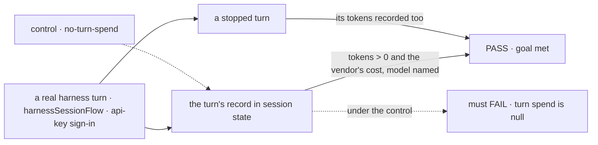
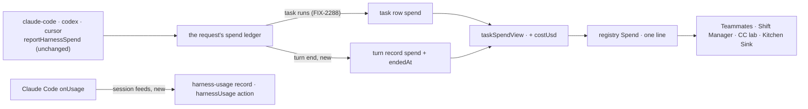

# FIX-2398 · What each task and turn cost

**Spec** · [Decisions](DECISIONS.md)

## Five people, before and after

| Someone who… | Today | After |
|---|---|---|
| **picks a harness for a coding task in Teammates** | Sees the harness and model the last run used, and nothing about what it cost. Choosing by cost is a guess | Sees tokens, the vendor's charge when there is one, and attempts on the card and in the popup, and a total for the Background list |
| **runs a Codex or Cursor task in any app** | Tokens reach the task row already, but no app but Claude Code-style draws them | The same line every harness gets: Codex and Cursor tokens and cost through the same view as Claude Code's |
| **works a Kitchen Sink harness session** | No turn records what it spent, and a Claude Code window warning heard mid-run is dropped | Each turn records its tokens, cost and duration; the window reading lands in the person's usage record, readable through the session flow's usage query |
| **opens a task in Shift Manager** | The inspector's *Harness · tokens · cost* section is a "not built yet" gap | The section shows the task's spend line from the row |
| **runs a subscription-billed harness** | n/a | Sees tokens and *no dollar figure*, never an estimate |

The row already carries a task's spend (FIX-2288) and every harness already reports it. What is
missing is one way to draw it, the cost in the view, and the same record for a Kitchen Sink turn,
which has no task row.

## The goal, and how we'll know it's met

**Every app that shows a coding task or a harness turn shows what it spent, in the same words:
model, tokens, the vendor's charge when it reported one, and for a turn how long it took.**

| Is it the right goal? | |
|---|---|
| **The real need** | Pick a harness by what it costs, and see a run's spend wherever the run shows ([FIX-2398](https://linear.app/fixpoint-labs/issue/FIX-2398), epic [FIX-2369](../../epics/FIX-2369/SPEC.md)'s *see what the work is doing*) |
| **Smaller, and rejected** | "Teammates draws the row's tokens." Hittable in one lab file, and leaves Kitchen Sink recording nothing and three more copies of the same line |
| **Bigger, and not this issue's** | A task's elapsed time and stall signals: FIX-2394, on the `startedAt`/`endedAt` row fields FIX-2168 adds. This ships the slot they fill. Subscription windows for Codex and Cursor: neither vendor sends one during a run ([D1](DECISIONS.md#d1)) |
| **Not done if** | The view has a cost but the line never shows it · a turn's count is read off a scripted harness only · a subscription run shows `$0.00` · a turn that failed or was stopped records nothing |



The check reads the turn record the page reads, through the flow's own state, never the
harness's handle.

| How we verify | |
|---|---|
| **Goal check** | `goals/harness-manager/a-turn-records-what-it-spent/` · real Claude Code on an API key (so a charge is reported) · run by the implementer at completion where the host can run Claude Code, else handed to `fsd-qa` · verdict in the implementation PR |
| **Signal** | **t**: after a completed turn, its record's `spend` names the model, `inputTokens + outputTokens > 0`, `costUsd > 0`, and `endedAt ≥ at`. **s**: a stopped turn's record carries `spend` too |
| **Input** | A one-line prompt with a fresh token to echo. Any other prompt must pass |
| **Anti-game** | Read the session state the page reads. Don't assert on `HarnessRunSpend` or a mocked ledger: both pass while the turn record stays empty |
| **Control that must fail** | `GOAL_CONTROL=no-turn-spend` (the flow skips its turn-end write). **t** and **s** FAIL on `spend` being `null`. Today's `main` fails the same way |

## What changes



One fold (`taskSpendView`) for a task and a turn, one component for every app. A turn's spend is
the request's own ledger at its end ([D2](DECISIONS.md#d2)).

**A host, after:**

```diff
  harnessSessionFlow({
    kind: "claude-code-session",
    workspace,
+   // The session flow's `harnessUsage` query reads what `onUsage` records. Optional.
+   usageReaders: { "claude-code": () => readClaudeUsage({ env }) },
    agent: (feeds) => claudeCodeAgent({ ...feeds, permissionMode: "bypassPermissions" }),
  });
```

```diff
- <Spend task={task} split harness />            // a lab's own copy
+ <Spend spend={row.spend} attempts={row.attempts} split harnessLabel={label} />  // the registry's
```

**Docs:** harness-manager README (the turn record's `spend` and `endedAt`, the `onUsage` feed,
`usageReaders`), orchestration README (`costUsd` on the spend view), ui README (the `spend`
item). No new docs-site page: the harness session and task-board pages gain one line each.

## The PR plan

| PR | What | Base |
|---|---|---|
| 1 · package slice | `taskSpendView.costUsd`; the session flow's turn spend, `onUsage` feed and `harnessUsage` action; the registry `spend` item and Kitchen Sink's byte copy | FIX-2387's implementation branch (the turn-end region), else `main` |
| 2 · Kitchen Sink | `harness-session.tsx` draws the latest turn's line | After 2410 → 2386 → 2384 (wave 2) |
| 3 · Shift Manager | the inspector's section and Tasks' COST column | After PR 1 and FIX-2418 |
| 4 · Teammates, stack 3 | card, popup and Background total; Cursor gets `onActivity` | After 2380 → 2382 (wave 4) |
| 5 · Claude Code-style | its `Spend.tsx` becomes the registry copy | After PR 1 |

## What stays as it is

- How a harness reports: `reportHarnessSpend` and the request's ledger, untouched. Codex and
  Cursor already report tokens and cost through it.
- The task row's `spend` field and its writes (FIX-2288). Only the fold gains a field.
- `recordHarnessUsage`'s rules. The session flow is one more writer through it, as the manager
  and the session door already are.
- FIX-2145 D2: a cost is only ever the vendor's billed charge.

## What's already here, and the debt

| Already here | What this does with it |
|---|---|
| `taskSpendView`, the fold of a row's spend (FIX-2288) | **Extends**: `costUsd`, the sum of reported charges |
| `requestSpendSources`, `readRequestSpend` (FIX-2145, FIX-2288) | **Builds on**: the turn's spend is the request's pending spend at its end |
| `recordHarnessUsage`, `harnessUsageCollection`, `harnessUsageAction` | **Reuses**: the session feeds call the one writer; the session flow carries the one query |
| Claude Code-style `Spend.tsx` | **Replaces** (PR 5): lifted into the registry, taking a view, not a lab row |
| The turn record (`harnessTurnRecordSchema`) | **Extends**: `spend`, `endedAt` |
| Anything else that draws a task's tokens | **None** but CC lab's: searched `tokenCount`, `spendLine`, `inputTokens` across `labs/`, `apps/`, `packages/*/src` |
| FIX-2288 D3, model and harness from the run's report | **Kept** |
| Epic ER-4, consume the owner's artifact | **Kept**: the row view is FIX-2379's; this adds to the spend view it carries, not a second view |

| Adds | Existing piece considered | Why it doesn't fit / how composed |
|---|---|---|
| `TaskSpendView.costUsd` | `TaskSpendSource.costUsd` | Composed: summed from the sources the view already folds |
| Turn `spend` and `endedAt` | `taskSpendView`; the task row | Composed: the turn stores `taskSpendView` of its own request's sources. A turn has no task row |
| `HarnessSessionFeeds.onUsage`, `usageReaders` | The manager's and the door's `onUsage` | Composed: the same one-line call into `recordHarnessUsage` |
| Registry `spend` item | CC lab's `Spend.tsx` | Lifted, so four apps stop copying it |

| The debt | |
|---|---|
| **Removes** | (PR 5) Claude Code-style's own `Spend.tsx` and `tokenCount` |
| **Adds** | None: every addition reuses an existing fold or writer |
| **Leaves** | Two spend shapes and two cost rules for one run (FIX-2330). The manager run row's own token count (FIX-2298) |

**Net: down** once PR 5 lands: one copy goes, nothing second is added.

## Sign off

**[The goal](#the-goal-and-how-well-know-its-met), at that size:** every app's task and turn shows
model, tokens, the vendor's charge and (for a turn) its duration, through one component. If wrong:
we ship one more lab copy, or hold this for task timing FIX-2394 already owns.

**[The debt](#whats-already-here-and-the-debt), net down:** a lab copy goes; no second fold. If
wrong: a fifth spend line someone keeps in step.

1. **[D1](DECISIONS.md#d1) · Codex and Cursor get no `onUsage`.** Their tokens already reach the
   row; neither vendor sends a window reading mid-run. If wrong: a feed with nothing to carry, or
   Teammates still missing Codex's windows, which a reader supplies.
2. **[D2](DECISIONS.md#d2) · A turn's spend is its request's ledger at turn end, folded by
   `taskSpendView`.** If wrong: a second fold, or a harness callback beside `reportHarnessSpend`.
3. **[D3](DECISIONS.md#d3) · A cost is the vendor's charge or nothing.** If wrong: a subscription
   run reads `$0.00`, or an estimate nobody billed.

**Open: none.** Number 1 is the one to weigh.

Feature · `orchestration` + `harness-manager` + `ui` registry, then four app PRs · small package slice · epic FIX-2369
