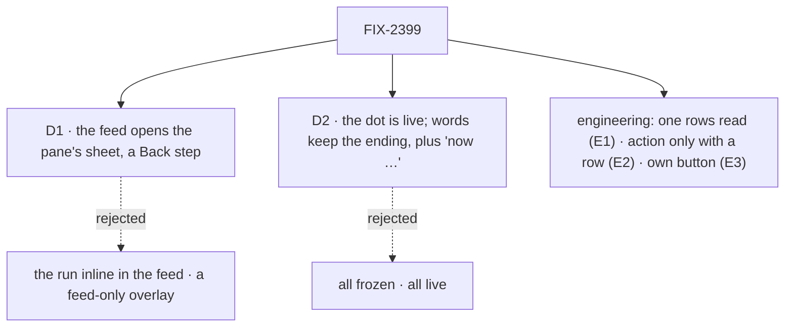

# FIX-2399 · Decisions

[Spec](SPEC.md) · **Decisions**

The epic placed this already: a lab-only change in wave 3, first in the Claude Code-style
`Entry.tsx` / `TasksPane.tsx` / `TaskCard.tsx` stack, with FIX-2394 after it
([FIX-2369 build order](../../epics/FIX-2369/DECISIONS.md#coordination-seams)). The selection
it asks to lift is already in the app (FIX-2400). What is left to decide is where an open from
the feed lands, and what a line's dot means once the task moves on.

## D1 · The feed opens the task in the pane's own sheet, as a Back step

| | The pane's sheet, via `openTaskOf` (chosen) | The full run inline, under the line | A feed-only overlay |
|---|---|---|---|
| One open task per session, shared with the pane and the address | yes | no, a second "open" | no, a second "open" |
| The pane shows which task is open | yes, its row is marked | no | no |
| Action row (Cancel, Steer, Retry) reachable from the feed | yes, the sheet's | needs a copy | needs a copy |
| Back and reload | as a pane pick (FIX-2400 D1) | lost | new address rule |
| New code | a prop and a button | a second work view in the feed | a second sheet |

- **Because:** threads mode's *View task* already works this way and is what the issue holds up
  as right. One selection means the address, Back, the pane mark and the action row all follow
  without new rules (tenet 2: refine what is there, don't add beside it).
- **Locks in:** an open from a feed line is the same as a pane pick: it adds a Back step, and the
  page's address names the task.

## D2 · The dot shows the task now; the words keep what the line reported

| | Dot live, words kept, "now …" when they differ (chosen) | Dot and words live | Both frozen (today) |
|---|---|---|---|
| A retried task's old result line | "failed · now running", blue pulsing dot | "running"; the line no longer says it failed | "failed", red dot |
| The feed as a record of what happened | kept | rewritten | kept |
| You see from the feed that a task is still going | yes | yes | no |

- **Because:** the feed is a history: a line said "failed" because the task failed then, and the
  main session's next words answer that. Rewriting it makes the turn after it read wrong. The dot
  is the live part the issue asks for, and "now running" says why it disagrees with the words.
- **Locks in:** a line's words never change after they land; the dot and the "now" suffix do.

## Decided, not asked

- **E1 · The session's task rows are read once, in the app.** The rows go to the
  main thread and the pane. Today threads mode reads the board twice. Session mode would read it
  twice too if the main thread kept its own watch, and the read is heavy (holds, harness, review,
  error per row). The rows are keyed by the session they were read for, so a session switch never
  judges the open task against the last session's rows (the reason the panes are keyed by session
  today).
- **E2 · *Open task* shows only for a task the board lists.** A routed answer has no row, and an
  id the pane can't find would open nothing. The address's own missing-task rule is unchanged.
- **E3 · *Open task* is its own button beside the fold toggle**, not the line itself. Buttons
  can't nest, and the fold (FIX-2362) stays.
- **E4 · A task's own sheet draws its entries with no *Open task*.** Its lines name tasks on the
  task's board, not on this session's, so the action would point nowhere.
- **E5 · A filed task's id is read by one rule.** `filedTaskOf`'s check moves to `lib/tool-steps.ts`;
  `entriesOf` and `toolRun` both call it.
- **E6 · In threads mode the result line gets *Open task* too**, through the same call; the board
  draws no mark on the open card (not asked for, and the sheet names the task).
- **E7 · The goal's leg 1 needs no model.** A task's ending lands as a line in the main session
  before any turn reads it (`workforce/src/conversation-board/task-settled.ts`), so leg 1 runs
  like `acts-on-an-opened-task`. Only leg 2 (a start line needs the main session to call
  `createTask`) uses the lab's default model.

## Considered and dropped

- **Make the whole result line open the task, and drop the fold.** One press fewer, but loses
  reading the reply in place, which FIX-2362 added on purpose.
- **Let `Thread` keep its own `watchTasks` in both modes.** One line, but a second heavy read in
  session mode; E1 removes the one threads mode has today instead.

## Open

None.

## Analysis

**2026-11-04, by the spec author** (no fresh sub-agent could be started in this session; a
reviewer may ask for one). Verdict: **build as scoped, smaller than filed** — the selection lift is
already on `main`. Reuse: both adds are existing calls and tokens in new places; no second
selection, no package change. Question 7: four ways into one selection, none a new mechanism.
Goal: the goal check grades the page against `listTasks`, and each control removes exactly one
behaviour the goal names (the open, the live dot, the shown row).

## How it got here

- **Draft** — the issue framed as a missing way from the feed into the selection the app already
  keeps (FIX-2400); built on threads mode's *View task* call, the pane's mark and FIX-2382's
  sheet, with one read of the rows.
