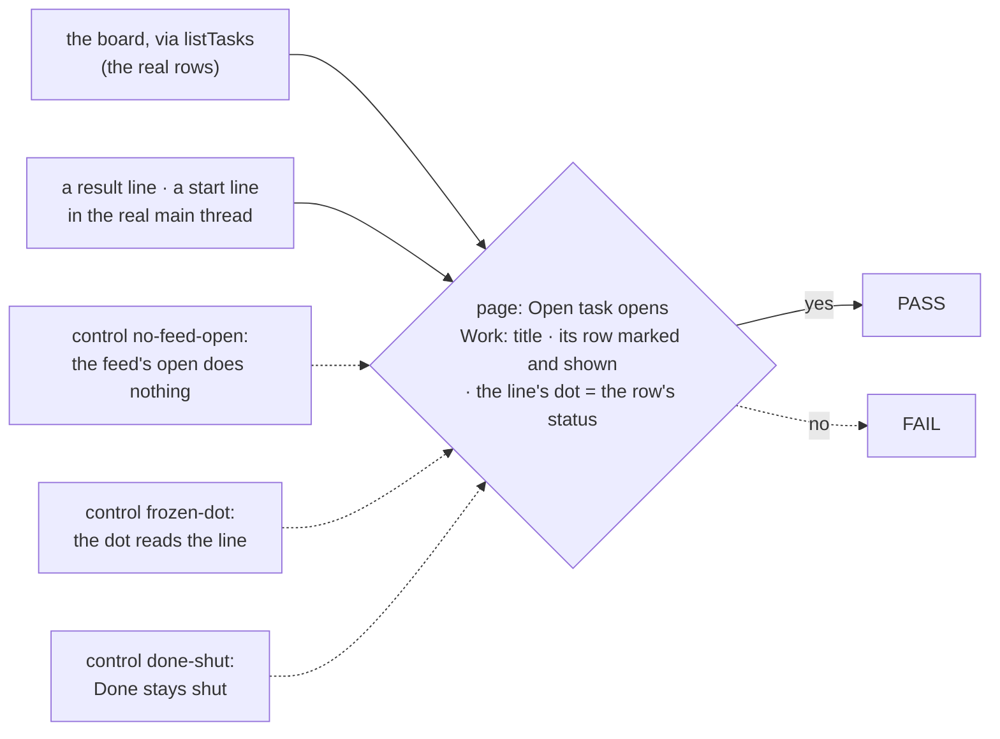
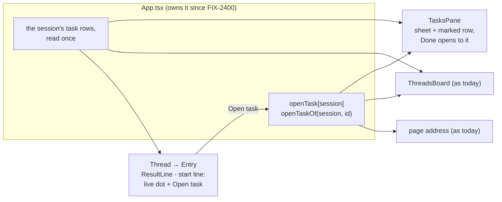

# FIX-2399 · Result lines open the task: one shared task selection across feed and pane

**Spec** · [Decisions](DECISIONS.md)

## Who feels it, before and after

| Someone who… | Today | After |
|---|---|---|
| **reads a background result in the Claude Code-style main thread** and wants the whole run | Clicks the line, which only unfolds the reply. Finds the task in the pane's *Done* group, which is shut, and opens it there | Presses *Open task* on the line. The task's sheet opens over the main thread, and its row in the pane is marked, with *Done* opened to show it |
| **sees the main session start a task** ("Start a task: Fix the login copy") | A line of words with no way to the task | The same line has a status dot and *Open task* |
| **retries a task that failed, then scrolls back to its result line** | The line's dot still says failed, with nothing to say the task is running again | The dot shows the task as it is now, and the line adds "now running"; the words still say what the line reported |
| **opens a task from the feed, then presses Back or reloads** | (no such open) | The same as opening from the pane: Back closes it, a reload or a link reopens it |
| **reads a conversation answer that has no task row** (a routed answer) | A result line | The same line, with no *Open task*: there is nothing to open |

## The goal, and how we'll know it's met

**In the Claude Code-style lab, a person gets from any line in the main thread that names a
task (a result, or the line where the main session started it) to that task's full run in one
press, sees the task's status as it is now on that line, and finds the same task marked in the
pane.**

- **The real need** (R-33, "see what the work is doing", impact 4/5): "In session mode a
  ResultLine only toggles a summary, and 'Started a task' has no link. Reaching the full run
  means finding the row in the collapsed Done group. Threads mode's 'View task' does this well."
- **Already done, so not this issue's:** the issue's first ask, "lift openId into App". The
  lab's app has kept the open task per session since FIX-2400 (#4492), so the page's address
  can name it. This issue makes the feed a second way into that one selection.
- **Smaller, and rejected:** *Open task* on the result line only. The start line is where a
  person first sees a task exists; leaving it as dead words keeps half the complaint.
- **Bigger, and not this issue's:** one session overlay shared across the labs (FIX-2340);
  time, progress and stall signals on the pane's rows and lines (FIX-2394, which builds on this
  change); marking the open card on the threads board.
- **Not done if:** *Open task* opens a sheet but the pane's row stays hidden in a shut *Done*;
  the dot reads the line's own recorded status, so a retried task still reads failed; the start
  line has no way to its task; or opening from the feed is not in the page's address, so Back
  and reload lose it.

Every signal is graded on the rendered page against the board's own rows, so a dot that reads
the line, or an open that names the wrong task, fails.

**How we verify.** A new goal, `goals/claude-code-style-lab/opens-a-task-from-the-feed`
(run: `pnpm tsx goals/claude-code-style-lab/opens-a-task-from-the-feed/run.mts`), on one
browser over `fsdev dev --app @flow-state-dev/claude-code-style`, built like
`acts-on-an-opened-task`: a fresh data folder, coding tasks on harness-manager's scripted coder.

- **Leg 1, no model.** Two coding tasks are filed through the board's own `createTask` action;
  one completes, one is cancelled. Each ending lands as a result line before any model turn, so
  the server gets no model credential.
  - *opens from the result*: the completed task's line's *Open task* opens the dialog
    `Work: <title>`, and the page's address names that task.
  - *row marked*: that task's row in the pane is visible, with `aria-expanded="true"` (it sits
    in *Done*).
  - *dot is live*: after *Retry* in the cancelled task's sheet (FIX-2382), within 15 s the
    cancelled line's dot is labelled with the status `listTasks` reads for the row (queued or
    running), and its words still say cancelled.
- **Leg 2, the lab's default model.** Ask the main session to start a background task (a held-out
  ask in `fixtures/input.json`).
  - *opens from the start line*: the line that started it has *Open task*, which opens the sheet of
    the task `listTasks` names for that call, and its dot's label matches the row's status.
- **Anti-game:** every signal reads the page and compares it with `listTasks`; nothing asserts
  on the adapter, the fake in `test/` or React state. The page is only clicked. An empty pane or
  a missing line is CAN'T TELL, not PASS.
- **Controls that must fail** (`GOAL_CONTROL=<name>`, each planted in the lab's source for the
  run and put back, as in `acts-on-an-opened-task`):
  - `no-feed-open`: the handler the main thread hands its lines does nothing. Must FAIL
    *opens from the result*, *row marked* and *opens from the start line*.
  - `frozen-dot`: the result line's dot reads the line's own status. Must FAIL *dot is live*.
  - `done-shut`: *Done* is not opened for the open task. Must FAIL *row marked*.

## What changes

One selection and one read of the rows; the feed becomes a second way in, beside the pane.

- **The feed opens the task.** `Thread` hands its entries the same `openTaskOf` the pane and
  threads mode's *View task* call (it already receives it as `onOpenThread`). A result line gets
  an *Open task* button beside its fold toggle, and keeps its fold. The start line (a `createTask`
  step, in a one-step run or inside an opened run) gets a dot and *Open task*. Opening from the
  feed is a Back step, like a pane click ([D1](DECISIONS.md#d1)).
- **The dot is live.** The lines read the session's task rows, so the dot is the row's status,
  pulsing while it runs as the pane's card does, labelled with its status as `TaskDoneRow`'s is.
  The result line's words keep the ending it reported and add "now <status>" when the task has
  moved on ([D2](DECISIONS.md#d2)). A line whose task the board doesn't list (a routed answer)
  stays as today, with no action.
- **The pane marks the row it shows.** `TaskCard` and `TaskDoneRow` already mark the open task;
  the change is that *Done* opens when the open task sits in it, and the row scrolls into view.
- **One read of the rows.** Today threads mode reads the board twice (the main thread's cards and
  the board), and session mode would too. The app reads a session's rows once and hands them to the
  main thread and the pane ([E1](DECISIONS.md#e1)).
- **The step knows its task.** A `createTask` step carries the task it filed, read by the one
  rule `filedTaskOf` uses today (an `ok` result with a `taskId`), moved where both can call it.
- **Docs:** `labs/claude-code-style/README.md`, the *Center* and *Right* paragraphs (*Open task*
  on result and start lines; the live dot; the open row marked). No site page or package README
  describes the lab's lines.

## What stays as it is

A result line's fold (FIX-2362's collapsed line that opens to the reply); the sheet, its
action row and its Esc (FIX-2382, FIX-2401); the address format (FIX-2400); threads mode's
cards and their *View task*; the board's look (no open-card mark there); the tool-line words
(FIX-2393); every package.

## What's already here, and the debt

The job is "open a task's view from where it is named". Searched: `openTaskOf`, `onOpen`,
`onOpenThread`, `openId` and `View task` across `labs/` and `apps/`; no `docs/mechanisms` row
names a UI selection. This is the **fourth way into one selection**, not a second selection.

| Already here | What this does with it |
|---|---|
| `App.tsx` `openTask` / `openTaskOf`, per session, written to the address (FIX-2400 D1) | **Reused** as the one selection; feed opens are pushes, as a pane pick is |
| The pane's row click, threads mode's `ThreadCard` *View task*, the address's `&task=` | **Kept**; the feed joins them |
| `TaskCard` / `TaskDoneRow` `selected` mark | **Reused**; *Done* now opens to it |
| `TasksPane`'s and `ThreadsBoard`'s own `watchTasks`, and `Thread`'s in threads mode | **Replaced** by one read in the app (E1) |
| `TASK_STATUS` dots and labels (`lib/task-status.ts`) | **Reused** for the live dot |
| `adapter.ts` `filedTaskOf` | **Moved** beside `toolRun`, one reader for both |
| FIX-2153 D2 (pane is read only), as amended by FIX-2382 D1 | **Kept** as amended; this adds no action on a task |
| FIX-2340, one session overlay across labs (Backlog) | **Left**; nothing here moves toward or away from it |

**Builds on / Adds**

| Adds | Existing piece considered | Why it doesn't fit, or how this composes |
|---|---|---|
| *Open task* on result and start lines | `ThreadCard`'s *View task* | Same call (`openTaskOf`), new place; no new state |
| Live dot on those lines | `TASK_STATUS`, the pane's card dot | Same tokens, read from the rows the pane already reads |

No package change: everything the lines need is already in the lab.

**The debt.** **Removes:** two duplicate board reads (threads mode's second read, and the one
session mode would have added). **Adds:** nothing a later reader would call debt. **Leaves:**
none new. **Net:** down, by one board read per open threads-mode session.

## Sign off

**Approve by merging.**

- **The goal:** from any line that names a task, one press to its run, its status live on the
  line, its row marked in the pane; proved on the page against the board's rows, with three
  controls. *If wrong:* the goal check shows which signal.
- **The debt:** down, one duplicate board read removed, no new mechanism. *If wrong:* the read
  goes back into each pane, one hook each.
1. **[D1](DECISIONS.md#d1) · the feed opens the pane's own sheet, as a Back step** (not an
   inline run in the feed, not a feed-only overlay). *If wrong:* FIX-2340's overlay replaces the
   sheet later; the feed's call doesn't change.
2. **[D2](DECISIONS.md#d2) · the dot is live; the words keep what the line reported, plus "now
   …"**. The one to weigh. *If wrong:* one line of the result line, either way.

Open: none.

Feature · `labs/claude-code-style` only · small (5 lab files, 1 new goal) · 1 PR · epic FIX-2369,
wave 3 stack `Entry.tsx`/`TasksPane.tsx`/`TaskCard.tsx`: 2399 → 2394
