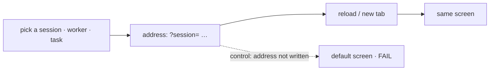

# FIX-2400 · What you had open survives a reload

**Spec** · [Decisions](DECISIONS.md)

## Who feels it, before and after

| Someone who… | Today | After |
|---|---|---|
| **reloads the Claude Code-style lab**, or vite rebuilds it, or the server restarts | Lands back on *New session* in the Sessions view; the session and the thread or task they had open are gone | Lands on the same view, session, and open thread or task |
| **reloads the Teammates lab** | Lands on the first teammate, with the task popup closed | Lands on the same teammate, with the same task open |
| **reloads Kitchen Sink's Flow State page** with a coordinator or worker conversation picked in the rail | Lands on the assistant's latest session; the picked conversation is gone | Lands on the same conversation, assistant or picked |
| **pastes a link a teammate sent** from any of the three | Opens the app's default screen | Opens what the sender had open |
| **presses Back** after picking another session, teammate or task | Leaves the app | Goes back to what they had open before |
| **opens a link whose session, worker or task is gone** | n/a | Gets the app's default screen, and the address drops the dead id |

A reload is what a developer does all day in these apps: every vite rebuild and every server
restart is one. Losing your place each time is the most frequent small cost the app review
found (R-34, impact 4/5).

## The goal, and how we'll know it's met

**After a reload, or from a pasted link, each app opens on what was open: the view, the
session or worker, and the open thread or task.**

| | |
|---|---|
| **The real need** | Epic FIX-2369: the four workforce apps become a daily driver. A daily driver keeps your place ([R-34](https://claude.ai/artifact/XW6HWCf1vDGdBzgesE9fiq#R-34)) |
| **Smaller, and rejected** | Remember the selection in `localStorage`. A reload keeps it, but a link carries nothing, Back still leaves the app, and two tabs fight over one value |
| **Bigger, and not this issue's** | One shared router package for every app. Each app's address names different things ([D2](DECISIONS.md#d2)); the shared part is the parameter name |
| **Not done if** | Only the reload works and a pasted link in a fresh tab does not; Back changes the address but not the screen; a dead id leaves a blank screen; e2e still needs `e2eSession` |



The checks render each app, pick, rebuild the app from the address alone, and read the screen.

**How we verify.** No `goals/` check: this is page state, with no flow behaviour for `fsdev run`
to grade.

| | |
|---|---|
| **Labs** | Screen tests in each lab's `test/` (happy-dom, on the fake lab): pick, unmount, mount a fresh `App` on the same address, assert the same view, session or worker, and open thread or task are drawn. One Back case and one dead-id case per lab |
| **Kitchen Sink** | A Playwright e2e test: pick a coordinator conversation in the rail, reload, and the picked panel still shows it. Every existing e2e test opens through `?session=`, so the whole suite exercises the read |
| **Input** | Any valid id, from the fixtures. A different picked session or worker must pass too |
| **Anti-game** | Assert on what is drawn, never on the address alone: an app that writes the address and ignores it on load must fail |
| **Control that must fail** | Each app with its address write removed by hand: every reload case goes red. The PR shows the red run |

## What changes

All three apps write one address, read it once on load, and read it again on Back
([D1](DECISIONS.md#d1)). The name for "the session this page shows" is devtool's
`SESSION_ADDRESS_PARAM` (`session`), the name Shift Manager's *Open trace* links and Kitchen
Sink's harness modes already use.

| App | Address |
|---|---|
| Claude Code-style lab | `?view=threads&session=<id>&task=<taskId>` |
| Teammates lab | `?worker=<id>`, and `&session=<id>&task=<taskId>` while a task is open |
| Kitchen Sink, Flow State | `?session=<id>`, the assistant's session or the picked one |

```diff
- await page.goto(`/flow-state?e2eSession=${encodeURIComponent(sessionId)}`);
+ await page.goto(`/flow-state?session=${encodeURIComponent(sessionId)}`);
```

**Docs:** no documentation impact. These are private labs and the reference app; no package API
changes.

## What stays as it is

- **Kitchen Sink's harness modes** keep their own `?session=` handling; their local `"session"`
  string becomes the devtool constant, nothing else.
- **The Teammates message popup** stays out of the address: it is opened from a line, with its
  text, and has no id a link could reopen by.
- **Pane widths and drafts** stay in browser storage, per browser, as today.

## What's already here, and the debt

| Already here | What this does with it |
|---|---|
| `SESSION_ADDRESS_PARAM`, `readSessionAddress` (`@flow-state-dev/devtool/react`) | **builds on**: all three apps use the name |
| Kitchen Sink `harness-frame.tsx`'s `SESSION_PARAM = "session"` | **replaces** with the devtool constant |
| Kitchen Sink's test-only `?e2eSession=` | **removes**: `?session=` does the job in every build |
| `useSearchParams` (Next) in Kitchen Sink; none in the labs | **builds on** in Kitchen Sink; the labs read `window.location` |
| Whatever already routes an app | **none** for the labs (searched `history.`, `popstate`, `URLSearchParams` under `labs/`); Kitchen Sink only the harness frame above |

**Builds on / Adds.** Nothing added to a package.

| Debt | |
|---|---|
| **Removes** | `e2eSession` and its test-mode gate; Kitchen Sink's second `"session"` string |
| **Adds** | A small address reader and writer in each of the three apps ([D2](DECISIONS.md#d2)). Not a second way: each app's address names different things |
| **Leaves** | Kitchen Sink's harness modes replace the address and do not answer Back; noted, not filed |

**Net: down.** One test-only path and one duplicate name go; nothing is added to a package.

## Sign off

- **The goal:** a reload or a link reopens the view, the session or worker, and the open thread
  or task, in all three apps. *If wrong:* a lab misses its own address, one more small PR.
- **The debt:** down; removes `e2eSession`. *If wrong:* a later shared router absorbs three small
  readers.
- **D1** · A pick adds a Back step; a default or a fallback does not. **Weigh this one.** *If
  wrong:* Back steps through picks you didn't mean to keep; switch to replace-only, one line per app.
- **D2** · Each app owns its address; only the parameter name is shared. *If wrong:* a fourth app
  wants the same reader, and it moves to a package then.
- **Open:** none.

Improvement · `labs/claude-code-style`, `labs/teammates`, `apps/kitchen-sink` · S · epic FIX-2369, wave 0
