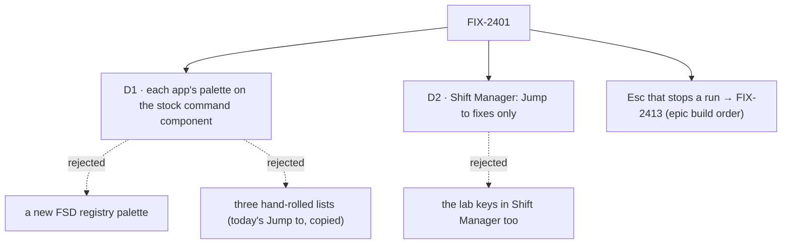

# FIX-2401 · Decisions

[Spec](SPEC.md) · **Decisions**

The issue settles the what: the keys, focus on select, roving tabs, an inline Fire confirm, and
the Jump to gaps. The epic settles two things already: Esc that stops a run is FIX-2413's
([build order](../../epics/FIX-2369/DECISIONS.md#coordination-seams)), and a piece two apps need
lives in its package or a registry ([D4](../../epics/FIX-2369/DECISIONS.md#d4)). So the cards
here are where the palette comes from, and how far Shift Manager goes.

## D1 · Each app's palette is built on the stock command component

| | Stock `command` per app (chosen) | A new FSD registry palette | Hand-rolled per app |
|---|---|---|---|
| Combobox roles, focus trap, focus restore | from Radix and cmdk, tested upstream | the same, wrapped | written three times; today's Jump to has none of them |
| Match on hint and id | `keywords` on each item | a prop we define | each app writes a matcher |
| What an app writes | its index and its picks (about 40 lines) | the same, plus learning our props | a list, arrows, a trap, a restore |
| New FSD surface | none | a component, its docs, its registry entry | none, but three copies |

- **Because:** what all three apps share is a generic combobox dialog, and that already exists
  in the registry the apps add `button` and `tooltip` from. What differs is the index (sessions,
  teammates, a Lab's screens and rows) and what a pick does, and both belong to each app.
  Wrapping cmdk in an FSD component would add a surface with no FSD meaning in it (tenet 2:
  primitives stay few). Copying today's Jump to keeps the gaps the review found.
- **Instead of:** a `jump-to` registry component; the issue's "SM's palette is the candidate to
  share".
- **Locks in:** cmdk and `radix-ui` (the umbrella package Claude Code-style and Shift Manager
  already use) as dependencies of all three; Teammates gets its first shadcn components.
  Shift Manager's Jump to is rewritten on it, keeping its message mode and test ids.

**What would change my mind:** a fourth app, or the palettes needing FSD data (a worker's state,
a task row's status vocabulary from FIX-2379) drawn the same way in each. Then a registry
component earns its place, and the three call sites make the lift mechanical.

## D2 · Shift Manager gets the Jump to fixes, not the lab keys

| | Jump to fixes only (chosen) | The lab keys too |
|---|---|---|
| What Shift Manager gains | every screen, project and workstream in Jump to; id and hint match; a worker opens its row; a dialog's focus rules | the same, plus Alt+↑/↓, `/` and `?` |
| Fits Shift Manager's shape | yes: it navigates a tree of screens, which Jump to already serves | Alt+↑/↓ has no one *next* across screens; `/` has several composers |
| Size | the review's three findings for Shift Manager | a design question per key |

- **Because:** the review's Shift Manager finding is about Jump to only. Shift Manager already
  has ⌘K, ⇧⌘K, `[` and `]`. The lab keys answer a list of sessions or teammates, which the labs
  have and Shift Manager does not.
- **Locks in:** no `?` key list in Shift Manager yet.

**What would change my mind:** Jake wanting one key set across the apps. Then a follow-up decides
what *next* and `/` mean on each Shift Manager screen.

## Decided, not asked

- **E1 · Which keys act while typing.** ⌘K/Ctrl+K and Alt+↑/↓ act from the composer too (as in
  Slack, so switching never needs a click out first). `/` and `?` act only outside a text field,
  through `isTypingTarget`. Alt+↑/↓ on macOS would otherwise move the caret to a paragraph's
  start; the switch wins, as Slack and Discord decide. AltGr (Ctrl and Alt held) is not Alt.
- **E2 · Alt+↑/↓ stops at the ends** of the list drawn (the view's sessions, or the teammates),
  and does not wrap.
- **E3 · Focus on select.** Whatever opens a session or a teammate (a click, the palette, Alt+↑/↓,
  a hire) focuses its composer. *New session* in the Claude Code-style lab focuses the project
  picker's first choice, since there is no composer yet. Nothing steals focus on first load.
- **E4 · The Claude Code-style index** is every session in every view the adapter serves, grouped
  by view, plus *New session* for each view. Picking one switches to its view. Teammates' index
  is its teammates and *Hire a teammate*; coding tasks stay in their popups.
- **E5 · The `?` key list** is a small dialog on the same Radix dialog, listing the keys that
  app has. Its Esc is a dismissal, which FIX-2413 keeps.
- **E6 · The inline Fire row** replaces `window.confirm` in the Conversation header. Keep is
  focused when it opens; Esc is Keep.
- **E7 · Roving focus** on the Claude Code-style view switch follows the ARIA tabs pattern:
  ←/→, Home and End; selection follows focus; a disabled view is skipped.
- **E8 · Jump to's workstreams** come from `readProject`, called once per project when the
  palette opens (never polled), with a line saying when a project's read failed (as the
  documents have today). No new route: a worker result opens `roster?team=<team>` and puts its row in
  view and focus. A link to it opens the team's Roster, which is what the address held before.
- **E9 · `isTypingTarget`** is named for what it reads (the target), beside `isSendKey`. It takes
  Shift Manager's body as is.
- **E10 · FIX-2414's links in Jump to** land first. Rendering a `CommandItem`'s content as its
  link is the implementer's call; the pick still navigates on Enter.

## Considered and dropped

- **A key-binding helper in `@flow-state-dev/react`** (a `useShortcuts(map)`). The bindings and
  where focus goes differ per app, and the issue says a hotkey helper is not a framework concept
  yet. Only the typing guard is the same in all three, so only it moves.
- **Waiting for FIX-2340's shared overlay.** It covers the session sheet and popup, not a
  palette, and is not scheduled. Nothing here touches the sheet.

## Analysis

2026-10-31, on the draft. **Right approach**, three folds: Teammates has no shadcn components
yet (said so); Kitchen Sink holds a fourth typing guard (now removed too); reading workstreams
through `useProjectRead` would start a 5 s poll per project (now one `readProject` per project
on open). Opened for the epic: the build order's FIX-2340 → 2413 → 2401 row, since this edits
no sheet. Recorded: the palettes add Radix dialogs beside `SessionPopup`'s own trap, which
FIX-2340 reconciles. A blind goal check widened the legs (start a session by keys, hint match,
combobox roles, every screen, Shift+Tab) and added three controls.

## How it got here

- **Draft**, 2026-10-31: framed as the labs' missing keyboard paths plus Shift Manager's Jump to
  gaps, on the stock command component with one helper lifted to react; the Esc half left to
  FIX-2413 per the epic build order.

## Notes from review

For the implementer, recorded and not folded: none of these changes the approach.

- Cursor (565b82a, approved). Overall verdict: "The chosen architecture is the simpler one." The inline notes:
  - "**Clarify:** 'A small dialog on the same Radix dialog' sounds like one dialog node with nested content. For implementers, 'second `CommandDialog` (or alert dialog) listing keys for this app' avoids accidental nesting with the switcher palette." (E5: the key list is its own dialog, never nested in the switcher.)
  - "E7 roving on the current hand-rolled tab buttons in `SessionsList.tsx` is doable but fiddly. Radix/shadcn **Tabs** (already used elsewhere in the repo) gives roving + `tabindex` behavior without a new dependency."
  - "Six controls + three Playwright legs + expanded screen tests in four packages overlap... Worth stating explicitly that vitest covers only gaps the goal does not."
  - "E8 is correct vs `useProjectRead` polling. When implementing, parallelize per-project `readProject`, show snapshot-backed Jump groups immediately, append workstreams in one batched update, and optionally dedupe reads already in flight from expanded sidebar projects."
  - "Lab composers today only set `aria-label` on the textarea — no session id on the field. Either soften the leg... or call out an intentional `data-*` hook." (The implementation adds `data-composer` and `data-session-id`. `focusComposer` uses them to find the new session's composer and not the one being unmounted, so they are not there only for tests.)
  - "If you keep one directory, document `GOAL_PART` and build-once semantics up front; otherwise consider `keyboard-first/{claude-code-style,teammates,shift-manager}` with a thin runner."
