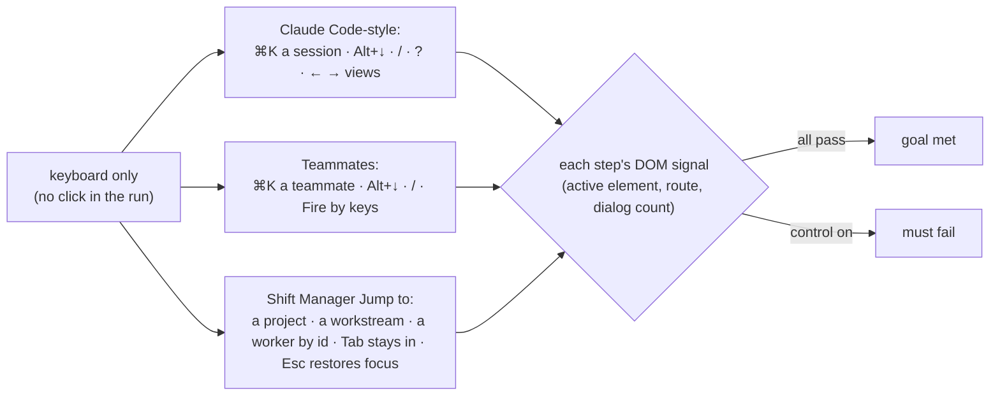
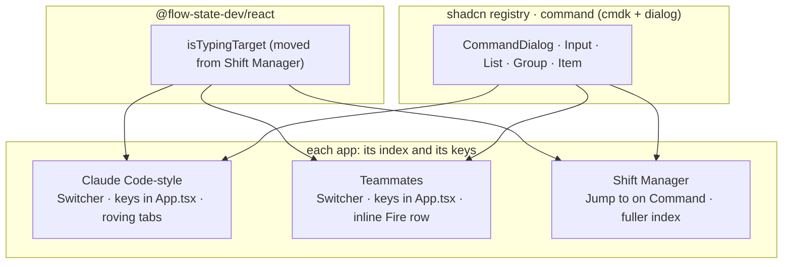

# FIX-2401 · Keyboard-first navigation and focus management

**Spec** · [Decisions](DECISIONS.md)

## Who feels it, before and after

| Someone who… | Today | After |
|---|---|---|
| **works a lab from the keyboard** (Claude Code-style, Teammates) | Reaches for the mouse to switch sessions or teammates, start a session, or get back to the composer | ⌘K/Ctrl+K finds any session or teammate by name and opens it; Alt+↑/↓ moves to the previous or next one; `/` puts the cursor in the composer; `?` lists every key. Opening a session or a teammate puts the cursor in its composer |
| **tabs through the Claude Code-style view switch** (Sessions · Projects) | Each view button is its own Tab stop, and arrows do nothing | One Tab stop for the switch; ← and → move between views, as a tab list does |
| **fires a teammate they hired** (Teammates) | A browser `confirm` box, which blocks the page and can't be styled or tested | An inline row in the header: *Fire Nova? It leaves your roster; this conversation stays readable.* · **Fire** · **Keep**. Focus lands on Keep |
| **uses Jump to in Shift Manager** | Finds Shift Coordinator, workers, tasks and documents by their shown name only. No other screen, no project, no workstream. A worker opens the whole Roster. Tab walks out of the palette, and closing it drops focus on the page body | Also finds every screen in the sidebar, every project and every workstream, and matches a hint or an id (a task's board or status, a worker's id). A worker opens Roster on its team with its row in view. Tab stays inside, and closing puts focus back where it was |
| **presses Esc with a sheet open while a turn runs** (Claude Code-style) | The sheet closes and the turn stops | **Unchanged by this issue.** FIX-2413 owns every Esc that stops a run, and merges first |
| **types `/`, `?` or `[` in a message box** | Types the character | Still types it. A key only acts outside a text field, except ⌘K and Alt+↑/↓, which also act from the composer |

## The goal, and how we'll know it's met

**In both labs a person can switch, start and get back to typing without the mouse, and Shift
Manager's Jump to reaches every place the sidebar does and behaves as a dialog should.**

- **Smaller, and rejected:** the labs only, with Jump to's gaps left for later. Jump to is the
  palette the labs are being given; leaving it label-only, partial and without a dialog's focus
  rules means the one app people already drive by ⌘K stays the one that can't reach a project.
- **Bigger, and not this issue's:** the Esc that stops a run (FIX-2413); one session overlay
  both labs share (FIX-2340); routes as real links (FIX-2414, which also touches Jump to and
  merges first); the lab bindings in Shift Manager ([D2](DECISIONS.md#d2)).
- **Not done if:** any leg below needs a mouse click; a browser `confirm` box opens anywhere in
  either lab; Shift Manager's README still says Jump to finds workstreams while it doesn't; `/`,
  `?` or `[` typed into a composer does anything but type; Tab or Shift+Tab can leave an open
  palette; closing a palette or the key list leaves focus on the page body; the view switch has
  more than one Tab stop; or any Esc behaves differently from what FIX-2413 shipped.



A browser run drives all three apps by key presses only and reads what the page says after each.

**How we verify.**

- **Goal leg (new), `goals/workforce-apps/keyboard-first`**, Playwright, no model turn.
  **Run:** `pnpm tsx goals/workforce-apps/keyboard-first/run.mts` (labs' and Shift Manager's
  pages built first). Each app boots on a fresh, empty data folder from its own config: the
  labs through their goals' `lab.mts` boots, Shift Manager on its DevTeam profile with one
  project and workstream the run creates through the Lab's HTTP routes. The modifier is
  Playwright's `ControlOrMeta`. The run never calls `click()`, fails on any
  `page.on("dialog")`, and starts every step with focus on a non-text element (the session or
  teammate list), so a palette's focus restore can't land it in the composer.
  - **a, Claude Code-style.** ⌘K, *New session*, Enter, pick the project by keys: a session
    opens and the composer is active. Do it again for a second. ⌘K, part of the first title,
    Enter: that session is selected and `document.activeElement` is the composer carrying its
    session id. Alt+↑ / Alt+↓ select the neighbour. `/` from the list: the composer is active.
    `?` opens the key list, which names every bound key; Esc closes it and focus is back on the
    list. The view switch has one element with `tabindex="0"`; Tab reaches it, → selects and
    focuses Projects. Typed into the composer, `/`, `?` and `[` stay as text.
  - **b, Teammates.** ⌘K, a teammate's name, Enter: its conversation is open and its composer
    (carrying its session id) is active. Alt+↓ moves to the next teammate. Hire a teammate by
    keys, then Fire it by keys: the inline row shows with Keep focused; Keep leaves it on the
    roster; Fire again and confirm removes it.
  - **c, Shift Manager.** ⌘K: the input has `role="combobox"` and ↓ changes its
    `aria-activedescendant`. Then in turn: each sidebar screen by name opens that screen; the
    project's name opens it; the workstream's name opens it; the eng team's coder by its **id**
    (read from the Lab at run time, never its shown name) opens Roster on its team with its
    `[data-worker-id]` row in view and focused; a task by its board ref (a hint, not its title) opens that task. With the palette
    open, eight Tabs and eight Shift+Tabs visit at least two elements and never leave the
    dialog. Focus a sidebar entry, ⌘K, Esc: focus is on that entry again.
- **Controls that must fail** (`GOAL_CONTROL=<name>`, same command; each patches the app's
  source in a scratch copy before the server loads it, prints the patch, and must fail at its
  own step and leave the others green, or the run says WRONG):
  - `no-composer-focus` drops focus on select in both labs: a and b fail at "composer active".
  - `no-type-guard` makes `isTypingTarget` answer false: a fails at "`/` stays as text".
  - `no-roving` gives every view button `tabindex="0"`: a fails at "one Tab stop".
  - `label-only` puts Jump to's match back to the shown label alone: c fails at "worker by id"
    and "task by board ref".
  - `plain-dialog` puts Jump to back in a plain `div`: c fails at "Tabs stay in" and "focus is
    back".
  - `browser-confirm` puts `window.confirm` back on Fire: b fails on the dialog.
- **Unit:** each app's screen tests (`labs/*/test/screen.test.tsx`,
  `packages/shift-manager/test/shell.test.tsx` and `jump-message.test.tsx`) cover the bindings,
  the typing guard and the message mode `> ` keeps; `@flow-state-dev/react` tests the lifted
  typing guard.

## What changes

- **Each app's palette is built on the stock command component** (`command` from the shadcn
  registry, which is cmdk inside a Radix dialog) ([D1](DECISIONS.md#d1)). It brings the
  combobox roles, arrow keys, matching on extra keywords, the focus trap and focus restore. An
  app writes only its index and what a pick does:

  ```diff
   // labs/teammates/src/components/Switcher.tsx (new; the Claude Code-style lab's is the same shape)
  +<CommandDialog open={open} onOpenChange={setOpen} title="Switch to">
  +  <CommandInput placeholder="A teammate…" />
  +  <CommandList>
  +    <CommandGroup heading="Teammates">
  +      {teammates.map((w) => (
  +        <CommandItem key={w.id} value={w.id} keywords={[w.name, w.role]} onSelect={() => pick(w.id)}>
  +          {w.name}<span className="ml-auto text-xs text-muted-foreground">{w.role}</span>
  +        </CommandItem>
  +      ))}
  +    </CommandGroup>
  +    <CommandGroup heading="Actions"><CommandItem onSelect={hire}>Hire a teammate</CommandItem></CommandGroup>
  +  </CommandList>
  +</CommandDialog>
  ```

- **Shift Manager's Jump to moves onto the same component.** Its message mode (`> `), its
  per-group cap, its document lines and every `data-testid` the tests and goals read stay. Its
  index gains every sidebar screen (Inbox, Tasks, Roster, Messages, Scheduled work, Usage,
  Settings), every project (shared and private) and every workstream, read once per project
  with `readProject` when the palette opens (no poll). A worker opens Roster on its team
  with its row in view.
- **The typing guard moves to `@flow-state-dev/react`**, beside `isSendKey`, as
  `isTypingTarget(target)`. Shift Manager's `isTyping` and Kitchen Sink's `inTextField`
  (`lib/use-suppress-history-keys.ts`) become imports of it, and both labs import it. One copy,
  four apps ([CLAUDE.md](../../../CLAUDE.md) → Coding conventions). Kitchen Sink's copy doesn't
  count a `select` as typing; with the shared one, a history key pressed on a select is left to
  the select, which is what a select wants.
- **Each lab gains its key bindings** in one place in its `App.tsx`: ⌘K/Ctrl+K, Alt+↑/↓, `/`,
  `?`. Selecting a session or a teammate, from any route in, focuses its composer. The
  Claude Code-style view switch gets roving focus. Teammates' Fire gets the inline confirm row.
- **Docs:** `packages/shift-manager/README.md` (the Jump to bullet: what it finds, a worker
  opens its team's Roster, matching on ids) and `apps/docs/docs/shift-manager/overview.md` (the
  Jump to line); each lab's README gains a *Keys* line; `packages/react/README.md` gains
  `isTypingTarget`. A changeset for `@flow-state-dev/react` (patch: a new export). No new docs
  page: nothing here is a framework concept.



## What stays as it is

Every Esc that stops a run, and the Claude Code-style sheet's Esc (FIX-2413 owns both and merges
first); the sheets and the Teammates popup (FIX-2340); `isSendKey` and how every composer sends;
Shift Manager's `[`, `]` and ⇧⌘K; its routes and their pinned shapes (Roster's team filter is
reused; a row in view is not a new route segment); core, engine and client.

## What's already here, and the debt

| Piece | What this does with it |
|---|---|
| Shift Manager's hand-rolled `JumpTo.tsx` (listbox, arrows, label match) | **Replaced in place** by the command component; its index, message mode and test ids are kept |
| shadcn `command` (cmdk), already a dependency of `@flow-state-dev/ui`'s `prompt-input` | **Reused** in all three apps. Claude Code-style and Shift Manager add it beside their `button` and `tooltip`; Teammates gets its first shadcn components (`command`, `dialog`) and the `radix-ui` and `cmdk` dependencies |
| Shift Manager's `isTyping` (`lib/panels.ts`), Kitchen Sink's `inTextField` | **Moved** to `@flow-state-dev/react` as `isTypingTarget`; both copies deleted |
| `isSendKey` (`@flow-state-dev/react`) | **Kept**, untouched; the new export sits beside it |
| Teammates' `SessionPopup` focus trap and restore | **Kept**; FIX-2340 will fold it with the Claude Code-style sheet |
| `readProject` (`lib/projects.ts`), the read under the sidebar's `useProjectRead` | **Reused** by Jump to, once per project on open. Not `useProjectRead`: it polls every 5 s, one hook per address, and the epic is removing Shift Manager's polls (D2) |
| [FIX-2369 D4](../../epics/FIX-2369/DECISIONS.md#d4), a piece two apps need goes to its package or the registry | **Followed**: the shared parts are a stock registry component and one react export; what differs per app (its index, its keys) stays in the app |
| [FIX-2369 build order](../../epics/FIX-2369/DECISIONS.md#coordination-seams): 2413 → 2418 → 2414 → 2401 on Shift Manager's files, and FIX-2340 → 2413 → 2401 on the labs' sheets and Esc | **Followed** for 2413, 2418 and 2414: this merges after them. **Asks an amendment** for FIX-2340: 2401 edits neither `Sheet.tsx` nor `SessionPopup`, so the row should read 2413 → 2401 with FIX-2340 independent; the epic thread is asked to amend it |

Methods that already do the job *move to a place by name*: Shift Manager's Jump to, the only
one. The labs have none (searched `metaKey`, `ctrlKey`, `keydown`, `Command`, `cmdk` under
`labs/`). This makes no second way: the labs gain the same component Shift Manager moves onto.

**Adds:** a switcher in each lab (its index, about 40 lines), key bindings in each lab's
`App.tsx`, one react export, the goal. **Removes:** Shift Manager's own listbox and arrow
handling, its private `isTyping`, Kitchen Sink's `inTextField`, and Teammates' `window.confirm`. **Debt:** three apps each own a
small key handler; a shared hotkey helper is not lifted because the bindings differ per app and
none is a framework concept yet. **Net:** flat to down.

## Sign off

**The goal:** the labs can be driven from the keyboard, and Jump to reaches every place the
sidebar does and behaves as a dialog. *If wrong:* the goal leg names the step that still needs a
mouse.

**The debt:** flat to down. It removes a hand-rolled listbox and a private helper, and adds two
small switchers on a stock component. *If wrong:* the switchers drift and want a registry
component; the three call sites are the same shape, so that lift is mechanical.

- **[D1](DECISIONS.md#d1) · Each app's palette is built on the stock command component**, not a
  new FSD registry component and not three hand-rolled lists. *If wrong:* the three palettes
  look different; we add a thin registry wrapper later.
- **[D2](DECISIONS.md#d2) · Shift Manager gets the Jump to fixes, not the lab keys** (no
  Alt+↑/↓, `/` or `?` there). *If wrong:* a follow-up adds them to Shift Manager's one key
  handler.

Improvement · labs, `shift-manager`, `react`, kitchen-sink (one import) · medium · 1 PR · wave 0 of FIX-2369 · merges after
FIX-2413, FIX-2418 and FIX-2414
