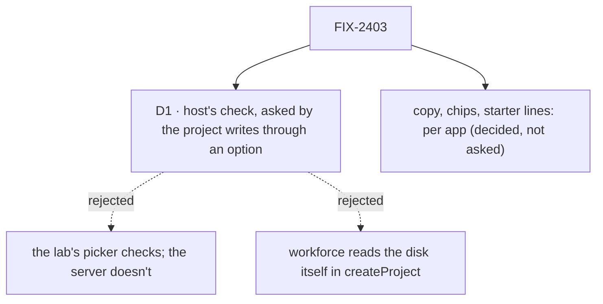

# FIX-2403 · Decisions

[Spec](SPEC.md) · **Decisions**

The issue settles the what: copy, chips and starter lines per app, and a repository check
before a project is made. The epic places the chips on FIX-2391's read (build order, wave 2)
and keeps shared UI in the registry (D4). One call is left: where the repository check lives.
The issue says "workforce's createProject error path"; this spec keeps the refusal there and
puts the check itself in the workspace host, which is what knows this machine.

## D1 · The repository check is the workspace host's, asked by workforce's project writes through an option

| | Host's check, through an option (chosen) | Lab picker only | Workforce reads the disk |
|---|---|---|---|
| A client that skips the page is refused | yes | no | yes |
| Same answer as the run's checkout gets | yes: one function | a copy | a copy |
| Project rows stay machine-independent | yes: no host, no check | yes | no: every server refuses by its own disk |
| Knows the host's remotes and listed repositories | yes | by lab code | no |

- **Instead of:** checking in the picker only, or making `createProject` stat paths and run
  git itself.
- **Because:** `repositoryProblem`'s own header says which remotes a host reaches is the host's
  call, made when it provisions. The host already holds the allow-list, the listed
  repositories and the ignore check (`ignoredProblem`), so asking it earlier gives one answer in
  two places instead of two answers that can drift (tenet 2; ER-3). Workforce stays a Layer 2
  package that offers the hook and holds no machine knowledge (ER-1, ER-2: opt-in, no default
  changes).
- **Locks in:** `WorkspaceHost.checkRepository` and its answer shape; the `checkRepository`
  option and action on `defineProjectBlocks`; the refusal code `repository-unusable`.
- **What would change my mind:** a second host kind (a cloud workspace) that can't answer
  without a network call per keystroke. Then the action stays and the picker asks on submit
  only.
- **If wrong, it costs:** moving an option between two packages; the host method stays.

## Decided, not asked

- **E1 · A starter line fills the composer; it never sends.** The person reads and edits it.
  Kitchen Sink's chips already behave so (FIX-2415); Shift Manager writes the composer's
  draft, not the palette's auto-send.
- **E2 · Starter lines come from what the app read at run time.** Shift Manager from the
  Shift Coordinator's delegates in the snapshot, Teammates from the roster row's delegates and
  role, the Claude Code-style lab from the view. Nothing names a Lab's worker in Shift
  Manager's source (it stays Lab-agnostic).
- **E3 · A network remote is not reached at create.** `https://` and `ssh://`
  remotes the host allows answer `usable` with `how: "clone"`; reach and credentials are still
  learned at the first run. A `git ls-remote` per keystroke is slow and needs credentials the
  page doesn't have.
- **E4 · Provision keeps its check.** A repository can change between create and run (a
  `.gitignore` edit, a deleted folder), so the run's refusal stays the last word. The two calls
  share `ignoredProblem`, so they can't disagree on the same tree.
- **E5 · The ignore check reads the source repository's working tree.** For a listed
  repository that is the tree a worktree is cut from, so it matches. For a `file://` clone it
  reads the source's tree, which can differ from its committed `.gitignore` while edited; E4
  catches that case at the run.
- **E6 · The chips are one registry component** (`harness-readiness`), copied into both labs
  (epic D4). Each lab reads the rows through its own `harness-readiness` flow's `read`
  action, which FIX-2391 already serves.
- **E7 · Teammates' strip is one lab read** (folder, model, default harness, and the folder's
  ignore problem if any), served beside the readiness flow; no new package surface.
- **E8 · Teammates checks its folder's ignore rule at start, non-fatally,** with the same host
  method, and shows the problem in the strip. Start still refuses only a missing or non-git
  folder, as today.
- **E9 · The empty right pane in the Claude Code-style lab says what will appear there**
  (background tasks in Sessions, threads in Projects). Copy, no data.
- **E10 · Order of work.** One package PR from `main` (workspace method, workforce option,
  harness-manager export, registry component), then one apps PR. Kitchen Sink's change touches
  `flow-state/page.tsx` by one prop; it merges after that file's open stacks if any are up.

## Considered and dropped

- **A first-run tour or overlay.** More surface than the issue asks for, and FIX-2340's shared
  overlay is still open.
- **Starter lines written by a model at session start.** A model turn before the first line
  costs money and time on every open, and the lines from live data already fit.

## How it got here

- **Draft**: framed as four apps' first runs teaching from data they already have; the one
  shared mechanism is the repository check, moved from the first run to the project's
  creation by asking the workspace host's existing check earlier through a workforce option;
  the chips read FIX-2391's action through one registry component.
