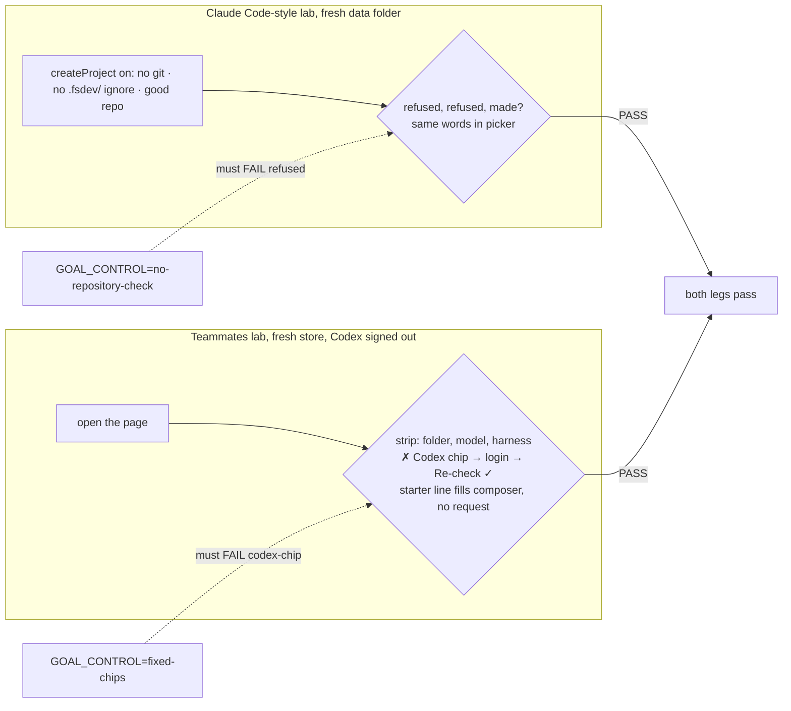
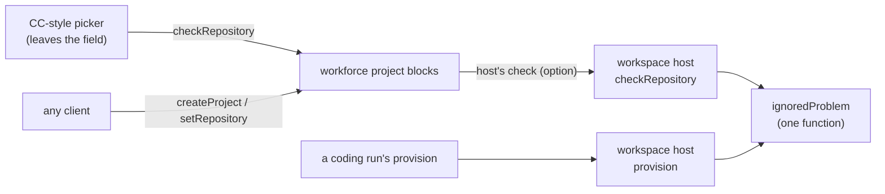

# FIX-2403 · First run that teaches: working context, repo validation and starter prompts

**Spec** · [Decisions](DECISIONS.md)

## Who feels it, before and after

| Someone who… | Today | After |
|---|---|---|
| **makes a first project in the Claude Code-style lab** on a folder that is not a git repository, or one whose `.gitignore` lacks `.fsdev/` | The project is made. The first coding task fails at checkout with a long refusal in the task's sheet | The picker says what is wrong as they leave the field, before they press Create, with the fix (`add **/.fsdev/ to .gitignore`). The server refuses the same project with the same words if the page is skipped |
| **makes a project on a repository the lab can use** | Sees no word on what happens to it | Sees one line under the field: runs work in their own git worktrees on their own branches, your checkout is never changed (or: in a clone under the lab's data folder, for a repository the lab doesn't list) |
| **opens the Claude Code-style picker in either view** | The same sentence in both views; nothing says how Sessions and Projects differ | Copy for the view they are in, the coding harnesses' readiness chips, and, once the session opens, example lines for that view that put themselves in the composer when clicked |
| **opens the Teammates lab for the first time** | "Say hello to Chief of Staff." No folder, model or harness in sight; nothing says Chief of Staff hands work on | A strip above the conversation: the working folder, the model, the default harness, and `✓ Cursor · ✗ Codex: run codex login` chips with Re-check. Chief of Staff's empty conversation names who it hands work to and offers starter lines |
| **opens Kitchen Sink's Flow State in Build, Interview or Debate** | The same four chips in every mode, one naming an artifact (`doc-1`) a fresh session doesn't have | Chips written for the mode they are in, none naming something that isn't there |
| **opens Shift Manager's Shift Coordinator with no conversation yet** | "You haven't talked with Shift Coordinator yet." | Starter lines built from the Shift Coordinator's own delegates, in whatever Lab is loaded, that fill the composer when clicked |

## The goal, and how we'll know it's met

**A person opening each workforce app for the first time can see what it works on and with,
learns before submitting that a repository won't work and why, and has a first line to send
that fits where they are.**

- **The real need** (R-37, FIX-2369 *Navigate and get started*): a first run that teaches,
  so the person doesn't learn the rules of the lab from a failed task.
- **Smaller, and rejected:** better copy and static chips only. The repository failure still
  arrives on the first coding task, which is the costliest place to learn it, and a page-only
  check is skipped by any other client of the same flow.
- **Not this issue's:** the readiness read itself (FIX-2391, merged); the no-op chip click in
  Kitchen Sink (FIX-2415, merged); reachability of a network remote, which is still learned at
  the first run (see [E3](DECISIONS.md#e3)).
- **Not done if:** the picker shows a problem the server would accept, or accepts one the
  server refuses (two checks that disagree); a chip shows a harness ready from a constant
  rather than the read; a starter line names a worker, artifact or file the app didn't read at
  run time; clicking a starter line sends it.



The check reads the server's own answers (the project list, the session's requests, the
readiness action) and the page only for what it shows.

**How we verify.**

| | |
|---|---|
| **Goal check, leg a** | `goals/claude-code-style-lab/checks-the-repository-first`, model n/a, `CLAUDE_CODE_STYLE_HARNESS=stub`, run by the implementer at completion; verdict on the labs PR |
| **Signal, leg a** | **refused**: `createProject` through the public client on a plain folder, a git repository with no `.fsdev/` rule, and one whose rule is written but not committed all fail with code `repository-unusable`, and `listProjects` holds none of them. **same-words**: the picker shows each refusal's text before Create is pressed, and Create stays disabled. **made**: a listed repository with the rule is made, and the line under the field says worktree |
| **Goal check, leg b** | `goals/teammates-lab/first-run-shows-its-context`, model n/a (no turn is graded), real browser, the `CODEX_HOME` set-up of `goals/teammates-lab/routes-only-to-ready-harnesses` |
| **Signal, leg b** | **strip**: the folder chip reads the `TEAMMATES_WORKDIR` the run set (a temp checkout, not this repository), the model chip `TEAMMATES_MODEL`, the harness chip `TEAMMATES_HARNESS`. **codex-chip**: a Codex chip with `codex login` in it; after the run logs in into that `CODEX_HOME`, Re-check turns it ✓ within 30 s. **starter**: clicking a starter line puts its text in the composer, and the session has no new request 3 s later |
| **Input** | Temp folders made by the run, with names no lab file holds; the Teammates roster as shipped. A different folder, model string or harness passes a correct lab |
| **Anti-game** | Leg a grades the server's refusals and the project list, never the adapter. Leg b's strip values are set by the run to values no source file names, so a constant can't pass |
| **Controls that must fail** | `GOAL_CONTROL=no-repository-check`: the lab's projects flow built without the check. Must FAIL **refused** (all three projects are made). `GOAL_CONTROL=fixed-chips`: the chips drawn from a constant all-ready list. Must FAIL **codex-chip** |
| **Unit, no goal check** | Kitchen Sink's chips per mode and Shift Manager's starter lines are copy over data the app already holds. Each gets a test shown red first: Kitchen Sink, every mode's chips differ and none names `doc-1`; Shift Manager, two rosters with different delegates give different lines, and none holds a Lab's worker name from source. The workspace check: a plain folder, a repository without the rule, one whose rule is only in uncommitted changes, one with no commit, one tracking a file under `.fsdev/`, a remote scheme the host refuses, and a good one, each with its answer, and the same answer as the provision check gives for the same repository |

## What changes

```diff
  // labs/claude-code-style/workforce/flows/projects.mts
- export function defineProjectsFlow() {
-   const projects = defineProjectBlocks();
+ export function defineProjectsFlow(options: { checkRepository: RepositoryCheck }) {
+   const projects = defineProjectBlocks({ checkRepository: options.checkRepository });
    return defineFlow({
      kind: PROJECTS_FLOW,
      actions: {
        listProjects: projects.actions.listProjects,
        createProject: projects.actions.createProject,      // refuses `repository-unusable`
+       checkRepository: projects.actions.checkRepository,  // the picker asks before Create
      },
    } as never);
  }

  // labs/claude-code-style/fsdev.config.mts
- const projects = defineProjectsFlow()({ id: PROJECTS_FLOW });
+ const projects = defineProjectsFlow({
+   // The same check a run's checkout gets, asked when the project is made.
+   checkRepository: (repository) => workspace.checkRepository(repository, { ignored: ASK_MARKER_IGNORED }),
+ })({ id: PROJECTS_FLOW });
```

- **`@flow-state-dev/workspace`:** `WorkspaceHost.checkRepository?(repository, { ignored? })`,
  optional like `list` and `remove`. It answers `{ usable: true, how: "worktree" | "clone" }`
  or `{ usable: false, problem }` without making anything: the host's remote allow-list, then
  for a `file://` remote or a listed repository that it exists and is a git repository, then
  `ignoredProblem` on the last commit's tree ([E5](DECISIONS.md#e5)), the function `provision`
  already runs on the checkout cut from it. A network remote the host allows is `usable` with no reachability read ([E3](DECISIONS.md#e3)).
- **`@flow-state-dev/workforce`:** `defineProjectBlocks({ checkRepository? })`. Given, it runs
  after `repositoryProblem` in `createProject` and `setRepository` and refuses with
  `ProjectRefusedError("repository-unusable", problem)`, and adds a read-only
  `checkRepository` action (input `{ repository }`, output the host's answer). Absent: today's
  behaviour, no action ([D1](DECISIONS.md#d1)).
- **`@flow-state-dev/harness-manager`:** `ASK_MARKER_IGNORED` (already defined in
  `workspace.ts`) is exported, so a host hands the same rule to the check that it hands to a
  run.
- **`@flow-state-dev/ui` registry:** a `harness-readiness` component: one chip per row of
  harness-manager's readiness action (`✓ Cursor`, `✗ Codex` with its remedy, `?` for no
  answer) and a Re-check button that calls the action with `refresh: true`. Both labs copy it
  (epic D4, ER-3).
- **Claude Code-style lab:** the picker's copy per view (Sessions: one session that works and
  hands off background tasks; Projects: a lead that files threads you review), the readiness
  chips, the repository check on leaving the field and the worktree-or-clone line, and a
  disabled Create while the check says no. An open session with no lines shows that view's
  example lines; a click fills the composer. The empty right pane says what will appear there.
- **Teammates lab:** a context strip over the conversation: the working folder (and, when it
  doesn't ignore `.fsdev/`, the same problem text as a warning), the model, the default harness,
  and the readiness chips. One lab read serves the strip's three values. Chief of Staff's empty
  conversation names its delegates from its roster row and offers starter lines; any other
  worker's empty conversation offers lines from its own role.
- **Kitchen Sink:** `SuggestionRow` takes the mode and shows that mode's chips; no chip names a
  thing a fresh session lacks.
- **Shift Manager:** the Shift Coordinator's empty conversation shows starter lines built from
  its delegates as the snapshot reads them, and a click puts the line in the composer's draft.
  No Lab's worker is named in Shift Manager's source.
- **Docs:** the workspace README (`checkRepository`), the workforce README (the
  `checkRepository` option and action, the `repository-unusable` refusal), the ui registry
  README (`harness-readiness`), and `apps/docs/docs/workforce/projects.md`, which lists the
  repository refusal (extended, no new page). The labs' READMEs gain one line each on the first run.



## What stays as it is

`repositoryProblem` and what a project row may record; `provision` and its refusal, which
stays the last word on a run (a repository can change between create and run); the readiness
read, its action and its capability (FIX-2391); Teammates' start-time refusal of a folder that
is not a git checkout; every app's composer and send path. A host that gives no
`checkRepository` sees no change.

## What's already here, and the debt

Searched `ignoredProblem`, `check-ignore`, `repositoryProblem`, `localRepositories`,
`remotes.allow`, `suggestion`, `starter`, `emptyText`, `Say hello` across `packages/`, `labs/`
and `apps/`. **Checking a repository for a run is done once today, at provision; this asks the
same function earlier, so it adds no second check.** Starter lines exist only as Kitchen Sink's
four static chips.

| Already here | What this does with it |
|---|---|
| `ignoredProblem` (`packages/workspace/src/worktree.ts`) and `provision`'s call | **Built on**: the check calls it; provision keeps calling it |
| `repositoryProblem` (`packages/workforce/src/projects/repository-value.ts`), which says reach is the host's call | **Kept**: the new hook is that host call, made at write time |
| `ASK_MARKER_IGNORED` (`packages/harness-manager/src/workspace.ts`) | **Exported**, unchanged |
| FIX-2391's readiness action, rows and remedy text | **Read** by the chips; nothing in it changes |
| Kitchen Sink `SuggestionRow`'s static list (FIX-2415 fixed its click) | **Replaced** by a list per mode |
| Teammates' and Shift Manager's empty-conversation text | **Replaced** by the starter lines |
| CC-style `listed()` in `fsdev.config.mts` (worktree or clone) | **Kept**; the host's answer says which, from the same listing |

| Builds on / Adds | Existing piece considered | Verdict |
|---|---|---|
| `WorkspaceHost.checkRepository` | `provision`'s refusal; `readSource` | extend: the provision check's first steps, with no place made |
| `defineProjectBlocks({ checkRepository })` + action | `repositoryProblem` | extend: the host's half of the same write fence |
| `harness-readiness` registry component | each lab drawing its own chips | new in the registry; replaces two would-be copies (D4) |

**Removes:** Kitchen Sink's static chip list and its `doc-1` chip; the late discovery of an
unusable repository. **Adds:** one optional host method, one option and action on the project
blocks, one registry component, a few hundred lines of copy and UI across four apps. **Leaves:**
a network remote's reach, checked only at the first run ([E3](DECISIONS.md#e3)). **Net:** flat,
no second way to do a job; the new surface is one optional method composed from the existing
check.

## Sign off

**Approve by merging.** Goal: each app's first run shows what it works on and with, refuses an
unusable repository before Create, and offers a first line that fits. *If wrong:* the labs keep
teaching through failed tasks. Debt: flat, one optional host method over the existing check.
*If wrong:* a second repository check drifts from provision's; the shared function prevents it.

- [D1](DECISIONS.md#d1) · **The repository check is the workspace host's, asked by workforce's
  project writes through an option**, not lab code and not workforce reading the disk. *If
  wrong:* the option moves, and the host method stays.

Open: none.

Improvement · `workspace` · `workforce` · `harness-manager` (one export) · `ui` registry · four
apps · medium · a package PR, then an apps PR · epic FIX-2369, wave 2 · reads FIX-2391
