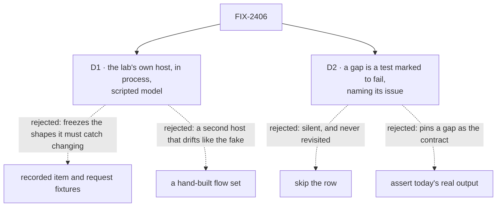

# FIX-2406 · Decisions

[Spec](SPEC.md) · **Decisions**

The epic placed this already: one owner, one PR from `main`, one scenario matrix run against both
real adapters and both fakes, after both labs' stack 2 merges
([FIX-2369 build order](../../epics/FIX-2369/DECISIONS.md#coordination-seams)). What is left to
decide is what the real column runs on, and what happens where fake and real disagree.

Solid edges are what you're signing. Dashed edges lost, and the label says why.

## D1 · The real column runs the lab's own host in process, with only the model scripted

| | |
|---|---|
| **Instead of** | Recorded items and requests replayed into the adapter; or a small flow set built for the test |
| **Because** | The failures the issue names are package changes: a notice's text, a hold's shape, a request's status. Only a run through the real packages produces the new shape; a recording keeps producing the old one until someone re-records it. A hand-built flow set is a second fake. The lab's own host (its workers, flows and store) with `createMockModelResolver` in place of the model, behind `createInProcessFetch`, is the served lab minus the model and the port |
| **Locks in** | Each lab keeps a host factory a test can call (`openLab`, `openTeammates`) with an optional `modelResolver`. The scripts name the workers' tool calls, so renaming a workforce tool means editing the scripts in the same PR, which is the point |

| | Own host, in process (chosen) | Recordings | Hand-built flows |
|---|---|---|---|
| Catches a notice or hold-shape change | yes | no, until re-recorded | only if copied in |
| Needs a model or network | no | no | no |
| Kept in step with | the workers' tool names | a capture run | a second host |

**What would change my mind:** the real column taking over a minute per lab in CI. Then the
slow scenarios move to recordings captured from this same host, refreshed by one command.

## D2 · Where fake and real disagree, the fake follows the real; a gap the real adapter will close is a test marked to fail

| | |
|---|---|
| **Instead of** | Skipping the row; or asserting what the real adapter shows today |
| **Because** | The real adapter is what ships, so a fake that shows something it can't is wrong and changes. But two gaps are the real adapter's: it never shows a failed turn, and Claude Code-style never shows an "interrupted" line (FIX-2375 adds it). Asserting today's output would pin the gap as the contract; skipping hides it. `it.fails` with the issue id runs the shared assertion, stays green while the gap is there, and turns red the day the issue lands, so that PR removes the mark |
| **Locks in** | Every gap in the matrix names a filed issue. A gap with no issue is not allowed: either the fake changes or an issue is filed |

## Decided, not asked

- **One scenario list per lab, not one shared module.** The two adapters have different verbs
  (`watchThread` and `interrupt` against `watchConversation` and task `cancel`), so a shared
  module would be a driver interface over two shapes for five functions. Both labs use the same
  five scenario names; the epic's "one matrix" is the five rows by four columns.
- **Teammates' stop row is a task cancel.** Teammates has no turn stop until FIX-2375; its stop
  verb is the task's Cancel.
- **The lapsed feed is a switch on the in-process fetch** that ends open streams and refuses new
  ones, then lets them through again. The fake already has `setConnection`.
- **Assertions read the adapter's output only** (views, entries, rows), never items or the store.
- **Stores are temporary SQLite files**, one per test, because both hosts are durable and a hold
  needs durable execution.
- **Mid-turn sends (`queued`) are not a row.** FIX-2376 makes them real and adds the row.

## Considered and dropped

| Alternative | Why it lost |
|---|---|
| Serve each lab on a port (`@flow-state-dev/node`'s `serve`) | `createInProcessFetch` takes the same router path with no port; a port adds flake and nothing the adapters can see |
| Move the matrix into `@flow-state-dev/testing` | Both adapters are lab code; the package would depend on apps |
| Only the real column; delete the fakes | The fakes are the screen tests' fixtures, and they stay useful once they're held to the real adapter |

## Open

### Need your sign-off: who builds the labs' failed-turn slice

**Plain terms.** FIX-2370 shipped the failed-turn line for Kitchen Sink and the shared component,
and planned "both lab adapters show a failed turn" as later slices. FIX-2370 is Done, but neither
lab shows a failed turn: the turn just stops. This matrix makes that visible.

**The trade-off.** Building it here makes this PR a feature as well as a test, and puts screen
work into the one PR the epic kept for tests. Filing it keeps this PR test-only, and the
failed-turn row's real column starts marked to fail with the new issue's id.

**My recommendation:** file a new issue, "the labs show a failed turn" (FIX-2370's planned lab
slices), as a FIX-2369 child; this PR marks the row against it. It can start now, in parallel.

**What would change my mind:** if the closure (FIX-2425) is close and nobody else will pick it
up soon, folding it in here is one fewer PR to land.

**What being wrong costs:** filing it: one more issue and PR, and a red mark that lasts until it
lands. Folding it in: a larger PR here, with UI review on a test PR.

## Analysis

2026-11-04, read against `main` at `c904dc3c`. Verdict: right approach, right size.

- **Reuse:** every runtime piece exists (`createInProcessFetch`, `createMockModelResolver`, the
  scripted coder, `openTeammates`); the one addition is Claude Code-style's host factory.
- **Right goal:** the issue's own evidence (the fakes' queued, error and hold behaviour) is what
  the matrix catches; checking the failed-turn row found a real gap (Open, above).
- **Size:** test code plus one host extraction; no package changes.

## How it got here

- Drafted 2026-11-04 from the issue, the epic's build order, and both labs' adapters and fakes
  on `main` at `c904dc3c`.
