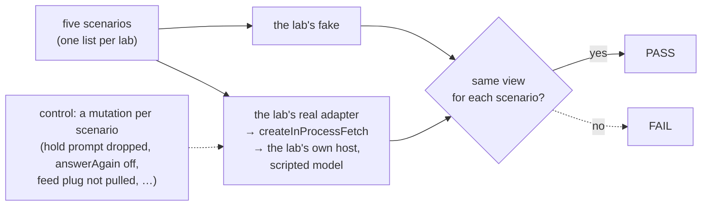
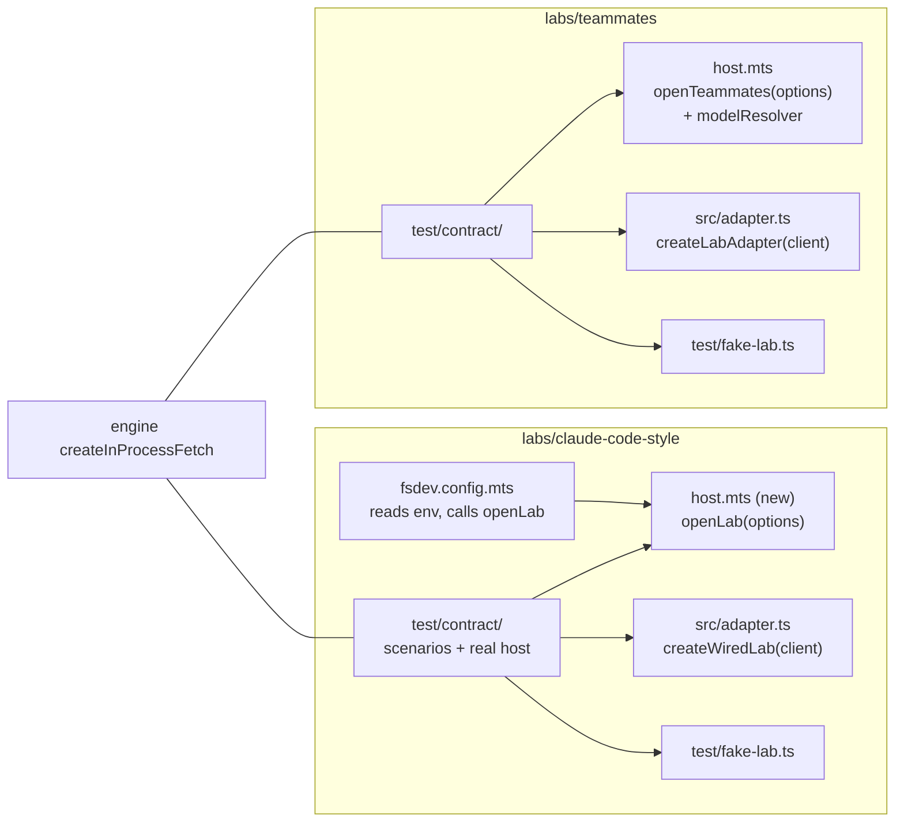

# FIX-2406 · Contract tests: run the real adapter against an in-process host, not only the fake

**Spec** · [Decisions](DECISIONS.md)

## Who feels it, before and after

| Someone who… | Today | After |
|---|---|---|
| **changes orchestration's notice text or a hold's shape** | Both labs' tests stay green; the labs break in a browser later | The labs' contract tests go red in CI on the same push |
| **changes a lab's adapter** | Its screen tests run on a 580–650-line fake that never calls it | Five scenarios run through the real adapter over the lab's real host, with only the model scripted |
| **changes a lab's fake** to draw a new state | Nothing says whether the real adapter ever reaches that state | The same five scenarios run on the fake; a fake that drifts from the real adapter fails |
| **reads a lab's screen tests** | Can't tell which of the fake's behaviours are real | Each gap between fake and real is listed by name, with the issue that closes it, and turns red when that issue lands |

## The goal, and how we'll know it's met

**When a package change alters what either lab's adapter shows for a mid-turn result, a failed
turn, a held question and its answer, a stopped run, or a lapsed connection, a CI test in that
lab fails, and the same test proves its fake shows the same thing.**

- **The real need** (R-40, "debug and test the labs", findings CC-ROB-8 and TM-ROB-8): the fakes
  already diverge from the real adapters (queued lines, errors, holds), so green screen tests say
  nothing about the package underneath.
- **Smaller, and rejected:** recorded item and request fixtures replayed into the real adapter.
  They freeze today's shapes, which is exactly what has to be caught changing; a notice-text
  change leaves a recording green until someone re-records it ([D1](DECISIONS.md#d1)).
- **Bigger, and not this issue's:** general record/replay for any flow (FIX-806); a published
  request host in `@flow-state-dev/testing` (FIX-1293, which `createInProcessFetch` in the engine
  now mostly answers); the screens themselves, which the fakes keep testing.
- **Not done if:** the real column passes only because it asserts what the real adapter happens
  to emit (it must assert the same view the fake column asserts); a scenario runs on one column
  only; a known gap is skipped instead of marked to fail; or the real host is a hand-built flow
  set rather than the lab's own host.

The check reads only what each adapter hands the screen (its views and entries), never the
store or the items, so the fake and the real adapter answer to one assertion.

**How we verify.** No goal check: this issue *is* a check, and it runs in CI with no model. What
proves it is the matrix itself plus a red run of each control.

| | |
|---|---|
| **Check** | `labs/claude-code-style/test/contract/` and `labs/teammates/test/contract/`, run by each lab's `pnpm test` (so CI) |
| **Signal** | Each lab: 5 scenarios × 2 columns (fake, real) pass, except the named known gaps, which fail as expected |
| **Input** | A scripted step model (`labs/test-support/contract.ts`) and harness-manager's scripted coder; the asks are plain sentences no worker file names. Another ask with the same shape passes |
| **Anti-game** | No assertion on item ids, timings or raw item shapes; the two columns share every assertion, so neither can be written to its own column's output |
| **Controls that must fail** | One per scenario on the real column, each a one-line mutation of the package or host: answerAgain off (mid-turn result), the error item dropped from the stream (failed turn, once its gap closes), the hold's prompt dropped (held question), the abort not sent (stop), the fetch plug left in (lapsed feed); and one on the fake column (its hold drawn without a prompt). The implementation PR shows each red run |

## What changes

- **Claude Code-style gets a host factory.** Its whole host is inline in `fsdev.config.mts`
  today, with top-level `await` and environment reads, so no test can build it. It moves into
  `host.mts` as `openLab(options)`, the shape Teammates already has in `openTeammates`; the config
  reads the environment and calls it. Served behaviour is unchanged.
- **Both factories take an optional `modelResolver` and a store.** A test passes the scripted
  model and a temporary SQLite file; the served lab passes neither and behaves as today.
- **One scenario list per lab, two columns.** Each lab's `test/contract/` holds the five
  scenarios once, as functions over a small driver, and runs them against the fake and against
  the real adapter over `createInProcessFetch` on the lab's own host. The two labs use the same
  five scenario names; the drivers differ because the two adapters do.
- **The fakes change where they are wrong.** Where the fake and the real adapter disagree and the
  real adapter is right, the fake changes. Where the real adapter lacks something a filed issue
  will add, the real column is marked to fail with that issue's id ([D2](DECISIONS.md#d2)).
- **The scenarios, by lab:**

| Scenario | Claude Code-style | Teammates |
|---|---|---|
| **Mid-turn result** | A background task settles while the main turn runs: a result entry with `duringTurn: true`, then text after it in that turn | Chief of Staff's coding task waits for review; once accepted, a `result` entry under the worker that ran it, and the task row reads `done` (Teammates takes a result as a turn of its own) |
| **Failed turn** | The model call fails: the thread stops running and shows the failure | Same, in the conversation |
| **Held question and answer** | A thread's task holds on a question: `waitingOn` names it; `sayInThread` answers; the hold clears and the task runs on | A task holds on a question: `waiting` names it; `answerTask` answers; it clears |
| **Stop** | `interrupt` during a running turn: the thread stops running | `taskActions(s).cancel` on a running task: it reads `cancelled` (Teammates has no turn stop until FIX-2375) |
| **Lapsed feed** | The host stops answering: `connection` reads `lapsed`, then `live` once it is back | `watchConnection` reads the same |

- **Docs:** no `apps/docs` impact; these are private labs' tests. Each lab's README paragraph on
  its test double gains one sentence naming the contract tests and what they cover.

## What stays as it is

- The screen tests, and the fakes as screen fixtures; the fakes only lose behaviours the real
  adapter contradicts.
- The goal checks under `goals/claude-code-style-lab/` and `goals/teammates-lab/`, which still
  prove the labs on a real model in a browser.
- Every package. Nothing in `@flow-state-dev/testing` or the engine changes. The one shared
  test piece, a step-capable scripted model and a plug on the fetch, lives in
  `labs/test-support/contract.ts`, with no imports, so both labs load it.
- The served labs: same flows, same store, same environment variables.

## What's already here, and the debt

| Already here | What this does with it |
|---|---|
| `createInProcessFetch` (engine), used by Kitchen Sink's and workforce's tests | **Builds on**: the real adapters' client fetcher |
| `createMockModelResolver` / `mockGenerator` (testing) | **Leaves alone**: it runs a turn's whole tool loop in one call, so a script can't wait between steps (file a task, wait for it to settle, then write). The labs' scripted model answers one step per call (`generateStep`), which the framework's own tool loop drives |
| harness-manager's scripted coder (`scriptedStepMs`) | **Builds on**: coding tasks with no model or sign-in |
| `openTeammates(options)` in `labs/teammates/host.mts` | **Extends**: an optional `modelResolver` |
| Claude Code-style's host, inline in `fsdev.config.mts` | **Replaces** with `openLab(options)` in `host.mts`; the config keeps the environment reads |
| The fakes, `test/fake-lab.ts` in each lab | **Extends**: each becomes a column of the matrix; corrected where it contradicts the real adapter |
| The labs' existing wired tests (`watch-thread`, `watch-on-notice`, …) over hand-written fetchers | **Leaves alone**: they pin one read each; the matrix pins scenarios end to end |
| Something that already runs one scenario on fake and real | **None found**: searched `labs/*/test` and `goals/` for a test importing both `fake-lab` and the adapter's wired constructor, and for `createInProcessFetch` under `labs/` |
| FIX-806 (record/replay), FIX-1293 (testing request host) | **Leaves alone**: related, not needed |

**Debt found, not paid here:**

- **Neither lab shows a failed turn.** FIX-2370's spec named "both lab adapters map `type: "error"`
  items to an error entry" as later app slices; FIX-2370 is Done, but Claude Code-style's adapter
  reads only `message` and `tool_output` items, and Teammates' leaves `error` unprojected. The
  failed-turn row's real column starts as a known gap naming
  [FIX-2550](https://linear.app/fixpoint-labs/issue/FIX-2550), filed for that slice.
- **Claude Code-style's fake draws an "interrupted" line the real adapter never emits.** FIX-2375
  (stop a running turn, with feedback) adds it; the stop row's real column carries that as a
  known gap.
- Mid-turn sends (`queued`) are out of the matrix: FIX-2376 makes them real, and adds its row.

**Net:** pays down one piece (Claude Code-style's untestable inline host) and adds test code
only. *If wrong:* the matrix costs CI time without catching drift; it is deleted in one PR.

## Sign off

- **The goal:** a package change that alters what a lab shows in the five scenarios fails CI in
  that lab. *If wrong:* drift keeps reaching the browser, and we've paid for two test suites.
- **The debt:** pays down one inline host; adds test code. *If wrong:* one-PR delete.
- **[D1](DECISIONS.md#d1) · the real column runs on the lab's own host in process, with a
  scripted model,** not on recordings. *If wrong:* slower tests than recordings, and a script to
  keep in step with the workers' tools. **The one to weigh.**
- **[D2](DECISIONS.md#d2) · a gap between fake and real is a test marked to fail, naming its
  issue.** *If wrong:* a gap nobody owns sits marked forever.
- **Open:** none. The labs' failed-turn slice is filed as FIX-2550 ([settled](DECISIONS.md#open)).

Feature · `labs/claude-code-style`, `labs/teammates` (private) · M · child of
[FIX-2369](https://linear.app/fixpoint-labs/issue/FIX-2369), wave 4
