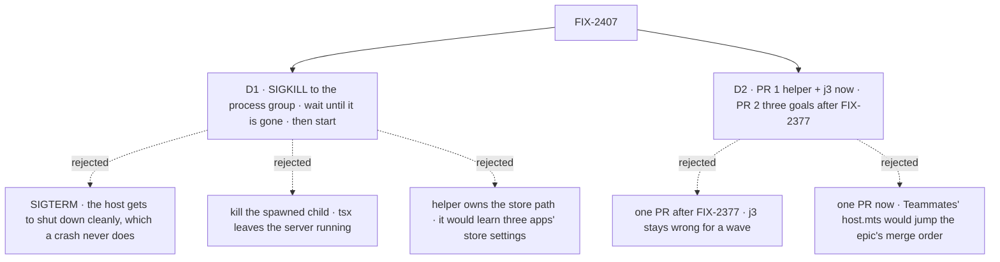

# FIX-2407 · Decisions

[Spec](SPEC.md) · **Decisions**

The epic already put the helper in `goals/lib`. Two calls are left: what a crash is, and how the
work splits across the epic's waves.

## The tree

Solid edges are what you're signing. Dashed edges lost, and the label says why.

## D1 · A crash is SIGKILL to the whole process group, checked gone before the restart

| | |
|---|---|
| **Instead of** | SIGTERM, or signalling only the spawned child, or a helper that also owns the store |
| **Because** | The claim under test is that work survives the host *dying*. SIGTERM lets the host run its shutdown, which a crash, an OOM or a closed laptop never does. The [POC](poc/wrapper-kill/README.md) shows that SIGKILL on the `tsx` wrapper leaves the server answering, so only the group is a crash. Waiting until the group is empty means the new host never shares the store with a survivor. The start function is the goal's, so the store path stays where each app already reads it ([tenet 2](../../../docs/philosophy.md): compose `stopProcessGroup`, don't widen it) |
| **Locks in** | `crashAndRestart(child, start)` in `goals/lib/server.mts`, exported from `goals/lib/index.mts`. It throws when `child` has no process group of its own (not spawned `detached`), and when a member of the group is still alive after a bounded wait. The signal is not a parameter |

**What would change my mind:** an app whose claim is about a *graceful* restart only. Then the
goal calls `stop()` and its own start, and needs no helper.

## D2 · Two PRs: the helper and the j3 fix now, the three app goals after FIX-2377

| | |
|---|---|
| **Instead of** | One PR now, or one PR after FIX-2377 |
| **Because** | The epic's build order lists FIX-2407 in wave 1 as a package slice that touches no app file, and lists *2407's goals* last in the `labs/teammates/host.mts` merge order, after 2377. The Teammates goal needs a stub-harness switch in that host and the Kitchen Sink goal needs a store-path switch in its config, so those wait. The helper and the j3 fix touch only `goals/`, and j3 is wrong today |
| **Locks in** | PR 1 from `main`: `crashAndRestart`, `startShiftManager` detached, j3 on the helper, with j3's `wrapper-kill` control. PR 2 from `main` after FIX-2377 merges: the three goals, the two env switches, `startKitchenSink` returning its child |

**What would change my mind:** FIX-2377 slipping by more than a wave. Then the Shift Manager
goal, which needs no app change, moves into PR 1.

## Decided, not asked

- **The cut turn is read through the client's `requests.interrupted()`**, the same list FIX-2377's
  Continue reads. The goal does not press Continue.
- **The task signal allows either outcome.** Whether a task on a dead claim is re-claimed or ended
  is harness-manager's policy. The goal fails only on a row that still reads *running* on a dead
  claim after the lease and one sweep.
- **A turn held open is the goal's to arrange**, with a scripted model or harness that waits. The
  goal kills only after it reads the turn as running, never on a timer.
- **The wait for an empty group is bounded** (a few seconds). The bound is the implementer's.
- **Each goal serves its app on its own scratch store**, never the developer's.
- **Names beyond `crashAndRestart` and the goal folders** are the implementer's.

## Considered and dropped

| Alternative | Why not |
|---|---|
| The helper in `@flow-state-dev/testing` (the issue's first idea) | The epic decided `goals/lib`: the process-group code already lives there |
| A restart-on-the-same-store helper that owns the store | D1: three apps keep their store three ways (`TEAMMATES_STORE`, Kitchen Sink's profile, Shift Manager's `GOAL_STORE`) |
| Fold the three graceful restarts onto the helper | They test a graceful restart and are correct; a crash would change what they prove |
| Kitchen Sink's Playwright isolation and a mobile project | Not about a restart; the issue lists them as context for Kitchen Sink's gaps |

## Open

None.

## Settled

- **Killing the `tsx` wrapper does not kill the server.** [POC](poc/wrapper-kill/README.md), run
  2026-10-31: after `child.kill("SIGKILL")` the server still answered; after a group SIGKILL it did
  not. j3 is affected today.

## How it got here

- **2026-10-31** · Drafted from the issue, the epic's build order and seams, and the POC.
