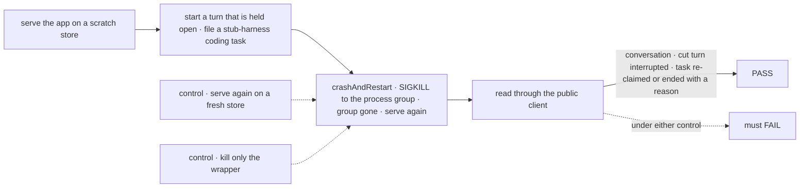
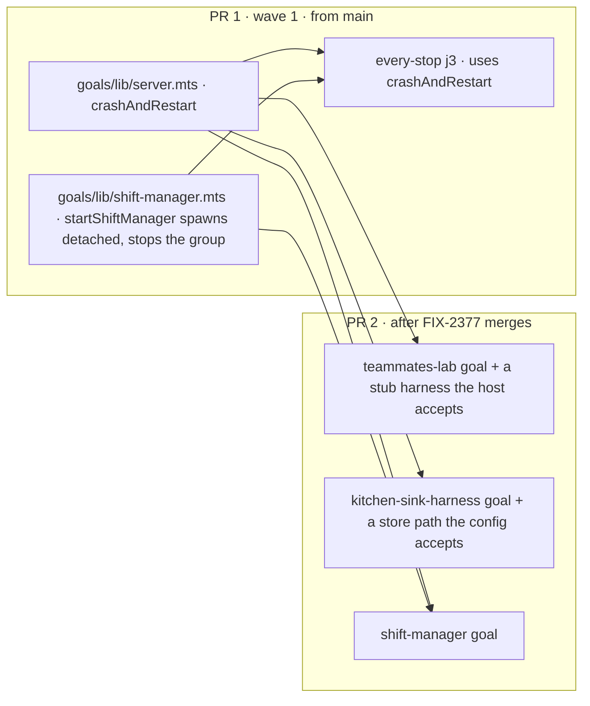

# FIX-2407 · A restart goal that proves each app's durability claim

**Spec** · [Decisions](DECISIONS.md)

## Before and after

| Someone who… | Today | After |
|---|---|---|
| **saves a file under `--dev` while a worker is mid-turn** (every save restarts the host) | Teammates says a restart keeps every conversation, and Kitchen Sink runs `durable: true` with startup recovery. No goal ever kills either one mid-turn, so nobody knows | A goal per app kills the host mid-turn and reads back the conversation, the cut turn and the coding task on the same store |
| **runs a coding task when the host dies** | Nothing checks what the task card says afterwards. A task held by a dead run could read *Running* forever | The goal fails unless the card reads a fresh attempt or an ending with its reason, without anyone touching it |
| **writes the next restart goal** | Copies one of four hand-rolled restarts (`journeyRestart`, two `servers.restart`s, `it-shows-worker-token-usage`) | Calls `crashAndRestart` in `goals/lib` |
| **reads Shift Manager's journey j3 PASS** | j3 kills the `tsx` wrapper with SIGKILL. The server underneath keeps running on the same store ([POC](poc/wrapper-kill/README.md)), so j3 grades a host that never crashed | j3 kills the whole process group and fails if anything in it survives |

## The goal, and how we'll know it's met

**In Teammates, Kitchen Sink and Shift Manager, a host killed mid-turn and served again on the
same store shows the conversation, the cut turn and the coding task's next state, with no user
action.**

| Is it the right goal? | |
|---|---|
| **The real need** | The issue: "host.mts promises conversations and pending messages survive a restart, but every goal starts on a fresh store." The epic's leg b is the person's version: "kill `fsdev dev` mid-turn, restart, and Continue finishes the turn" |
| **Smaller, and rejected** | The helper alone. It proves nothing about an app until an app's goal calls it, and the issue names three apps |
| **Bigger, and rejected** | Continue or Discard from the page after the restart. That is FIX-2377's control and its check. This goal stops at *the cut turn is listed as interrupted*; 2377's Continue reads that list |
| **Not done if** | A restart reads a fresh store and the goal still passes · the killed process group keeps a member alive and the goal still passes · a task on a dead claim reads *Running* past the lease and the goal still passes · any of the three apps has no goal |



| How we verify | |
|---|---|
| **Goal check** | One goal per app, out of CI like every goal: `goals/teammates-lab/survives-a-crash-mid-turn/`, `goals/kitchen-sink-harness/survives-a-crash-mid-turn/`, `goals/shift-manager/survives-a-crash-mid-turn/`. Each serves the app on its own scratch store, holds a turn open, files a coding task on a stub harness, crashes the host and reads back with the public client |
| **Signal** | `conversation`: the session lists the person's message and every earlier turn. `cut-turn`: `requests.interrupted()` lists the turn that was running, and it does not read as still running. `task`: within the lease plus one sweep, the task row reads a new attempt or an ending whose reason names the restart, with no call from the goal in between |
| **Control that must fail** | `fresh-store`: the second serve gets a new store path; `conversation` fails. `wrapper-kill`: the helper signals only the spawned wrapper; it throws *the process group survived*, and the goal fails. Each FAIL is shown in the PR before the PASS |

## What changes



1. **`goals/lib/server.mts` gains `crashAndRestart`** ([D1](DECISIONS.md#d1)). It takes the
   running child and the goal's own start function. It refuses a child that was not spawned
   `detached`, sends SIGKILL to the process group, waits until no member of the group is left,
   and then calls the start function. The start function keeps the store: the helper never
   learns where an app keeps it.
2. **`startShiftManager` spawns `detached` and `stop()` signals the group**, as the Teammates and
   Kitchen Sink starters already do. j3 calls `crashAndRestart` in place of
   `served.child.kill("SIGKILL")`.
3. **PR 2: one goal per app** ([D2](DECISIONS.md#d2)). Teammates' host takes a stub harness for
   goals the way Shift Manager's DevTeam host does (`GOAL_HARNESS=stub`). Kitchen Sink's config
   takes a SQLite path from the environment, so a goal never writes the developer's
   `.fsdev/data/flowstate.db`, and `startKitchenSink` returns its child.

```diff
- served.child.kill("SIGKILL");
- await served.exited;
- await sleep(2_000);
- served = await serveLab(serving, "j3-after");
+ served = await crashAndRestart(served.child, () => serveLab(serving, "j3-after"));
```

**Docs:** `goals/README.md` → "Script techniques", one entry for `crashAndRestart`. No
`apps/docs` page: goals are internal tooling.

## What stays as it is

- **Startup recovery.** `detectInterruptedOnStartup` and the lease sweep are the engine's. The
  goals read them; they change nothing in `engine`, `core` or `orchestration`.
- **The graceful stops.** `stop()` stays SIGTERM. Only a goal that asks for a crash gets SIGKILL.
- **The other hand-rolled restarts.** `workers-talk-together` and `workers-message-each-other`
  restart through `stop()` with SIGTERM, which `tsx` relays. They are correct and are left alone.
- **Kitchen Sink's Playwright suite.** It stays on memory. The issue's notes on parallel specs and
  a mobile project are not about a restart and are not in this spec.

## What's already here, and the debt

| Already here | What this does with it |
|---|---|
| `goals/lib/server.mts`: `refuseIfAnswering`, `stopProcessGroup`, `onClosed` | **Builds on.** `crashAndRestart` is `stopProcessGroup` with SIGKILL, plus a wait until the group is gone, plus the start |
| `goals/lib/durable.mts`: in-process durable stores for the `continue-interrupted-run` goals | **Left as it is.** It serves goals that run the engine in-process; a crash needs a separate process |
| Four hand-rolled restarts: `journeyRestart` (j3), `workers-talk-together` and `workers-message-each-other` `servers.restart`, `it-shows-worker-token-usage` | **j3 adopts the helper** (it is the one that is wrong). The other three use a graceful stop and stay |
| `startTeammates`, `startKitchenSink`: already `detached` | **Builds on** |
| Shift Manager DevTeam's `GOAL_HARNESS=stub` scripted harness | **Copied in shape** for Teammates' host in PR 2: one env value that picks a scripted slot |
| Epic [FIX-2369 DECISIONS → Decided](../../epics/FIX-2369/DECISIONS.md): "FIX-2407's restart helper goes in `goals/lib`, not `@flow-state-dev/testing`" | **Kept** |
| The job, *restart a host on its store in a goal*: searched `goals/` for `restart`, `SIGKILL`, `kill(-`, `stop()`; `packages/testing` for `restart`, `kill` (none) | This is the **fifth** way, and the first shared one; j3 moves onto it |

| Builds on / Adds | Existing piece considered | Why it doesn't fit, or how it is composed |
|---|---|---|
| `crashAndRestart` | `stopProcessGroup` | Composed from it. It cannot be a flag on it: `stopProcessGroup` returns at once, and a restart must wait until the group is gone or the new host races the old one for the store |
| Teammates' stub harness | DevTeam's `harness.mts` `scriptedHarness` | Reused where the import is allowed; Teammates gets the same env switch, not a second scripted harness |
| Kitchen Sink store path | `localSqliteStores()` | Extended with a path from the environment |

| The debt | |
|---|---|
| **Removes** | j3's hand-rolled kill, and the false PASS it can give |
| **Adds** | One `goals/lib` function. One env switch each in Teammates' host and Kitchen Sink's config, both goal-only |
| **Leaves** | Three graceful restarts that stay hand-rolled; they are correct, and folding them buys nothing |

**Net: flat.** One helper in, one wrong copy out, two goal-only env switches.

## Sign off

**[The goal](#the-goal-and-how-well-know-its-met):** three apps, a crash mid-turn, the
conversation, cut turn and task read back with no user action. If wrong: a durability claim in
`host.mts` that nothing tests.

**[The debt](#whats-already-here-and-the-debt), flat.** If wrong: a fifth restart pattern that
the next goal copies instead.

1. **[D1](DECISIONS.md#d1) · A crash is SIGKILL to the whole process group, checked gone.** If
   wrong: goals miss whatever a graceful stop would have broken.
2. **[D2](DECISIONS.md#d2) · Two PRs: the helper and the j3 fix now, the three goals after
   FIX-2377.** If wrong: the helper waits one wave with only j3 using it.

**Open: none.** Feature · `goals/lib`, three goals, two goal-only env switches · small · 2 PRs ·
epic FIX-2369, wave 1
