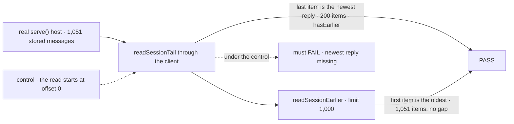

# FIX-2408 · Read a long session from its newest end

**Spec** · [Decisions](DECISIONS.md)

## Who feels it, before and after

| Someone who… | Today | After this slice (the client) | After the Shift Manager adopts it (wave 2) |
|---|---|---|---|
| **opens a Shift Coordinator conversation that has run for days** | Sees the oldest 1,000 items and a "More than shown" line; new replies never appear | Unchanged | Sees the newest replies, with *Load earlier* above them |
| **opens a long coding run's Session tab** | Loses its newest steps past 1,000 items | Unchanged | Sees the newest steps; earlier ones on request |
| **builds an app on `@flow-state-dev/client`** | Writes their own end-first loop (the Shift Manager's `send.ts` has one) or reads from the start | Calls `readSessionTail`, `readSessionEarlier`, `refreshSessionWindow` | — |
| **uses `useSession` from `@flow-state-dev/react`** | Reads the whole history, by contract | Unchanged | Unchanged |

## The goal, and how we'll know it's met

**An app can show the newest items of a session of any length in its first read, page back on
request with no gap, and read the window again without losing a reply stored among items it
already shows.**

- **Smaller, and rejected:** raise the Shift Manager's page budget from 5 to 50. The newest reply
  still drops once a conversation passes the new cap, and every poll reads more.
- **Bigger, and not this issue's:** a live feed of new items (FIX-2374's `sessionFeed`, and
  FIX-2409's change notices through FIX-2367's `client.subscribe`), and the server cost of reading
  every request to answer one page (FIX-877, FIX-1672).
- **Not done if:** a session of more than 1,000 items read through the client comes back without
  its newest item, or a refresh shows a reply half-written after it finished.

**How we verify.**

- **Goal check:** `packages/node/test/client-session-tail.test.ts`. A real `serve()` host, one
  action that stores 1,050 messages, then one more, "newest reply". The tail holds it as its last
  item; *Load earlier* reaches the first item with no gap.
- **Control that must fail:** the tail read started at offset 0 (what the Shift Manager does
  today). Prototyped: the goal check fails.
- **Unit:** `packages/client/test/session-window.test.ts` against a source that answers as the
  engine's state route does. It pins: two calls for a long session and one for a short one; a
  session that grows between calls; item types kept across reads; *Load earlier* with no gap and
  no call at the start; **a refresh shows a reply's finished text when it first read the reply
  half-written, and an item stored behind the newest one**, which a read past the old end misses
  ([D1](DECISIONS.md#d1)); a read that pages while an item is stored behind it starts over; a
  session created again under the id starts over at its end. Each of these has a control
  prototyped to fail.
- **The issue's app test** (seed more than 1,000 items, assert the newest reply renders) belongs to
  the Shift Manager's adoption, in the wave-2 stack ([below](#what-stays-as-it-is)).

## What changes

- **`@flow-state-dev/client`** gains `session-client/session-window.ts`, exported from the root:
  - `readSessionTail(source, sessionId, { limit?, itemTypes? })`: the newest `limit` items
    (default `SESSION_WINDOW_PAGE`, 200). One call when the session fits, else one more from its
    end.
  - `readSessionEarlier(source, window, { limit? })`: the window grown back by `limit` items.
  - `refreshSessionWindow(source, window)`: the window read again.
  - A `SessionItemsWindow`: `items` oldest first, `start`, `total`, `hasEarlier`, the item types
    it was read with, and the read's `at` and `sessionCreatedAt` for `sessions.stream`.
  - `source` is `Pick<SessionsApi, "state">`, as `readEveryCollectionPage` takes `listCollectionItems`.
- **Every read is one shape** ([D1](DECISIONS.md#d1)): from a start position to the session's end.
  Paging follows `useSession`'s rule: each later page starts one item early and the read starts
  over when that item moved ([D2](DECISIONS.md#d2)).
- **Docs:** the client README and the client API page get the three functions. A `patch`
  changeset for `@flow-state-dev/client`.

## What stays as it is

- **No app file in this slice** (the epic's wave 1). The Shift Manager adopts it in the wave-2 stack
  `2422 → 2374 → 2408 → 2373 → 2409`: `run.ts`'s `readSessionItems` and `send.ts`'s
  `sessionHoldsLine` are deleted for these functions in that change (epic ER-3), the "More than
  shown" line becomes *Load earlier*, and the 5-second re-read becomes a refresh until FIX-2409
  replaces it.
- **No engine or route change.** The state route already returns `pagination.total`.
- **No feed and no poll.** New items arriving live are FIX-2374's `sessionFeed` (epic ER-4). The
  window's `at` and `sessionCreatedAt` are what that feed, or `sessions.stream`, follows from.
- **`useSession`** reads the whole history, as its callers expect.

## What's already here, and the debt

| Piece | What this does with it |
|---|---|
| Shift Manager `send.ts` `sessionHoldsLine`: reads from the newest page back | **Generalised** here; deleted in the adoption PR |
| Shift Manager `run.ts` `readSessionItems`: oldest first, 5 pages, `truncated` | **Replaced** in the adoption PR |
| `useSession`'s `readPages`: the overlap-and-start-over paging rule | **Reused as a rule**, not as code: it is a private closure in `react` that reads from offset 0 |
| `readEveryCollectionPage`: the shared collection page loop | **Pattern followed** (a function over a narrow source, in `client`) |
| `sessions.state` and its `pagination` | **Used** as it is |

**Adds:** three functions and a type in `client`. **Removes:** nothing here; two Shift Manager
copies in the adoption PR. **Debt:** the paging rule now lives in two places, `useSession`'s
closure and this module. Moving `useSession`'s full read onto `readFrom` is a follow-up, not this
slice, because it changes a React hook's read path every app uses. **Net:** down once the
adoption lands.

## Sign off

**Approve by merging.** Two calls:

- **Refresh re-reads the window, not only what came after it** ([D1](DECISIONS.md#d1)). *If wrong:*
  a view with no feed reads a few hundred items per refresh rather than a handful; a delta read
  would be cheaper but leaves a reply half-written on screen and drops items stored late.
- **The helper is three functions over `sessions.state`, not a new route option** ([D2](DECISIONS.md#d2)).
  *If wrong:* a long session's first read costs two calls, each of which reads every request on
  the server (FIX-877), until a route option is added.

Feature · `client` · small · 1 PR · wave 1 of FIX-2369 · adopted by the Shift Manager in wave 2
