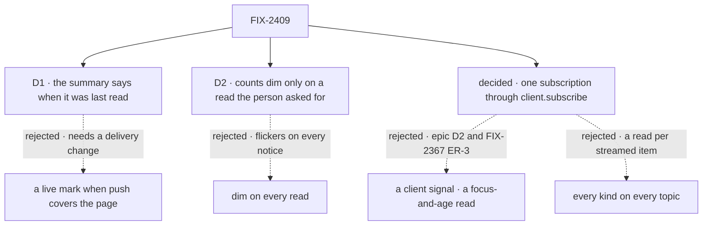

# FIX-2409 · Decisions

[Spec](SPEC.md) · **Decisions**

Two calls are the owner's: what the summary claims about its own age, and when counts dim. The
rest follows from the epic's D2 and rules, FIX-2367's rules and FIX-2466's precedent, and is
recorded so nobody re-derives it.

## The tree

Solid edges are what you're signing. Dashed edges lost, and the label says why.

## D1 · The summary says when it was last read, *as of 14:02 · refresh*, and never claims to be live

| | |
|---|---|
| **Instead of** | A *live* mark while push covers the page, and the time only when it doesn't |
| **Because** | Shift Manager can't know whether push covers it. `client.subscribe` tells a subscriber *that* something changed, never whether its socket is up and crossing. A live mark needs a new client surface, which epic D2 says is asked of FIX-2367's delivery work, not built here. The read time is a fact the snapshot holds, and the connection bar already says when the server is lost (FIX-2373) |
| **Locks in** | On a host where push covers the page, a quiet hour shows an old time while the summary is current. Anyone who distrusts it presses R, which costs one read |

It comes down to what Shift Manager can know: the read time, yes; whether push covers it, no.

**What would change my mind:** people pressing R out of habit, or FIX-2367's delivery work adding
a covered state to `client.subscribe` for another reason. Then the line says *live* when covered.

## D2 · Counts dim only while a read the person asked for runs: R, *refresh*, or Retry

| | |
|---|---|
| **Instead of** | Dimming on every read, as the issue asked (*"dim counts while `refreshing`"*) |
| **Because** | Reads now start on notices from other sessions: each ask, each task moved, each project changed. Counts that dim on each would flicker through a busy shift and say nothing the person asked about. A read the person asked for is the one they wait on |
| **Locks in** | A read started by a notice runs with no sign. The *as of* time moves when it lands, and counts change in place |

It comes down to a busy shift: dimming on every notice makes the counts flicker.

**What would change my mind:** people missing a change because it landed silently. Then a changed
count flashes once, which is a different signal from dimming.

## Decided, not asked

- **The scope is the epic's, not the issue's.** Epic D2: no change signal in `client`, no
  focus-and-age read, no timer of our own. The subscription's own `pollIntervalMs` is the only
  timer, and it runs only where push can miss a change (FIX-2428 D3). With FIX-2545, the default
  bus on one process counts as crossing, so on Shift Manager's usual host it never runs.
- **No pause while the tab is hidden.** A pause is a visibility source of the app's own, which D2
  rules out, and a returning tab would only read what push already brought. If hooks should pause
  when hidden, that is `client.subscribe`'s, for every app, and FIX-2367's to decide.
- **What the subscription hears**, by what the snapshot reads:

  | Topic | Acts on | Why |
  |---|---|---|
  | the user's | `resource` in a collection the snapshot reads (the board ledger, private projects, the roster's own and standard workers) | A task filed, moved or settled; a project; a hire |
  | the org's | `resource` in a collection the snapshot reads (the worker inventory, org projects) | The org's workers and projects |
  | each listed session, except Shift Manager's own | `request`, `run` | An ask is a request that suspends; a run's request writes reach its parent as `run`, so a delegate's ask is heard before its session is listed |
  | any | `resync`, and `null` (connect, reconnect, timer) | Always read |

  Never `items`: a reply sends one per stored item, and the snapshot would read per chunk (the
  `every-kind` control). Never another resource under the user or org: Usage writes its readings
  there, and messages between workers land there. Matching a path to a collection is FIX-1506's
  rule, as FIX-2466's views use it. The implementer may leave out a child session whose parent is
  heard; a root is always heard.
- **The convergence point is the topic list, and Shift Manager's own sessions never enter it**
  (tenet 5). Every writer the snapshot's read, or a view that reads on `readAt`, sets off must
  land on a topic or kind the snapshot ignores: Schedules' `listSchedules` and Usage's queries
  (reading and `usage-own-*` sessions), the projects setup and the reading-session open (once per
  connection). [The checker](poc/refresh-sites/) lists every action site; leg b is the run.
  `listDelegates` writes on the conversation, which is heard: one read per panel open, not a loop.
- **The topic list follows the snapshot.** A session the read lists is added, and its first
  subscribe reads once, so a change between the read and the subscribe is not lost (FIX-2367
  ER-6). Re-subscribing only the new topic, not the whole list, is the implementer's.
- **One read in flight, one waiting**, through `useSubscription`'s coalesced read; the generation
  guard still keeps the newest. A burst of notices is one read.
- **The fallback pace is 30 s**, the issue's figure and the lapsed retry's ceiling. The snapshot
  is the Lab's widest read, so it is slower than a single view's 3 to 5 s.
- **The three nudges go** (epic ER-3). `TasksPanel` and `TaskBoardMeta` keep their board reads; the
  task screen keeps following its run. Where push can miss a change, the summary catches up within
  30 s instead of at once. Shift Manager runs under `serve()`, which has push.
- **The user's own reads stay.** After an answer, a line, a task action or a Retry, the read is
  immediate feedback and must not wait for a notice's round trip.
- **R reads unless focus is in a field**, as `[` and `]` do. *Refresh* in the line is the same read.
- **Shift Manager gets a changeset** (`patch`).

## Considered and dropped

| Alternative | Why not |
|---|---|
| A change signal in `@flow-state-dev/client` (the issue) | A second client watch interface beside `client.subscribe`. Epic D2 |
| A read on focus when older than 30 s, and a slow visible-tab timer (the issue) | The always-on poll FIX-2367 ER-3 forbids, and stale while the tab is in view |
| A user-topic notice when a session is created | Reopens the bus's topic contract for one case the board's notice already covers. FIX-2466 D1 |
| Keeping the three nudges beside the subscription | Two ways to keep one snapshot fresh (ER-3), and a second read per change |

## Settled

- **25 read sites, 3 nudges** — **CONFIRMED** by [`poc/refresh-sites/`](poc/refresh-sites/):
  104 files, 22 sites kept, 3 go, 7 action sites classified. Control `FIX2409_CONTROL=plant` exits 1.
  It found `listDelegates` running as an action, now in FIX-2556.
- **A run's request writes reach its parent's topic as `run`** — **CONFIRMED** by reading the
  publisher (`sessionNotices` and `requestNotices` in `packages/engine/src/bus/publish-writes.ts`).
- **The default bus on one process counts as crossing** — **CONFIRMED**: FIX-2545 merged (#4704),
  and FIX-2466's goal log shows 0 idle reads on the default bus.

## Analysis

2026-11-04 · watermark 2026-11-04 (FIX-2545 merged) · **Right approach.** Run by the author;
no fresh sub-agent was available in this session.

1. **Reuse** — every *Adds* row composes `useSubscription` or extends a Shift Manager piece; none
   is a new mechanism. See [Builds on / Adds](SPEC.md#whats-already-here-and-the-debt).
2. **Prior art** — invalidate-on-notify (Rails Turbo's page refresh broadcast, TanStack Query's
   invalidation on a socket event): the server says *changed*, the client re-reads, bursts are
   debounced. Matches.
3. **Other shapes** — the issue's own; recorded above.
4. **New factors** — FIX-2545 removed the timer on one process. FIX-2412 is in spec in parallel.
5. **Necessity** — earns its place: *Nothing needs you* is false today while something does.
6. **Ergonomics** — nothing to learn: the summary changes by itself; R matches `[` and `]`.
7. **Concerns** — a view that reads by writing can wake the snapshot. Folded: the exclusion,
   leg b, and FIX-2556.

## How it got here

- **Draft** — re-scoped from the issue's client signal and focus-and-age read to epic D2: one
  subscription in Shift Manager's provider through `client.subscribe`, hearing what the snapshot
  reads, never its own sessions; the three nudges go; the line says the read time.

**Open: none.**
