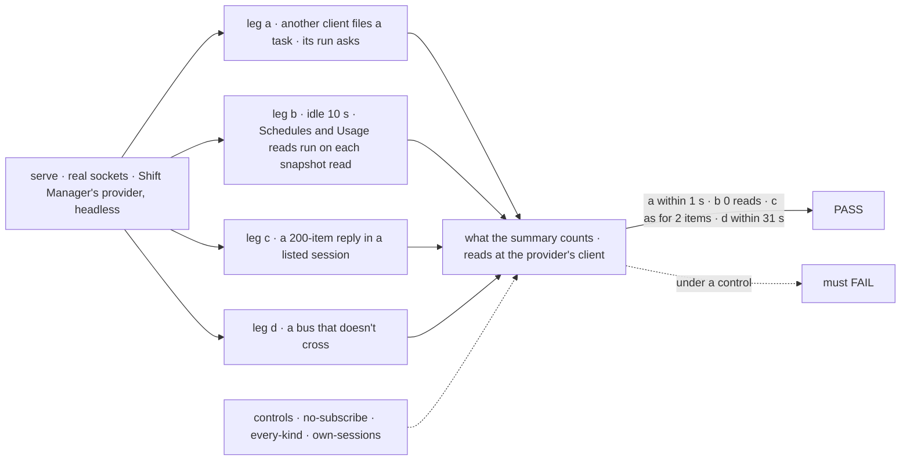
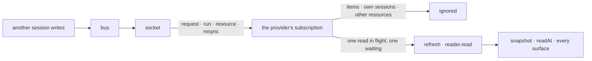

# FIX-2409 · Shift Manager's snapshot reads again when the Lab changes, and says how old it is

**Spec** · [Decisions](DECISIONS.md)

## Six people, before and after

| Someone who… | Today | After |
|---|---|---|
| **waits at Shift Coordinator while a delegate asks a question** | *Nothing needs you.* until they send a line, answer something or press Retry | *1 thing needs you* within a second, with Inbox's count in the sidebar |
| **has a scheduled task fire, or files one from another tab** | Not in Tasks, nor its ask in Inbox, until something reads the Lab | In Tasks when it is filed; its ask in Inbox when it asks |
| **comes back to a Shift Manager tab after an hour** | Whatever was read last, with no sign of its age | Current wherever push covers it. The summary says *as of 14:02 · refresh*; R or the link reads now ([D1](DECISIONS.md#d1)) |
| **watches a worker stream a long reply** | No snapshot reads | Still none per streamed item. It reads when the reply ends or asks |
| **sleeps the laptop, or runs the Lab on processes whose bus doesn't cross** | Nothing reads again until they act | A read every 30 s while push can miss a change, and one when the socket is back |
| **starts a conversation on another device and leaves it idle** | Not listed until a read | Listed at the next read, as in the claude-code-style lab ([FIX-2466 D1](../FIX-2466/DECISIONS.md#d1)) |

The issue was written before the epic decided how a change reaches an app. It asked for a change
signal in `@flow-state-dev/client` and a focus-and-age refresh. [Epic FIX-2369 D2](../../epics/FIX-2369/DECISIONS.md#d2)
replaced both: a change arrives only through FIX-2367's `client.subscribe`, which polls only where
push can miss a change. The claude-code-style lab's session list is done
([FIX-2466](../FIX-2466/SPEC.md)), and the Teammates roster is [FIX-2412](https://linear.app/fixpoint-labs/issue/FIX-2412)'s.
This issue is Shift Manager's snapshot.

## The goal, and how we'll know it's met

**While Shift Manager is open, what it says needs you, what is running and its task lists change
on their own within a second of a change another session makes, with no read between changes and
none per streamed item; where push can miss a change they catch up within 30 seconds; and the
summary says when it was last read.**

| Is it the right goal? | |
|---|---|
| **The real need** | The issue: *"A delegate's new ask or a schedule-started task stays invisible while the summary says 'Nothing needs you.'"* The epic: *"An app's snapshot refreshes on FIX-2367's notices, with an* as of *label"* ([FIX-2369](../../epics/FIX-2369/SPEC.md)) |
| **Smaller, and rejected** | A read on focus when the snapshot is older than 30 s, the issue's first step. The summary still says *Nothing needs you* while the tab is in view, and it is the poll [FIX-2367 ER-3](../../epics/FIX-2367/DECISIONS.md#who-owns-what) forbids |
| **Bigger, and not this issue's** | Shift Manager's Roster and Delegates panel, and the Teammates roster (FIX-2412). A notice when a session is created (FIX-2466 D1). A mark that says push covers the page, which needs a delivery change ([D1](DECISIONS.md#d1)) |
| **Not done if** | The goal check never ran on real sockets · an ask shows only because its task screen was open · reads during a reply grow with its length · a view's own read wakes the snapshot · where push misses a change, the summary never reads again |



The check reads what the summary would draw and the reads its client makes, never what was published.

| How we verify | |
|---|---|
| **Goal check** | `goals/shift-manager/its-summary-changes-on-its-own/` · model `n/a` (code turns ask) · run by the implementer at completion · verdict on the implementation PR |
| **Signal** | `a:ask-within-1s`: the provider's Inbox count goes 0 → 1 within 1 s of the run's request reading `suspended`, on a conversation the snapshot did not list at start. `b:idle-0-reads`: 0 snapshot reads over a 10 s idle window, with the scheduled-work list and usage query run after each snapshot read, as their screens do. `c:as-short`: as many snapshot reads during a 200-item reply as during a 2-item reply of the same length. `d:within-poll`: on a bus that doesn't cross, the ask shows within 30 s + 1 s |
| **Input** | One `serve()` host on a bound port, the default bus, a conversation flow with the Workforce board and a worker flow whose task turn calls `ctx.suspendForUser`, as [`goals/task-board/asks-a-person-one-way`](../../../goals/task-board/asks-a-person-one-way/goal.md) builds it. Leg d uses `goals/lib/crossing-bus.mts` set to `false`. A different valid input: the task filed by a scheduled fire must pass leg a too |
| **Anti-game** | Count reads at the provider's own fetcher (one `sessions.list` with dispatch runs is one snapshot read). Assert on the snapshot the provider holds. Real WebSocket clients; the task screen is not mounted |
| **Control that must fail** | `GOAL_CONTROL=no-subscribe`, and today's `main`: `a:ask-within-1s` FAILS. `GOAL_CONTROL=every-kind` (acts on `items` too): `c:as-short` FAILS. `GOAL_CONTROL=own-sessions` (hears Shift Manager's reading and usage sessions): `b:idle-0-reads` FAILS |

The *as of* line, its dimming and R are drawn by components; their tests cover them, not the goal check.

## What changes


Three nudges from views become one subscription that hears what the snapshot reads.

```diff
 // lib/lab-data.tsx — the provider
+const topics = useMemo(() => snapshotTopics(snapshot), [snapshot]);   // user, org, each listed session but its own
+useSubscription(topics, (notice) => heard(notice) && refresh(), { client, pollIntervalMs: 30_000 });

 // lib/task.tsx, TasksPanel, TaskBoardMeta — the nudges
-if (next === "suspended" && …) void refresh();

 // the summary
 "Nothing needs you."
+<AsOf readAt={snapshot.readAt} />   // as of 14:02 · refresh — R reads too
```

**Docs:** update Shift Manager's README: *What you see* (the screen reads again when another
session changes what it shows; the *as of* line; R), the *Keys* bullet, and Roster's *"It doesn't
refresh on its own"* unless FIX-2412 has already rewritten it. Shift Manager changeset (`patch`).
No `apps/docs` change: no framework API changes, and no published page states when Shift Manager
reads (searched `apps/docs/docs/shift-manager/`).



## What stays as it is

- **The read itself**, its sections and its failures. A notice says when to read, never what.
- **The user's own reads**: boot, org switch, after an answer, after a line, Retry, and the lapsed
  retry ([FIX-2373 D2](../FIX-2373/DECISIONS.md#d2)). The wait on an answered run is FIX-2455's.
- **FIX-2466's four views** (message log, a project's entries, a worker's conversation, a task's
  run link) and the board views FIX-2429 moved. Each hears its own notices; none is touched.
- **Roster and the Delegates panel**: FIX-2412's.
- **`client`, `react`, `core`**: nothing new ([ER-1](../../epics/FIX-2369/DECISIONS.md#who-owns-what), D2).

## What's already here, and the debt

| Already here | What this does with it |
|---|---|
| **The job, "tell a screen what it shows changed".** Mechanisms `change-bus`, `push-delivery`. Shift Manager already calls `useSubscription` in `TasksPanel` and `TaskBoardMeta` (FIX-2429), and FIX-2466 moves four more views. Closest: `useSubscription` | **Builds on.** Not a new way: one more call of the one way |
| The snapshot's `refresh()`, its generation guard and lapsed retry | **Builds on.** Notices call it through `useSubscription`'s coalesced read |
| Three views that nudge the snapshot (the [checker](poc/refresh-sites/): 25 read sites, 22 kept) | **Removes** ([ER-3](../../epics/FIX-2369/DECISIONS.md#who-owns-what), one implementation per need) |
| A ledger write's user `resource` notice (FIX-1506, [FIX-2429](../FIX-2429/DECISIONS.md#decided-not-asked)); a run's request writes as `run` on its parent's topic (FIX-2426) | **Builds on.** A new task, and a delegate's ask before its session is listed, reach a topic the snapshot hears |
| [Epic D2 and ER-4](../../epics/FIX-2369/DECISIONS.md#d2); [FIX-2367 ER-3, ER-5](../../epics/FIX-2367/DECISIONS.md#who-owns-what); [FIX-2428 D3](../FIX-2428/DECISIONS.md#d3) | **Kept.** This is the consumer they name. The issue's client signal and focus-and-age poll are superseded by D2 |
| [FIX-2466 D1](../FIX-2466/DECISIONS.md#d1); its *What stays*, which left this snapshot here | **Kept**, the same rule for a session created elsewhere |

| Adds | Existing piece considered | Why it doesn't fit / how composed |
|---|---|---|
| The provider's subscription: its topics and the notices it acts on | `push-delivery` · `useSubscription` with `client` | Composed: one call through the provider's own client. Topics and filter are the snapshot's, since only it knows what it reads |
| The *as of* line and R | Roster's read time; the `[` and `]` handler in `App.tsx` | Extends both: the same `readAt`, and R in the same handler with its typing guard |

| The debt | |
|---|---|
| **Removes** | Three nudges. The provider's *never on its own* contract and the README line saying so |
| **Adds** | The snapshot never hears Shift Manager's own reading and usage sessions, because Schedules and Usage write a request there on every snapshot read. Paid by [FIX-2556](https://linear.app/fixpoint-labs/issue/FIX-2556), which makes those reads write nothing |
| **Leaves** | Views that read on `readAt` read once per snapshot read, now more often; `listDelegates` costs a snapshot read per panel open (FIX-2556). A session created elsewhere with no board write joins at the next read (FIX-2466 D1). The topic list grows with listed sessions |

**Net: down.** Three ad-hoc nudges become one subscription; the one exclusion is paid by FIX-2556.

## Sign off

**[The goal](#the-goal-and-how-well-know-its-met):** every count Shift Manager shows changes within a
second of another session's change, with no reads between changes. If wrong: a summary that is
right only after you touch it.

**[The debt](#whats-already-here-and-the-debt): down**, three nudges out, one subscription and one
exclusion in. If wrong: the snapshot wakes itself through a view that writes.

1. **[D1](DECISIONS.md#d1) · The summary says when it was last read, never that it is live.** If
   wrong: on a quiet afternoon the time looks old and people press R for nothing.
2. **[D2](DECISIONS.md#d2) · Counts dim only while a read the person asked for runs.** If wrong:
   a background read gives no sign until its time changes.

**Open: none.** D1 is the one to weigh.

Feature · shift-manager · small: one subscription, a line and a key, three nudges out · epic FIX-2369, stack 2422 → 2374 → 2408 → 2373 → 2409, all four Done; FIX-2428 Done
