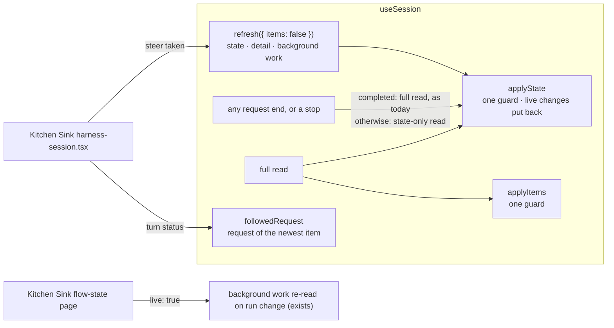

# FIX-2410 · Re-read a session's state without its whole history

**Spec** · [Decisions](DECISIONS.md)

## Who feels it, before and after

| Someone who… | Today | After |
|---|---|---|
| **runs a long Claude Code, Codex or Cursor session in Kitchen Sink** | Every turn end and every steered line calls `session.refresh()`, which pages the session's **entire item history** plus the background-work list, only to pick up a few state keys. A completed turn pays the history read twice (the hook's own closing read, then the page's) | A steered line re-reads state only: one read, no items. A completed turn pays the history read once, the hook's closing read. That read is still O(history), so turns still get slower as a session grows until FIX-2408's tail-first reads land; this removes the duplicates, not the growth |
| **watches a turn's notice while a steered line is the newest request** | `SessionBody` builds its own client and lists 20 requests to find the turn's status, because `latestRequest` names the steer | `session.followedRequest` is the turn's status, read by the hook |
| **uses background work on the Flow State page** | `BackgroundWorkRefresh` ("Demo debt") pays a full history re-read per turn to see a job the turn filed | The page passes `live: true`, which already re-reads background work as runs start and finish. The component is deleted |
| **calls `useSession` anywhere else** | — | `refresh()` is unchanged. A request that ends without completing, or is stopped, gets one state-only read (one that changed resources used to get a full read; it now gets the state read too). No new read on the completed path |

## The goal, and how we'll know it's met

**An app reads a session's current state without re-reading its item history, and reads the
status of the request it shows, from `useSession` alone.**

- **Smaller, and rejected:** only add `refresh({ items: false })`. Kitchen Sink would keep its
  turn-end effect and its own request poll, the two workarounds the issue asks to delete.
- **Bigger, and not this issue's:** harness-manager emitting turn records some other way (they
  already arrive as `state_change` on the turn's own stream, which the hook reduces); a server
  route that reads one request of a session by id; FIX-2408's tail-first reads; live change
  notices (FIX-2409, through FIX-2367's `client.subscribe`).
- **Not done if:** `refresh({ items: false })` reads any item page; or it clears or replaces the
  items on screen (stop records included); or a state read rewinds state a later read set, or a
  live `state_change` that arrived while it was out (FIX-1618's hazard); or Kitchen Sink still
  creates a client or lists requests in `SessionBody`.

**How we verify.**

- **Hook unit tests (new), `packages/react/test/useSession-state-reread.test.tsx`**, against the
  scripted fetch the other `useSession` tests use:
  - `refresh({ items: false })` makes exactly one `GET .../state` with `include_items=false`,
    one detail read and one background-work read (the issue's "state and child sessions"; a
    steered line pays that one list read too); items on screen are the same objects after.
  - A state-only read requested before a full read, landing after it, does not rewind state; a
    full read requested before a state-only read, landing after it, still loads its items but
    keeps the newer state.
  - A request that ends `failed` or `aborted` (also after a mid-stream resource change), and a
    stop, each make one state-only read; a `completed` end makes the full read it makes today and
    no state-only one.
  - A `state_change` that arrives while a state-only read is out is still there when the read
    lands.
  - `followedRequest` reads `in_progress` while the followed stream runs, then the terminal
    status with its end time; when the newest request is another one (a steer), its status
    comes from one `GET .../requests/:id/status`, and from no extra read when it is the newest.
- **Kitchen Sink (changed), `apps/kitchen-sink/test/harness-session-steer.test.tsx`**: a taken
  line triggers a state-only read, never a full one; the turn's notice reads its status from the
  hook with no `sessions.requests` call from the page.
- **Control that must fail:** each check's red state is produced in the build PR: the
  state-only path calling the full read fails the one-read check; dropping the state sequence
  guard fails the rewind check; removing the terminal state read fails the failed-end check.
- **Parity:** the rest of the react suite passes unchanged.
- **Real host (new), `packages/node/test/state-reread.test.ts`.** A plain `serve()` flow whose
  action writes state and then fails: the `include_items=false` read holds what it wrote and no
  items, and the status route says when it ended. Its red state: the route copying only
  `completedAtMs` (a failed record holds `failedAtMs`), which this slice fixes in one line.
  The Kitchen Sink page itself needs a coding harness for a real turn, so its check stays the
  page test against a stubbed hook.

## What's already here, and the debt

| Already here | What this does with it |
|---|---|
| `useSession.refresh()` = `refreshSnapshot()` + `refreshChildSessions()`; the snapshot pages every item when `items` is on | **Extends:** takes `{ items?: boolean }`. `items: false` reads the state endpoint once with `includeItems: false` and merges state only. Default unchanged |
| `applySnapshot`, one guard over state and items together (FIX-1618) | **Splits** it into a state half and an items half, each with one guard. A full read applies both; a state-only read applies the state half only, so it never touches the items or their stop records. The state half puts back the live state and resource changes that arrived while its read was out |
| The terminal branch of the request stream: full snapshot on `completed`, and on any other end that changed resources | **Changes:** `completed` keeps the full read, because the view's own stream can run ahead of what is kept and the closing read settles those items. Every other end, resource changes included (the state read carries resources), and a stop, makes a state-only read |
| `GET .../requests/:id/status` copies `completedAtMs` only; a failed record holds `failedAtMs` | **Fixes** in one line: it reports either as `completedAtMs` |
| `latestRequest` (one `requests({ limit: 1 })` read at mount and each end) | **Kept.** `followedRequest` reuses that read when the followed request is the newest |
| `GET /:flowKind/requests/:requestId/status` and `flow.request(id).status()` | **Builds on** for a followed request that isn't the newest |
| `useSession({ live: true })` re-reading background work on each run change | **Builds on:** the Flow State page opts in and drops `BackgroundWorkRefresh` |
| FIX-2374 moving `readPages` and `followSession` into the client | **Stacks on it** (epic build order `2374 → 2410`): this edits the hook beside the code that moves. It does not use `sessionFeed`; the feed carries no session state (epic ER-4 holds: no second feed) |

**Net, for users:** one option on `refresh`, one new field on the view, a state read instead of
none (or a full read) at a non-completed end; Kitchen Sink loses two effects, its own client in
`SessionBody`, and the `BackgroundWorkRefresh` component. **For the build:** the
`applySnapshot` split, a small kept list of live changes for reads in flight, and
`followedRequest`'s three sources (stream, `latestRequest`, status route), read on a change of
shown request or a stream's end, never per item. **Seam:** the Flow State page edit is two lines in a wave-0/2
hot file (`flow-state/page.tsx`); it merges in order with that stack.
